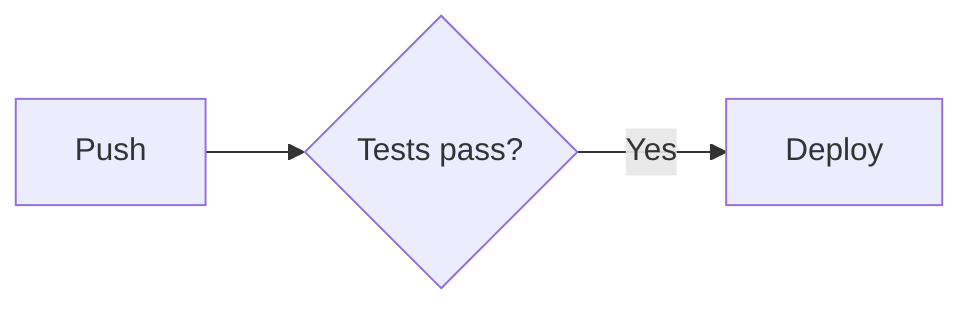

# GitHub Expert Center Cheat Sheet

A bilingual (English / 日本語) cheat sheet for experts staffing the **GitHub Universe "Expert Center" booth**.
It gives fast, booth-ready answers about **GitHub Actions, GitHub Copilot and GitHub Advanced Security** (priority),
plus Migration, Adoption, Administration, Billing, Codespaces, Projects & Issues and Packages.

Built with [Astro](https://astro.build) + [Starlight](https://starlight.astro.build), Mermaid diagrams
([`astro-mermaid`](https://github.com/joesaby/astro-mermaid)), Pagefind search and
[`starlight-links-validator`](https://github.com/HiDeoo/starlight-links-validator).

**Live site:** https://bmanterdev.github.io/github-cheatsheet/

## Local development

Requires Node.js **22.22+**.

```bash
npm install
npm run dev       # http://localhost:4321/github-cheatsheet/
npm run build     # production build to dist/ (+ Pagefind index + link validation)
npm run preview   # serve dist/ locally
```

> Search (Pagefind) only works with `npm run build && npm run preview`, not in `npm run dev`.

## Deployment

`.github/workflows/deploy.yml` builds with `withastro/action` and deploys with `actions/deploy-pages` on every push to
`main` (or manually via *workflow_dispatch*).

One-time setup: **Settings → Pages → Build and deployment → Source = "GitHub Actions"**.

## Project structure

```
astro.config.mjs              # site/base, locales, sidebar groups, mermaid, links validator
src/content/docs/             # English pages (root locale)
  index.mdx                   # splash homepage
  start-here/ actions/ copilot/ ghas/ migration/ adoption/
  administration/ billing/ codespaces/ projects-issues/ packages/
src/content/docs/ja/          # Japanese pages — same paths as English
src/components/               # interactive MDX components (see below)
src/snippets/                 # raw YAML/text files importable via '@snippets/<file>?raw'
src/styles/custom.css         # GitHub-ish accent colors, tables, <details>, widget styles
```

The sidebar is **autogenerated per directory**: any page you add to `src/content/docs/<group>/` appears in that
group, ordered by `sidebar.order` (then title). Priority groups (Start here, Actions, Copilot, GHAS) are expanded;
the rest are collapsed. To add a new group, add a `group(...)` line in `astro.config.mjs`.

## Authoring guide

Content authors **must** follow these rules so the site stays consistent and the build stays green.

### 1. Files & translations

- English page: `src/content/docs/<group>/<slug>.mdx` → URL `/github-cheatsheet/<group>/<slug>/`
- Japanese page: **same path** under `ja/`: `src/content/docs/ja/<group>/<slug>.mdx` → `/github-cheatsheet/ja/<group>/<slug>/`
- Use lowercase kebab-case slugs. Each group already has an `index.mdx` overview (`sidebar.order: 0`).
- If a JA page is missing, Starlight shows the English page with a "not translated" notice — but always try to ship both.

### 2. Internal links — exact required format

Links are **not** rewritten for the base path, and `starlight-links-validator` checks them at build time. Write
**absolute paths that include the `/github-cheatsheet` base, the locale prefix for Japanese, and a trailing slash**:

| From | Link to | Write |
| --- | --- | --- |
| EN page | EN page | `[Runners](/github-cheatsheet/actions/runners/)` |
| JA page | JA page | `[ランナー](/github-cheatsheet/ja/actions/runners/)` |
| any | heading | `/github-cheatsheet/actions/runners/#larger-runners` (hash must exist — it is validated) |
| any | external | `https://docs.github.com/en/...` (EN) / `https://docs.github.com/ja/...` (JA) |

These **fail** the build: `/actions/runners/` (missing base), `../runners/` or `./runners/` (relative links), links to
pages that do not exist, and `#hashes` that do not match a heading. Links passed inside component props (e.g.
`DecisionTree` `links`, `DocsLinks`) are *not* validated — use them mainly for external GitHub Docs URLs, and
double-check any internal ones by hand. Starlight `<LinkCard href>` and frontmatter `hero.actions[].link` **are**
validated.

### 3. Page template

```mdx
---
title: Larger runners
description: One-sentence summary used in search results and social cards.
sidebar:
  order: 10            # 0 = group overview; then 10, 20, 30… leaves room for inserts
---

import { Aside, Tabs, TabItem, Badge } from '@astrojs/starlight/components';
import { TLDR, DocsLinks, LastVerified, DecisionTree, CompareTable, YamlBuilder, FlashCards } from '@components';

<LastVerified date="2026-10" />

<TLDR>
- The 10-second answer, 1–3 bullets.
</TLDR>

## Common booth questions

<details>
<summary>Can larger runners use static IPs?</summary>

Yes — … (leave a blank line after `<summary>` and before `</details>` so Markdown renders inside).

</details>

## Deep dive

Mermaid diagrams, tables, components…

<DocsLinks links={[
  { label: 'About larger runners', href: 'https://docs.github.com/en/actions/using-github-hosted-runners/about-larger-runners' },
]} />
```

The Japanese page is identical in structure, with translated text, JA headings (`## ブースでよくある質問`,
`## 詳細解説`) and `docs.github.com/ja/...` links. Components auto-detect the page language for built-in labels.

### 4. Mermaid

Use a fenced code block with the `mermaid` language in `.md` or `.mdx`:

````md

````

Diagrams render client-side and re-render automatically for light/dark theme. Tips: quote labels containing
special characters (`A["/ or Ctrl+K"]`), keep diagrams small (they must be readable on a booth laptop), and prefer
`flowchart LR`/`TD`, `sequenceDiagram`, `timeline`.

### 5. MDX gotchas

- `{` and `<` in normal prose must be escaped (`\{`, `&lt;`) or wrapped in backticks; inside fenced code blocks they are fine.
- GitHub expressions in prose: write `` `${{ secrets.TOKEN }}` `` (inline code) — never bare.
- **Multi-line strings inside component props lose their indentation** (MDX strips leading whitespace inside JSX
  attributes). For YAML or anything indentation-sensitive, define it in an `export const` block (after the imports)
  or import a file with `?raw`, then pass the variable:

  ```mdx
  export const base = `name: CI
  on: push
  # @steps
  `;
  {/* or: import base from '@snippets/ci-base.yml?raw';  (files in src/snippets/, no escaping needed) */}

  <YamlBuilder base={base} options={options} />
  ```

  Single-line strings with `\n` (e.g. `snippet: "permissions:\n  contents: read"`) also work.
- Inside JS template literals (`` `...` ``) escape GitHub expressions as `\${{ github.ref }}`; otherwise `${...}` is
  treated as JS interpolation and the build fails.
- Use spaces, never tabs, in YAML.

## Components

Import from the barrel: `import { TLDR, DocsLinks, … } from '@components';`
(or individually: `import TLDR from '@components/TLDR.astro';`).

All components work in light/dark mode, are keyboard accessible, and accept `lang?: 'en' | 'ja'` (auto-detected from
the page locale if omitted). Every visible string comes from props; built-in labels (Back, Start over / 最初から,
Copy / コピー, …) can be overridden via `labels={{ startOver: '…' }}` (keys in `src/components/i18n.ts`).
String props marked *md* accept inline Markdown (`**bold**`, `*italic*`, `` `code` ``, `[text](url)`) or raw HTML.

| Component | Props |
| --- | --- |
| `<TLDR>` | `heading?` (default "TL;DR"), slot content |
| `<DocsLinks>` | `links: {label, href, description?}[]`, `heading?` (default "GitHub Docs" / "GitHub ドキュメント") |
| `<LastVerified>` | `date: string` (e.g. `"2026-10"`), `label?` → "Last verified: 2026-10" / "最終確認: 2026-10" |
| `<DecisionTree>` | `tree: { start, nodes: { [id]: {question (md), help? (md), options: {label, next}[]} \| {answer (md), links?: {label, href}[]} } }`, `title?`, `labels?` |
| `<YamlBuilder>` | `base: string`, `options: {id, label, snippet, section? = 'steps', description? (md), explanation? (md, shown when enabled), default?: boolean}[]`, `title?`, `filename?`, `labels?` |
| `<CompareTable>` | `columns: {key, label}[]`, `rows: {feature (md), category?, values: {[key]: string (md) \| boolean}}[]`, `title?`, `featureLabel?`, `labels?` |
| `<FlashCards>` | `cards: {q (md), a (md)}[]`, `title?`, `labels?` |

### DecisionTree

One question at a time, breadcrumb of choices, Back and Start over buttons. All nodes are rendered into the HTML, so
answers are searchable. The build fails if an option points to a missing node.

```mdx
<DecisionTree title="Which runner?" tree={{
  start: 'q1',
  nodes: {
    q1: { question: 'Need a **GPU**?', options: [{ label: 'Yes', next: 'gpu' }, { label: 'No', next: 'std' }] },
    gpu: { answer: 'Use **GPU larger runners**.', links: [{ label: 'Docs', href: 'https://docs.github.com/en/actions' }] },
    std: { answer: '`ubuntu-latest` is fine.' },
  },
}} />
```

### YamlBuilder

`base` contains marker lines `# @<section>` (e.g. `# @top`, `# @job`, `# @steps`). Each enabled option's `snippet`
is inserted at the marker matching its `section`, re-indented to the marker's indentation (write snippets
flush-left). Unused markers are removed. Output has a Copy button.

```mdx
export const base = `name: CI
on: [push]
# @top
jobs:
  build:
    runs-on: ubuntu-latest
    # @job
    steps:
      - uses: actions/checkout@v5
      # @steps
`;

export const options = [
  { id: 'perms', label: 'Least-privilege token', section: 'top', default: true,
    snippet: `permissions:
  contents: read`, explanation: 'Read-only `GITHUB_TOKEN`.' },
  { id: 'conc', label: 'Cancel superseded runs', section: 'top',
    snippet: `concurrency:
  group: \${{ github.workflow }}-\${{ github.ref }}
  cancel-in-progress: true` },
  { id: 'timeout', label: 'Job timeout', section: 'job', snippet: 'timeout-minutes: 15' },
  { id: 'node', label: 'Node.js', snippet: `- uses: actions/setup-node@v4
  with:
    node-version: 22` },
];

<YamlBuilder title="CI workflow" filename=".github/workflows/ci.yml" base={base} options={options} />
```

### CompareTable

Column visibility chips, category filter (shown when rows have `category`), and text filter. `true` → ✅, `false` /
missing → —.

```mdx
<CompareTable
  title="Copilot plans"
  columns={[{ key: 'free', label: 'Free' }, { key: 'biz', label: 'Business' }]}
  rows={[
    { feature: 'Code completion', category: 'IDE', values: { free: true, biz: true } },
    { feature: 'IP indemnity', category: 'Legal', values: { free: false, biz: true } },
  ]}
/>
```

### FlashCards

Click / Enter / Space flips, ←/→ or Previous/Next navigate, Shuffle reorders.

```mdx
<FlashCards title="Quiz" cards={[{ q: 'What does `GITHUB_TOKEN` expire with?', a: 'The job.' }]} />
```

### TLDR, DocsLinks, LastVerified

```mdx
<LastVerified date="2026-10" />
<TLDR>
- Short answer.
</TLDR>
<DocsLinks links={[{ label: 'GitHub Actions', href: 'https://docs.github.com/en/actions' }]} />
```

Starlight built-ins are also available: `Aside`, `Tabs`/`TabItem`, `Card`/`CardGrid`, `LinkCard`, `Steps`, `Badge`
from `@astrojs/starlight/components`, and plain `<details><summary>`.

See [`src/content/docs/start-here/how-to-use.mdx`](src/content/docs/start-here/how-to-use.mdx) for a live demo of
every component.
