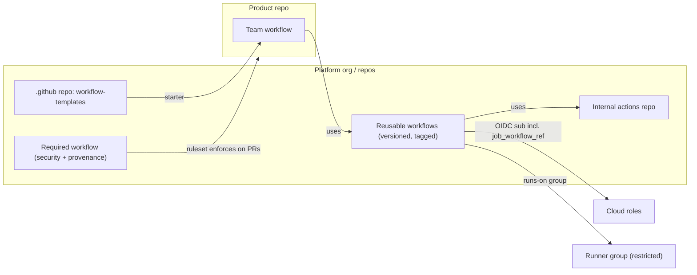

import { TLDR, DocsLinks, LastVerified, CompareTable } from '@components';
import { Aside, Badge, Steps } from '@astrojs/starlight/components';

<LastVerified date="2026-10" />

<TLDR>
- **To enforce CI**, use org rulesets with **"Require workflows to pass before merging."** The workflow lives in a central repo and runs on every targeted repo's PRs. Target repos by name or by **custom property**.
- **To guide teams**, use **workflow templates** (`.github` repo → `workflow-templates/`) and versioned **reusable workflows** as the golden path.
- **To control the supply chain**, use **allowed-actions policies** (enterprise → org → repo), the **SHA-pinning requirement**, **Actions event/actor policies**, and **internal/private** action repos shared with "Accessible from repositories in the org/enterprise."
- **For infrastructure and identity**, use **runner groups** scoped to orgs, repos or workflows. Make OIDC trust central with `job_workflow_ref` subject templates or `repo_property_*` claims.
- **To prove compliance**, stream the **audit log** (`workflows.*`, `org.required_workflow_*`, runner and secret events) to your SIEM.
</TLDR>

## Common booth questions

How do we force every repo to run our security scan before merge?

Create an **organization ruleset** (a branch ruleset that targets the default branch) and add the rule **"Require workflows to pass before merging."** Point it at a workflow file in a central repo, pinned to a branch, tag or SHA. Target repos by pattern or by **custom property** (for example `compliance = pci`). The workflow runs in the context of each target repo on PRs, and teams can't remove it from their own repos. Start in **Evaluate** mode to see the impact before you set it to **Active**. <Badge text="Verify plan availability" variant="caution" />

Ruleset-required workflow vs. required status check: what's the difference?

A **required status check** only says "a check named `X` must be green." The repo still has to *have* a workflow that produces `X`, and anyone who can edit the workflow could fake or rename it. You can lock the check to a GitHub App source, but you are still trusting the repo's YAML. A **required workflow** is *supplied by the central repo*, so the repo can't skip or alter it.

How do we share private actions across the company without Marketplace?

Put the action or reusable workflow in a **private or internal** repo, then go to **Settings → Actions → General → Access** and choose *Accessible from repositories in the organization* (or enterprise, for internal repos). Workflows reference it as `uses: my-org/actions-repo/path@ref`. Note: outside collaborators on the consuming repos can see logs from runs that use it.

How do we stop teams using random Marketplace actions?

Go to **Enterprise → Policies → Actions** and choose *Allow enterprise, and select non-enterprise, actions and reusable workflows*. Then:
- Optionally allow **GitHub-authored** and/or **Marketplace verified creators**.
- Add an explicit allowlist (`aws-actions/*`, `docker/build-push-action@*`). Prefix an entry with `!` to block it.
- Enable **"Require actions to be pinned to a full-length commit SHA."**

Orgs can only narrow what the enterprise allows. Combine this with **workflow dependency lockfiles** <Badge text="Preview" variant="caution" />, since the policy checks the locked commit.

Can we control *who* and *which events* can trigger workflows?

Yes, with **Actions policies → workflow execution protections** at the enterprise, org or repo level. **Actor rules** cover users, roles, apps, Copilot and Dependabot, and let you separate "can push code" from "can run CI." **Event rules** can restrict `pull_request_target` or `workflow_dispatch`, for example. Disallowed runs fail with an error, and `workflows.actions_policy_violation` appears in the audit log.

We're on GHES. How do we get Marketplace actions?

The recommended approach is **GitHub Connect**, which gives automatic access to GitHub.com actions, governed by the same allowed-actions policies. For air-gapped instances or tighter control, use the **`actions-sync`** tool to mirror specific action repos onto the instance manually. GHES needs its own runners (self-hosted or ARC). Also check whether features like the immutable OIDC subject are available on GHES; that one is **not**.

How do platform teams roll out a "golden path" without breaking teams?

Publish **versioned reusable workflows** (for example `platform/.github/workflows/build.yml@v3`) plus **workflow templates** that call them. Enforce only the non-negotiables (security scan, provenance) with **required workflows**. Bind cloud deploy rights to the golden workflow through OIDC `job_workflow_ref`. Measure adoption with the audit log or code search for `uses: platform/`.

## Golden path architecture

## Ways to enforce CI standards

<CompareTable
  title="Ways to enforce CI standards"
  columns={[
    { key: 'req', label: 'Required workflows (ruleset)' },
    { key: 'tpl', label: 'Workflow templates' },
    { key: 'reuse', label: 'Reusable workflows' },
    { key: 'check', label: 'Required status checks' },
  ]}
  rows={[
    { feature: 'Teams can opt out / edit it', category: 'Enforcement', values: { req: 'No (central file)', tpl: 'Yes (copied once)', reuse: 'Yes (caller chooses to call)', check: 'Partly (they own the YAML)' } },
    { feature: 'Blocks merge if failing', category: 'Enforcement', values: { req: true, tpl: false, reuse: 'Only if also a required check', check: true } },
    { feature: 'Central updates propagate', category: 'Maintenance', values: { req: true, tpl: false, reuse: 'Yes (if caller uses a moving ref)', check: false } },
    { feature: 'Target by custom property', category: 'Targeting', values: { req: true, tpl: false, reuse: false, check: 'Yes (via ruleset)' } },
    { feature: 'Evaluate (dry-run) mode', category: 'Rollout', values: { req: true, tpl: false, reuse: false, check: 'Yes (ruleset)' } },
    { feature: 'Best for', category: 'Use', values: { req: 'Non-negotiable gates (SAST, license, provenance)', tpl: 'Fast onboarding, paved road', reuse: 'DRY build/deploy logic, SLSA L3', check: 'Simple per-repo gates' } },
  ]}
/>

<Aside type="tip" title="Talking point">
A good pattern is **templates to start, reusable workflows to stay current, required workflows to enforce, and custom properties to decide who gets what.**
</Aside>

## Governance building blocks

| Building block | Level | What to say at the booth |
| --- | --- | --- |
| **Allowed actions & reusable workflows policy** | Enterprise → org → repo | Allowlist with `!` deny patterns. Optionally require SHA pinning |
| **Actions policies (workflow execution protections)** | Enterprise / org / repo | Actor and event allowlists. Default block on `pull_request_target` in public repos (enforced Nov 2, 2026) |
| **Workflow permissions default** | Enterprise / org | Default `GITHUB_TOKEN` to read-only. Block Actions from creating or approving PRs |
| **Fork PR policies** | Enterprise / org / repo | Require approval for outside contributors. Control fork workflows in private repos |
| **Runner groups** | Enterprise / org | Restrict runners to selected orgs, repos or **workflows**. Separate prod deploy runners |
| **Environments** | Repo | Required reviewers (up to 6), wait timers, branch rules, environment secrets |
| **Artifact, log and cache retention** | Enterprise / org / repo | 90 days by default (up to 400 for private). Cache size and retention policies |
| **Custom properties** | Org / enterprise | Drive ruleset targeting **and** OIDC `repo_property_*` claims |

### Centralized OIDC

<Steps>

1. Org admin sets an **OIDC subject template** (REST API) that includes `job_workflow_ref` (and `environment`).
2. Cloud roles trust only `...:job_workflow_ref:platform/deploy/.github/workflows/deploy.yml@refs/tags/v3`.
3. Optionally add custom properties like `business_unit` as `repo_property_*` claims for ABAC conditions.
4. Repos opt in to the org template (`use_default: false`). Existing OIDC users are **not** switched automatically.

</Steps>

### Runner groups

- Create groups per trust zone, for example `prod-deploy`, `general` and `gpu`. Restrict each one to specific orgs, repos or **specific workflows**.
- Both self-hosted runners and **GitHub-hosted larger runners** can be placed in groups (Team or Enterprise Cloud).
- Combine groups with environments so that prod credentials only exist on prod runners.

## Audit log events for Actions

| Area | Example events |
| --- | --- |
| Workflow runs | `workflows.created_workflow_run`, `workflows.completed_workflow_run`, `workflows.rerun_workflow_run`, `workflows.approve_workflow_job` |
| Policy | `workflows.actions_policy_violation`, `org.update_actions_settings`, `org.set_default_workflow_permissions` |
| Required workflows | `org.required_workflow_create`, `org.required_workflow_update`, `org.required_workflow_delete` |
| Secrets & variables | `org.update_actions_secret`, `repo.create_actions_secret`, `environment.update_actions_secret` |
| Runners | `org.register_self_hosted_runner`, `org.runner_group_created`, `org.self_hosted_runner_offline` |
| Environments | `environment.add_protection_rule`, `environment.update_protection_rule` |

Stream these events to Splunk, Datadog, S3, Azure Blob or Event Hubs, or GCS for SIEM correlation.

## GHES considerations

- Get actions through **GitHub Connect** (automatic, policy-controlled) or **`actions-sync`** (manual mirror, works air-gapped).
- **Runners** must be self-hosted or ARC. There are no GitHub-hosted runners on GHES.
- **Feature lag**: newer Actions features arrive in later GHES releases. Check the release notes for your version, which is 3.22 as of Oct 2026.
- OIDC works, but the **immutable subject format is not available on GHES**.
- Moving off GHES? GHE.com with data residency gives you GitHub-hosted runners and new features without upgrades.

<DocsLinks links={[
  { label: 'Enforcing policies for GitHub Actions in your enterprise', href: 'https://docs.github.com/en/enterprise-cloud@latest/admin/enforcing-policies/enforcing-policies-for-your-enterprise/enforcing-policies-for-github-actions-in-your-enterprise' },
  { label: 'Creating rulesets for repositories in your organization', href: 'https://docs.github.com/en/organizations/managing-organization-settings/creating-rulesets-for-repositories-in-your-organization' },
  { label: 'Enforcing dependency review (required workflow example)', href: 'https://docs.github.com/en/code-security/how-tos/secure-at-scale/configure-organization-security/configure-specific-tools/enforce-dependency-review' },
  { label: 'About Actions policies', href: 'https://docs.github.com/en/actions/concepts/about-actions-policies' },
  { label: 'Sharing actions and workflows with your organization', href: 'https://docs.github.com/en/actions/how-tos/reuse-automations/share-with-your-organization' },
  { label: 'Creating workflow templates', href: 'https://docs.github.com/en/actions/how-tos/reuse-automations/create-workflow-templates' },
  { label: 'Runner groups', href: 'https://docs.github.com/en/actions/concepts/runners/runner-groups' },
  { label: 'OpenID Connect reference', href: 'https://docs.github.com/en/actions/reference/security/oidc' },
  { label: 'Audit log events for your organization', href: 'https://docs.github.com/en/organizations/keeping-your-organization-secure/managing-security-settings-for-your-organization/audit-log-events-for-your-organization' },
  { label: 'About using actions on GHES', href: 'https://docs.github.com/en/enterprise-server@latest/admin/managing-github-actions-for-your-enterprise/managing-access-to-actions-from-githubcom/about-using-actions-in-your-enterprise' },
]} />
