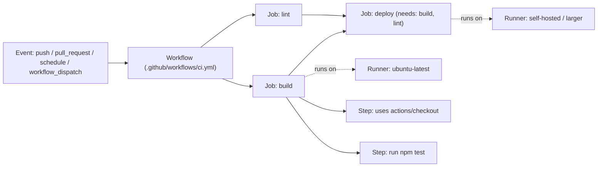

import { Aside, Badge } from '@astrojs/starlight/components';
import { TLDR, DocsLinks, LastVerified, FlashCards } from '@components';

<LastVerified date="2026-10" />

<TLDR>
- An **event** (push, PR, schedule, manual…) triggers one or more **workflows** (`.github/workflows/*.yml`).
- A workflow contains **jobs**. Jobs run in parallel by default, each on its own fresh **runner**. Use `needs:` to order them.
- A job is a list of **steps**. Each step is either a shell command (`run:`) or an **action** (`uses:`). Steps share the job's filesystem.
- Every job gets a short-lived **`GITHUB_TOKEN`**. Scope it down with `permissions:`.
- Pass data between jobs with **outputs** for small strings and **artifacts** for files. Use the **cache** to speed up dependency installs.
</TLDR>

## Common booth questions

<details>
<summary>Do jobs share a machine or a filesystem?</summary>

No. Every job runs on a fresh runner. GitHub-hosted runners are a new VM for each job. Steps **within** a job share the
workspace. Between jobs, use `outputs` for small values or `actions/upload-artifact` / `actions/download-artifact` for files.

</details>

<details>
<summary>What can the GITHUB_TOKEN do, and how long does it live?</summary>

It is an installation token for a GitHub App that is scoped to the repository. It expires when the job finishes, and
never lasts longer than 24 hours. Its default permissions are set at the enterprise, org or repo level: either
"permissive" (read/write) or "restricted" (read-only `contents` and `packages`). Always set an explicit `permissions:`
block so the workflow does not depend on that default.

</details>

<details>
<summary>Why didn't my workflow trigger when another workflow pushed a commit?</summary>

Events that the `GITHUB_TOKEN` causes do **not** start new workflow runs. This prevents recursive loops. The exceptions are
`workflow_dispatch` and `repository_dispatch`. To chain workflows, use a GitHub App token, `workflow_run`, or a
reusable workflow. See [Advanced workflows](/github-cheatsheet/actions/advanced-workflows/#chaining-workflows).

</details>

<details>
<summary>Artifacts vs cache — which should I use?</summary>

- **Artifacts** hold build **outputs** that you want to keep, download or pass to a later job (binaries, test reports).
- **Cache** holds **inputs** that you can rebuild but that are slow to fetch (`node_modules`, `~/.m2`). Entries are
  best-effort and can be evicted. The limit is 10 GB per repository.

</details>

<details>
<summary>What is the difference between contexts and environment variables?</summary>

**Contexts** (`github`, `env`, `vars`, `secrets`, `matrix`, `needs`, `steps`, `runner`, `inputs`…) are evaluated by
the Actions engine **before** the step is sent to the runner. **Environment variables** (`$GITHUB_SHA`, `$MY_VAR`) are
read by the shell **on** the runner. Use contexts in `if:` and in `with:` inputs. Use env vars inside scripts.

</details>

<details>
<summary>Is it safe to put a PR title expression straight into a run: script?</summary>

No. That pattern is **script injection**: the expression is substituted into the script before the shell runs, so a
crafted PR title can execute commands. Map the value to an env var first:
`env: TITLE: ${{ github.event.pull_request.title }}`, then use `"$TITLE"` in the script.
For more on this, see the [Actions overview](/github-cheatsheet/actions/) and its security page.

</details>

## The architecture in one picture



| Concept | Where it lives | Key point |
| --- | --- | --- |
| Event | `on:` | Can filter by branch, tag, path or activity `types`. |
| Workflow | `.github/workflows/*.yml` | The workflow file must exist on the ref that the event refers to (some events, such as `schedule` and `workflow_run`, use only the default branch). |
| Job | `jobs.<id>` | Parallel by default. Has its own `runs-on`, `permissions`, `env`, `if`, `timeout-minutes`. |
| Step | `jobs.<id>.steps[]` | `run:` (shell) or `uses:` (action). Runs sequentially within the job. |
| Runner | `runs-on:` | GitHub-hosted, larger, or self-hosted. See [Runners](/github-cheatsheet/actions/runners/). |

## Minimal annotated workflow

```yaml
name: CI
on:
  pull_request:
  push:
    branches: [main]

permissions:
  contents: read            # least privilege for GITHUB_TOKEN

jobs:
  build:
    runs-on: ubuntu-latest
    timeout-minutes: 15     # default is 360 — always set a lower one
    outputs:
      version: ${{ steps.ver.outputs.version }}
    steps:
      - uses: actions/checkout@v7
      - id: ver
        run: echo "version=$(cat VERSION)" >> "$GITHUB_OUTPUT"
      - run: make build
      - uses: actions/upload-artifact@v7
        with:
          name: dist
          path: dist/

  deploy:
    needs: build                       # wait for build; skip if it fails
    if: github.ref == 'refs/heads/main'
    runs-on: ubuntu-latest
    steps:
      - uses: actions/download-artifact@v8
        with:
          name: dist
      - run: echo "Deploying ${{ needs.build.outputs.version }}"
```

<Aside type="tip">
Major versions shown here (`checkout@v7`, `upload-artifact@v7`, `download-artifact@v8`) are the latest releases as of
2026-10. Many GitHub Docs examples still show older majors. For production, **pin to a full commit SHA** and let
Dependabot keep the SHAs up to date.
</Aside>

## Contexts and expressions

- Syntax: `${{ <expression> }}`. In `if:`, the `${{ }}` wrapper is optional.
- Useful functions: `contains()`, `startsWith()`, `format()`, `join()`, `toJSON()`, `fromJSON()`, `hashFiles()`.
- Status functions: `success()` (the implicit default), `always()`, `failure()`, `cancelled()`.
- Precedence of `vars` / `secrets`: environment > repository > organization (the most specific wins).

```yaml
if: github.event_name == 'push' && startsWith(github.ref, 'refs/tags/v')
```

## GITHUB_TOKEN basics

```yaml
permissions:          # workflow level — applies to all jobs
  contents: read
jobs:
  release:
    permissions:      # job level — replaces (not merges with) the workflow block
      contents: write
      id-token: write # needed for OIDC to clouds and for artifact attestations
```

- Any scope that you leave out of a `permissions:` block is set to `none`.
- PRs from **forks** get a read-only token and no secrets (apart from `GITHUB_TOKEN`).

## Job outputs and the `needs` graph

- Set a step output with `echo "key=value" >> "$GITHUB_OUTPUT"`, then expose it through `jobs.<id>.outputs`.
- Read it in a downstream job with `needs.<job>.outputs.<key>`.
- Limits: **1 MB per job** and **50 MB total** of outputs per workflow run.
- If any job in `needs` fails or is skipped, the dependent job is skipped. Override this with `if: always()` or `if: ${{ !cancelled() }}`.

## Artifacts vs cache (one line each)

- **Artifact:** keeps files produced by a run, to download later or pass to another job (`actions/upload-artifact@v7` / `download-artifact@v8`).
- **Cache:** reuses dependencies across runs, keyed by `hashFiles('**/lockfile')` (`actions/cache@v6` or the built-in `cache:` input on `setup-*` actions). The limit is 10 GB per repo.

## Quick self-check

<FlashCards
	title="Fundamentals flash cards"
	cards={[
		{ q: 'Do two jobs in the same workflow share a filesystem?', a: 'No — each job gets a fresh runner. Use **artifacts** or **outputs**.' },
		{ q: 'How do you make job B wait for job A?', a: '`needs: A` on job B.' },
		{ q: 'Permission needed to request an OIDC token?', a: '`id-token: write`' },
		{ q: 'Default job timeout?', a: '360 minutes (6 h). Set `timeout-minutes` lower.' },
		{ q: 'Does a push made with `GITHUB_TOKEN` trigger `on: push` workflows?', a: 'No (except `workflow_dispatch` / `repository_dispatch` events).' },
		{ q: 'Max size of job outputs?', a: '1 MB per job, 50 MB per workflow run.' },
	]}
/>

<DocsLinks
	links={[
		{ label: 'Understanding GitHub Actions', href: 'https://docs.github.com/en/actions/get-started/understand-github-actions' },
		{ label: 'Workflow syntax', href: 'https://docs.github.com/en/actions/reference/workflows-and-actions/workflow-syntax' },
		{ label: 'Contexts reference', href: 'https://docs.github.com/en/actions/reference/workflows-and-actions/contexts' },
		{ label: 'Expressions', href: 'https://docs.github.com/en/actions/reference/workflows-and-actions/expressions' },
		{ label: 'Use GITHUB_TOKEN for authentication', href: 'https://docs.github.com/en/actions/tutorials/authenticate-with-github_token' },
		{ label: 'Store and share data (artifacts)', href: 'https://docs.github.com/en/actions/tutorials/store-and-share-data' },
		{ label: 'Dependency caching reference', href: 'https://docs.github.com/en/actions/reference/workflows-and-actions/dependency-caching' },
	]}
/>
