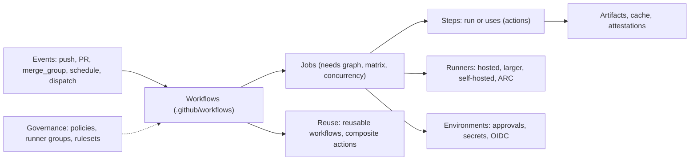

import { LinkCard, CardGrid, Badge } from '@astrojs/starlight/components';
import { TLDR, DocsLinks, LastVerified } from '@components';

<LastVerified date="2026-10" />

<TLDR>
- GitHub Actions is GitHub's built-in automation: **events → workflows → jobs → steps**, running on **GitHub-hosted** or **self-hosted** runners.
- Hosted runner range: standard VMs, **Arm64** and **GPU** (both GA), and **larger runners** with static IPs, Azure private networking and custom images.
- Scale reuse with **reusable workflows** (whole pipelines) and **composite actions** (bundles of steps). Govern them with runner groups, environments and rulesets.
- Secure by default: least-privilege `GITHUB_TOKEN`, **OIDC** instead of cloud keys, SHA-pinned actions, **artifact attestations**.
- Most hard booth questions are about **required checks with path filters**, **monorepos**, **ARC** and **cost**. Jump to the pages below.
</TLDR>

## The Actions map

## Pages in this section

<CardGrid>
	<LinkCard title="Fundamentals" description="Events, jobs, steps, contexts, GITHUB_TOKEN, outputs, artifacts vs cache." href="/github-cheatsheet/actions/fundamentals/" />
	<LinkCard title="Runners" description="Hosted, larger, Arm64, GPU, private networking, self-hosted, ARC, runner groups." href="/github-cheatsheet/actions/runners/" />
	<LinkCard title="Advanced workflow patterns" description="Reusable vs composite, dynamic matrix, concurrency, environments, merge queue, monorepos." href="/github-cheatsheet/actions/advanced-workflows/" />
	<LinkCard title="Production CI workflow builder" description="Interactive builder for a hardened CI/CD workflow, plus a reusable caller and callee." href="/github-cheatsheet/actions/yaml-builder/" />
	<LinkCard title="Security hardening" description="OIDC, least-privilege token, pinning and lockfiles, pull_request_target, script injection, attestations." href="/github-cheatsheet/actions/security/" />
	<LinkCard title="Performance & cost" description="Caching, concurrency, right-sized runners, timeouts and billing controls." href="/github-cheatsheet/actions/performance-cost/" />
	<LinkCard title="Enterprise patterns" description="Required workflows via rulesets, allowed-actions policies, templates, golden-path workflows." href="/github-cheatsheet/actions/enterprise-patterns/" />
	<LinkCard title="Troubleshooting" description="Debug logging, common errors, why workflows don't trigger, gh run commands." href="/github-cheatsheet/actions/troubleshooting/" />
</CardGrid>

## Top booth questions

My required check is stuck on "Expected — Waiting for status". Why?

The workflow was skipped by a `paths` or `branches` filter, so it never reported a status. Jobs skipped by `if:` report
Success, but workflows skipped by filters report nothing. Use an always-run aggregator job as the single required check.
See the [Advanced workflows page](/github-cheatsheet/actions/advanced-workflows/#path-filters-vs-required-checks).

Reusable workflow or composite action?

A **reusable workflow** is a whole pipeline: multiple jobs, its own runners, environments and secrets, and it can be centrally
governed. A **composite action** is a set of steps that runs inside the caller's job. Reusable workflows nest up to 10 levels,
with at most 50 unique reusable workflows per file. See the
[comparison](/github-cheatsheet/actions/advanced-workflows/#reusable-workflows-vs-composite-actions).

How do hosted runners reach my private network?

Use **Azure private networking** on larger runners, an **OIDC-authenticated API gateway**, or **WireGuard**. For a
simple firewall allow-list, larger runners offer **static IPs** (Linux/Windows). If none of these fit, use self-hosted
runners or ARC. See [Runners](/github-cheatsheet/actions/runners/).

How do I stop storing cloud keys in GitHub secrets?

Use **OIDC**. Grant `permissions: id-token: write`, then have the cloud role trust `token.actions.githubusercontent.com`
with a `sub` condition pinned to the repo and environment. Repos created after 2026-07-15 use an immutable `sub` format
that includes owner and repo IDs. Try it in the [workflow builder](/github-cheatsheet/actions/yaml-builder/).

Is there a 2026 price change for Actions or self-hosted runners?

<Badge text="Verify before quoting" variant="caution" /> As of 2026-10, GitHub Docs still describes self-hosted
runners as free to use (you pay for your own infrastructure). We could not verify any 2026 pricing change. Check the
GitHub pricing page and changelog live before you answer.

<DocsLinks
	links={[
		{ label: 'GitHub Actions documentation', href: 'https://docs.github.com/en/actions' },
		{ label: 'Understanding GitHub Actions', href: 'https://docs.github.com/en/actions/get-started/understand-github-actions' },
		{ label: 'Workflow syntax', href: 'https://docs.github.com/en/actions/reference/workflows-and-actions/workflow-syntax' },
		{ label: 'Actions limits', href: 'https://docs.github.com/en/actions/reference/limits' },
		{ label: 'Actions runner pricing', href: 'https://docs.github.com/en/billing/reference/actions-runner-pricing' },
	]}
/>
