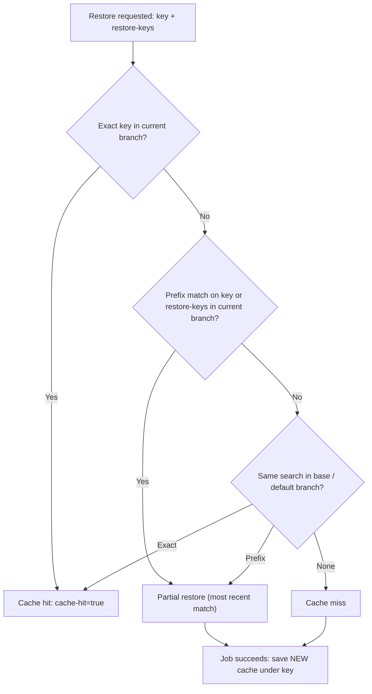
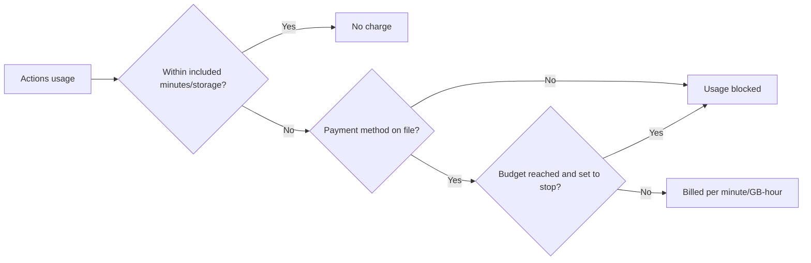

import { TLDR, DocsLinks, LastVerified, CompareTable, FlashCards } from '@components';
import { Aside, Badge } from '@astrojs/starlight/components';

<LastVerified date="2026-10" />

<TLDR>
- **Cache dependencies.** Use `setup-*` with `cache:` or `actions/cache@v4`. The **10 GB per repo** cache allowance is included, admins can raise the limit (overage is billed), and entries not accessed in **7 days** are evicted.
- **Stop wasting minutes.** Use `concurrency` with `cancel-in-progress`, `timeout-minutes`, and `paths` / `paths-ignore` filters.
- **Billing is per-minute by SKU.** Linux 2-core is **$0.006/min**, Windows **$0.010**, macOS **$0.062**, and Linux arm64 **$0.005**. Standard runners are free on public repos. Jobs are rounded up to whole minutes.
- **Included minutes do not cover larger runners.** Larger runners are always billed, even on public repos.
- **Use budgets** to cap Actions spend. For metered products like Actions, a budget can **stop** usage when it is reached.
</TLDR>

## Common booth questions

<details>
<summary>How much does a GitHub-hosted runner cost?</summary>

It is billed per minute, rounded **up** per job. Standard runner rates from GitHub Docs, Oct 2026:

| Runner | SKU | USD / min |
| --- | --- | --- |
| Linux 1-core x64 | `actions_linux_slim` | $0.002 |
| Linux 2-core x64 | `actions_linux` | $0.006 |
| Linux 2-core arm64 | `actions_linux_arm` | $0.005 |
| Windows 2-core x64 / arm64 | `actions_windows` / `_arm` | $0.010 |
| macOS 3/4-core (M1 or Intel) | `actions_macos` | $0.062 |

Docs now publish **per-SKU dollar rates**. Quote those rather than the old "2× / 10×" OS minute multipliers. For larger runners, check [Actions runner pricing](https://docs.github.com/en/billing/reference/actions-runner-pricing). For example, Linux 4-core is $0.012 and Linux 64-core is $0.162.

</details>

<details>
<summary>How many free minutes do we get?</summary>

For **private repos** on standard runners:

| Plan | Minutes / month | Artifact + Packages storage | Cache per repo |
| --- | --- | --- | --- |
| Free / Free for orgs | 2,000 | 500 MB | 10 GB |
| Pro | 3,000 | 1 GB | 10 GB |
| Team | 3,000 | 2 GB | 10 GB |
| Enterprise Cloud | 50,000 | 50 GB | 10 GB |

Standard runners are **free in public repos**, for GitHub Pages and for Dependabot. Included minutes **cannot** be used for larger runners.

</details>

<details>
<summary>Do self-hosted runners cost anything?</summary>

GitHub Docs (Oct 2026) still say self-hosted runners are **free to use with Actions**. You pay for the machines, network, storage and the ops work. <Badge text="Verify before quoting" variant="caution" /> We could not verify any 2026 self-hosted "platform fee" in docs. Check github.com/pricing and the changelog live before you discuss it.

</details>

<details>
<summary>Our cache keeps getting evicted. What can we do?</summary>

1. Check **Actions → Caches** for thrashing: the total exceeds the limit, so the oldest-accessed entries are evicted.
2. Stop caching per-PR or per-SHA keys that nobody else can restore. PR caches are scoped to `refs/pull/N/merge` and are useful only to re-runs of that PR.
3. Warm caches from `push` to `main`, because every branch can read default-branch caches.
4. **Raise the repo cache limit** in Actions settings. The cap is set by the org or enterprise (up to 10 TB for user-owned repos), it requires a payment method, and usage over 10 GB is billed (about $0.07 per GB-month).

</details>

<details>
<summary>Why didn't my PR restore the cache from another PR?</summary>

By design. A run can restore caches from its **own branch**, the **base branch** and the **default branch**, but not from sibling or child branches or other PRs. This is a security boundary.

</details>

<details>
<summary>Larger runner or more parallel jobs?</summary>

- **Larger runners** suit CPU-bound builds that don't shard, such as compiles and Docker builds. Twice the cores usually costs about twice the per-minute rate, so the win comes from wall-clock time or from scaling better than linearly.
- **Matrix / sharding** suits test suites that split cleanly. Each job pays its own setup cost: checkout, cache restore and toolchain.
- Watch the **concurrency limits**, which are total concurrent jobs per plan. Standard runners allow 20 (Free), 60 (Team) and 500 (Enterprise). macOS is capped at 5 or 50. Support can raise them.

</details>

<details>
<summary>How do we stop surprise bills?</summary>

Set **budgets** on the new billing platform at enterprise, org, cost center or repo level. For **metered** products such as Actions, a budget can **stop usage** once it is reached. You'll get alerts at 75%, 90% and 100% of the budget, and emails at 90% and 100% of **included** minutes. Without a payment method, usage stops when included quota runs out, and larger runners are blocked entirely.

</details>

## Cache key resolution



```yaml
- uses: actions/cache@v4
  with:
    path: ~/.npm
    key: ${{ runner.os }}-npm-${{ hashFiles('**/package-lock.json') }}
    restore-keys: |
      ${{ runner.os }}-npm-
```

**Key facts**
- A cache is **immutable**. To change its contents, save under a new key. Keys can be at most 512 characters.
- The repo allowance is **10 GB**. Admins can raise the limit, and usage above 10 GB is billed. Entries **unused for 7 days are evicted**. When the repo is full, eviction removes the least recently accessed entries first.
- Rate limits per repo: **200 uploads/min, 1,500 downloads/min, 400 deletes/min**.
- Low-trust triggers such as `pull_request_target`, `issue_comment` and `workflow_run` get **read-only** access to default-branch caches. Use the new `cache-mode` key (`read`, `write`, `write-only`, `none`) to set access explicitly.
- `restore-keys` that are too broad can restore stale data. Rely on lockfile-hash keys.

### `setup-*` built-in caching

| Ecosystem | Action | Input |
| --- | --- | --- |
| npm / Yarn / pnpm | `actions/setup-node` | `cache: npm` |
| pip / pipenv / Poetry | `actions/setup-python` | `cache: pip` |
| Gradle / Maven | `actions/setup-java` | `cache: gradle` |
| Go | `actions/setup-go` | caching is on by default in recent versions |
| .NET NuGet | `actions/setup-dotnet` | `cache: true` |
| RubyGems | `ruby/setup-ruby` | `bundler-cache: true` |

## Artifacts (v4)

- Use `actions/upload-artifact@v4` and `actions/download-artifact@v5`. Artifacts are **immutable** in v4. You can't upload twice to the same name, so give each matrix leg a unique name and use `merge-multiple` / `pattern` on download.
- **Retention** defaults to **90 days**. Public repos can configure 1–90 days and private repos 1–400 days. Override per upload with `retention-days`, which can't exceed the repo or org limit.
- Artifact storage **shares** its allowance with GitHub Packages and accrues hourly in GB-hours. Deleting an artifact stops *future* charges but not storage already accrued this cycle.
- **Artifacts vs cache**: use artifacts to pass build outputs between jobs or keep them for people, and use the cache to speed up repeat dependency installs.

## Save minutes: concurrency, timeouts, filters

```yaml
on:
  pull_request:
    paths-ignore: ['docs/**', '**.md']
concurrency:
  group: ${{ github.workflow }}-${{ github.ref }}
  cancel-in-progress: true
jobs:
  test:
    runs-on: ubuntu-latest
    timeout-minutes: 20   # default is 360 (6h) on GitHub-hosted
```

- `cancel-in-progress` kills superseded PR runs. For deploys, use a separate group **without** cancel.
- `concurrency.queue: max` lets up to **100** runs wait in a group instead of replacing the pending one. You **can't** combine it with `cancel-in-progress: true`.
- **Path filters** skip whole workflows. If such a workflow is a *required check*, the PR will wait forever. See the [troubleshooting page](/github-cheatsheet/actions/troubleshooting/).
- Cache Docker layers (`cache-from`/`cache-to: type=gha`) and run fast lint jobs before slow ones (`needs:`).

## Larger runners vs parallelism vs self-hosted

<CompareTable
  title="Where should this job run?"
  columns={[
    { key: 'std', label: 'Standard hosted' },
    { key: 'large', label: 'Larger hosted' },
    { key: 'self', label: 'Self-hosted / ARC' },
  ]}
  rows={[
    { feature: 'Per-minute billing', category: 'Cost', values: { std: 'Yes (free on public repos)', large: 'Yes, always (even public)', self: 'No GitHub minute charge*' } },
    { feature: 'Uses included minutes', category: 'Cost', values: { std: true, large: false, self: 'N/A' } },
    { feature: 'You pay infra and ops', category: 'Cost', values: { std: false, large: false, self: true } },
    { feature: 'Up to 96 cores / GPU', category: 'Capability', values: { std: false, large: true, self: 'Your hardware' } },
    { feature: 'Static IPs / Azure private networking', category: 'Capability', values: { std: false, large: true, self: true } },
    { feature: 'Custom images', category: 'Capability', values: { std: false, large: true, self: true } },
    { feature: 'Ephemeral clean VM per job', category: 'Security', values: { std: true, large: true, self: 'Only if you configure it (JIT / ARC)' } },
    { feature: 'Plan required', category: 'Access', values: { std: 'Any', large: 'Team or Enterprise Cloud', self: 'Any' } },
  ]}
/>

\* Self-hosted: "free to use with GitHub Actions" per docs as of 2026-10. Re-verify pricing announcements live.

**Self-hosted cost model**: compute (VMs or Kubernetes nodes, idle capacity), storage and egress, image maintenance and patching, autoscaling (ARC), security hardening and on-call time. Self-hosted is usually worth it for very high volume, special hardware, or network locality. Compare against larger runners, which are pay-per-minute with zero ops.

## Billing controls



- **Budgets** can be set for an enterprise, org, cost center or repo, with alerts at 75%, 90% and 100%. For metered products, a budget can block further usage.
- **Cost centers** let you charge Actions spend back to business units based on their repos and orgs.
- Use the **usage report** or the REST "billing usage" endpoints and the **Actions metrics** (usage and performance) to find your most expensive workflows.
- Storage pricing above the included allowance: **$0.25/GB-month** for artifacts and Packages, **$0.07/GB-month** for the cache.

## Cost and performance gotchas

<FlashCards
  title="Performance & cost gotchas"
  cards={[
    { q: 'A job runs 61 seconds. How many minutes are billed?', a: '**2.** Each job is rounded up to the next whole minute.' },
    { q: 'Do larger runners consume included minutes?', a: '**No.** They are always billed per minute, even on public repos.' },
    { q: 'Can PR #12 restore a cache saved by PR #11?', a: 'No. PR caches are scoped to `refs/pull/N/merge`. Warm shared caches from `push` on the default branch.' },
    { q: 'When are caches evicted?', a: 'When they have gone unused for **7 days**, or least-recently-accessed first once the repo limit (10 GB by default) is exceeded.' },
    { q: 'What is the default job timeout on GitHub-hosted runners?', a: '**6 hours** (360 min). Set `timeout-minutes` so hung jobs don\'t burn minutes.' },
    { q: 'Can you upload to the same artifact name twice in v4?', a: 'No. Artifacts are immutable in v4, so use unique names per matrix leg.' },
    { q: 'Does deleting artifacts reduce this month\'s bill?', a: 'Only for future hours. Storage already accrued in this cycle stays billed.' },
  ]}
/>

<DocsLinks links={[
  { label: 'GitHub Actions billing', href: 'https://docs.github.com/en/billing/concepts/product-billing/github-actions', description: 'Included minutes and storage, storage accrual' },
  { label: 'Actions runner pricing', href: 'https://docs.github.com/en/billing/reference/actions-runner-pricing', description: 'Per-minute rates for all SKUs' },
  { label: 'Dependency caching reference', href: 'https://docs.github.com/en/actions/reference/workflows-and-actions/dependency-caching', description: 'Key matching, scope, limits, cache-mode' },
  { label: 'Store and share data with workflow artifacts', href: 'https://docs.github.com/en/actions/tutorials/store-and-share-data' },
  { label: 'Actions limits', href: 'https://docs.github.com/en/actions/reference/limits', description: 'Concurrency, timeouts, rate limits' },
  { label: 'Workflow syntax: concurrency', href: 'https://docs.github.com/en/actions/reference/workflows-and-actions/workflow-syntax#concurrency' },
  { label: 'Budgets and alerts', href: 'https://docs.github.com/en/billing/concepts/budgets-and-alerts' },
]} />
