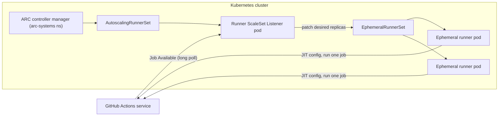

import { Aside, Badge, Tabs, TabItem } from '@astrojs/starlight/components';
import { TLDR, DocsLinks, LastVerified, DecisionTree, CompareTable } from '@components';

<LastVerified date="2026-10" />

<TLDR>
- **Standard GitHub-hosted** runners (`ubuntu-latest`, `windows-latest`, `macos-latest`, `*-arm`): a fresh VM for each job, managed by GitHub, free and unlimited for public repos.
- **Larger runners** (GitHub Team / Enterprise Cloud): more CPU/RAM, **GPU**, **static IPs**, **Azure private networking**, **custom images** and runner groups. They are always billed per minute.
- **Self-hosted** runners: your hardware and network, and your patching. On Kubernetes, use **Actions Runner Controller (ARC)** with **runner scale sets**.
- Run self-hosted runners as **ephemeral** (one job each) or **JIT**. Never attach persistent self-hosted runners to **public** repositories.
- Route jobs with `runs-on:` (a label, a runner name, or `group:` plus `labels:`). Control access with **runner groups**.
</TLDR>

## Common booth questions

<details>
<summary>What does ubuntu-latest point to today?</summary>

**Ubuntu 24.04**. `windows-latest` points to **Windows Server 2025**, and `macos-latest` points to **macOS 26 (arm64/M1)**.
Pin an explicit label (`ubuntu-24.04`) if a silent image change would break your build. `ubuntu-26.04`, `*-vs2026` and
`xcode-27` are newer images; check their status on the runner-images repo before you rely on them. GitHub notes that
beta images may not be covered by support.

</details>

<details>
<summary>Can GitHub-hosted runners reach my private network or on-prem systems?</summary>

Yes. There are three documented approaches:

1. **Azure private networking** (larger runners): the runners get NICs inside **your Azure VNET**. GitHub Team customers can configure it at the org level, and Enterprise Cloud customers at the enterprise or org level.
2. An **API gateway with OIDC**: your gateway trusts GitHub's OIDC token.
3. A **WireGuard** overlay network.

Use **static IPs** (larger runners, Linux/Windows) if you only need to add the runners to a firewall allow-list.

</details>

<details>
<summary>Do you have Arm64 and GPU runners?</summary>

Yes, both are GA.

- **Arm64:** `ubuntu-24.04-arm`, `ubuntu-22.04-arm` and `windows-11-arm` are available as standard runners. `macos-latest` is already Apple silicon.
- **GPU:** larger runners for Linux/Windows with 4 cores and 1× NVIDIA Tesla T4 (16 GB VRAM).

Arm64 runners are often a cheap speed win for multi-arch container builds: they avoid QEMU emulation.

</details>

<details>
<summary>Are self-hosted runners free?</summary>

GitHub Docs (checked 2026-10) still says self-hosted runners are *"free to use with GitHub Actions, but you are responsible
for the cost of maintaining your runner machines."* <Badge text="Verify before quoting" variant="caution" /> We could not verify whether any 2026
pricing change applies to self-hosted usage. Check the
[pricing page](https://github.com/pricing) and the GitHub changelog live before you answer pricing questions.

</details>

<details>
<summary>Should I use ARC or a VM autoscaler such as Terraform or the Philips module?</summary>

- **ARC** (Kubernetes operator, runner scale sets mode) is GitHub's **supported, recommended** autoscaler for Kubernetes.
- Outside Kubernetes, you can use the open-source **Runner Scale Set Client** (`actions/scaleset`), which calls the same scale-set APIs.
- Community VM autoscalers work too, but GitHub does not support them.

</details>

<details>
<summary>How do I stop every repo from using our expensive GPU and prod-network runners?</summary>

Put those runners in a **runner group**. Restrict the group to selected repositories, and optionally to selected **workflows**
(for example, only a central reusable deploy workflow). Larger runners also have a per-runner **max concurrency** setting.

</details>

<details>
<summary>My job is stuck on "Waiting for a runner to pick up this job". Why?</summary>

There are four common causes:

- No runner matches **all** of the `runs-on` labels.
- The repo is not allowed to use the runner group.
- The runner group or larger-runner concurrency limit has been reached.
- The runners are offline.

Jobs stay queued for up to **24 hours** before they fail.

</details>

## Runner types at a glance

<CompareTable
	title="Runner types"
	columns={[
		{ key: 'std', label: 'Standard hosted' },
		{ key: 'larger', label: 'Larger runners' },
		{ key: 'self', label: 'Self-hosted (VM)' },
		{ key: 'arc', label: 'ARC scale sets' },
	]}
	rows={[
		{ feature: 'Managed / patched by GitHub', category: 'Operations', values: { std: true, larger: true, self: false, arc: false } },
		{ feature: 'Clean VM per job', category: 'Operations', values: { std: true, larger: true, self: 'If ephemeral', arc: 'Yes (ephemeral pods)' } },
		{ feature: 'Autoscaling', category: 'Operations', values: { std: true, larger: true, self: 'DIY', arc: true } },
		{ feature: 'Plan required', category: 'Operations', values: { std: 'Any', larger: 'Team / Enterprise Cloud', self: 'Any', arc: 'Any' } },
		{ feature: 'Arm64', category: 'Hardware', values: { std: true, larger: true, self: true, arc: true } },
		{ feature: 'GPU', category: 'Hardware', values: { std: false, larger: 'Linux/Windows T4', self: true, arc: true } },
		{ feature: 'Custom image', category: 'Hardware', values: { std: false, larger: 'Linux/Windows', self: true, arc: 'Your container image' } },
		{ feature: 'Static egress IP', category: 'Network', values: { std: false, larger: 'Linux/Windows', self: 'Your network', arc: 'Your network' } },
		{ feature: 'Private network access', category: 'Network', values: { std: 'OIDC gateway / WireGuard', larger: 'Azure private networking', self: true, arc: true } },
		{ feature: 'Billing', category: 'Cost', values: { std: 'Included minutes, then per-minute', larger: 'Always per-minute', self: 'Your infra (verify current fees)', arc: 'Your infra (verify current fees)' } },
		{ feature: 'Safe for public repos', category: 'Security', values: { std: true, larger: true, self: false, arc: 'Only with strict isolation' } },
	]}
/>

## Which runner should I use?

<DecisionTree
	title="Which runner should I use?"
	tree={{
		start: 'q1',
		nodes: {
			q1: {
				question: 'Does the job need to reach resources on a **private network** (on-prem, private VNET)?',
				options: [
					{ label: 'Yes', next: 'q2' },
					{ label: 'No', next: 'q4' },
				],
			},
			q2: {
				question: 'Is the private network in **Azure**, or reachable from an Azure VNET?',
				options: [
					{ label: 'Yes', next: 'vnet' },
					{ label: 'No', next: 'q3' },
				],
			},
			q3: {
				question: 'Do you run **Kubernetes** and have a platform team to operate it?',
				options: [
					{ label: 'Yes', next: 'arc' },
					{ label: 'No', next: 'selfvm' },
				],
			},
			q4: {
				question: 'Do you need a **firewall allow-list** (static IP), a **GPU**, more CPU/RAM, or a **pre-baked image**?',
				options: [
					{ label: 'Yes', next: 'larger' },
					{ label: 'No', next: 'q5' },
				],
			},
			q5: {
				question: 'Are you building **Arm64** artifacts (multi-arch containers, Graviton, Apple silicon)?',
				options: [
					{ label: 'Yes', next: 'arm' },
					{ label: 'No', next: 'standard' },
				],
			},
			vnet: {
				answer: '**Larger runners with Azure private networking.** GitHub still manages the runners, and they get NICs in your VNET. Available on the Team (org level) and Enterprise Cloud plans.',
				links: [{ label: 'About Azure private networking', href: 'https://docs.github.com/en/organizations/managing-organization-settings/about-azure-private-networking-for-github-hosted-runners-in-your-organization' }],
			},
			arc: {
				answer: '**Actions Runner Controller (ARC)** with runner scale sets: ephemeral pods that autoscale on job demand.',
				links: [{ label: 'ARC quickstart', href: 'https://docs.github.com/en/actions/tutorials/use-actions-runner-controller/get-started' }],
			},
			selfvm: {
				answer: '**Self-hosted VM runners**, registered as `--ephemeral` or JIT and recreated after each job. Also consider an **OIDC API gateway** or **WireGuard** from hosted runners as a lower-ops option.',
				links: [{ label: 'Private networking options', href: 'https://docs.github.com/en/actions/concepts/runners/private-networking' }],
			},
			larger: {
				answer: '**GitHub-hosted larger runners.** Static IPs, custom images and GPU are Linux/Windows only. Put them in a runner group to control access and cost.',
				links: [{ label: 'Larger runners', href: 'https://docs.github.com/en/actions/concepts/runners/larger-runners' }],
			},
			arm: { answer: '**Arm64 hosted runners**: `runs-on: ubuntu-24.04-arm` (or `windows-11-arm`, `macos-latest`). Building natively avoids slow QEMU emulation.' },
			standard: { answer: '**Standard hosted runners** (`ubuntu-latest`) are fine. For very light jobs (labeling, notifications), consider `ubuntu-slim` (a 1-vCPU container).' },
		},
	}}
/>

## GitHub-hosted runners

### Standard labels (as of 2026-10)

| OS | Labels | Notes |
| --- | --- | --- |
| Linux x64 | `ubuntu-latest` (= 24.04), `ubuntu-24.04`, `ubuntu-22.04`, `ubuntu-26.04` | Public repos: 4 vCPU / 16 GB. Private: 2 vCPU / 8 GB. |
| Linux lightweight | `ubuntu-slim` | 1 vCPU / 5 GB **container** on a shared VM. Good for glue jobs. |
| Linux arm64 | `ubuntu-24.04-arm`, `ubuntu-22.04-arm`, `ubuntu-26.04-arm` | GA. |
| Windows x64 | `windows-latest` (= 2025), `windows-2025`, `windows-2022` | `windows-2025-vs2026` also exists. |
| Windows arm64 | `windows-11-arm`, `windows-11-vs2026-arm` | GA. |
| macOS | `macos-latest` (= 26, M1), `macos-14`, `macos-15`, `macos-26`; Intel `macos-15-intel`, `macos-26-intel` | No nested virtualization on Apple silicon. |

### Larger runners

<Badge text="Team / Enterprise Cloud" variant="note" />

- **Sizes:** you create the runner, give it a name, and pick a size. You then target it with `runs-on: <runner-name>` or through its group.
- **GPU:** 4-core with 1× Tesla T4, 28 GB RAM and 16 GB VRAM (Linux/Windows).
- **Static IPs** and **custom images** are available on Linux and Windows. macOS larger runners support neither, and they also cannot use Azure private networking.
- **Custom images:** you build a VM image from a GitHub base image with a workflow. Storage is billed separately (GB-hours).
- **Billing:** larger runners **never** use included minutes, even on public repos. You pay per minute only while a job runs.

```yaml
jobs:
  build:
    runs-on:
      group: gpu-runners          # runner group (access-controlled)
      labels: [linux-gpu-t4]      # runner name/label within the group
```

## Self-hosted runners

- You install the open-source runner agent on your own machines. It makes **outbound** HTTPS calls to GitHub; no inbound ports are needed.
- **Default labels:** `self-hosted`, an OS label (`linux`, `windows`, `macOS`) and an architecture label (`x64`, `ARM`, `ARM64`). You can add custom labels such as `gpu` or `prod-net`.
- `runs-on: [self-hosted, linux, prod-net]` means the runner must have **all** of these labels.
- **Ephemeral:** register with `./config.sh --ephemeral`. The runner takes one job and then de-registers itself. GitHub recommends ephemeral runners for autoscaling, because persistent runners can be handed a job while they are shutting down.
- **JIT (just-in-time):** create a single-use runner configuration through the REST API (`generate-jitconfig`). It needs no registration token on the box. ARC uses JIT internally.
- **Updates:** runners auto-update by default. If you disable this, you must apply updates yourself within the support window.

<Aside type="danger" title="Public repositories">
Anyone can open a pull request from a fork and run code on a self-hosted runner that is attached to a public repo. Use
GitHub-hosted runners for public repos. If you must use self-hosted runners there, make them ephemeral and isolated, and
require approval for fork workflows.
</Aside>

## Actions Runner Controller (ARC)

ARC is a Kubernetes operator. In **runner scale set** mode, the current documented mode, a listener pod holds an HTTPS
long-poll to GitHub. When jobs arrive, it scales a set of **ephemeral runner pods** that register with **JIT**
configurations.



<Tabs>
<TabItem label="Install">

```bash
# 1. Controller (once per cluster)
helm install arc \
  --namespace arc-systems --create-namespace \
  oci://ghcr.io/actions/actions-runner-controller-charts/gha-runner-scale-set-controller

# 2. A runner scale set (one per pool / runner group)
helm install arc-runner-set \
  --namespace arc-runners --create-namespace \
  --set githubConfigUrl="https://github.com/my-org" \
  --set githubConfigSecret=my-github-app-secret \
  --set minRunners=0 --set maxRunners=20 \
  oci://ghcr.io/actions/actions-runner-controller-charts/gha-runner-scale-set
```

</TabItem>
<TabItem label="Use in a workflow">

```yaml
jobs:
  build:
    runs-on: arc-runner-set   # the Helm installation name (or one of its labels, ARC ≥ 0.14.0)
    steps:
      - uses: actions/checkout@v7
```

</TabItem>
<TabItem label="Gotchas">

- Authenticate with a **GitHub App** rather than a PAT.
- Each scale set belongs to **one** runner group.
- For Docker builds, choose **`dind`** or **Kubernetes mode** (`containerMode`). Kubernetes mode needs a persistent work volume and runs job containers as separate pods.
- Set `minRunners` above 0 for warm capacity. With 0, every job pays the pod start-up time.
- Forward runner logs to external storage, because ephemeral pods disappear.
- ARC is supported by GitHub. Your Kubernetes cluster is your responsibility.

</TabItem>
</Tabs>

## Runner groups

- Available for self-hosted runners, ARC scale sets and larger runners on Team and Enterprise plans.
- They control which **organizations** (at the enterprise level), **repositories** and **workflows** can use the runners. For example, you can allow only `my-org/platform/.github/workflows/deploy.yml@refs/heads/main`.
- A runner belongs to exactly one group. New runners go to the `Default` group.
- Pattern: a **prod-network** group restricted to the central reusable deploy workflow. This means that application repos can deploy only through the approved pipeline.

<DocsLinks
	links={[
		{ label: 'GitHub-hosted runners reference', href: 'https://docs.github.com/en/actions/reference/runners/github-hosted-runners' },
		{ label: 'Larger runners', href: 'https://docs.github.com/en/actions/concepts/runners/larger-runners' },
		{ label: 'Private networking with GitHub-hosted runners', href: 'https://docs.github.com/en/actions/concepts/runners/private-networking' },
		{ label: 'Self-hosted runners reference', href: 'https://docs.github.com/en/actions/reference/runners/self-hosted-runners' },
		{ label: 'Actions Runner Controller', href: 'https://docs.github.com/en/actions/concepts/runners/actions-runner-controller' },
		{ label: 'ARC quickstart', href: 'https://docs.github.com/en/actions/tutorials/use-actions-runner-controller/get-started' },
		{ label: 'Runner groups', href: 'https://docs.github.com/en/actions/concepts/runners/runner-groups' },
		{ label: 'Actions runner pricing', href: 'https://docs.github.com/en/billing/reference/actions-runner-pricing' },
	]}
/>
