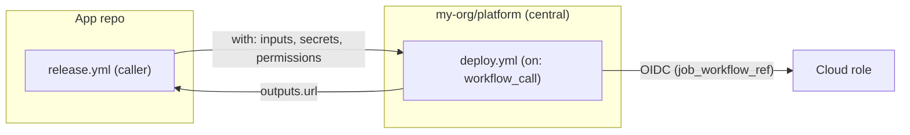

import { Aside, Badge, Tabs, TabItem } from '@astrojs/starlight/components';
import { TLDR, DocsLinks, LastVerified, YamlBuilder } from '@components';

export const ciBase = `name: CI
on:
  pull_request:
    # @pr
  push:
    branches: [main]
  # @on
# @top
jobs:
  build:
    runs-on: ubuntu-latest
    # @job
    steps:
      - uses: actions/checkout@v7
        with:
          persist-credentials: false   # don't leave the token in .git/config
      # @steps
  # @jobs
`;

export const ciOptions = [
	{
		id: 'sha',
		label: 'SHA-pinning note',
		section: 'top',
		default: true,
		snippet: `
# Supply-chain hardening: in production, pin every action to a full commit SHA,
# e.g. "uses: actions/checkout@<40-char-sha> # v7.0.1", and let Dependabot bump it.
# Orgs can enforce this: Settings > Actions > "Require actions to be pinned to a full-length commit SHA".`,
		description: 'Adds a reminder comment at the top of the file.',
		explanation: 'Tags such as `@v7` can be moved, so a compromised tag would run new code in your pipeline. A full SHA is immutable. Dependabot (`package-ecosystem: github-actions`) understands SHA pins plus the version comment and keeps them updated.',
	},
	{
		id: 'permissions',
		label: 'Least-privilege GITHUB_TOKEN',
		section: 'top',
		default: true,
		snippet: `
permissions:
  contents: read`,
		description: 'Workflow-wide read-only token. Jobs opt in to more.',
		explanation: 'Every scope you leave out becomes `none`. Jobs that need more (OIDC, attestations) declare their own `permissions:` block, which **replaces** this one for that job. This limits the damage if a step is compromised.',
	},
	{
		id: 'concurrency',
		label: 'Cancel superseded PR runs',
		section: 'top',
		default: true,
		snippet: `
concurrency:
  group: \${{ github.workflow }}-\${{ github.event.pull_request.number || github.ref }}
  cancel-in-progress: \${{ github.event_name == 'pull_request' }}`,
		explanation: 'A new push to a PR cancels the stale run, which saves minutes. Runs on `main` are never cancelled, so every merge is fully built and deployed.',
	},
	{
		id: 'paths',
		label: 'Skip docs-only PRs (paths-ignore)',
		section: 'pr',
		snippet: `
paths-ignore:
  - 'docs/**'
  - '**.md'`,
		explanation: '**Caution:** if this workflow is a *required* status check, a docs-only PR will never run it and the check stays **Pending** forever. For required workflows, skip at job level with `if:` or use an always-run aggregator job instead. See Advanced workflows → Path filters vs required checks.',
	},
	{
		id: 'mergegroup',
		label: 'Merge queue support (merge_group)',
		section: 'on',
		snippet: `
merge_group:
  types: [checks_requested]`,
		explanation: 'Required if the repo uses a **merge queue**. Without it, the queue waits forever for this check.',
	},
	{
		id: 'timeout',
		label: 'Job timeout',
		section: 'job',
		default: true,
		snippet: 'timeout-minutes: 15',
		explanation: 'The default is 360 minutes. A hung test then burns 6 hours of runner time. Set a tight ceiling.',
	},
	{
		id: 'matrix',
		label: 'Node.js version matrix',
		section: 'job',
		snippet: `
strategy:
  fail-fast: false
  matrix:
    node: [20, 22, 24]`,
		explanation: 'Tests every supported runtime in parallel. `fail-fast: false` lets every leg finish, so you see all the failures at once.',
	},
	{
		id: 'node',
		label: 'Set up Node.js with dependency cache',
		default: true,
		snippet: `
- uses: actions/setup-node@v7
  with:
    node-version: \${{ matrix.node || 22 }}
    cache: npm
- run: npm ci
- run: npm test
- run: npm run build`,
		explanation: '`cache: npm` uses the Actions cache, keyed on your lockfile hash. The cache is limited to 10 GB per repo. `matrix.node || 22` works with or without the matrix.',
	},
	{
		id: 'upload',
		label: 'Upload build artifact',
		default: true,
		snippet: `
- uses: actions/upload-artifact@v7
  if: strategy.job-index == 0     # upload once, even with a matrix
  with:
    name: dist
    path: dist/
    retention-days: 7`,
		explanation: 'Passes `dist/` to later jobs (provenance, deploy). Artifact names must be unique within a run, so only the first matrix leg uploads.',
	},
	{
		id: 'depreview',
		label: 'Dependency review on PRs',
		section: 'jobs',
		snippet: `
dependency-review:
  if: github.event_name == 'pull_request'
  runs-on: ubuntu-latest
  permissions:
    contents: read
  steps:
    - uses: actions/checkout@v7
      with:
        persist-credentials: false
    - uses: actions/dependency-review-action@v5
      with:
        fail-on-severity: high`,
		explanation: 'Blocks PRs that add dependencies with known high or critical vulnerabilities (and, optionally, disallowed licenses). Free for public repos. Private repos need **GitHub Code Security**.',
	},
	{
		id: 'attest',
		label: 'Build provenance attestation',
		section: 'jobs',
		snippet: `
provenance:
  needs: build
  if: github.event_name == 'push'
  runs-on: ubuntu-latest
  permissions:
    contents: read
    id-token: write
    attestations: write
  steps:
    - uses: actions/download-artifact@v8
      with:
        name: dist
        path: dist
    - uses: actions/attest@v4
      with:
        subject-path: 'dist/**'`,
		explanation: 'Signs a SLSA build-provenance attestation (Sigstore) for each file. Consumers verify it with `gh attestation verify`. This needs the artifact-upload option. You get SLSA Build L3 if you move the build into a reusable workflow.',
	},
	{
		id: 'deploy',
		label: 'Deploy: protected environment + OIDC to AWS',
		section: 'jobs',
		snippet: `
deploy:
  needs: build
  if: github.event_name == 'push' && github.ref == 'refs/heads/main'
  runs-on: ubuntu-latest
  environment:
    name: production              # add required reviewers in Settings > Environments
    url: https://example.com
  concurrency:
    group: deploy-production
    cancel-in-progress: false     # never kill a deploy halfway
  permissions:
    contents: read
    id-token: write               # lets the job request an OIDC token
  steps:
    - uses: actions/download-artifact@v8
      with:
        name: dist
        path: dist
    - uses: aws-actions/configure-aws-credentials@v6
      with:
        role-to-assume: arn:aws:iam::123456789012:role/gha-deploy-prod
        aws-region: us-east-1
    - run: aws s3 sync dist/ s3://my-bucket/ --delete`,
		explanation: '**Environment:** the job pauses until a required reviewer approves (for private repos this needs Enterprise), and only then are the environment secrets released. **OIDC:** you store no AWS keys. AWS trusts `token.actions.githubusercontent.com`, and its trust policy should pin `sub` to `repo:ORG/REPO:environment:production`. Repos created after 2026-07-15 use an immutable `sub` format that includes owner and repo IDs.',
	},
];

export const calleeBase = `name: Reusable deploy
on:
  workflow_call:
    # @call
# @top
jobs:
  deploy:
    runs-on: ubuntu-latest
    # @job
    outputs:
      url: \${{ steps.deploy.outputs.url }}
    steps:
      - uses: actions/checkout@v7
      # @steps
      - id: deploy
        run: |
          ./deploy.sh
          echo "url=https://app.example.com" >> "$GITHUB_OUTPUT"
`;

export const calleeOptions = [
	{
		id: 'inputs',
		label: 'Typed inputs',
		section: 'call',
		default: true,
		snippet: `
inputs:
  environment:
    type: string
    required: true`,
		explanation: 'Inputs are typed (`string`, `number`, `boolean`). The caller\'s `env:` is **not** passed down, so everything must come in through inputs or `vars`.',
	},
	{
		id: 'secrets',
		label: 'Declared secrets',
		section: 'call',
		snippet: `
secrets:
  DEPLOY_TOKEN:
    required: true`,
		explanation: 'Declare the secrets you need. Callers pass them explicitly or use `secrets: inherit` (same org or enterprise only).',
	},
	{
		id: 'outputs',
		label: 'Workflow outputs',
		section: 'call',
		default: true,
		snippet: `
outputs:
  url:
    description: Deployed URL
    value: \${{ jobs.deploy.outputs.url }}`,
		explanation: 'This maps job outputs to workflow outputs. The caller reads them with `needs.<job>.outputs.url`.',
	},
	{
		id: 'perms',
		label: 'Least-privilege permissions',
		section: 'top',
		default: true,
		snippet: `
permissions:
  contents: read
  id-token: write`,
		explanation: 'A callee can only **reduce** the permissions that the caller grants, never raise them.',
	},
	{
		id: 'env',
		label: 'Protected environment',
		section: 'job',
		default: true,
		snippet: 'environment: \${{ inputs.environment }}',
		explanation: 'Approvals and environment secrets are enforced centrally. Combine this with a runner group restricted to this workflow and an OIDC trust policy on `job_workflow_ref` so that deploys can **only** happen here.',
	},
	{
		id: 'conc',
		label: 'Per-environment concurrency',
		section: 'job',
		snippet: `
concurrency:
  group: deploy-\${{ inputs.environment }}
  cancel-in-progress: false`,
		explanation: 'Don\'t use `github.workflow` alone here. In a callee it is the **caller\'s** name, which can cancel the caller.',
	},
];

export const callerBase = `name: Release
on:
  push:
    branches: [main]
# @top
jobs:
  deploy:
    uses: my-org/platform/.github/workflows/deploy.yml@v3
    # @job
  # @jobs
`;

export const callerOptions = [
	{
		id: 'with',
		label: 'Pass inputs',
		section: 'job',
		default: true,
		snippet: `
with:
  environment: production`,
	},
	{
		id: 'inherit',
		label: 'secrets: inherit',
		section: 'job',
		default: true,
		snippet: 'secrets: inherit',
		explanation: 'Passes all of the caller\'s secrets. This works only within the same org or enterprise. For cross-org calls, or to follow least privilege, replace it with an explicit mapping such as `DEPLOY_TOKEN: ${{ secrets.PROD_DEPLOY_TOKEN }}` under `secrets:`.',
	},
	{
		id: 'cperms',
		label: 'Grant permissions to the callee',
		section: 'job',
		default: true,
		snippet: `
permissions:
  contents: read
  id-token: write`,
		explanation: 'The calling job sets the ceiling for the callee\'s `GITHUB_TOKEN`. If you leave this out, the callee gets the default token permissions.',
	},
	{
		id: 'smoke',
		label: 'Use the callee output',
		section: 'jobs',
		snippet: `
smoke-test:
  needs: deploy
  runs-on: ubuntu-latest
  steps:
    - run: curl -fsS "\${{ needs.deploy.outputs.url }}/health"`,
	},
];

<LastVerified date="2026-10" />

<TLDR>
- Toggle the options below to assemble a **hardened CI/CD workflow**, then copy the YAML.
- The defaults already give you a solid baseline: SHA-pinning note, read-only `GITHUB_TOKEN`, stale-run cancellation, job timeout, cached installs and an artifact.
- Add-ons: **merge queue**, **dependency review**, **build provenance attestation**, and a **deploy job** with an approval-gated environment and **OIDC** to AWS (no stored keys).
- The second builder shows the **reusable workflow** contract between a central callee and the app-team caller.
</TLDR>

## Common booth questions

What is the minimum I should add to every workflow?

Four things:

- `permissions:` (read-only by default).
- `timeout-minutes`.
- A `concurrency` group to cancel stale PR runs.
- SHA-pinned third-party actions.

These four changes cost nothing and remove most of the "runaway bill" and "over-privileged token" risk.

Why persist-credentials: false on checkout?

By default, `actions/checkout` writes the `GITHUB_TOKEN` into `.git/config` so that later `git push` commands work. Any later step,
including third-party actions and uploaded artifacts that contain `.git`, could read the token. Turn it off unless the job pushes.

Do I still need SHA pinning if I trust GitHub-authored actions?

It is best practice for all actions, and the org policy **"Require actions to be pinned to a full-length commit SHA"**
applies to GitHub-authored actions too. Reusable workflows are exempt. An alternative is **workflow dependency
lockfiles** <Badge text="Public preview" variant="caution" /> (`gh actions-lock`, which writes `.github/workflows/actions.lock`). They pin
transitive dependencies as well, and GitHub says SHA pinning in the workflow files is then unnecessary.

Does OIDC completely replace cloud secrets?

For AWS, Azure, GCP, HashiCorp Vault, JFrog, PyPI and others: yes. The job exchanges a short-lived GitHub OIDC token for
a short-lived cloud credential. Security depends on the **trust policy conditions**: always restrict `sub` to the repo
and the environment or branch, never just the org.

How do I roll this out to 500 repos?

There are three levers:

- Put the build/deploy logic in a **reusable workflow** in a central repo (see the second builder).
- Publish a **workflow template** in the org's `.github` repo so new repos start from the baseline.
- Use **rulesets** at the org level to require the status checks.

For the governance details, see the [Actions overview](/github-cheatsheet/actions/).

Why put the attestation in a separate job?

It keeps `id-token: write` and `attestations: write` away from the job that runs `npm install` and your tests, which
execute third-party code. Only a small, trusted job can sign.

## Build a production-grade CI workflow

<YamlBuilder
	title="Production-grade CI/CD workflow"
	filename=".github/workflows/ci.yml"
	base={ciBase}
	options={ciOptions}
/>

<Aside type="tip">
Major versions shown here were the latest releases as of 2026-10: `checkout@v7`, `setup-node@v7`, `upload-artifact@v7`,
`download-artifact@v8`, `attest@v4`, `dependency-review-action@v5` and `configure-aws-credentials@v6`. Many GitHub Docs
examples still show older majors. Check the release notes for breaking changes before you upgrade, then pin to SHAs.
</Aside>

### What each option is for

| Option | Use case | Watch out for |
| --- | --- | --- |
| SHA-pinning note | Supply-chain integrity (a tag can be re-pointed). | Org policy can enforce it. Dependabot updates SHA pins. |
| Least-privilege token | Limit what a compromised step can do. | A job-level `permissions:` replaces the workflow block entirely. |
| Cancel superseded runs | Save minutes on busy PRs. | Don't cancel on `main` or for deploys. |
| `paths-ignore` | Skip CI for docs-only changes. | Breaks **required** checks, because they stay Pending. |
| `merge_group` | Repos that use a merge queue. | Without it, queued PRs never get the check. |
| `timeout-minutes` | Stop hung jobs. | The default is 6 h. |
| Matrix | Multi-version support. | 256 jobs max per run. Artifact names must be unique. |
| setup-node cache | Faster installs. | 10 GB per repo, with LRU eviction. |
| Upload artifact | Hand off build output between jobs. | `retention-days` controls storage cost. |
| Dependency review | Block vulnerable or disallowed-license deps at PR time. | Private repos need GitHub Code Security. |
| Attestation | Verifiable provenance (SLSA). | Needs `id-token` and `attestations: write`. |
| Environment + OIDC | Gated, keyless production deploys. | The trust policy `sub` must match the environment. |

## Reusable workflow: caller vs callee

<Tabs>
<TabItem label="Callee (central)">

<YamlBuilder
	title="Reusable workflow (callee)"
	filename="my-org/platform/.github/workflows/deploy.yml"
	base={calleeBase}
	options={calleeOptions}
/>

</TabItem>
<TabItem label="Caller (app repo)">

<YamlBuilder
	title="Caller workflow"
	filename=".github/workflows/release.yml"
	base={callerBase}
	options={callerOptions}
/>

</TabItem>
</Tabs>

<Aside type="caution">
A job that calls a reusable workflow cannot have `runs-on`, `steps` or `env`. It can use only `name`, `uses`, `with`,
`secrets`, `strategy`, `needs`, `if`, `concurrency`, `permissions` and `cache-mode`. See
[Advanced workflows](/github-cheatsheet/actions/advanced-workflows/#reusable-workflows-vs-composite-actions) for more patterns.
</Aside>

<DocsLinks
	links={[
		{ label: 'Secure use reference (hardening)', href: 'https://docs.github.com/en/actions/reference/security/secure-use' },
		{ label: 'OIDC in AWS', href: 'https://docs.github.com/en/actions/how-tos/secure-your-work/security-harden-deployments/oidc-in-aws' },
		{ label: 'Use artifact attestations', href: 'https://docs.github.com/en/actions/how-tos/secure-your-work/use-artifact-attestations/use-artifact-attestations' },
		{ label: 'Configure the dependency review action', href: 'https://docs.github.com/en/code-security/how-tos/secure-your-supply-chain/manage-your-dependency-security/configure-dependency-review-action' },
		{ label: 'Workflow dependency lockfiles (preview)', href: 'https://docs.github.com/en/actions/concepts/security/workflow-dependency-lockfiles' },
		{ label: 'Reuse workflows', href: 'https://docs.github.com/en/actions/how-tos/reuse-automations/reuse-workflows' },
		{ label: 'Managing GitHub Actions settings (SHA pinning policy)', href: 'https://docs.github.com/en/repositories/managing-your-repositorys-settings-and-features/enabling-features-for-your-repository/managing-github-actions-settings-for-a-repository' },
	]}
/>
