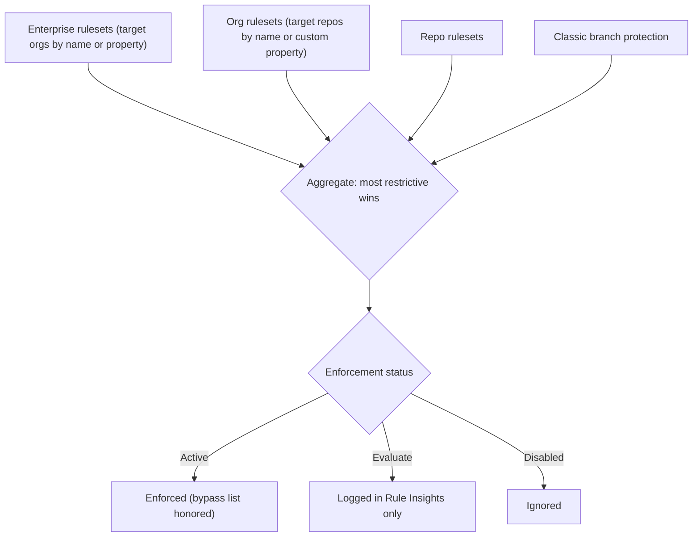
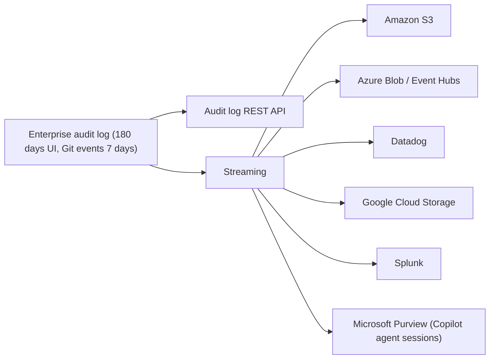

import { TLDR, DocsLinks, LastVerified, DecisionTree, CompareTable, FlashCards } from '@components';
import { Aside, Badge, Steps } from '@astrojs/starlight/components';

<LastVerified date="2026-10" />

<TLDR>
- **Rulesets beat branch protection at scale.** Define them at the **repo, org or enterprise** level, target repos with **custom properties**, roll out in **Evaluate** mode, and keep bypass lists small. When rulesets overlap they **aggregate**, and the most restrictive rule wins.
- **Push rulesets** block file paths, extensions, sizes and path lengths across the **whole fork network** (private and internal repos).
- **Least privilege:** use up to **20 custom org roles**, custom enterprise roles <Badge text="Preview" variant="caution" />, and enterprise teams.
- **Audit log:** 180 days in the UI (Git events: 7 days). **Stream** it to S3, Azure Blob, Event Hubs, Datadog, GCS, Splunk or Microsoft Purview.
- **Automation:** prefer **GitHub Apps** (short-lived installation tokens) over PATs. If you must use PATs, use **fine-grained** ones, with approval and maximum-lifetime policies.
</TLDR>

## Common booth questions

Rulesets or branch protection rules: which should we use?

For anything at scale, use **rulesets**. They can be defined once at the org or enterprise level and applied to many repos, they target repos dynamically by **custom property** or name pattern, they have **Evaluate** mode with Rule Insights, they support layered bypass lists, they cover tags and pushes, and they're readable by everyone with access. Both mechanisms **coexist and aggregate**, so you can migrate gradually. Prebuilt rulesets are in [`github/ruleset-recipes`](https://github.com/github/ruleset-recipes).

Two rulesets disagree: one needs 1 review, another needs 2. Which wins?

Rulesets have no priority. Rules from every applicable ruleset **and** from branch protection are aggregated, and the **most restrictive** version applies, so the answer is 2 reviews.

How do we roll out a new rule without breaking 2,000 repos?

Create it in **Evaluate** mode, watch **Rule Insights** for "would fail" events, fix the offenders or adjust the rule, then switch it to **Active**. Target a pilot set first with a custom property such as `tier = pilot`.

Can we stop people committing `.env` files or 500 MB binaries?

Yes, with **push rulesets** (private and internal repos). They block by file path, extension, path length or file size, and apply to every push including forks. Use **delegated bypass** if some pushes legitimately need an exception. Use **secret scanning push protection** for the secrets themselves.

Our audit team needs logs for 7 years.

The UI keeps **180 days** (and Git events for 7 days), so **stream** the log to your SIEM or storage. Supported targets are Amazon S3, Azure Blob Storage, Azure Event Hubs, Datadog, Google Cloud Storage, Splunk and Microsoft Purview (Copilot agent-session events only). If a stream is paused, GitHub buffers **7 days** of data. Streaming to **multiple endpoints** is <Badge text="Preview" variant="caution" />.

Our IP allow list broke GitHub Actions and integrations. Why?

The allow list also applies to **GitHub App tokens, including `GITHUB_TOKEN`**, so traffic from standard hosted runners and third-party Apps is blocked. Fixes:
- Enable the allow-list configuration for installed GitHub Apps, so their declared IPs are added.
- Use **larger runners with static IPs** or self-hosted runners.
- With **EMU + Entra ID OIDC**, use the IdP's Conditional Access instead of the GitHub allow list. Installation tokens aren't covered by CAP.

PAT or GitHub App for our automation?

Use a **GitHub App** for anything shared or long-lived. It isn't tied to a person, its installation tokens expire after an hour, its permissions are fine-grained per repo, and its rate limits scale. Use **fine-grained PATs** for personal scripts. Org owners can **require approval**, **restrict classic PATs** and set a **maximum lifetime** (the fine-grained default is 366 days; classic PATs have no expiry requirement).

Can a security lead read the audit log without being an owner?

Yes. Create a **custom org role** with the "View organization audit log" permission (up to 20 custom org roles per org). At the enterprise level, **custom enterprise roles** are in <Badge text="Preview" variant="caution" />.

## Rulesets

| Ruleset type | Targets | Typical rules |
|---|---|---|
| **Branch** | Branches by `fnmatch` pattern, default branch, all | Require PR + reviews, status checks (including Actions workflows), deployments, signed commits, linear history, merge queue, code scanning results, block force-push/deletion, commit metadata regex |
| **Tag** | Tags by pattern | Restrict create/update/delete, naming |
| **Push** | Every push to the repo **and its fork network** (private/internal) | Restrict file paths, extensions, max path length, max file size |

**Details worth knowing**
- Limits: up to **75 rulesets per repo** and **75 org-wide** rulesets.
- **Bypass list:** repo roles, teams, enterprise teams, GitHub Apps and deploy keys. Bypass can be "always" or "for pull requests only". **Delegated bypass** sends requests to approvers.
- **Enforcement statuses:** Active, **Evaluate** (not enforced, results in Rule Insights) and Disabled.
- **Enterprise rulesets** (Enterprise → Policies → Code) target **orgs** (all, a list, a name pattern, or **org custom properties**), then repos (all, a property, or a deployment context), then branches/tags.
- New rule <Badge text="Preview" variant="caution" />: **require an additional approval for unattributed Copilot PRs**.
- Rulesets are **not** migrated by GEI, so keep them as code (REST API, Terraform) and re-apply after migrations.

## Custom properties

- Structured metadata on **repos** (and **orgs** for enterprise targeting): for example `team`, `data-classification`, `tier` or `compliance=pci`.
- Use them to target **rulesets**, **security configurations** and Copilot or other policies dynamically. A new repo tagged `compliance=pci` picks up the right rules automatically.
- You can mark a property as **required** with a default value, so every repo gets classified.
- <Badge text="Preview" variant="caution" /> **External custom properties** sync values from an external system (such as a software catalog). <Badge text="Preview" variant="caution" /> **Copilot-suggested values** need Copilot Business or Enterprise.

## Repository and member policies (enterprise level)

Enterprise owners can **enforce** a policy or leave it to org owners ("No policy"). The common ones are:

| Area | Examples |
|---|---|
| Repository creation | Who can create public, private or internal repos |
| Visibility changes, deletion, transfer | Restrict to org owners |
| Forking | Allow or disallow forks of private/internal repos, and choose where forks can go |
| Base permissions | Default org member permission on repos (none, read, write, admin) |
| Actions | Allowed actions (GitHub-only, verified creators, allow-list, **SHA pinning required**), runner policies, fork PR workflow approvals |
| Copilot / AI | **AI controls** tab: features, models, agents, MCP |
| Code security | Security configurations, push protection defaults |

## Roles

| Role type | Scope | Notes |
|---|---|---|
| Predefined org roles | Org | Owner, member, moderator, billing manager, security manager, plus repo roles (read, triage, write, maintain, admin) |
| **Custom repository roles** | Org | Based on a repo role, with extra fine-grained permissions |
| **Custom organization roles** | Org | Up to **20** per org, for example "manage org webhooks" or "view audit log" |
| **Enterprise roles** | Enterprise | Owner, member, billing manager, and more. Assignable to **enterprise teams** |
| **Custom enterprise roles** <Badge text="Preview" variant="caution" /> | Enterprise | Delegate enterprise admin tasks without full ownership |

## Audit log and streaming

- **Health checks run every 24 hours.** Fix a misconfigured stream within **6 days** to avoid data loss.
- A **paused** stream buffers **7 days** of data. If it's paused for 3 weeks or more, it resets.
- Useful searches include `action:repo.destroy`, `action:copilot` (plan and settings events) and `actor:Copilot` (agent activity).
- <Badge text="Preview" variant="caution" /> **Multiple endpoints**, and streaming Copilot agent session activity to the same destination.

## IP allow lists

<Steps>

1. Define the allowed CIDRs at the **enterprise** level (they're inherited by orgs) or per org.
2. Enable the **IP allow list configuration for installed GitHub Apps**, so that the IPs Apps declare are added automatically.
3. Plan for **Actions**: use larger runners with **static IP ranges**, or self-hosted runners. Standard hosted runners won't match your list.
4. **EMU + Entra ID OIDC:** choose the GitHub allow list **or** the IdP's Conditional Access. Choosing the IdP turns off the GitHub allow list configs for all orgs.
5. Remember that the allow list **doesn't** restrict EMU provisioning (SCIM, SAML or OIDC).

</Steps>

## GitHub Apps vs personal access tokens

<CompareTable
	title="Automation identities"
	columns={[
		{ key: 'app', label: 'GitHub App' },
		{ key: 'fg', label: 'Fine-grained PAT' },
		{ key: 'classic', label: 'Classic PAT' },
	]}
	rows={[
		{ feature: 'Tied to a person', values: { app: false, fg: true, classic: true } },
		{ feature: 'Per-repo, per-permission scoping', values: { app: true, fg: true, classic: false } },
		{ feature: 'Short-lived tokens', values: { app: 'Installation token ≈ 1 hour', fg: 'Expiry required (org max lifetime policy)', classic: 'Optional expiry' } },
		{ feature: 'Org approval workflow', values: { app: 'Installation approval', fg: true, classic: false } },
		{ feature: 'Org can block entirely', values: { app: true, fg: true, classic: true } },
		{ feature: 'Survives employee leaving', values: { app: true, fg: false, classic: false } },
		{ feature: 'Recommended for', values: { app: 'CI/CD, bots, integrations', fg: 'Personal scripts', classic: 'Legacy only' } },
	]}
/>

<Aside type="tip" title="Talking point">
In Actions workflows, use `GITHUB_TOKEN` with explicit `permissions:` for in-repo work. For cross-repo work, mint a short-lived **GitHub App token** inside the workflow. For cloud access, use **OIDC**. None of these needs a PAT.
</Aside>

## GHES versions and upgrades

| | |
|---|---|
| **Latest** | **3.22** (GA 2026-09-08) — re-check the [release notes](https://docs.github.com/en/enterprise-server@latest/admin/release-notes) on the day |
| **Supported** | 3.22, 3.21, 3.20, 3.19. **3.18 closed down on 2026-10-16** |
| **Upgrade rule** | You can upgrade from a feature release **at most two releases behind** (for example 3.20 or 3.21 → 3.22). Use the Upgrade assistant to plan a path. |
| **Patches** | **Hotpatch** within a feature series. A feature upgrade needs a maintenance window. |
| **Before upgrading** | Capacity check (required), backup (backup-utils), VM snapshot, staging instance test. Let background jobs finish (`ghe-check-background-upgrade-jobs`). |
| **Copilot** | Not available on GHES. |

<DecisionTree
	title="Which control should I use?"
	tree={{
		start: 'q1',
		nodes: {
			q1: {
				question: 'What do you want to control?',
				options: [
					{ label: 'How code gets into branches / tags', next: 'rules' },
					{ label: 'Which files can be pushed at all', next: 'push' },
					{ label: 'Who can administer what', next: 'roles' },
					{ label: 'Where people connect from', next: 'ip' },
					{ label: 'What happened and who did it', next: 'audit' },
				],
			},
			rules: { answer: '**Branch/tag rulesets** at the org or enterprise level, targeted by custom properties, rolled out in **Evaluate** first.' },
			push: { answer: '**Push rulesets** (private/internal repos, entire fork network), plus **secret scanning push protection** for credentials.' },
			roles: { answer: '**Custom org roles** (up to 20), **custom repo roles**, **enterprise teams** and custom enterprise roles (Preview).' },
			ip: { answer: '**IP allow list**. With EMU + Entra ID OIDC you can use **Conditional Access** instead.' },
			audit: { answer: '**Audit log** (180 days) + **streaming** to your SIEM for long-term retention.' },
		},
	}}
/>

<FlashCards
	title="Governance quiz"
	cards={[
		{ q: 'Max rulesets per repo?', a: '**75** per repo, and 75 org-wide.' },
		{ q: 'Conflicting rulesets: which wins?', a: 'None has priority. Rules aggregate, and the **most restrictive** applies.' },
		{ q: 'Audit log UI retention?', a: '**180 days**; Git events **7 days**.' },
		{ q: 'Fine-grained PAT default max lifetime policy?', a: '**366 days**.' },
		{ q: 'Oldest GHES version you can upgrade directly to 3.22 from?', a: '**3.20** (at most two feature releases behind).' },
	]}
/>

<DocsLinks
	links={[
		{ label: 'About rulesets', href: 'https://docs.github.com/en/repositories/configuring-branches-and-merges-in-your-repository/managing-rulesets/about-rulesets' },
		{ label: 'Available rules for rulesets', href: 'https://docs.github.com/en/repositories/configuring-branches-and-merges-in-your-repository/managing-rulesets/available-rules-for-rulesets' },
		{ label: 'Enterprise code governance with rulesets', href: 'https://docs.github.com/en/enterprise-cloud@latest/admin/enforcing-policies/enforcing-policies-for-your-enterprise/enforcing-policies-for-code-governance' },
		{ label: 'Custom properties', href: 'https://docs.github.com/en/organizations/managing-organization-settings/managing-custom-properties-for-repositories-in-your-organization' },
		{ label: 'Custom organization roles', href: 'https://docs.github.com/en/organizations/managing-peoples-access-to-your-organization-with-roles/managing-custom-organization-roles' },
		{ label: 'Roles in an enterprise', href: 'https://docs.github.com/en/enterprise-cloud@latest/admin/concepts/enterprise-fundamentals/roles-in-an-enterprise' },
		{ label: 'Streaming the audit log', href: 'https://docs.github.com/en/enterprise-cloud@latest/admin/monitoring-activity-in-your-enterprise/reviewing-audit-logs-for-your-enterprise/streaming-the-audit-log-for-your-enterprise' },
		{ label: 'IP allow list', href: 'https://docs.github.com/en/enterprise-cloud@latest/admin/configuring-settings/hardening-security-for-your-enterprise/restricting-network-traffic-to-your-enterprise-with-an-ip-allow-list' },
		{ label: 'PAT policies for your organization', href: 'https://docs.github.com/en/organizations/managing-programmatic-access-to-your-organization/setting-a-personal-access-token-policy-for-your-organization' },
		{ label: 'GHES upgrade requirements', href: 'https://docs.github.com/en/enterprise-server@latest/admin/upgrading-your-instance/preparing-to-upgrade/upgrade-requirements' },
	]}
/>
