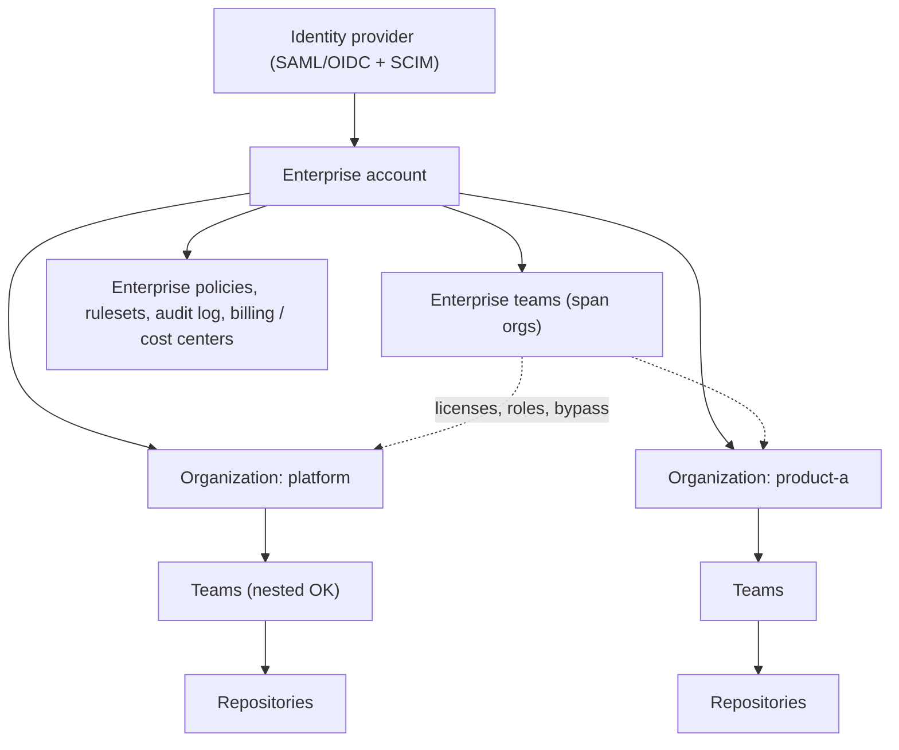

import { TLDR, DocsLinks, LastVerified, DecisionTree, CompareTable } from '@components';
import { Aside, Badge, LinkCard, CardGrid } from '@astrojs/starlight/components';

<LastVerified date="2026-10" />

<TLDR>
- **Hierarchy:** Enterprise → Organizations → Teams → Repositories. **Enterprise teams** span orgs and can receive Copilot licenses, enterprise roles and ruleset bypass.
- **Choose the enterprise type _before_ you create the account:** personal accounts (with SAML SSO) or **Enterprise Managed Users** (IdP-provisioned accounts with no public content). Switching later means migrating.
- **GHE.com data residency** (EU, Australia, US, Japan) always uses **EMU** and runs on your own `SUBDOMAIN.ghe.com`.
- **EMU partner IdPs:** Entra ID (SAML or OIDC), Okta and PingFederate (SAML), plus SCIM. The Okta + Entra ID mix is **not supported**.
- **GHES** is self-hosted. The latest is **3.22**; check the release notes on the day.
</TLDR>

## Common booth questions

Should we use Enterprise Managed Users?

Use it if you want the **IdP to be the source of truth** for accounts, usernames, org membership and access, and you don't need developers to contribute to public or outside repos from those accounts. Managed users **can't create public repos, gists or public Pages sites, or collaborate outside the enterprise**. GitHub itself says EMU isn't right for everyone. Run through the decision tree below.

We already have a GHEC enterprise with personal accounts. Can we flip it to EMU?

No. Adopting EMU requires a **new enterprise account** and a migration (GEI), so involve GitHub Sales. Plan identity first. See [Migration](/github-cheatsheet/migration/).

What's the difference between SAML SSO and SCIM here?

**SAML/OIDC** is about *authentication* (proving who you are). **SCIM** is about *provisioning* (creating and suspending accounts and syncing groups). With **EMU**, SCIM creates the GitHub accounts themselves. With **personal accounts**, users bring their own GitHub account, SAML links it to the IdP identity, and SCIM only provisions or deprovisions **org access**.

Can we use Entra ID Conditional Access with GitHub?

Yes, with **EMU + OIDC (Entra ID)**. GitHub validates your IdP's **Conditional Access Policy** for web sessions and user tokens. This doesn't apply to GitHub App **installation** tokens. You can then use the IdP's IP conditions **instead of** GitHub's IP allow list.

What's the difference between enterprise teams and org teams?

**Enterprise teams** span orgs (up to 2,500 teams, 5,000 users per team, assignable to up to 1,000 orgs). They can receive Copilot licenses, enterprise or custom roles, and ruleset bypass, and they can be @-mentioned (`@/ent:team`). They **can't** be CODEOWNERS, be nested or secret, or have team maintainers. Use org teams for those cases.

Is GHE.com the same as GitHub.com?

It's GitHub Enterprise Cloud hosted in your chosen region on a dedicated subdomain, **always with EMU**. You get cloud features (including Copilot) without managing GHES upgrades. A few features may differ by region or rollout, so check "feature availability" in the docs for the specific feature before promising it.

## Enterprise account structure

| Level | Typical owner | What you manage there |
|---|---|---|
| **Enterprise** | Enterprise owners | Identity (SSO/SCIM/EMU), policies, enterprise rulesets, Copilot and AI controls, billing, cost centers, audit log streaming, enterprise roles |
| **Organization** | Org owners | Org rulesets, custom properties, custom org roles, security configurations, runners, secrets |
| **Team** | Team maintainers | Membership (or IdP group sync), repo access |
| **Repository** | Repo admins | Repo rulesets, environments, branch protection, settings |

<Aside type="tip" title="Talking point: how many orgs?">
Fewer orgs is usually better. Use orgs as **administrative or security boundaries** (different policies, owners or compliance needs), not to mirror the org chart. Use **custom properties** and teams for the rest.
</Aside>

## Enterprise types compared

<CompareTable
	title="Enterprise deployment options"
	columns={[
		{ key: 'personal', label: 'GHEC (personal accounts)' },
		{ key: 'emu', label: 'GHEC with EMU' },
		{ key: 'dr', label: 'GHE.com (data residency)' },
		{ key: 'ghes', label: 'GHES (self-hosted)' },
	]}
	rows={[
		{ feature: 'Hosted by GitHub', category: 'Hosting', values: { personal: true, emu: true, dr: true, ghes: false } },
		{ feature: 'Choose data region', category: 'Hosting', values: { personal: false, emu: false, dr: 'EU, Australia, US, Japan', ghes: 'Wherever you host it' } },
		{ feature: 'URL', category: 'Hosting', values: { personal: 'github.com', emu: 'github.com', dr: '`SUBDOMAIN.ghe.com`', ghes: 'Your hostname' } },
		{ feature: 'Accounts created by IdP (SCIM)', category: 'Identity', values: { personal: false, emu: true, dr: true, ghes: 'Optional (SCIM on GHES)' } },
		{ feature: 'Users bring their own GitHub account', category: 'Identity', values: { personal: true, emu: false, dr: false, ghes: false } },
		{ feature: 'SSO', category: 'Identity', values: { personal: 'SAML (any SAML 2.0 IdP)', emu: 'SAML or OIDC (Entra ID)', dr: 'SAML or OIDC (Entra ID)', ghes: 'SAML, LDAP, CAS, built-in' } },
		{ feature: 'Public repos / outside collaboration', category: 'Collaboration', values: { personal: true, emu: false, dr: false, ghes: 'Within the instance' } },
		{ feature: 'GitHub Copilot', category: 'Features', values: { personal: true, emu: true, dr: true, ghes: false } },
		{ feature: 'You run upgrades / backups', category: 'Operations', values: { personal: false, emu: false, dr: false, ghes: true } },
		{ feature: 'Latest features without waiting for a release', category: 'Operations', values: { personal: true, emu: true, dr: 'Yes (check per-feature availability)', ghes: false } },
	]}
/>

## Which enterprise type?

<DecisionTree
	title="Which enterprise type?"
	tree={{
		start: 'q1',
		nodes: {
			q1: {
				question: 'Must code and data **stay in a specific region**, or must it run in **your own data center / air-gapped**?',
				options: [
					{ label: 'Specific region (EU, AU, US, JP)', next: 'dr' },
					{ label: 'Own data center / air-gapped', next: 'ghes' },
					{ label: 'Neither', next: 'q2' },
				],
			},
			q2: {
				question: 'Do you want the **IdP to create and own** every account (usernames, profile, lifecycle)?',
				options: [
					{ label: 'Yes', next: 'q3' },
					{ label: 'No / not sure', next: 'q4' },
				],
			},
			q3: {
				question: 'Do developers need to contribute to **public or outside** repositories from their work accounts?',
				help: 'Managed users can only contribute inside the enterprise. Outside work needs a separate personal account.',
				options: [
					{ label: 'Yes, regularly', next: 'personal' },
					{ label: 'No', next: 'emu' },
				],
			},
			q4: {
				question: 'Do you have an established IdP onboarding/offboarding process (SCIM-capable)?',
				options: [
					{ label: 'Yes', next: 'q3' },
					{ label: 'No', next: 'personal' },
				],
			},
			dr: {
				answer: '**GHE.com with data residency**, which always uses **EMU**.',
				links: [{ label: 'About data residency', href: 'https://docs.github.com/en/enterprise-cloud@latest/admin/data-residency/about-github-enterprise-cloud-with-data-residency' }],
			},
			ghes: {
				answer: '**GitHub Enterprise Server**. Remember that Copilot is not available on GHES, and you own the upgrades.',
				links: [{ label: 'GHES releases', href: 'https://docs.github.com/en/enterprise-server@latest/admin/all-releases' }],
			},
			emu: {
				answer: '**GHEC with Enterprise Managed Users**. Use a single partner IdP (Entra ID, Okta, PingFederate) for both auth and SCIM.',
				links: [{ label: 'About EMU', href: 'https://docs.github.com/en/enterprise-cloud@latest/admin/concepts/identity-and-access-management/enterprise-managed-users' }],
			},
			personal: {
				answer: '**GHEC with personal accounts** + enterprise-level **SAML SSO**. Optionally add SCIM for org access and team sync.',
				links: [{ label: 'Choosing an enterprise type', href: 'https://docs.github.com/en/enterprise-cloud@latest/admin/concepts/enterprise-fundamentals/choose-an-enterprise-type' }],
			},
		},
	}}
/>

## SSO, SCIM and IdP support

| | Personal-account enterprise | Enterprise Managed Users |
|---|---|---|
| **Authentication** | SAML 2.0 (any compliant IdP; some officially tested), configured at the enterprise or org level | SAML, or **OIDC (Entra ID)**, enforced for every user |
| **Provisioning** | SCIM manages **org access** only; users keep their own accounts | SCIM **creates, updates and suspends accounts**, and IdP groups map to teams |
| **Partner IdPs** | — | **Entra ID** (SAML + OIDC), **Okta** (SAML), **PingFederate** (SAML) |
| **Other IdPs** | Any SAML 2.0 | Allowed if SCIM 2.0 compliant, but GitHub support may be limited for mixed or untested setups |
| **Conditional Access** | — | IdP CAP is validated with OIDC (Entra ID) |

<Aside type="caution" title="Gotchas">
- **Okta + Entra ID** combined for SSO and SCIM, in either order, is explicitly **not supported**.
- Prefer **one partner IdP for both** authentication and provisioning to get full GitHub support.
- With EMU, keep a **break-glass setup user** (the `_admin` account) and its recovery codes safe.
</Aside>

## Pages in this section

<CardGrid>
	<LinkCard title="Governance & policies" description="Rulesets, custom properties, roles, audit log streaming, IP allow lists, Apps vs PATs, GHES versions." href="/github-cheatsheet/administration/governance/" />
	<LinkCard title="Migration" description="Moving into your new enterprise." href="/github-cheatsheet/migration/" />
</CardGrid>

<DocsLinks
	links={[
		{ label: 'Choosing an enterprise type', href: 'https://docs.github.com/en/enterprise-cloud@latest/admin/concepts/enterprise-fundamentals/choose-an-enterprise-type' },
		{ label: 'About Enterprise Managed Users', href: 'https://docs.github.com/en/enterprise-cloud@latest/admin/concepts/identity-and-access-management/enterprise-managed-users' },
		{ label: 'GHE.com data residency', href: 'https://docs.github.com/en/enterprise-cloud@latest/admin/data-residency/about-github-enterprise-cloud-with-data-residency' },
		{ label: 'Teams in an enterprise', href: 'https://docs.github.com/en/enterprise-cloud@latest/admin/concepts/enterprise-fundamentals/teams-in-an-enterprise' },
		{ label: 'Configuring SAML SSO for your enterprise', href: 'https://docs.github.com/en/enterprise-cloud@latest/admin/managing-iam/using-saml-for-enterprise-iam/configuring-saml-single-sign-on-for-your-enterprise' },
		{ label: 'Abilities and restrictions of managed users', href: 'https://docs.github.com/en/enterprise-cloud@latest/admin/managing-iam/understanding-iam-for-enterprises/abilities-and-restrictions-of-managed-user-accounts' },
	]}
/>
