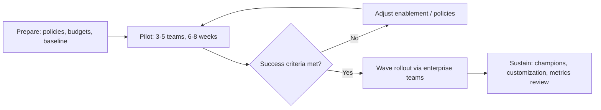
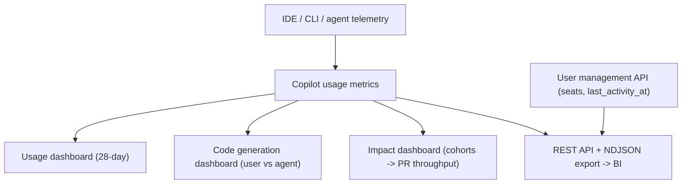

import { TLDR, DocsLinks, LastVerified, DecisionTree, FlashCards } from '@components';
import { Aside, Badge, Steps } from '@astrojs/starlight/components';

<LastVerified date="2026-10" />

<TLDR>
- **Pilot:** about 6–8 weeks with mixed-seniority volunteer teams. Capture a baseline first, combine telemetry with surveys, and set success criteria up front.
- **Enable, don't just license.** Run hands-on sessions, publish a prompt and instructions library, appoint champions, and set up an internal channel. Unused seats are the #1 failure mode.
- **Measure** with the **Copilot usage metrics** dashboards (usage, code generation, **impact** cohorts → PR throughput), the REST API and the NDJSON export. The "Copilot usage metrics" policy must be **enabled**.
- **Decide the policies before go-live:** features and models (AI controls), public code matching, content exclusion, MCP, cloud agent, budgets, session data and audit log streaming.
- **Billing changed on June 1, 2026.** Usage now runs on **GitHub AI Credits**, so set budgets and cost centers early.
</TLDR>

## Common booth questions

How big should our pilot be, and how long?

There is no official number. A practical pattern is **50–200 developers across 3–5 teams** with different languages and seniority, running for **6–8 weeks**: 2 weeks to onboard, then 4–6 weeks of steady use. Make it big enough to cover your main stacks and IDEs, and long enough to get past the novelty curve.

What should we measure to prove value?

Track three layers:
1. **Adoption**: daily/weekly active users, and engagement by feature (completions, chat, agent mode, CLI, code review).
2. **Output**: lines changed with AI by user vs agent (code generation dashboard), and **PR throughput and time to merge** by adoption cohort (impact dashboard).
3. **Experience**: survey satisfaction, flow and perceived time saved.

Baseline before the pilot. Treat single numbers such as acceptance rate as signals, not as ROI.

Why do our numbers differ between the dashboard and the API?

The surfaces are designed for different purposes. Most metrics come from **client-side IDE telemetry**, so users need telemetry enabled, and proxies can drop it. Server-side telemetry backfills **active-user** counts but not feature or LOC breakdowns. Copilot Chat on GitHub.com and Mobile aren't included. Seat data comes from the **user management API**, not from the usage metrics. GitHub publishes a "reconciling metrics" guide.

How far back can we report?

The usage metrics API reports go back to **October 10, 2025**, with up to **1 year** of history. Organization-level reports are available from **December 12, 2025**. Dashboards show **28-day** trends. For longer retention, export the data to your BI tool.

Usage shows up in multiple orgs. Is that double counting?

Org-level metrics follow **org membership**, not where the seat is assigned. A user's usage appears in **every org they belong to**, but only once at the enterprise level, and only if they hold a seat inside that enterprise.

Can a BU lead see only their org's metrics?

Yes. Create a **custom organization role** with the "View organization Copilot metrics" permission. No enterprise-level access is needed.

Legal asks: will our code train models?

For **Business/Enterprise** (GitHub Generative AI Services Terms), GitHub does not use your Inputs/Outputs to train models unless you instruct it to, and you keep ownership of your Inputs. Enable **public code matching** controls (block, or allow with code references). For indemnity language, point legal to the Customer Agreement or Trust Center; don't paraphrase it at the booth.

## Rollout timeline

## Pilot design

| Element | Recommendation |
|---|---|
| **Cohort** | Volunteers plus a few skeptics. Mix of stacks, IDEs and seniority. Include a team that does code review heavily. |
| **Baseline** | 4+ weeks of PR throughput, time to merge and DORA metrics before seats are assigned. Run a short survey. |
| **Comparison** | Compare against non-pilot teams with similar work, or compare the cohort with itself before and after. Use the **impact dashboard** cohorts. |
| **Success criteria** | For example: ≥X% weekly active users, positive survey delta, and no increase in change failure rate. Agree on these with sponsors **in advance**. |
| **Licensing** | Assign seats through an **enterprise team** or an org team, so expanding later is just a membership change. |
| **Feedback loop** | A weekly 15-minute champion sync and a channel for prompts that worked or failed. |

## Enablement content that works

- **Kickoff (60–90 min, hands-on):** completions → chat → agent mode / plan mode → Copilot code review → CLI, all run on *your* codebase.
- **Repository custom instructions** (`.github/copilot-instructions.md`), plus **org custom instructions** for coding standards and security guidelines.
- **Prompt files and custom agents** in a shared repo, so the "how we write tests here" prompts are reusable.
- **Role-based tracks:** frontend, backend, data, SRE (the CLI and cloud agent for toil), and reviewers (Copilot code review).
- **Office hours and "show & tell"** run by champions. Recognize good use cases publicly.
- **Guardrails:** humans still own the code, so review AI-generated changes as you would any other change, and run CodeQL and secret scanning on them.

## Measuring impact

| Need | Use |
|---|---|
| Exec trend view | Usage metrics dashboard (enterprise **Insights** tab) |
| AI vs agent share of code | Code generation dashboard |
| Adoption depth → PR outcomes | **Copilot impact** dashboard (adoption cohorts) |
| Custom BI / long retention | REST `/enterprises/{enterprise}/copilot/metrics/reports/...` (`enterprise-1-day`, `enterprise-28-day/latest`) and the NDJSON export |
| Reclaiming idle seats | User management API `last_activity_at` |

<Aside type="caution">
API reports need the **"Copilot usage metrics"** policy enabled and tokens with `manage_billing:copilot` or `read:enterprise`. Prefer the **usage metrics API** for new integrations; GitHub recommends it as the most complete source.
</Aside>

## Change management

- **Executive sponsor + clear "why".** Frame it as removing toil, not as headcount.
- **Address fears directly:** job security, code quality ("you still own it") and IP (the Business/Enterprise terms).
- **Make it the default.** Pre-install it in dev containers and Codespaces, include custom instructions in templates, and enable Copilot code review on golden-path repos.
- **Close the loop.** Publish monthly metrics plus stories, and reallocate idle seats.

## Policy decisions checklist

<Steps>

1. **Plan and licensing:** Copilot Business vs Enterprise (Copilot is **GHEC-only**; there's no Copilot on GHES). Decide how seats are assigned: enterprise teams, org teams, or direct enterprise assignment.
2. **Billing guardrails:** set user-level budgets (universal, cost-center or individual), cost-center budgets, and the "AI credits paid usage" policy. Note: **there's no automatic fallback** to cheaper models when a budget runs out.
3. **Features and models:** configure these in the **AI controls** tab. For each one, choose to enable, disable, or *let organizations decide*. Decide whether new features and models follow "default availability" or require explicit opt-in.
4. **Agents:** decide on the Copilot cloud agent (which orgs), third-party agents <Badge text="Preview" variant="caution" />, and Copilot code review (including automatic review).
5. **MCP:** decide on the MCP allowlist (GA), or a custom MCP registry <Badge text="Preview" variant="caution" />.
6. **Public code matching:** block, or allow with code references.
7. **Content exclusion:** choose which paths to exclude. ⚠ It is **not** honored by Copilot CLI or IDE agent mode, so don't rely on it as a secrets control.
8. **Data:** set the "Store local sessions in the Cloud" policy, and decide who can see cloud agent session logs.
9. **Audit:** use `action:copilot` and `actor:Copilot` in the audit log, which is retained for **180 days**. Stream it to your SIEM for longer retention.
10. **Customization:** set org custom instructions, org/enterprise custom agents, and a shared prompt library repo.

</Steps>

<DecisionTree
	title="Business or Enterprise?"
	tree={{
		start: 'q1',
		nodes: {
			q1: {
				question: 'Are you on **GitHub Enterprise Cloud**?',
				options: [
					{ label: 'Yes', next: 'q2' },
					{ label: 'No — GHES only', next: 'ghes' },
					{ label: 'No — GitHub Team / Free org', next: 'biz' },
				],
			},
			q2: {
				question: 'Do heavy users need a **larger monthly AI-credit allowance per seat** or priority access to premium models?',
				options: [
					{ label: 'Yes, for many users', next: 'ent' },
					{ label: 'Not broadly', next: 'mix' },
				],
			},
			ghes: { answer: 'Docs state Copilot is **not currently available for GitHub Enterprise Server**. Licensing goes through a GitHub Enterprise Cloud account, so discuss GHEC or GHE.com options with the account team.' },
			biz: { answer: '**Copilot Business** (Copilot Enterprise requires GitHub Enterprise Cloud).' },
			ent: { answer: '**Copilot Enterprise** for those users. Compare plans on the docs page before quoting.', links: [{ label: 'Copilot plans', href: 'https://docs.github.com/en/copilot/get-started/plans' }] },
			mix: { answer: 'Start with **Copilot Business** broadly and use budgets for heavy users. If you need to mix plans across orgs, check the current plan-assignment options before quoting.', links: [{ label: 'Copilot plans', href: 'https://docs.github.com/en/copilot/get-started/plans' }] },
		},
	}}
/>

<FlashCards
	title="Copilot rollout quiz"
	cards={[
		{ q: 'Which policy must be on for usage metrics?', a: 'The **"Copilot usage metrics"** policy.' },
		{ q: 'Which dashboard ties adoption to PR throughput?', a: 'The **Copilot impact** dashboard (adoption cohorts).' },
		{ q: 'Source of truth for seats?', a: 'The **Copilot user management API** (`last_activity_at`).' },
		{ q: 'Does content exclusion apply to Copilot CLI?', a: '**No**, and not to IDE agent mode either.' },
		{ q: 'Copilot audit log retention?', a: '**180 days**. Stream it to a SIEM for longer.' },
	]}
/>

<DocsLinks
	links={[
		{ label: 'Rolling out Copilot at scale', href: 'https://docs.github.com/en/copilot/tutorials/roll-out-at-scale' },
		{ label: 'Measuring the success of a Copilot trial', href: 'https://docs.github.com/en/copilot/tutorials/roll-out-at-scale/measure-success' },
		{ label: 'Copilot usage metrics (concepts)', href: 'https://docs.github.com/en/copilot/concepts/copilot-usage-metrics/copilot-metrics' },
		{ label: 'Copilot impact dashboard', href: 'https://docs.github.com/en/copilot/how-tos/administer-copilot/view-impact-dashboard' },
		{ label: 'REST: Copilot usage metrics', href: 'https://docs.github.com/en/rest/copilot/copilot-usage-metrics' },
		{ label: 'Manage enterprise Copilot policies', href: 'https://docs.github.com/en/copilot/how-tos/administer-copilot/manage-for-enterprise/manage-enterprise-policies' },
		{ label: 'Copilot budgets', href: 'https://docs.github.com/en/copilot/concepts/billing-and-usage/organizations-and-enterprises/budgets' },
		{ label: 'Resources for approval (legal/compliance)', href: 'https://docs.github.com/en/copilot/tutorials/roll-out-at-scale/govern-at-scale/resources-for-approval' },
	]}
/>
