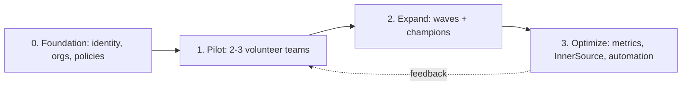

import { TLDR, DocsLinks, LastVerified, FlashCards } from '@components';
import { Aside, LinkCard, CardGrid } from '@astrojs/starlight/components';

<LastVerified date="2026-10" />

<TLDR>
- Adoption is a **change program**, not a license purchase. Run it as **Foundation → Pilot → Expand → Optimize**, with exit criteria for each phase.
- **Champions** (one per team or ~business unit) scale enablement better than central training alone.
- **InnerSource** (default `internal` visibility, CONTRIBUTING.md, CODEOWNERS, good-first-issues) turns GitHub into a collaboration platform rather than just a Git host.
- **Measure outcomes**, not activity. Use **DORA** for delivery and **SPACE** for developer experience, plus **Copilot usage metrics** (dashboards and API) for AI adoption.
</TLDR>

## Common booth questions

Where do we start? We have 3,000 developers.

Start with a **foundation** that is identity (EMU or SSO), org structure, base rulesets and security configurations. Then **pilot with 2–3 volunteer teams** that have different stacks, and then expand in **waves** led by champions. Write exit criteria for each phase, for example "pilot teams ship to prod from GitHub Actions, and 80% of their repos have the default security configuration applied".

How do we show leadership that this is working?

Pick 3–5 metrics **before** you start and baseline them:
- **DORA**: deployment frequency, lead time for changes, change failure rate and time to restore.
- PR cycle time.
- Security MTTR (from security overview).
- Copilot active users and engagement (from the Copilot usage metrics dashboard or API).

Report trends, not single snapshots. See [Copilot rollout](/github-cheatsheet/adoption/copilot-rollout/) for the AI-specific measures.

What does a champions program look like in practice?

Champions are volunteers with protected time (for example ~10%). They get early access, a private channel and a monthly sync with the platform team, and they run local demos and office hours. Recognize them publicly. Champions also bring back the friction you'd never see otherwise.

How do we get teams to reuse each other's code (InnerSource)?

- Make **`internal`** the default repo visibility for enterprise-wide discovery.
- Require a README, CONTRIBUTING.md and CODEOWNERS (through templates or rulesets).
- Label `good first issue`.
- Publish shared libraries and reusable workflows.
- Use **custom properties** to tag ownership and lifecycle so repos are discoverable and governable.

Developers resist "another tool". What works?

Remove old paths deliberately: set a read-only date for the legacy SCM and CI. Make the new path the easiest one, with templates, starter workflows and golden-path repos. Show quick wins such as Copilot, Codespaces for onboarding and auto-merge.

Security wants to block everything until it's reviewed. How do we unblock?

Bring security in on day one. Rulesets in **Evaluate** mode show the impact before you enforce, security configurations apply GHAS settings at scale, and audit log streaming to their SIEM gives them visibility. Security becomes a co-owner instead of a gate. See [Administration](/github-cheatsheet/administration/).

## Rollout phases

| Phase | Goals | Exit criteria (examples) |
|---|---|---|
| **0 Foundation** | Enterprise type (EMU vs personal), SSO/SCIM, org design, base rulesets, security configurations, audit log streaming | IdP-provisioned users can sign in; policies are enforced at enterprise or org level |
| **1 Pilot** | Migrate 2–3 diverse teams (repos + CI), gather friction, build templates | Pilot teams deploy from Actions; baselines captured |
| **2 Expand** | Migration waves, champion network, self-service onboarding (IssueOps, templates) | % of repos migrated, % of teams with a champion, legacy read-only dates set |
| **3 Optimize** | InnerSource, reusable workflows, Copilot customization, cost controls | DORA/SPACE trends improving; legacy decommissioned |

## Onboarding kit (what to hand every new team)

- **Golden-path template repos**: README, CONTRIBUTING, CODEOWNERS, Dependabot config and a starter workflow.
- **Org-level reusable workflows** for build, test and deploy, plus rulesets that require their checks.
- **Codespaces/dev container** definitions so the first commit happens on day one.
- **Copilot**: enable it for the team, share the custom-instructions template, and send a link to the internal prompt library.
- A **"how we work"** page covering branching model, PR size, review SLAs and the security alert triage flow.

## Measuring adoption and impact

| Lens | What it tells you | Where the data comes from |
|---|---|---|
| **DORA** | Delivery throughput and stability | Deployments API/environments, PR and incident data, your observability tools |
| **SPACE** | Satisfaction, Performance, Activity, Communication, Efficiency | Developer surveys + system data. Never use a single metric alone. |
| **Copilot usage metrics** | Active users, engagement by feature/IDE/model, lines of code, PR throughput by adoption cohort | Copilot usage metrics dashboards, code generation and impact dashboards, REST API, NDJSON export |
| **Security posture** | Alert backlog, MTTR, coverage | Security overview |
| **Platform health** | Actions minutes, queue time, cost by cost center | Billing usage reports, Actions metrics |

<Aside type="caution" title="Talking point: don't weaponize metrics">
Measure **teams and trends**, not individuals. Activity metrics (commits, lines of code) are easy to game. Pair them with outcome metrics (lead time, change failure rate) and with developer-satisfaction surveys.
</Aside>

## Common blockers and answers

| Blocker | Answer |
|---|---|
| "Our data can't leave our region." | **GHE.com data residency** (EU, Australia, US, Japan); see [Administration](/github-cheatsheet/administration/). |
| "We need full control of identities." | **Enterprise Managed Users**, with IdP-provisioned accounts that can't create public content. |
| "We can't migrate history." | GEI migrates history and PRs from GHES, ADO, Bitbucket Server and GitLab; see [Migration](/github-cheatsheet/migration/). |
| "Legal is worried about AI code." | Business/Enterprise terms: no training on your Inputs/Outputs, plus public code matching filters; see [Copilot rollout](/github-cheatsheet/adoption/copilot-rollout/). |
| "Costs will explode." | Budgets and alerts, cost centers, and user-level AI credit budgets. |
| "Teams won't change." | Champions, golden paths and published legacy read-only dates. |

<CardGrid>
	<LinkCard title="Copilot rollout" description="Pilot design, enablement, measuring impact, policy checklist." href="/github-cheatsheet/adoption/copilot-rollout/" />
	<LinkCard title="Migration" description="Choose the right tool and run a migration program." href="/github-cheatsheet/migration/" />
	<LinkCard title="Administration" description="Enterprise structure, EMU, data residency, governance." href="/github-cheatsheet/administration/" />
</CardGrid>

<FlashCards
	title="Adoption quick quiz"
	cards={[
		{ q: 'Name the 4 DORA metrics.', a: 'Deployment frequency, lead time for changes, change failure rate, time to restore service.' },
		{ q: 'What does SPACE stand for?', a: 'Satisfaction & well-being, Performance, Activity, Communication & collaboration, Efficiency & flow.' },
		{ q: 'Best default visibility for InnerSource?', a: '`internal`: visible to all enterprise members.' },
	]}
/>

<DocsLinks
	links={[
		{ label: 'Rolling out GitHub Copilot at scale', href: 'https://docs.github.com/en/copilot/tutorials/roll-out-at-scale' },
		{ label: 'GitHub Copilot usage metrics', href: 'https://docs.github.com/en/copilot/concepts/copilot-usage-metrics/copilot-metrics' },
		{ label: 'About repository visibility (internal)', href: 'https://docs.github.com/en/repositories/creating-and-managing-repositories/about-repositories#about-internal-repositories' },
		{ label: 'Choosing an enterprise type', href: 'https://docs.github.com/en/enterprise-cloud@latest/admin/concepts/enterprise-fundamentals/choose-an-enterprise-type' },
		{ label: 'About security overview', href: 'https://docs.github.com/en/code-security/security-overview/about-security-overview' },
	]}
/>
