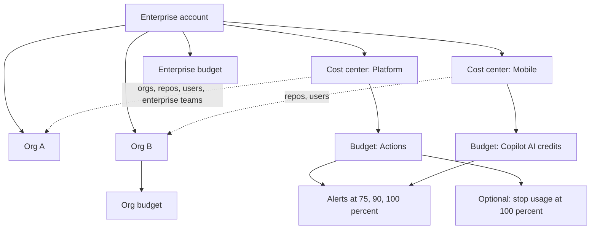

import { TLDR, DocsLinks, LastVerified, DecisionTree, FlashCards } from '@components';
import { Aside, LinkCard, CardGrid } from '@astrojs/starlight/components';

<LastVerified date="2026-10" />

<TLDR>
- One **billing platform** covers both **licenses** (GHE/Team seats, Copilot seats, GHAS active committers) and **metered usage** (Actions, Packages, Codespaces, Git LFS, Copilot AI credits).
- **Cost centers** split spend by business unit. **Budgets** alert at 75%, 90% and 100%, and can **stop** metered usage.
- **Usage-based GHE licensing:** you pay monthly for every unique user who held a license during the cycle, instead of a prepaid seat count.
- **Azure subscription:** metered charges can go on your Azure bill. If you bought GHEC through a Microsoft EA, this is required to buy GHAS, Codespaces or Copilot.
- **Get the facts from the usage report** (CSV export in the UI, or REST `…/settings/billing/usage`).
</TLDR>

## Common booth questions

<details>
<summary>Who consumes a GitHub Enterprise Cloud seat?</summary>

**These consume a seat:**

- Org members and owners
- Enterprise owners who belong to at least one org
- Outside collaborators on **private or internal** repos (forks excluded). Each person counts once.
- Dormant users who are still members

**These do not:**

- Billing managers
- Enterprise owners who are not in any org
- The EMU setup user
- Suspended managed users
- Outside collaborators on public repos
- Guest collaborators who are not org members or repo collaborators
- Unaffiliated users
- Failed invitations

**Usage-based billing:** anyone who held a license **at any point** in the cycle is billable for that cycle. Pending invitations do **not** count.

**Without EMU or usage-based billing:** pending org and collaborator invitations **do** consume seats.

</details>

<details>
<summary>What is a GHAS "active committer"?</summary>

A unique user who **pushed a commit in the last 90 days** to a repo with **Secret Protection** or **Code Security** enabled.

- Each SKU is counted separately.
- GitHub App bots are excluded.
- For repos migrated with GEI, only commits after the migration count.
- Public repos get code scanning, secret scanning and dependency review for free.
- AI features (AI Scan, agentic autofix) bill under the separate **Code Security AI Credits** SKU.

</details>

<details>
<summary>Can a budget actually stop spending, or only alert?</summary>

- **Metered products** (Actions, Copilot AI credits, Codespaces, cloud sandboxes and so on): the budget can **stop usage**.
- **License-based products** (Copilot seats, GitHub Team/Enterprise seats): the budget **only alerts**. The exception is the **GHAS SKUs**, which support a **hard budget**.
- **Copilot user-level budget of $0:** stops that user immediately.

</details>

<details>
<summary>Our Copilot AI credits ran out. Does Copilot fall back to a cheaper model?</summary>

**No.** The docs say: *"no automatic fallback to lower-cost models when a budget is exhausted."*

For orgs and enterprises, paid overage is **on by default** unless an admin disables the "AI credits paid usage" policy. To cap spend, use cost-center **included-usage** controls and user-level budgets. See [Copilot](/github-cheatsheet/copilot/) for allowances.

</details>

<details>
<summary>Can we pay GitHub through Azure?</summary>

Yes. Connect an **Azure subscription ID** to the org or enterprise under *Billing & licensing → Payment information → Metered billing via Azure*.

- **Permissions:** you need to be a GitHub owner **and** an owner of the Azure subscription, plus tenant-wide admin consent for GitHub's SPV app.
- **Billing dates:** Azure bills metered usage on the **1st of each month**. Plan charges stay on your usual GitHub billing date.
- **Limitation:** prepaid usage is not available through Azure.

</details>

<details>
<summary>We run both GHES and GHEC. Do we pay twice for the same person?</summary>

**No, if you sync license usage between the two environments.**

- **De-duplication:** users who already consume a GHEC license are not counted again on GHES.
- **Who counts on GHES:** active authenticated users and dormant users.
- **Freeing seats:** suspended users don't consume a license, so suspend dormant users.
- **Cost of combining:** GHES can be combined with a GHEC enterprise account at no additional cost.

</details>

<details>
<summary>How do I chargeback Actions or Copilot spend to teams?</summary>

Create **cost centers** and assign orgs, repos, users or **enterprise teams** to them. Enterprise team membership auto-syncs.

How each product type is attributed:

- **Usage-based** (e.g. Actions): by **repo or org**.
- **License-based** (e.g. Copilot seats): by **user**.
- **AI-credit products** (e.g. cloud agent): by **user** or by the **granting org**.

Limits: **1,000** active cost centers per enterprise, and **25,000** resources per cost center.

</details>

## Why did my bill go up?

<DecisionTree
	title="Why did my bill go up?"
	tree={{
		start: 'q1',
		nodes: {
			q1: {
				question: 'Open the **usage report** (Billing & licensing → Usage). Which line grew?',
				help: 'Group by product/SKU, then by org or repo.',
				options: [
					{ label: 'Copilot', next: 'cop' },
					{ label: 'GitHub Actions', next: 'act' },
					{ label: 'GitHub Enterprise seats', next: 'ghe' },
					{ label: 'GHAS (Secret Protection / Code Security)', next: 'ghas' },
					{ label: 'Codespaces', next: 'cs' },
					{ label: 'Packages / storage', next: 'pkg' },
				],
			},
			cop: {
				question: 'Is it **seats** or **AI credits** (usage)?',
				options: [
					{ label: 'Seats', next: 'copSeats' },
					{ label: 'AI credits / overage', next: 'copCredits' },
				],
			},
			copSeats: {
				answer: 'Copilot Business/Enterprise is billed **per granted seat**. Look for new grants, such as teams or enterprise teams assigned seats. Reclaim seats from inactive users using the seat-activity data.',
				links: [{ label: 'Copilot billing for organizations', href: 'https://docs.github.com/en/copilot/concepts/billing-and-usage/organizations-and-enterprises/billing' }],
			},
			copCredits: {
				answer: 'Usage went past the **pooled AI-credit allowance**, and paid overage is **on by default**. Premium models and agentic sessions (cloud agent, CLI, third-party agents) consume more credits. To cap spend, add **user-level budgets**, use **cost-center included-usage** controls, or disable the "AI credits paid usage" policy. Copilot does not fall back to a cheaper model on its own.',
				links: [{ label: 'Copilot budgets', href: 'https://docs.github.com/en/copilot/concepts/billing-and-usage/organizations-and-enterprises/budgets' }],
			},
			act: {
				question: 'Is the growth in **private-repo minutes** on pricier runners (larger, macOS, Windows, GPU)?',
				options: [
					{ label: 'Yes, pricier runner types', next: 'actRunners' },
					{ label: 'No, plain Linux minutes grew', next: 'actVolume' },
					{ label: 'It is storage, not minutes', next: 'actStorage' },
				],
			},
			actRunners: {
				answer: 'Each runner type has **its own per-minute SKU**. Check `runs-on` labels, matrix fan-out and `timeout-minutes`. Public repos on standard runners are free.',
				links: [{ label: 'Actions runner pricing', href: 'https://docs.github.com/en/billing/reference/actions-runner-pricing' }],
			},
			actVolume: {
				answer: 'Look for new workflows, schedules, or missing `concurrency` cancellation. Also check **Copilot code review**: on private repos, each review consumes Actions minutes on top of AI credits. Minutes are charged to the **repo owner**, not to whoever triggered the run.',
				links: [{ label: 'GitHub Actions billing', href: 'https://docs.github.com/en/billing/concepts/product-billing/github-actions' }],
			},
			actStorage: {
				answer: 'Artifact storage accrues **hourly** and is **shared with Packages**. Shorten artifact retention and delete old artifacts. Cache storage is a separate per-repo allowance.',
				links: [{ label: 'GitHub Actions billing', href: 'https://docs.github.com/en/billing/concepts/product-billing/github-actions' }],
			},
			ghe: {
				answer: 'Under **usage-based** licensing, every user who held a seat **at any time** in the cycle is billable. Typical causes: new orgs, outside collaborators on private or internal repos, dormant members, and pending invitations (when not on UBB or EMU). Check *Licensing → Consumed licenses* and the dormant-users report.',
				links: [{ label: 'People who consume a license', href: 'https://docs.github.com/en/billing/reference/github-license-users' }],
			},
			ghas: {
				answer: 'You have more **unique active committers** (anyone who pushed in the last 90 days) on repos with the SKU enabled. This usually follows a security configuration rollout to more repos, or new contributors. AI Scan and autofix bill separately as **Code Security AI Credits**. GHAS SKUs support **hard budgets**.',
				links: [{ label: 'GHAS billing', href: 'https://docs.github.com/en/billing/concepts/product-billing/github-advanced-security' }],
			},
			cs: {
				answer: 'Codespaces bills **compute** per core-hour (bigger machines cost more) plus **storage** in GB-months, including prebuilds. Check org-owned billing, allowed **machine types**, **idle timeout**, **retention**, and prebuild triggers. Prebuilds also consume Actions minutes.',
				links: [{ label: 'Codespaces billing', href: 'https://docs.github.com/en/billing/concepts/product-billing/github-codespaces' }],
			},
			pkg: {
				answer: 'Look at private package **storage** (shared with Actions artifacts) and **data transfer**. Downloads by Actions using `GITHUB_TOKEN` are free. Downloads by **self-hosted runners using a PAT** are billed. Container registry storage and bandwidth are **currently free**.',
				links: [{ label: 'Packages billing', href: 'https://docs.github.com/en/billing/concepts/product-billing/github-packages' }],
			},
		},
	}}
/>

## The billing platform at a glance



### Metered and licensed products

| Product | Billed by | Included usage? | Budget can stop usage? |
|---|---|---|---|
| **GitHub Enterprise / Team** | Seats, or usage-based licenses | n/a | No (alert only) |
| **Copilot Business / Enterprise** | Per granted seat | Pooled AI credits per seat | Seats: no. AI-credit overage: **yes** |
| **Copilot AI credits** | Token usage (1 credit = $0.01) | Plan allowance | **Yes** |
| **GHAS** (Secret Protection, Code Security) | Unique active committers in the last 90 days | Free features on public repos | **Yes** (hard budget) |
| **Code Security AI Credits** | AI Scan / agentic autofix | Draws first on the Copilot AI-credit allowance | **Yes** |
| **Actions** | Minutes per runner SKU, plus storage in GB-hours | Plan minutes and storage (private repos) | **Yes** |
| **Packages** | Storage and data transfer | Plan quota (private only; public is free) | **Yes** |
| **Codespaces** | Core-hours, plus storage in GB-months | Personal accounts only | **Yes** |
| **Git LFS** | Storage and bandwidth | Plan quota | **Yes** |

<Aside type="caution">
Prices change, so don't quote dollar figures from memory. Open the [pricing calculator](https://github.com/pricing/calculator)
or the product's billing page in GitHub Docs. GHAS per-committer pricing is **not** published on docs.github.com;
check github.com/enterprise/advanced-security live.
</Aside>

### Budgets and alerts: rules of thumb

- **Scopes:** enterprise, org, **cost center** (enterprise only), user, and repo. Budgets are not available for prepaid volume licenses.
- **Alerts:** budget alerts fire at **75%, 90% and 100%**, in the UI and by email. Separate **included-usage** alerts fire at 90% and 100% for Actions, Packages, Git LFS and Codespaces.
- **Copilot user-level budgets:** three kinds (universal, cost-center, individual). Individual budgets can **expire**, which suits a temporary "power user" bump.
- **Gotcha:** a budget on a *license* product never cuts anyone off. GHAS hard budgets are the only exception, so pair license budgets with policy controls.

### Usage-based licenses for GitHub Enterprise

| Term | Meaning |
|---|---|
| **Consumed licenses** | Users who hold a license **right now** |
| **Billable licenses** | Unique users who held a license **at any point** in the cycle, pro-rated if they started mid-cycle |

- **Who is enrolled:** GHEC trials created on or after **1 Aug 2024** are auto-enrolled. Existing invoiced or volume customers keep their current model until **renewal**, then can opt in.
- **Payment options:** card, PayPal, prepaid credits, Azure subscription, or a PO through Sales.

### Usage reports and API

- **UI:** *Billing & licensing → Usage* shows charts and offers a CSV export. You can filter by product, org, repo or cost center.
- **REST API:** user, org and enterprise scopes are available. Org examples:

```bash
# Detailed usage report (all metered products)
gh api /organizations/ORG/settings/billing/usage
# Summary
gh api /organizations/ORG/settings/billing/usage/summary
# Copilot AI-credit usage
gh api /organizations/ORG/settings/billing/ai_credit/usage
```

- **Who can see it:** only owners, billing managers, and roles with equivalent billing permissions.
- **Data residency:** GHE.com enterprises are always on the latest billing platform, with cost centers and flexible payment.

## Talking points and gotchas

- **A seat is not a committer.** A GHE seat covers the user. GHAS is a separate count of **active committers per SKU**.
- **Outside collaborators on internal or private repos consume GHE seats.** Each person is counted once across the enterprise.
- **Visual Studio subscriptions with GitHub Enterprise:** linked subscribers consume their **bundled VS license**. Make sure accounts are linked so you can see who is covered.
- **Azure + Microsoft EA:** if GHEC was bought through an EA, connecting Azure is the **only** way to add GHAS, Codespaces, Copilot, or Actions/LFS/Packages usage beyond the included amounts.
- **Removing someone mid-cycle doesn't refund that cycle** under usage-based billing.

<FlashCards
	title="Billing quick quiz"
	cards={[
		{ q: 'Do billing managers consume a GHE seat?', a: '**No.**' },
		{ q: 'What window defines a GHAS active committer?', a: 'A commit pushed in the **last 90 days** to a repo with the SKU enabled.' },
		{ q: 'Which license-based SKUs support a hard budget?', a: '**GHAS** (Secret Protection / Code Security).' },
		{ q: 'When does Azure bill GitHub metered usage?', a: 'On the **1st of each month**.' },
		{ q: 'Is GHCR storage billed today?', a: 'Container registry storage and bandwidth are **currently free**. GitHub will give at least one month\'s notice before that changes.' },
	]}
/>

<CardGrid>
	<LinkCard title="Copilot" description="Plans, AI credits, admin controls." href="/github-cheatsheet/copilot/" />
	<LinkCard title="GitHub Advanced Security" description="Secret Protection and Code Security." href="/github-cheatsheet/ghas/" />
	<LinkCard title="Administration" description="EMU, enterprise teams, policies." href="/github-cheatsheet/administration/" />
	<LinkCard title="Codespaces" description="Org billing and cost policies." href="/github-cheatsheet/codespaces/" />
</CardGrid>

<DocsLinks
	links={[
		{ label: 'Introduction to billing', href: 'https://docs.github.com/en/billing/get-started/introduction-to-billing' },
		{ label: 'Cost centers', href: 'https://docs.github.com/en/billing/concepts/cost-centers' },
		{ label: 'Budgets and alerts', href: 'https://docs.github.com/en/billing/concepts/budgets-and-alerts' },
		{ label: 'Usage-based billing for enterprise licenses', href: 'https://docs.github.com/en/billing/concepts/enterprise-billing/usage-based-licenses' },
		{ label: 'People who consume a license', href: 'https://docs.github.com/en/billing/reference/github-license-users' },
		{ label: 'GHAS billing (active committers)', href: 'https://docs.github.com/en/billing/concepts/product-billing/github-advanced-security' },
		{ label: 'Azure subscription payments', href: 'https://docs.github.com/en/billing/concepts/azure-subscriptions' },
		{ label: 'REST API: billing usage', href: 'https://docs.github.com/en/rest/billing/usage' },
		{ label: 'Combined GitHub Enterprise cloud and server use', href: 'https://docs.github.com/en/billing/concepts/enterprise-billing/combined-enterprise-use' },
	]}
/>
