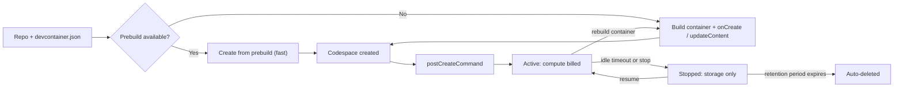

import { TLDR, DocsLinks, LastVerified, CompareTable, FlashCards } from '@components';
import { Aside, Tabs, TabItem, LinkCard, CardGrid, Code } from '@astrojs/starlight/components';

export const devcontainer = `{
  "name": "my-service",
  "image": "mcr.microsoft.com/devcontainers/typescript-node:22",
  "features": {
    "ghcr.io/devcontainers/features/docker-in-docker:2": {},
    "ghcr.io/devcontainers/features/azure-cli:1": {}
  },
  "hostRequirements": { "cpus": 4, "memory": "8gb" },
  "onCreateCommand": "npm ci",
  "updateContentCommand": "npm run build",
  "postCreateCommand": "npm run seed",
  "forwardPorts": [3000],
  "portsAttributes": { "3000": { "label": "web", "onAutoForward": "openPreview" } },
  "secrets": {
    "NPM_TOKEN": { "description": "Read token for the private registry" }
  },
  "customizations": {
    "vscode": {
      "extensions": ["dbaeumer.vscode-eslint", "GitHub.copilot"]
    },
    "codespaces": {
      "openFiles": ["README.md"]
    }
  }
}`;

<LastVerified date="2026-10" />

<TLDR>
- A codespace is a **Docker container on a cloud VM** that GitHub hosts. You configure it as code in `.devcontainer/devcontainer.json`, and you can open it in the browser, VS Code, JetBrains or `gh codespace`.
- Machine types range from **2 cores / 8 GB RAM / 32 GB** up to **32 cores / 128 GB / 128 GB**, and the environment is always Linux.
- **Prebuilds** run your setup ahead of time with Actions. They are recommended when creation takes more than 2 minutes.
- **Billing:** compute (core-hours) plus storage (GB-month). The bill goes to the **user** or the **org**, depending on the org's setting. Only personal accounts get free quota.
- **Org policies:** org owners can restrict machine types, idle timeout, retention, port visibility and the number of codespaces per user. These policies apply **only to org-billed codespaces**.
</TLDR>

## Common booth questions

Who pays: the developer or the org?

The org chooses who pays.

- **Org pays:** when the org enables org billing, codespaces created from its repos (or org-owned forks) by members and collaborators who are allowed to use Codespaces are **billed to and owned by the org**. Org owners can delete them.
- **User pays:** otherwise, the user's personal account pays.
- **Free quota:** GitHub Free accounts get 120 core-hours and 15 GB-month of storage; Pro gets 180 core-hours and 20 GB-month. Org and enterprise plans have **no** free quota.
- **Removed users:** if someone is removed from the org or repo, their codespaces are **deleted automatically**.

Can we enforce machine size, idle timeout and retention?

Yes, with **Codespaces policies** set at the org level, optionally targeted at specific repos.

- **How policies combine:**
  - Machine types: org-wide policies define the allowed superset, and repo policies can only narrow it.
  - Timeouts and retention: when several policies apply, the **shortest** value wins.
- **Defaults:** idle timeout is **30 min** (users can choose 5–240 min) and retention is **30 days** (maximum 30).
- **Lifetime cap:** a codespace stops after a **maximum lifetime of 12 hours**, whatever the idle setting.
- **Gotcha:** policies **don't apply** to codespaces the user pays for.

Do Codespaces work with our IP allow list or EMU?

- **IP allow list:** the docs say that if you configure an **IP allow list** for the org, *"you won't be able to use GitHub Codespaces for repositories owned by the organization."* There is no Codespaces-specific allow list.
- **EMU:** Codespaces is **not available for repositories owned by managed user accounts**, meaning personal repos of EMU users. Org-owned repos are a separate question, so check your enterprise settings.

Are GPU machines available?

The current Codespaces docs list only CPU machine types (2–32 cores), so treat GPU codespaces as **not available**.

- **For GPU CI or ML jobs:** use **GPU larger runners** in Actions.
- **For interactive GPU work:** use your own cloud VM with dev containers.

How do secrets work?

**Codespaces secrets** are separate from Actions and Dependabot secrets. They are injected as **environment variables** at runtime.

- **Three levels:**
  - **User:** you pick which repos can use each secret.
  - **Repo:** up to **100** secrets.
  - **Org:** up to **100** secrets, with a policy for which repos get them (all, private only, or selected).
- **Size limit:** 48 KB each.
- **Recommended secrets:** list them under `secrets` in `devcontainer.json` and users are prompted for them when they create a codespace.

Why didn't my `postCreateCommand` run during the prebuild?

This is by design. Prebuilds run `onCreateCommand` and `updateContentCommand` only. `postCreateCommand` runs later, when the user's codespace is created.

Put heavy, cacheable work (dependency install, compile) in the first two, and user-specific work in `postCreateCommand` or `postStartCommand`.

Codespaces vs local Dev Containers: which one?

Both use the **same `devcontainer.json`** spec, so you can support both from one config.

- **Local Dev Containers:** free compute, but runs on the laptop's resources, needs Docker locally and works offline.
- **Codespaces:** zero local setup, strong machines and prebuilds, browser access, and centrally controlled policies and billing.

See the comparison table below.

## Lifecycle

## devcontainer.json example

Put this in `.devcontainer/devcontainer.json`. You can keep several configs in `.devcontainer/<name>/devcontainer.json` and pick one at creation time.

<Tabs>
	<TabItem label="devcontainer.json">
		<Code code={devcontainer} lang="jsonc" title=".devcontainer/devcontainer.json" />
	</TabItem>
	<TabItem label="What each key does">

| Key | Purpose |
|---|---|
| `image` / `build.dockerfile` | Base environment. The default universal image is used if you have no config. |
| `features` | Composable install units, such as Docker-in-Docker or cloud CLIs |
| `hostRequirements` | Minimum machine spec. Smaller machine types are hidden from users. |
| `onCreateCommand` / `updateContentCommand` | Run during **prebuilds** (cacheable) |
| `postCreateCommand` | Runs after creation in the user's codespace |
| `forwardPorts` / `portsAttributes` | Auto-forward ports and label them |
| `secrets` | **Recommended** secrets that users are prompted for |
| `customizations.vscode.extensions` | Extensions installed for everyone |

	</TabItem>
</Tabs>

## Prebuilds

- **What they are:** a prebuild is configured per **branch, region and devcontainer file**. A dedicated **GitHub Actions** workflow builds it.
- **Triggers:** every push (the default), when the config changes, or on a schedule. Use a schedule or config-change trigger to save Actions minutes on busy repos.
- **Cost:** prebuild **storage** is billed like codespace storage, and the build consumes **Actions minutes**.
- **Talking point:** large monorepos can go from many minutes to near-instant creation.

## Org policies and controls

| Control | Where | Notes |
|---|---|---|
| Enable Codespaces | Org settings → Codespaces | All members, selected members, or disabled for private repos |
| Who pays | Org settings → Codespaces → Billing | Org-owned or user-owned |
| Machine types | Policy | Org-wide superset; repo policies can only restrict further |
| Max idle timeout | Policy | Shortest applicable value wins |
| Max retention | Policy | Also removes the per-codespace "Keep codespace" exemption |
| Port visibility | Policy | Disallow **Public** and/or **Org**. Private forwarding can't be disabled because SSH needs it. |
| Max codespaces per user | Policy | Always applies to all repos |
| Spend | Budgets | Metered product, so a budget can **stop** usage |

<Aside type="tip">
The usual cost-control trio is: org-owned billing, a machine-type policy (for example, up to 8-core), a 30-min max idle timeout plus 7-day retention, and a Codespaces **budget**.
</Aside>

## Codespaces vs local Dev Containers

<CompareTable
	title="Where should the dev container run?"
	columns={[
		{ key: 'cs', label: 'GitHub Codespaces' },
		{ key: 'local', label: 'Local Dev Containers' },
	]}
	rows={[
		{ feature: 'Uses devcontainer.json', category: 'Config', values: { cs: true, local: true } },
		{ feature: 'Local Docker required', category: 'Setup', values: { cs: false, local: true } },
		{ feature: 'Prebuilds', category: 'Speed', values: { cs: true, local: 'Image caching only' } },
		{ feature: 'Machine size', category: 'Hardware', values: { cs: '2–32 cores', local: 'Your laptop' } },
		{ feature: 'GPU', category: 'Hardware', values: { cs: false, local: 'If your host has one' } },
		{ feature: 'Works offline', category: 'Access', values: { cs: false, local: true } },
		{ feature: 'Browser / iPad access', category: 'Access', values: { cs: true, local: false } },
		{ feature: 'Central org policies', category: 'Governance', values: { cs: true, local: false } },
		{ feature: 'Cost', category: 'Billing', values: { cs: 'Core-hours + GB-month', local: 'Free (your hardware)' } },
		{ feature: 'Source code leaves the laptop', category: 'Security', values: { cs: 'Never on the laptop', local: 'Cloned locally' } },
	]}
/>

## Personalization

- **Dotfiles:** pick any repo you own in your [Codespaces settings](https://github.com/settings/codespaces). It is cloned into every codespace, and an `install.sh` (or similar) runs automatically.
- **Settings Sync:** brings VS Code settings, keybindings and extensions.
- **Personal preferences** (editor, region, default idle timeout and retention) live in user settings, and org policies can override them.

<FlashCards
	title="Codespaces quick quiz"
	cards={[
		{ q: 'Default idle timeout?', a: '**30 minutes**. Users can set 5–240 min, and org policy can lower the maximum.' },
		{ q: 'Default retention for stopped codespaces?', a: '**30 days**, which is also the maximum.' },
		{ q: 'Which lifecycle commands run during a prebuild?', a: '`onCreateCommand` and `updateContentCommand`' },
		{ q: 'Do org policies apply to user-paid codespaces?', a: '**No.** Only org-billed ones.' },
		{ q: 'Max secrets per org?', a: '**100** (48 KB each)' },
	]}
/>

<CardGrid>
	<LinkCard title="Billing" description="Budgets and the usage report." href="/github-cheatsheet/billing/" />
	<LinkCard title="GitHub Actions" description="Prebuilds run on Actions; GPU runners." href="/github-cheatsheet/actions/" />
</CardGrid>

<DocsLinks
	links={[
		{ label: 'What are GitHub Codespaces?', href: 'https://docs.github.com/en/codespaces/about-codespaces/what-are-codespaces' },
		{ label: 'Introduction to dev containers', href: 'https://docs.github.com/en/codespaces/setting-up-your-project-for-codespaces/adding-a-dev-container-configuration/introduction-to-dev-containers' },
		{ label: 'About prebuilds', href: 'https://docs.github.com/en/codespaces/prebuilding-your-codespaces/about-github-codespaces-prebuilds' },
		{ label: 'Choosing who owns and pays for codespaces', href: 'https://docs.github.com/en/codespaces/managing-codespaces-for-your-organization/choosing-who-owns-and-pays-for-codespaces-in-your-organization' },
		{ label: 'Restricting access to machine types', href: 'https://docs.github.com/en/codespaces/managing-codespaces-for-your-organization/restricting-access-to-machine-types' },
		{ label: 'Restricting the idle timeout period', href: 'https://docs.github.com/en/codespaces/managing-codespaces-for-your-organization/restricting-the-idle-timeout-period' },
		{ label: 'Restricting forwarded port visibility', href: 'https://docs.github.com/en/codespaces/managing-codespaces-for-your-organization/restricting-the-visibility-of-forwarded-ports' },
		{ label: 'Development environment secrets', href: 'https://docs.github.com/en/codespaces/managing-codespaces-for-your-organization/managing-development-environment-secrets-for-your-repository-or-organization' },
		{ label: 'Codespaces billing', href: 'https://docs.github.com/en/billing/concepts/product-billing/github-codespaces' },
	]}
/>
