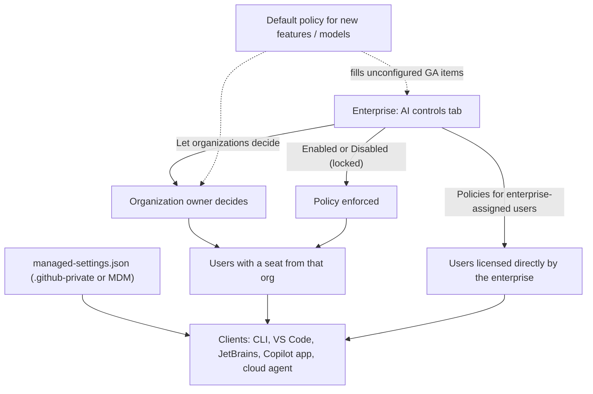
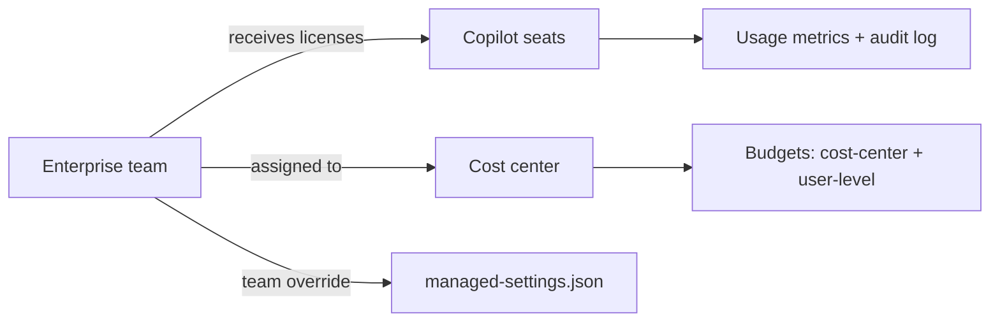

import { TLDR, DocsLinks, LastVerified, CompareTable, FlashCards } from '@components';
import { Aside, Badge, Steps } from '@astrojs/starlight/components';

<LastVerified date="2026-10" />

<TLDR>
- **Policies:** all Copilot feature, agent, model and MCP policies live on the enterprise **AI controls** tab and in org settings. The enterprise sets Enabled / Disabled / **Let organizations decide**. For the cloud agent, the enterprise can pick exactly which orgs get it.
- **New default (22 October 2026):** the *Default policy for new features* starts applying to **unconfigured GA features**, and it defaults to **enabled**. Review unconfigured policies now.
- **Client guardrails:** `managed-settings.json`, delivered from a `.github-private` repo or via MDM, sets the default model, MCP allow/deny lists, sandboxing and plugins, with enterprise-team overrides.
- **Visibility:**
  - The audit log keeps **180 days**, covers settings, licenses and agent activity on GitHub.com, and has **no prompts**.
  - The usage metrics dashboard and API show adoption.
  - OpenTelemetry can capture agent traces.
- **Spend:** AI credit **budgets** (user-level, cost-center, org, enterprise) and **cost centers**. There is *no automatic fallback* to cheaper models when a budget runs out.
</TLDR>

## Common booth questions

<details>
<summary>Enterprise says one thing, org says another. Which policy wins?</summary>

It depends on the enterprise setting:
- **Enabled or Disabled:** the enterprise choice is locked for every org.
- **Let organizations decide:** each org owner chooses.

When a user gets seats from **several orgs in the same enterprise** with different settings, the **least restrictive** policy usually applies (with documented exceptions).

When a user has licenses from **different enterprises**, the **most restrictive** policy almost always applies.

Users licensed **directly by the enterprise** aren't covered by "Let organizations decide". The *Policies for enterprise-assigned users* setting decides their default.

</details>

<details>
<summary>What happens on October 22, 2026?</summary>

The **Default policy for new features** becomes active for Copilot Business and Copilot Enterprise.
- Any **GA** feature you haven't explicitly configured (new or existing) takes this policy's value.
- The policy itself is **enabled by default**. If you do nothing, unconfigured features turn **on**.
- It does **not** apply to preview features.
- The equivalent **models** policy is already active.

The policy page shows a banner that counts your unconfigured policies.

</details>

<details>
<summary>Can we restrict which MCP servers developers can use?</summary>

Yes, in layers:

1. **MCP servers in Copilot** policy. It is **disabled by default** and governs only Business/Enterprise users. It does *not* control the GitHub MCP server inside third-party hosts such as Cursor or Claude.
2. **Allowlist/denylist** in `managed-settings.json` (`allowedMcpServers` / `deniedMcpServers`). This is GitHub's **recommended, GA** method. Clients evaluate the rules in this order:
   1. Built-in servers are always allowed.
   2. A deny match blocks the server.
   3. If an allowlist exists, a server must match it.
   4. A server whose URL or command contains an unresolved variable is blocked.
   5. Malformed JSON blocks everything except built-in servers.
3. **Custom MCP registry** <Badge text="Preview" variant="caution" />. GitHub says this is *not* the recommended way to restrict access.

</details>

<details>
<summary>Can we see what prompts developers send?</summary>

**Not in the audit log.** It records plan, policy and license changes plus agent activity on GitHub.com. It doesn't record client session data such as local CLI prompts.

Options:
- **OpenTelemetry** export from clients. Prompts, responses and tool arguments are **off by default**, and admins enable each capture class separately.
- **Hooks**, for example `userPromptSubmitted` sending events to your own logging service.

Cloud agent **session logs** are visible on GitHub.com to people with repo access.

</details>

<details>
<summary>Does content exclusion stop agent mode from reading our secrets folder?</summary>

**No, not reliably.** GitHub's docs state content exclusion is **not supported in Edit and Agent modes** of Copilot Chat in VS Code and other editors.

For **Copilot CLI**, the docs conflict:
- The how-to page says the CLI doesn't support content exclusion.
- The concept page's table lists CLI chat support.

Verify before quoting. Content exclusion also doesn't apply to symlinks or remote filesystems, and IDE-provided semantic info (types, hovers) can still leak through.

Use real controls for secrets:
- Don't commit them.
- Secret scanning and push protection.
- Repo permissions.

</details>

<details>
<summary>How do we cap Copilot spend?</summary>

- **User-level budgets (ULB):** a universal enterprise default, a cost-center default, or a per-user override (with optional `expires_at`). ULBs **hard-stop**, and a **$0 ULB blocks immediately**.
- **Cost-center budgets** cap *metered* overage after the pooled credits run out.
- Admins can disable the **AI credits paid usage** policy entirely.
- There is **no automatic fallback** to cheaper models when a budget is exhausted.

See the [Copilot overview](/github-cheatsheet/copilot/) for plan allowances.

</details>

<details>
<summary>How do we measure adoption and impact?</summary>

Tools:
- The **Copilot usage metrics dashboard** (28-day trends).
- The **code generation dashboard**.
- The **Copilot impact dashboard** (adoption cohorts → PR output).
- The **usage metrics REST API** and NDJSON export.

Caveats:
- Metrics need **IDE telemetry enabled**.
- They exclude Copilot Chat on GitHub.com and GitHub Mobile.
- Seat data comes from the **user management API**, which is the source of truth.
- To give someone visibility into a single org, create a custom org role with *View organization Copilot metrics*.

</details>

<details>
<summary>Can we enable the coding agent for just a pilot group?</summary>

Yes:
- At enterprise level, the cloud agent policy lets you **select specific organizations**.
- Repo admins can disable the cloud agent per repository.
- Some policies can block the cloud agent for **all users** in your enterprise's repositories, whoever is paying for their seat.
- For finer pilots, assign licenses via an **enterprise team** and use managed-settings team overrides.

</details>

## Policy inheritance



<Aside type="tip">
**Multiple licenses** inside one enterprise → least restrictive (usually). **Across enterprises** → most restrictive (almost always). The *Feature availability when policies conflict* reference lists the exceptions.
</Aside>

## Policy areas on the AI controls tab

| Sidebar area | What you control | Notes |
|---|---|---|
| **Agents** | Copilot cloud agent, third-party agents <Badge text="Preview" variant="caution" />, agent apps <Badge text="Preview" variant="caution" /> | The cloud agent can be granted to **selected orgs** |
| **Copilot** (admin, privacy, models, billing, usage) | Model availability, *Suggestions matching public code*, AI credits paid usage, usage metrics, session cloud storage | *Suggestions matching public code* defaults to **Allowed** for Copilot Business |
| **Copilot → Features & clients** | Copilot in IDEs, GitHub.com, CLI, the Copilot app, preview features | The **CLI and the Copilot app have separate client policies** |
| **MCP** | *MCP servers in Copilot*, registry URL, *Restrict MCP access to registry servers* | Off by default |
| **Content exclusion** | Paths/repos Copilot ignores | Business/Enterprise only |

Who can change policies?
- **Enterprise:** owners, or anyone with the *Manage enterprise AI controls* custom role permission.
- **Organization:** owners, or holders of granular custom permissions.

Watch the audit log for drift.

## Enterprise managed settings (client guardrails)

The `managed-settings.json` file centrally configures Copilot **clients**: Copilot CLI, VS Code, the Copilot app, Copilot cloud agent and JetBrains IDEs. Not every client supports every key.

```text
.github-private/            # selected as the enterprise's source of client governance
└── copilot/
    ├── managed-settings.json   # { "model": { "overridable": "auto" }, "allowedMcpServers": [...] }
    ├── team-mappings.json      # { "no-auto.json": ["special-team"] }
    └── teams/
        └── no-auto.json        # { "model": "unmanaged" }
```

- **Deployment:** *server-managed* from `.github-private` (recommended: internal visibility, edits restricted to admins), via **MDM**, or as a local file. If several layers exist, *all* apply, and a deny from any layer wins.
- **Use cases from the docs:**
  - Default new chats to **Auto**.
  - Block sensitive agent operations.
  - Require sandboxing.
  - Install approved plugins.
  - Set MCP allow/deny lists.
  - Configure OpenTelemetry.
- **Fail-safe:** if a client can't fetch the policy, it keeps the last enforced one. The policy can get stricter but never looser.

## Seats and rollout

<Steps>

1. **Choose where licenses come from.** Org-level seat assignment (users or org teams), or an **enterprise team** that receives Copilot Business licenses directly and can span orgs.
2. **Set the governance baseline.** Configure every policy explicitly before 22 October 2026 so nothing changes silently. Set public-code matching and the MCP policy.
3. **Ship managed settings.** Use `.github-private/copilot/managed-settings.json` with an MCP allowlist, the default model, and overrides per enterprise team.
4. **Allocate spend.** Assign orgs, repos, users or **enterprise teams** to **cost centers** (team membership auto-syncs), then add user-level and cost-center budgets.
5. **Pilot the cloud agent.** Grant it to selected orgs, and set the org-default runner type for `copilot-setup-steps.yml`.
6. **Measure and iterate.** Use the usage metrics dashboard and API, and stream the audit log to your SIEM.

</Steps>



<Aside type="note">
**Audit tip:** `action:copilot.cfb_seat_assignment_created` finds new seat assignments. For *team-based* assignments, the actor on `copilot.cfb_seat_added` may not be the person who changed the team membership.
</Aside>

## Content exclusion

| Where | Inline suggestions | Chat / agent |
|---|---|---|
| VS Code | ✅ | Chat ✅ · **Edit ❌ · Agent ❌** |
| Visual Studio, JetBrains | ✅ | ✅ (Agent mode in IDEs: ❌, per the how-to note) |
| Xcode | ✅ | ❌ |
| Eclipse | ✅ | ✅ |
| GitHub.com, GitHub Mobile | n/a | ✅ <Badge text="Preview" variant="caution" /> |
| Copilot code review (GitHub.com) | n/a | ✅ excluded files aren't reviewed |
| Copilot CLI | n/a | ⚠️ Docs conflict, so verify |

- **Who can configure it:**
  - Repo admins, for their repos. This affects every Copilot user in the enterprise working in those repos.
  - Org owners, for users with a seat from that org.
  - Enterprise owners.
- **Limitations:**
  - Excluded data can still arrive indirectly through IDE semantic info.
  - Symlinks and remote filesystems aren't covered.
  - The cloud agent isn't listed in the support table, so don't promise it.
- **Privacy note:** the client sends the repo URL to fetch the policy, and these URLs are not logged.

## Audit, metrics and telemetry

<CompareTable
	title="Which visibility tool answers which question?"
	columns={[
		{ key: 'audit', label: 'Audit log' },
		{ key: 'metrics', label: 'Usage metrics' },
		{ key: 'otel', label: 'OpenTelemetry' },
		{ key: 'session', label: 'Agent session logs' },
	]}
	rows={[
		{ feature: 'Policy / settings changes', values: { audit: true, metrics: false, otel: false, session: false } },
		{ feature: 'License grants / removals', values: { audit: true, metrics: false, otel: false, session: false } },
		{ feature: 'Cloud agent activity on GitHub.com', values: { audit: '`actor:Copilot`', metrics: 'PR metrics', otel: false, session: true } },
		{ feature: 'Adoption (DAU, features, languages, models)', values: { audit: false, metrics: true, otel: 'Partial', session: false } },
		{ feature: 'Prompts / responses', values: { audit: false, metrics: false, otel: 'Opt-in capture class', session: 'Cloud agent only' } },
		{ feature: 'Retention', values: { audit: '180 days (stream to SIEM)', metrics: 'Up to 1 year via API', otel: 'Your backend', session: 'On GitHub.com' } },
	]}
/>

- **Audit log streaming** destinations: S3, Azure Blob, Azure Event Hubs, Datadog, GCS, Splunk, and Microsoft Purview (Copilot agent-session events only). Streaming **agent session activity** and multiple endpoints are <Badge text="Preview" variant="caution" />.
- **Usage metrics API:** `/enterprises/{enterprise}/copilot/metrics/reports/...` requires the *Copilot usage metrics* policy. Data starts **10 October 2025** at enterprise level and **12 December 2025** at org level.
- **Minimum IDE versions** apply for metrics, for example VS Code 1.107.1 with Copilot Chat 0.35.3.

## Gotchas

- A user's **personal plan is cancelled** when they get a Business/Enterprise seat, so personal and org policies can't conflict.
- **Copilot Enterprise is GitHub Enterprise Cloud only.** Copilot isn't available on GitHub Enterprise Server itself.
- **EMU** users can't use automatic code-review setup.
- Third-party agents and agent apps are previews behind their own policies.
- Usage numbers will differ between the dashboard, the API and billing. GitHub documents why, so don't promise exact reconciliation.

<FlashCards
	title="Admin quiz"
	cards={[
		{ q: 'Where are enterprise Copilot policies?', a: 'Enterprise → **AI controls** tab (Agents, Copilot, Features & clients, MCP).' },
		{ q: 'Two orgs in one enterprise disagree — which policy?', a: 'Usually the **least restrictive**. Across enterprises: most restrictive.' },
		{ q: 'What flips on 22 Oct 2026?', a: '*Default policy for new features* applies to unconfigured GA features (enabled by default).' },
		{ q: 'GA way to allowlist MCP servers?', a: '`allowedMcpServers` / `deniedMcpServers` in `managed-settings.json`.' },
		{ q: 'Audit log retention?', a: '180 days. Stream to a SIEM for longer.' },
		{ q: 'Does the audit log include prompts?', a: 'No. Use OTel (opt-in prompt capture) or hooks.' },
		{ q: 'Effect of a $0 user-level budget?', a: 'The user is blocked immediately (hard stop).' },
		{ q: 'Content exclusion in IDE agent mode?', a: 'Not supported.' },
	]}
/>

<DocsLinks
	links={[
		{ label: 'Copilot policies for enterprises and organizations', href: 'https://docs.github.com/en/copilot/concepts/enterprise/policies' },
		{ label: 'Managing enterprise policies', href: 'https://docs.github.com/en/copilot/how-tos/administer-copilot/manage-for-enterprise/manage-enterprise-policies' },
		{ label: 'Default availability of features and models', href: 'https://docs.github.com/en/copilot/concepts/enterprise/default-availability' },
		{ label: 'Getting started with enterprise-managed settings', href: 'https://docs.github.com/en/copilot/how-tos/administer-copilot/manage-for-enterprise/use-managed-settings/get-started' },
		{ label: 'Configure an enterprise MCP allowlist', href: 'https://docs.github.com/en/copilot/how-tos/administer-copilot/manage-mcp-usage/configure-enterprise-allowlist' },
		{ label: 'Content exclusion', href: 'https://docs.github.com/en/copilot/concepts/security-governance-and-network-settings/content-exclusion' },
		{ label: 'Reviewing audit logs for Copilot', href: 'https://docs.github.com/en/copilot/how-tos/administer-copilot/manage-for-enterprise/review-audit-logs' },
		{ label: 'Copilot usage metrics', href: 'https://docs.github.com/en/copilot/concepts/billing-and-usage/copilot-usage-metrics/copilot-metrics' },
		{ label: 'OpenTelemetry for agent monitoring', href: 'https://docs.github.com/en/copilot/concepts/enterprise/opentelemetry' },
		{ label: 'Budgets for AI credits', href: 'https://docs.github.com/en/copilot/concepts/billing-and-usage/organizations-and-enterprises/budgets' },
		{ label: 'Cost centers', href: 'https://docs.github.com/en/billing/concepts/cost-centers' },
	]}
/>
