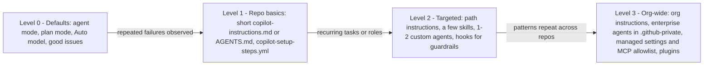

import { TLDR, DocsLinks, LastVerified, DecisionTree, FlashCards } from '@components';
import { Aside, Badge } from '@astrojs/starlight/components';

<LastVerified date="2026-10" />

<TLDR>
- **Start with nothing.** Agent mode, the cloud agent and the CLI find repo context on their own. GitHub's advice is to *"start with the smallest customization that solves your problem."*
- **Add customization only after you see a repeated failure**, and pick the right tool for it:
  - Wrong repo facts → short **instructions**.
  - A recurring procedure → a **skill**.
  - A distinct role or restricted tools → a **custom agent**.
  - A rule that must always hold → a **hook** or CI.
  - A system the agent can't reach → **MCP**.
- **Anti-patterns:**
  - Bloated instruction files.
  - Restating what's in the code.
  - Lots of MCP tools.
  - Conflicting instructions.
  - Instructions doing a linter's job.
- **Context engineering beats prompt engineering:** plan first, scope tasks small, give acceptance criteria, make tests the feedback loop, default to **Auto** models, and review everything.
</TLDR>

<Aside type="note" title="How to read this page">
<Badge text="Documented" variant="success" /> = stated in GitHub Docs (linked). <Badge text="Field opinion" variant="note" /> = practitioner experience and our recommendation, not an official GitHub statement. Say which one you're quoting when you talk to a customer.
</Aside>

## Common booth questions

We have no Copilot customization yet. Where do we start?

Don't start by writing files. Use the defaults for a sprint or two:
- Agent mode, plan mode and Auto model selection.
- Well-written issues for the cloud agent.

Then:
1. **Write down the failures that repeat**, such as "it never runs `make proto`" or "it uses npm instead of pnpm".
2. Fix the most common one with a **short** `.github/copilot-instructions.md` covering build/test commands and non-obvious rules.

The cloud agent can draft this file for you. GitHub's own generation prompt caps it at **2 pages**. <Badge text="Documented" variant="success" />

Isn't a big, detailed instructions file better? More context = better answers?

No. Instructions are **always on**, so every line competes with the actual task for the model's attention, in every request.
- GitHub says to keep instructions minimal when they are "so detailed that they distract from the immediate task" and to move specialized guidance into skills or custom agents. <Badge text="Documented" variant="success" />
- GitHub's sample prompt for generating instructions limits them to 2 pages. For code review, GitHub suggests staying under ~1,000 lines. <Badge text="Documented" variant="success" />
- In our experience, a 50–150-line file of commands and non-obvious rules beats a 1,000-line style guide. <Badge text="Field opinion" variant="note" />

Prompt files or skills — which should we invest in?

**For new work, default to skills.** <Badge text="Field opinion" variant="note" />

Both encode a repeatable task. What differs is reach and triggering. <Badge text="Documented" variant="success" />

| | Skills | Prompt files |
|---|---|---|
| Who triggers it | Copilot loads it automatically when relevant | You invoke it explicitly |
| Where it works | Cloud agent, code review, CLI, Copilot app and IDE agent mode | IDE only (VS Code, Visual Studio; JetBrains and Xcode in preview) |
| What it can bundle | Scripts and templates | The prompt itself |
| Portability | Open standard | Not mentioned in GitHub's docs |

Keep prompt files for **human-initiated, IDE-only templates with inputs**, such as "scaffold a form named X".

When is a custom agent worth it?

When you need a **different role with a different toolset or model**. Examples:
- A read-only planner with `tools: ["read","search"]`.
- A security reviewer that can't edit files.
- A docs writer that follows your standards.

GitHub's own guidance: choose something simpler if "you only need task-specific instructions" (use a skill) or if "the default agent performs the task well". <Badge text="Documented" variant="success" />

In VS Code you can chain agents with `handoffs`, for example plan → implement → review. The cloud agent ignores `handoffs`. <Badge text="Documented" variant="success" />

How do we make sure the agent never does X?

Don't rely on an instruction. GitHub says instructions "do not guarantee that it will follow every rule". <Badge text="Documented" variant="success" />

Use **deterministic** controls instead:
- A `preToolUse` **hook** that denies the tool call.
- Rulesets and branch protection.
- Required CI checks.
- Enterprise `managed-settings.json`, for example an MCP allowlist or a sandbox requirement.

Should we connect all our internal systems via MCP?

Only the ones the agent **can't already reach**. GitHub says to avoid adding an MCP server when built-in tools cover your needs, and to allowlist specific read-only tools for the cloud agent, because it uses them without asking. <Badge text="Documented" variant="success" />

Every tool schema costs context. With large toolsets, models pick the wrong tool more often. Enable only the tools a task needs, for example per custom agent with `tools: ["jira/get_issue"]`. <Badge text="Field opinion" variant="note" />

Should developers pick models manually or use Auto?

Default to **Auto**:
- It's GA in VS Code, the CLI, JetBrains, GitHub.com and the Copilot app.
- It routes each request by task complexity and availability.
- Paid plans get a **10% discount** on model costs when using Auto. <Badge text="Documented" variant="success" />
- Enterprises can set `"model": "auto"` as the default via managed settings. <Badge text="Documented" variant="success" />

**Pin a model** when you need reproducibility, a specific capability, or a cheap fast model for a narrow custom agent. <Badge text="Field opinion" variant="note" />

Our cloud agent PRs are hit-and-miss. What's the #1 fix?

1. **Write better issues.** Include a clear problem statement, **complete acceptance criteria** (for example "should there be unit tests?") and hints about which files to change. <Badge text="Documented" variant="success" />
2. **Make sure the agent can build and test** in `copilot-setup-steps.yml`. GitHub says that if Copilot can build, test and validate its changes, it's more likely to produce PRs that can be merged quickly. <Badge text="Documented" variant="success" />

## The 2026 principle: less configuration, better feedback loops

The agent harnesses (IDE agent mode, Copilot cloud agent, Copilot CLI) now do much of the context work themselves:
- They search the codebase, including **semantic code search** on the cloud agent.
- They read files and run commands.
- They delegate to subagents with a separate context.
- They load skills only when relevant.

GitHub's best-practices page even notes that, without file paths, *"the agent can often discover the right code on its own"*. <Badge text="Documented" variant="success" />

So most of a team's leverage is not in more prompt text. It is in <Badge text="Field opinion" variant="note" />:
1. **Clear tasks:** scope plus acceptance criteria.
2. **A working environment:** the agent can install, build and test.
3. **Fast, trustworthy feedback:** tests, linters and CI the agent can run.
4. **A few targeted customizations**, added in response to observed failures.

## Should I create a custom agent, skill, prompt, instruction — or nothing?

<DecisionTree
	title="Pick the right customization (or none)"
	tree={{
		start: 'q1',
		nodes: {
			q1: {
				question: 'What problem have you **actually observed** (more than once)?',
				help: 'If you cannot name a repeated failure yet, choose the last option.',
				options: [
					{ label: 'Copilot gets repo facts wrong (build/test commands, conventions, layout)', next: 'qFacts' },
					{ label: 'A specific recurring task is done inconsistently', next: 'qTask' },
					{ label: 'I want a distinct role, restricted tools or a different model', next: 'qRole' },
					{ label: 'A rule must ALWAYS hold (format, blocked commands, policy)', next: 'hook' },
					{ label: 'The agent needs data or actions in an external system', next: 'qMcp' },
					{ label: 'Nothing specific — we are just getting started', next: 'nothing' },
				],
			},
			qFacts: {
				question: 'Could a newcomer find this fact in **under a minute** from the code, README or config files?',
				options: [
					{ label: 'Yes — it is obvious from the repo', next: 'discoverable' },
					{ label: 'No — it is tribal knowledge or non-obvious', next: 'qScope' },
				],
			},
			qScope: {
				question: 'Does it apply to the **whole repo**, or only to certain paths or file types?',
				options: [
					{ label: 'Whole repo', next: 'instrRepo' },
					{ label: 'Certain paths / file types / sub-projects', next: 'instrPath' },
				],
			},
			qTask: {
				question: 'Who should trigger it, and where must it work?',
				options: [
					{ label: 'Copilot should pick it up automatically, including in the cloud agent, CLI or code review', next: 'skill' },
					{ label: 'It needs bundled scripts or templates', next: 'skill' },
					{ label: 'A developer runs it explicitly from IDE chat, with different inputs each time', next: 'prompt' },
				],
			},
			qRole: {
				question: 'Do you need a **different toolset or model**, or just different instructions for one kind of task?',
				options: [
					{ label: 'Different tools / model / persona that I select or delegate to', next: 'agent' },
					{ label: 'Just task-specific instructions', next: 'skill' },
					{ label: 'Honestly, the default agent already does it fine', next: 'nothing' },
				],
			},
			qMcp: {
				question: 'Can the agent already reach it with **built-in tools** (shell, `gh` CLI, files, the default GitHub MCP server)?',
				options: [
					{ label: 'Yes', next: 'builtin' },
					{ label: 'No — it needs a new integration', next: 'mcp' },
				],
			},
			nothing: {
				answer: '**Do nothing (yet).** Use agent mode / cloud agent / CLI with **Auto** model selection, start complex work in **plan mode**, and write issues with acceptance criteria. Keep a list of repeated failures; customize only when a pattern appears.',
				links: [
					{ label: 'Best practices for Copilot cloud agent', href: 'https://docs.github.com/en/copilot/tutorials/cloud-agent/get-the-best-results' },
					{ label: 'Plan mode in your IDE', href: 'https://docs.github.com/en/copilot/how-tos/copilot-in-your-ide/use-copilot-agents/use-plan-mode' },
				],
			},
			discoverable: {
				answer: "**Don't write it down.** The agent will find it, and duplicated facts go stale and cost context on every request. If it still gets it wrong repeatedly, add a **one-line** pointer (for example \"Build: `make ci`\") to `copilot-instructions.md`.",
			},
			instrRepo: {
				answer: 'Add it to **`.github/copilot-instructions.md`** (or `AGENTS.md` if you also use other agents). Keep the whole file short: commands, non-obvious constraints, where things live. GitHub’s generator prompt caps it at 2 pages.',
				links: [{ label: 'Add repository instructions', href: 'https://docs.github.com/en/copilot/how-tos/copilot-on-github/customize-copilot/add-custom-instructions/add-repository-instructions' }],
			},
			instrPath: {
				answer: 'Use a **path-specific** file: `.github/instructions/NAME.instructions.md` with `applyTo: "glob"`, or a nested **`AGENTS.md`** in that sub-folder (nearest wins). It only loads when matching files are in play.',
				links: [{ label: 'Path-specific instructions', href: 'https://docs.github.com/en/copilot/how-tos/copilot-on-github/customize-copilot/add-custom-instructions/add-repository-instructions#creating-path-specific-custom-instructions' }],
			},
			skill: {
				answer: 'Create an **agent skill**: `.github/skills/<name>/SKILL.md` with a precise `description` (that is what triggers loading), plus any scripts or templates. It works in the cloud agent, code review, CLI and IDE agent mode, and stays out of context until needed.',
				links: [{ label: 'Adding agent skills', href: 'https://docs.github.com/en/copilot/how-tos/copilot-on-github/customize-copilot/customize-cloud-agent/add-skills' }],
			},
			prompt: {
				answer: 'A **prompt file** (`.github/prompts/NAME.prompt.md`) is fine for an explicit, IDE-only template with inputs. If you later want the agent to apply it on its own, or in the cloud, convert it to a skill.',
				links: [{ label: 'Prompt files', href: 'https://docs.github.com/en/copilot/concepts/prompting-and-context/prompt-files' }],
			},
			agent: {
				answer: 'Create a **custom agent** (`.github/agents/NAME.agent.md`) with a tight `tools` allowlist and an optional `model`. Examples: a read-only planner (`["read","search"]`) or a security reviewer with no `edit`. For organization-wide roles, put it in `.github-private`.',
				links: [{ label: 'Custom agents configuration', href: 'https://docs.github.com/en/copilot/reference/custom-agents-configuration' }],
			},
			hook: {
				answer: 'Use a **hook**, not an instruction. Use `preToolUse` to deny dangerous commands or protected-path edits, and `postToolUse` to run the formatter or log activity. Also back the rule with **CI, rulesets** or enterprise **managed settings**.',
				links: [{ label: 'Hooks for GitHub Copilot', href: 'https://docs.github.com/en/copilot/concepts/customizations/hooks' }],
			},
			builtin: {
				answer: '**No MCP needed.** Built-in tools already reach it. If the agent doesn’t know *how* to use them for this system, write a **skill** that describes the steps.',
			},
			mcp: {
				answer: 'Add an **MCP server**, but expose only the tools the task needs (`tools: ["server/tool"]`), prefer read-only tools, and vet the server. Enterprises: govern it with the `managed-settings.json` allowlist.',
				links: [
					{ label: 'Configure MCP for the cloud agent', href: 'https://docs.github.com/en/copilot/how-tos/copilot-on-github/customize-copilot/configure-mcp-servers' },
					{ label: 'Enterprise MCP allowlist', href: 'https://docs.github.com/en/copilot/how-tos/administer-copilot/manage-mcp-usage/configure-enterprise-allowlist' },
				],
			},
		},
	}}
/>

## What's still worth customizing

| Mechanism | Worth it for | Not for | Source |
|---|---|---|---|
| **Repo instructions** (`copilot-instructions.md` / `AGENTS.md`) | Build/test/lint commands, non-obvious constraints, where things live, "always run X before Y" | Style guides the linter enforces, architecture essays, facts obvious from code | <Badge text="Documented" variant="success" /> GitHub's example and generator prompt |
| **Path-specific instructions** | Rules for one area (tests, migrations, a sub-project) | Repo-wide rules | <Badge text="Documented" variant="success" /> |
| **Skills** | Repeatable multi-step procedures with scripts/templates: release notes, Actions failure debugging, deploy steps | Broad always-applicable rules | <Badge text="Documented" variant="success" /> comparing-customizations |
| **Custom agents** | Distinct roles with **restricted tools** or a specific model (planner, reviewer, docs) and handoffs in VS Code | Things the default agent already does well | <Badge text="Documented" variant="success" /> |
| **Prompt files** | Explicit, human-triggered IDE templates with inputs | Anything the cloud agent or CLI must use | <Badge text="Documented" variant="success" /> support matrix · <Badge text="Field opinion" variant="note" /> lower priority than skills |
| **Hooks** | Guaranteed behavior: deny commands, protect paths, auto-format, audit logging | Soft preferences | <Badge text="Documented" variant="success" /> |
| **MCP** | Systems built-in tools can't reach (ticketing, observability, internal APIs) | Re-wrapping what `gh`, shell or the GitHub MCP server already do | <Badge text="Documented" variant="success" /> |

## Anti-patterns

| Anti-pattern | Why it hurts | Instead |
|---|---|---|
| **Bloated instruction files** | Always-on text distracts from the task in *every* request <Badge text="Documented" variant="success" /> | ≤2 pages. Move procedures into skills. |
| **Restating what's discoverable** | Wastes context and goes stale. The agent searches the code anyway. <Badge text="Field opinion" variant="note" /> | Document only non-obvious, tribal knowledge. |
| **Too many MCP servers/tools** | Unvetted tools run autonomously on the cloud agent <Badge text="Documented" variant="success" />. Big tool lists eat context and hurt tool selection <Badge text="Field opinion" variant="note" />. | Per-agent tool allowlists. Read-only first. Enterprise allowlist. |
| **Conflicting instructions** (personal vs repo vs org, root vs nested `AGENTS.md`) | All relevant sets are sent. GitHub advises avoiding conflicts. <Badge text="Documented" variant="success" /> | One owner per layer. Review org instructions centrally. |
| **Using instructions as a linter** | Instructions aren't guaranteed <Badge text="Documented" variant="success" /> | Linter + formatter in CI, plus a `postToolUse` hook. |
| **Pre-approving `shell` in third-party skills** | Can let prompt-injected or malicious skills run commands <Badge text="Documented" variant="success" /> | Review skills (`gh skill preview`) and pin versions. |
| **One mega custom agent "that does everything"** | Defeats the point of a role with restricted tools <Badge text="Field opinion" variant="note" /> | Several small agents, or just the default agent plus skills. |

## Context engineering tips

1. **Plan first.** Use **plan mode** in VS Code, JetBrains, Xcode, Eclipse and the CLI (<kbd>Shift</kbd>+<kbd>Tab</kbd>) for anything non-trivial. On GitHub.com, ask the cloud agent to research and plan on a branch before opening a PR. <Badge text="Documented" variant="success" />
2. **Small, scoped tasks.** Cloud agent sessions are capped at **59 minutes**, and GitHub says to break complex tasks into smaller ones. GitHub also lists broad refactors, ambiguous work, and security- or PII-sensitive work as better done by humans. <Badge text="Documented" variant="success" />
3. **Issues are prompts.** Include a problem statement, acceptance criteria and file hints. <Badge text="Documented" variant="success" />
4. **Tests are the feedback loop.** Make `copilot-setup-steps.yml` install dependencies so the agent can run tests and linters. A red test is worth more than a paragraph of instructions. <Badge text="Field opinion" variant="note" />
5. **Batch PR feedback.** Use **Start a review** so `@copilot` works through all comments at once. <Badge text="Documented" variant="success" />
6. **Auto by default, pin on purpose.** <Badge text="Documented" variant="success" /> (Auto is GA, with a 10% discount on paid plans.)
7. **Fresh session per task.** Long, mixed-topic sessions carry stale context. Start new sessions for new tasks, and use subagents for side quests. <Badge text="Field opinion" variant="note" />
8. **Review everything.** Agent PRs need human approval by design. The person who asked Copilot to create a PR can't approve it, and Actions workflows don't run until approved. <Badge text="Documented" variant="success" />

## Maturity model

Most teams should spend weeks at Level 0–1. Move up a level only when a concrete, repeated failure justifies it, and **prune** customizations that no longer earn their context cost. <Badge text="Field opinion" variant="note" />

## Talking points

- "Treat Copilot customizations like code: small, reviewed, owned and deleted when stale."
- "Use instructions for what a new hire needs on day one, skills for what they need when doing a specific job, and hooks for what you'd never trust them to remember."
- "If you can lint it, don't prompt it."
- "MCP is a capability, not a customization. Every tool is attack surface and context cost."

<FlashCards
	title="Best-practice quiz"
	cards={[
		{ q: "GitHub's one-line rule for choosing a customization?", a: '"Start with the smallest customization that solves your problem."' },
		{ q: 'Instructions vs. hooks — which guarantees behavior?', a: '**Hooks** (they run code). Instructions "do not guarantee that it will follow every rule".' },
		{ q: 'Why prefer skills over always-on instructions for procedures?', a: 'Only the name/description is considered until relevant, which keeps the context lean, and they work across the cloud agent, CLI, code review and IDE.' },
		{ q: 'Where do prompt files NOT work?', a: 'Cloud agent / GitHub.com, Copilot CLI, Eclipse.' },
		{ q: 'When should you NOT add an MCP server?', a: 'When built-in tools already cover the need.' },
		{ q: 'Max length GitHub suggests for generated repo instructions?', a: '2 pages (code review guidance: ~1,000 lines max).' },
		{ q: 'Three ingredients of a good cloud-agent issue?', a: 'Clear problem, complete acceptance criteria, which files to change.' },
		{ q: 'Default model strategy?', a: '**Auto** (GA, 10% discount on paid plans). Pin only on purpose.' },
	]}
/>

<DocsLinks
	links={[
		{ label: 'Comparing Copilot customization features', href: 'https://docs.github.com/en/copilot/concepts/customizations/comparing-customizations', description: 'GitHub’s own when-to-use / when-not-to-use guidance.' },
		{ label: 'Copilot customization cheat sheet', href: 'https://docs.github.com/en/copilot/reference/customization-cheat-sheet' },
		{ label: 'Best practices for Copilot cloud agent', href: 'https://docs.github.com/en/copilot/tutorials/cloud-agent/get-the-best-results' },
		{ label: 'Use plan mode', href: 'https://docs.github.com/en/copilot/how-tos/copilot-in-your-ide/use-copilot-agents/use-plan-mode' },
		{ label: 'Auto model selection', href: 'https://docs.github.com/en/copilot/concepts/models/auto-model-selection' },
		{ label: 'Hooks for GitHub Copilot', href: 'https://docs.github.com/en/copilot/concepts/customizations/hooks' },
		{ label: 'Risks and mitigations for Copilot cloud agent', href: 'https://docs.github.com/en/copilot/concepts/security-governance-and-network-settings/risks-and-mitigations' },
	]}
/>
