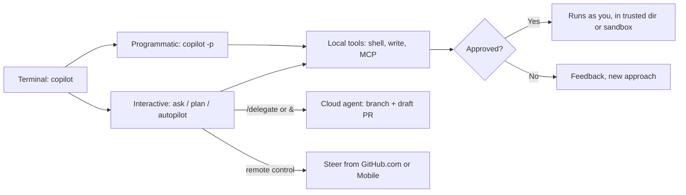
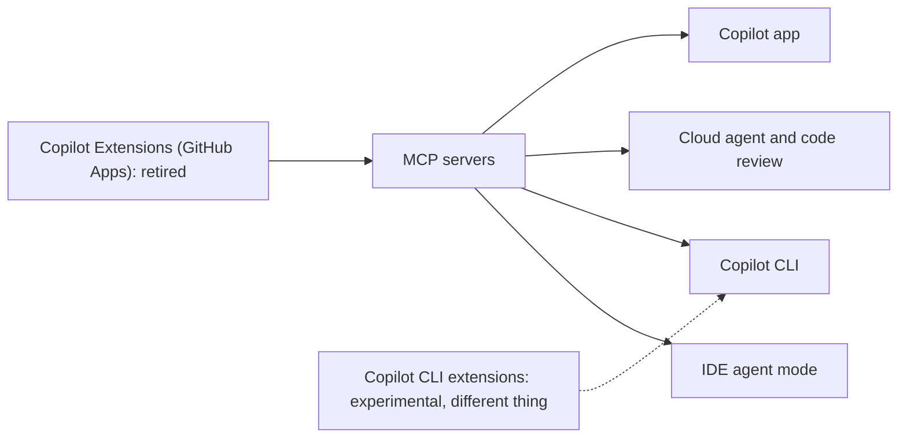

import { TLDR, DocsLinks, LastVerified, FlashCards } from '@components';
import { Aside, Badge, Tabs, TabItem, Steps } from '@astrojs/starlight/components';

<LastVerified date="2026-10" />

<TLDR>
- **Copilot CLI** is a terminal-native agent and is **included in every plan**. It has three modes: **ask/execute**, **plan** (Shift+Tab) and **autopilot**.
  - **Programmatic use:** `copilot -p "…"`.
  - **Approvals:** tool use is approval-gated. You can loosen this with `--allow-tool`, `--deny-tool` and `--allow-all-tools`.
  - **Delegation:** `/delegate` hands the task to the **cloud agent**.
- **Copilot Spaces** bundle context for Copilot: repos, PRs, issues, files, notes and images. Anyone with a Copilot license, **including Free**, can create one. Questions are billed as chat.
- The original GitHub App-based **Copilot Extensions** are **retired**. **MCP** is the extensibility path now.
- The **GitHub MCP server** comes in two forms:
  - **Remote:** `https://api.githubcopilot.com/mcp/`, GHEC only, not GHES.
  - **Local:** a binary or Docker image.
  - Expose only what you need with **toolsets** and **read-only** mode.
</TLDR>

## Common booth questions

<details>
<summary>Is Copilot CLI GA? Which plan do I need?</summary>

The plans page says *"All plans include Copilot CLI and the Copilot app"*, and that includes Free. No docs page labels the core CLI as preview. The sub-features that **are** labeled are:
- **Cloud sandboxes** <Badge text="Preview" variant="caution" />.
- **CLI extensions** <Badge text="Experimental" variant="caution" />.

CLI usage consumes **AI Credits**.

We couldn't find a dated GA announcement for the CLI, so verify before you quote a date.

</details>

<details>
<summary>How do I stop the CLI from running dangerous commands in CI?</summary>

Run it programmatically with explicit allow and deny rules. A **deny always wins over an allow**:

```shell
copilot -p "Fix the lint errors" \
  --allow-tool='write' --allow-tool='shell(npm)' \
  --deny-tool='shell(rm)' --deny-tool='shell(git push)'
```

For more isolation:
- Enable **local sandboxing** with `/sandbox enable`.
- Use a **cloud sandbox** with `copilot --cloud` <Badge text="Preview" variant="caution" />.
- Run it in a container or VM.

Be careful with `--allow-all-tools`, `/allow-all` and `/yolo`. They give Copilot **your** permissions.

</details>

<details>
<summary>Does our org's MCP policy apply to the CLI?</summary>

**Not fully. This is a key admin gotcha.** The docs list two org-level policies that the CLI **can't currently enforce**:
- **MCP servers in Copilot**.
- **MCP Registry URL**.

If you need tight control over MCP in the terminal, combine the following:
- Managed configuration.
- Hooks.
- Endpoint controls.

</details>

<details>
<summary>What replaced Copilot Extensions?</summary>

**MCP.** The old GitHub App-based Copilot Extensions integration is **retired**, and the old "building Copilot Extensions" docs now redirect to the MCP concept page.

Today, "extensions" means something else: **Copilot CLI extensions**. These are JS modules that add tools and slash commands to a CLI session, and they are **experimental**.

We couldn't verify the exact retirement date.

</details>

<details>
<summary>Can I use the GitHub MCP server with GitHub Enterprise Server?</summary>

The **remote** server (`api.githubcopilot.com/mcp/`) is **not supported on GHES**. You can run the **local** server (binary or Docker) and point it at your GHES host.

Remember that Copilot itself isn't available on GHES. This scenario is about **other MCP hosts and agents** working against GHES data.

</details>

<details>
<summary>What's a Copilot Space vs custom instructions?</summary>

**Custom instructions** are always-on *rules* that tell Copilot how to behave.

A **Space** is curated *knowledge* for a topic. It can hold:
- Repos, which track the **latest `main`**.
- Specific files, PRs and issues.
- Free-text notes and transcripts.
- Uploads and images.

You can share a Space across an org (admin, editor or viewer access) or publicly. You can also reach Spaces from the IDE through the GitHub MCP server.

</details>

<details>
<summary>Can I steer a CLI session from my phone?</summary>

Yes, with **remote control**. A synced CLI session can be monitored and steered from **GitHub.com or GitHub Mobile** while it keeps running on your machine, which must stay online. On Business and Enterprise, this needs the **"Store local sessions in the Cloud"** policy set to at least **View**.

Press have called this "Mission Control", but the docs don't use that name.

</details>

## Copilot CLI

<Tabs>
<TabItem label="Install">

```shell
# npm (all platforms, Node.js 22+)
npm install -g @github/copilot

# macOS / Linux (Homebrew)
brew install --cask copilot-cli

# Windows
winget install GitHub.Copilot

# Install script (macOS / Linux)
curl -fsSL https://gh.io/copilot-install | bash
```
Then run `copilot`, and use `/login` if you're asked to sign in. It runs on Linux, macOS and Windows (PowerShell and WSL). For usage-based billing to display correctly, use **v1.0.48 or later**.

</TabItem>
<TabItem label="Modes">

| Mode | How | What happens |
|---|---|---|
| Ask/execute (default) | `copilot` | Conversational; asks before risky tools |
| **Plan** | <kbd>Shift</kbd>+<kbd>Tab</kbd> | Clarifying questions → structured plan, no code yet |
| **Autopilot** | <kbd>Shift</kbd>+<kbd>Tab</kbd> or `--autopilot` | Works hands-free locally with full permissions (cap with `--max-autopilot-continues`) |
| Programmatic | `copilot -p "…"` | Single prompt, then exit; combine with approval flags |
| **Delegate** | `/delegate …` or prefix prompt with `&` | Hands off to the **cloud agent** → branch + draft PR |
| Cloud sandbox <Badge text="Preview" variant="caution" /> | `copilot --cloud` | Whole session in an isolated cloud env; inherits cloud-agent policies (e.g. firewall) |

</TabItem>
<TabItem label="Permissions">

**Trusted directories.** When a session starts, the CLI asks you to confirm that you trust the launch directory. **Don't launch it from your home directory.**

**Per-tool prompts.** When a tool needs approval, you choose one of:
- **Yes** (this time only).
- **Yes for the rest of the session.** This approves *any* use of that tool. Approving `rm` once, for example, allows `rm -rf`.
- **No**, with feedback.

**Flags:**
- `--allow-tool` and `--deny-tool` accept `'shell(cmd)'`, `'shell(git push)'`, `'write'`, `'MyServer'` or `'MyServer(tool)'`.
- `--allow-all-tools` approves everything.
- **Deny takes precedence over allow.**

**In a session:** `/allow-all` and `/yolo` loosen approvals.

</TabItem>
<TabItem label="Customize">

- **MCP:** the **GitHub MCP server is preconfigured**. Add more servers with `copilot mcp add --transport http NAME URL` or `/mcp add`. They are saved in `~/.copilot/mcp-config.json`.
- **Custom agents:** agent profiles live in `~/.copilot/agents`, the repo's `.github/agents`, or the org's `.github-private` repo under `/agents`. Pick one with `/agent`.
- **Built-in agents:** `explore`, `task`, `general-purpose`, `code-review`, `research`, `rubber-duck` and `security-review`.
- **Other customization:** custom instructions, **skills**, **hooks** and **Copilot Memory**.
- **Models:** switch with `/model` or `--model`. Some models offer a **1M-token context** and configurable reasoning, and both use more credits. You can also bring your **own provider** (OpenAI-compatible, Azure OpenAI, Anthropic, or local models such as Ollama) through `COPILOT_PROVIDER_*` environment variables.
- **Context:** `/usage` shows the credits used in the session. `/context` and `/compact` manage the context window. Auto-compaction kicks in at about 95%.

</TabItem>
</Tabs>



<Aside type="caution" title="Admin gotchas">
- The CLI **doesn't enforce** the "MCP servers in Copilot" or "MCP Registry URL" policies.
- The **audit log does not capture local CLI prompts**. Use hooks or a custom logging integration if you need that.
- Sessions are stored locally and may **sync to GitHub** depending on settings and the "Store local sessions in the Cloud" policy.
</Aside>

## The GitHub Copilot app and the SDK

- **GitHub Copilot app:** a dedicated workspace for managing agent-driven work across **parallel tasks and multiple repositories**, tying together the browser, the terminal and the PR lifecycle. It is included in all plans. Auto model selection is GA there, and the Efficiency / Balance / Intelligence tiers are available.
- **GitHub Copilot SDK:** build your own apps and internal tools on the **same primitives** that power the first-party Copilot surfaces.

## Copilot Spaces

- A Space can contain:
  - Repositories, which always track the **latest code on `main`**.
  - Specific code files, PRs and issues.
  - Free text such as notes and transcripts.
  - Images and file uploads.
- **Org-owned** spaces can be shared with members at **admin, editor or viewer** access, or kept hidden. **Personal** spaces can be public (view-only by default), shared with specific people, or private.
- You use Spaces in Copilot Chat on **GitHub.com**, and from the **IDE through the GitHub MCP server** (the remote server's `copilot_spaces` toolset).
- **Billing:** questions in a Space are billed like chat, in AI Credits.
- **Use cases:** onboarding packs, "how our auth works" knowledge hubs, incident runbooks, and a Space for each product area.

## Copilot on GitHub.com and Mobile

| Surface | Highlights |
|---|---|
| **Chat on GitHub.com** | Ask about any repo, file, issue, PR or discussion (attach with `@`); built-in GitHub tools such as creating branches, files and issues; semantic code search; hand a task from chat to the cloud agent |
| **Agents page / tab** | Start, monitor and steer cloud, third-party and custom agent sessions; set up **automations** |
| **Pull requests** | **PR summaries** (not on Free); Copilot code review; `@copilot` to iterate |
| **Session history** | Query your synced sessions from the cloud agent, code review, the CLI, VS Code, JetBrains and the app (if your policies allow) |
| **Public code references** | Matches to public code are shown with repo and licence info in chat and agent logs |
| **GitHub Mobile** | Copilot Chat; code review; start cloud agent tasks; steer remote CLI sessions |
| **GitHub Desktop** | Commit message and summary generation |
| **Windows Terminal** | Copilot Chat in the terminal |

## Copilot Extensions → MCP



Talking point: MCP works across **every major Copilot surface**, so you build an integration **once**. Partners who want a full agent persona on GitHub use **agent apps** <Badge text="Preview" variant="caution" />.

## The GitHub MCP server

<Tabs>
<TabItem label="Remote (hosted)">

```json title=".vscode/mcp.json"
{
  "servers": {
    "github": {
      "type": "http",
      "url": "https://api.githubcopilot.com/mcp/"
    }
  }
}
```
- Hosted by GitHub and authenticated with OAuth or a PAT. **Not supported on GHES.**
- **Toolsets by URL:** `…/mcp/x/<toolset>`, for example `/mcp/x/actions`. Add `/readonly` to expose only read tools, for example `/mcp/readonly`.
- **Headers:** `X-MCP-Toolsets`, `X-MCP-Tools`, `X-MCP-Readonly`, `X-MCP-Lockdown` and `X-MCP-Insiders`.
- Toolsets that exist only on the remote server: `copilot`, `copilot_spaces` and `github_support_docs_search`.

</TabItem>
<TabItem label="Local">

```shell
# Docker
docker run -i --rm \
  -e GITHUB_PERSONAL_ACCESS_TOKEN=<token> \
  -e GITHUB_TOOLSETS="repos,issues,pull_requests,actions,code_security" \
  ghcr.io/github/github-mcp-server

# Binary flags
github-mcp-server --toolsets default,actions --read-only
github-mcp-server --lockdown-mode
```
- Works with GHES, because you supply the host and the token.
- `GITHUB_TOOLSETS` takes precedence over `--toolsets`.
- `--tools` adds individual tools on top of the toolsets.

</TabItem>
</Tabs>

**Toolsets:**
- **`default`** = `context`, `repos`, `issues`, `pull_requests`, `users`.
- **Others:** `actions`, `code_security`, `code_quality`, `secret_protection`, `dependabot`, `security_advisories`, `discussions`, `gists`, `git`, `governance` (rulesets and custom properties), `labels`, `notifications`, `orgs`, `projects`, `stargazers`, `copilot`.
- **`all`** enables everything.

**Safety knobs:**
- **Read-only mode** wins over everything: write tools are skipped even if you request them explicitly.
- **Lockdown mode** hides content from public repos that was written by users **without push access**. It reduces prompt-injection risk, but it is **not an authorization boundary**.

**Governance:**
- The **"MCP servers in Copilot"** policy is off by default and applies to Business and Enterprise users.
- OAuth app and GitHub App policies.
- PAT policies.
- SSO enforcement.
- The **`managed-settings.json` allowlist (GA)**, or a **custom MCP registry** <Badge text="Preview" variant="caution" /> built on the v0.1 registry spec.

**Discovery:** the **GitHub MCP Registry** at `github.com/mcp` is a curated list of partner and community servers.

Talking point: **fewer tools means better tool choice and a smaller context**. The server's own docs recommend enabling only the toolsets you need.

<FlashCards
	title="CLI & MCP quick quiz"
	cards={[
		{ q: 'Run the CLI non-interactively?', a: '`copilot -p "prompt"`. Add `--allow-tool` / `--deny-tool` flags as needed.' },
		{ q: 'Which wins: `--allow-all-tools` or `--deny-tool`?', a: '**`--deny-tool`** always takes precedence.' },
		{ q: 'Hand a CLI task to the cloud agent?', a: '`/delegate <task>`, or prefix the prompt with `&`.' },
		{ q: 'Remote GitHub MCP server URL?', a: '`https://api.githubcopilot.com/mcp/`. Not supported on GHES.' },
		{ q: 'Make the remote MCP server read-only?', a: 'Append `/readonly` to the URL, or send the `X-MCP-Readonly` header.' },
		{ q: 'Default local MCP toolsets?', a: '`context`, `repos`, `issues`, `pull_requests`, `users`.' },
		{ q: 'Who can create Copilot Spaces?', a: 'Anyone with a Copilot license, **including Copilot Free**.' },
		{ q: 'Status of the original Copilot Extensions?', a: '**Retired.** MCP is the successor.' },
		{ q: 'Which org MCP policies does the CLI not enforce?', a: '"MCP servers in Copilot" and "MCP Registry URL".' },
	]}
/>

<DocsLinks links={[
  { label: 'About GitHub Copilot CLI', href: 'https://docs.github.com/en/copilot/concepts/agents/copilot-cli/about-copilot-cli' },
  { label: 'Installing Copilot CLI', href: 'https://docs.github.com/en/copilot/how-tos/copilot-cli/set-up-copilot-cli/install-copilot-cli' },
  { label: 'Delegating tasks (autopilot, /delegate)', href: 'https://docs.github.com/en/copilot/how-tos/copilot-cli/use-copilot-cli/delegate-tasks-to-cca' },
  { label: 'Remote control of CLI sessions', href: 'https://docs.github.com/en/copilot/concepts/agents/copilot-cli/about-remote-control' },
  { label: 'About Copilot Spaces', href: 'https://docs.github.com/en/copilot/concepts/prompting-and-context/spaces' },
  { label: 'Model Context Protocol (MCP) and Copilot', href: 'https://docs.github.com/en/copilot/concepts/customizations/mcp' },
  { label: 'Copilot CLI extensions (experimental)', href: 'https://docs.github.com/en/copilot/concepts/customizations/extensions' },
  { label: 'Configure an MCP registry', href: 'https://docs.github.com/en/copilot/how-tos/administer-copilot/manage-mcp-usage/configure-mcp-registry' },
  { label: 'GitHub MCP server (repo)', href: 'https://github.com/github/github-mcp-server' },
  { label: 'Where to use GitHub Copilot', href: 'https://docs.github.com/en/copilot/get-started/where-to-use-github-copilot' },
]} />
