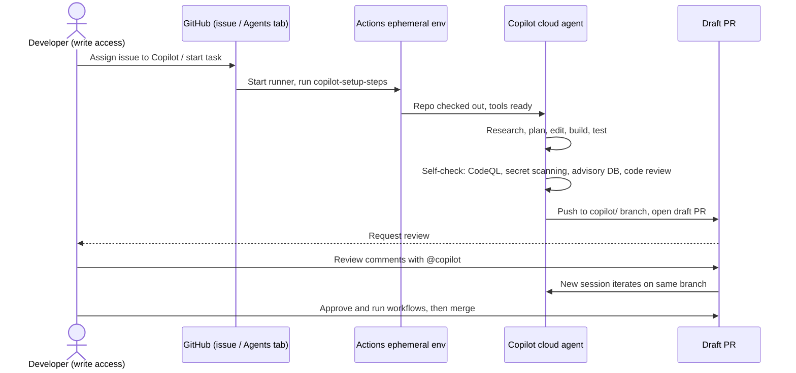
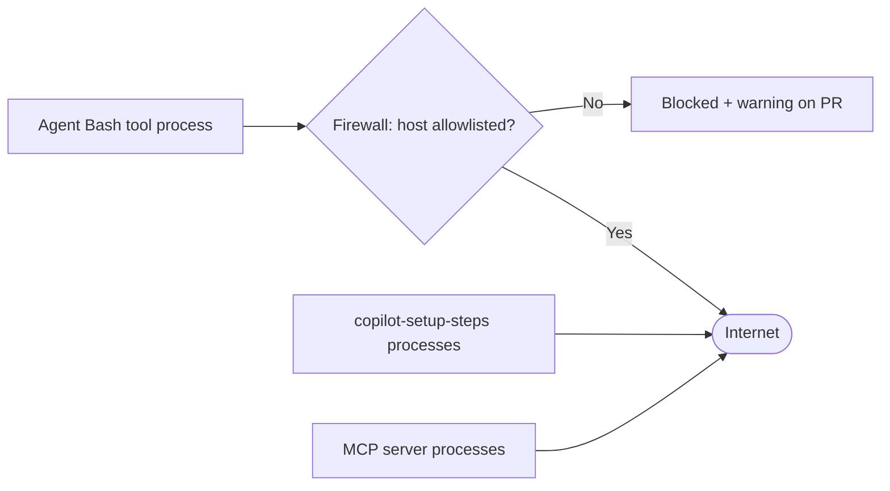

import { TLDR, DocsLinks, LastVerified, DecisionTree, YamlBuilder } from '@components';
import { Aside, Badge, Tabs, TabItem, Steps } from '@astrojs/starlight/components';

export const setupBase = `name: "Copilot Setup Steps"

on:
  workflow_dispatch:
  push:
    paths:
      - .github/workflows/copilot-setup-steps.yml
  pull_request:
    paths:
      - .github/workflows/copilot-setup-steps.yml

jobs:
  # The job MUST be named copilot-setup-steps
  copilot-setup-steps:
    # Ubuntu x64 or Windows x64 only; larger runner / ARC labels also work
    runs-on: ubuntu-latest
    # @job
    permissions:
      contents: read
    steps:
      # @steps
`;

export const setupOptions = [
	{
		id: 'checkout',
		label: 'Check out the repo',
		default: true,
		description: 'Optional: Copilot checks out the repo itself after setup if you don\'t.',
		snippet: `
- name: Checkout code
  uses: actions/checkout@v6`,
	},
	{
		id: 'lfs',
		label: 'Check out with Git LFS',
		description: 'Use **instead of** the plain checkout if the repo uses LFS.',
		snippet: `
- name: Checkout code (with LFS)
  uses: actions/checkout@v6
  with:
    lfs: true`,
	},
	{
		id: 'node',
		label: 'Node.js + npm ci',
		snippet: `
- name: Set up Node.js
  uses: actions/setup-node@v7
  with:
    node-version: "22"
    cache: "npm"
- name: Install JavaScript dependencies
  run: npm ci`,
	},
	{
		id: 'python',
		label: 'Python + pip install',
		snippet: `
- name: Set up Python
  uses: actions/setup-python@v6
  with:
    python-version: "3.13"
    cache: "pip"
- name: Install Python dependencies
  run: pip install -r requirements.txt`,
		explanation: 'Check the latest major version of `actions/setup-python` before copying.',
	},
	{
		id: 'timeout',
		label: 'Shorter timeout',
		section: 'job',
		snippet: 'timeout-minutes: 30',
		explanation: 'The maximum is **59**. A session can never run longer than 59 minutes.',
	},
	{
		id: 'services',
		label: 'Postgres service container',
		section: 'job',
		snippet: `
services:
  postgres:
    image: postgres:16
    env:
      POSTGRES_PASSWORD: postgres
    ports:
      - 5432:5432`,
		explanation: '`services` is one of the few job keys Copilot honours: `steps`, `permissions`, `runs-on`, `services`, `snapshot` and `timeout-minutes`.',
	},
];

<LastVerified date="2026-10" />

<TLDR>
- The **Copilot cloud agent** (formerly "coding agent") works **asynchronously**:
  - You assign an issue or describe a task.
  - It researches, plans, edits, builds and tests in an **ephemeral GitHub Actions environment**.
  - It pushes to a `copilot/` branch and opens a **draft pull request** for human review.
- You configure its environment with **`.github/workflows/copilot-setup-steps.yml`**. The file must be on the **default branch** and contain a single job named `copilot-setup-steps`.
- **Guardrails:**
  - Only users with **write access** can trigger it.
  - It can push to **one branch**.
  - It **can't approve or merge** its own PR, and the person who asked for the PR can't approve it either.
  - **Actions workflows wait for approval** before they run on its PRs.
  - Internet access goes through a **firewall**.
- **Cost:** AI Credits plus **Actions minutes**. Sessions are capped at **59 minutes**.
- **Copilot code review:** works in any language and can be set up as an automatic reviewer through rulesets. Each review costs AI Credits plus Actions minutes.
</TLDR>

## Common booth questions

<details>
<summary>How is the coding agent different from agent mode in my IDE?</summary>

**Agent mode** runs **locally and synchronously**. You watch it work, and it uses your machine and your credentials.

The **cloud agent** runs **remotely and asynchronously** in an isolated Actions runner. Its output is a **PR** with a session log. Use it for well-scoped backlog work you can delegate, such as:
- Bug fixes.
- Adding tests.
- Small features.
- Dependency bumps.
- Docs.

There is a [decision tree](#cloud-agent-or-ide-agent-mode) below.

</details>

<details>
<summary>Can the agent push straight to main or merge its own PR?</summary>

**No.**
- It can only push to its own `copilot/…` branch, or to the PR branch when you `@copilot` on an existing PR.
- It **can't** run raw `git push`.
- It can't mark its PR "Ready for review", and it can't approve or merge.
- Branch protections and required checks still apply to it.
- The **person who asked** for the PR **can't approve it**, so "Required approvals" still needs a second human.

</details>

<details>
<summary>Why didn't my CI run on Copilot's PR?</summary>

This is **by design**. Workflows don't run on cloud-agent PRs until someone with write access clicks **Approve and run workflows**. You can change a setting so that workflows run automatically. Treat that as a security decision: the agent's code could modify workflows.

</details>

<details>
<summary>Our build needs private packages / internal network access. Will it work?</summary>

Yes, with configuration. Here are the options:
- **Pre-install dependencies** in `copilot-setup-steps.yml`.
- Add **Agents secrets and variables** for credentials.
- **Allowlist** the hosts in the firewall settings.
- For internal networks, use **larger runners with Azure private networking**, or **self-hosted ARC runners**. Ephemeral, single-use runners are recommended. With self-hosted runners you **must disable the built-in firewall** and supply your own network controls.

</details>

<details>
<summary>Does the firewall stop all data exfiltration?</summary>

**No.** GitHub says so explicitly. The firewall only covers processes started by the agent's **Bash tool**. It does **not** cover:
- **MCP server** processes.
- Anything that runs during **`copilot-setup-steps.yml`**.

It also only works on GitHub-hosted Linux runners: it is incompatible with Windows and self-hosted runners. Treat it as defence in depth, not a guarantee.

</details>

<details>
<summary>What does a session cost?</summary>

Each session uses **AI Credits**, which depend on the model and tokens, plus **GitHub Actions minutes**. Self-hosted runners don't use Actions minutes. Steering a running session with extra messages also consumes credits. With Auto model selection, paid plans get **10% off** model costs.

</details>

<details>
<summary>Can I use Claude or Codex instead of Copilot's agent?</summary>

Yes, as a **public preview** <Badge text="Preview" variant="caution" />. **Third-party coding agents** (Anthropic Claude via the Claude Agent SDK, and OpenAI Codex via the Codex SDK) run from the same places as Copilot's agent:
- The Agents tab.
- Issue assignment.
- `@AGENT_NAME` mentions on PRs.
- GitHub Mobile.
- VS Code.

They need a policy to be enabled: an org or enterprise policy on Business and Enterprise, or an account setting on Pro, Pro+ and Max. They are **not** available on Free or Student. Copilot applies the same security protections to them as it does to its own agent.

</details>

<details>
<summary>Does Copilot code review replace human reviewers?</summary>

Not by default. Copilot leaves **"Comment"** reviews, so its reviews don't count toward required approvals. Every review includes an **approval assessment** in the overview comment, but that assessment doesn't satisfy merge rules on its own.

**Copilot approvals** can be turned on at the enterprise, org or repo level. They are **off by default**. Once enabled, a Copilot "Approve" review satisfies the required-approval rule the same way a teammate's approval would. Repo admins can use **file paths** to control where Copilot approvals count. If new commits are pushed after Copilot approves, the approval is **dismissed**.

Talking point: use it as a **first-pass reviewer**, and turn on approvals only for low-risk paths.

</details>

## How the cloud agent works



Key facts:
- **One repo, one branch and one PR per task.** The agent can't change several repos in one run.
- **59-minute** maximum per session, which you cannot extend. Break big tasks into smaller ones.
- **Self-validation.** By default, the agent checks its own code with **CodeQL**, **secret scanning**, the **GitHub Advisory Database** (for new dependencies) and **Copilot code review**. This **doesn't need a GHAS, Code Security or Secret Protection license**. You can disable individual checks.
- **Commits:**
  - The **author is Copilot** and the **requester is the co-author**.
  - Commits are **signed** and show as "Verified".
  - Each commit message **links to the session log**.
- **Sessions:** cloud-agent sessions are **shared by default** with people who have repo access. Stopping a session ends the Actions run but keeps the commits that were already pushed.

### Entry points

| Where | How |
|---|---|
| Issues | Assign the issue to **Copilot** |
| Agents tab / page | `github.com/copilot/agents` or the repo **Agents** tab: start, pick a model or agent, monitor, **steer** |
| Copilot Chat on GitHub.com | Ask it to make a change; the chat context carries into the session |
| Pull requests | Comment `@copilot …` on an existing PR, or use "Fix with Copilot" from a code review comment <Badge text="Preview" variant="caution" /> |
| IDEs | Delegate from VS Code, JetBrains, Eclipse or Visual Studio |
| Terminal | GitHub CLI, Copilot CLI, the GitHub MCP server |
| Other | GitHub Mobile, REST API, Slack, Microsoft Teams, Jira, Azure Boards, Linear, Raycast |
| Security campaigns | Assign code scanning alerts to Copilot |
| Automations | Run on a schedule or on repo events (private or internal repos; Pro and above); configure on the repo **Agents** tab |

<Aside type="tip" title="Talking point: automations">
**Automations** let the cloud agent run on a **schedule or on repo events**, for example nightly "fix failing tests" or weekly release notes. Each run is billed to the user who **created** the automation. That user also **can't approve** the PRs the automation opens. Events from users without write access are ignored by default.
</Aside>

## `copilot-setup-steps.yml`

Rules that people get wrong:
- The file must be at **exactly** `.github/workflows/copilot-setup-steps.yml`, **on the default branch**.
- It must contain **one job named `copilot-setup-steps`**. Only these keys are honoured: `steps`, `permissions`, `runs-on`, `services`, `snapshot` and `timeout-minutes` (59 max). Everything else is ignored.
- If a step fails, Copilot **skips the remaining steps** and starts working anyway.
- Any `fetch-depth` you set on `actions/checkout` is overridden.
- Runners must be **Ubuntu x64 or Windows x64**. **macOS is not supported.** Windows isn't compatible with the built-in firewall, so use it with self-hosted or private-networked runners.
- **Copilot code review reuses this file by default.** To configure review separately, create `copilot-code-review.yml`.
- Org owners can set a **default runner type** for the cloud agent and decide whether repos can override it.

<YamlBuilder title="Build a copilot-setup-steps.yml" filename=".github/workflows/copilot-setup-steps.yml" base={setupBase} options={setupOptions} />

## Firewall and network



- The firewall is **on by default** for the cloud agent and code review. You configure it in the repo or org **Internet access** settings.
- The **recommended allowlist** covers:
  - OS package repos.
  - Common container registries (Docker Hub, ACR, ECR).
  - Language package registries.
  - Certificate authorities.
  - The hosts that the Playwright MCP server needs to download browsers.
- You can add your own hosts, or disable the firewall. You **must** disable it to use self-hosted runners.
- Blocked calls show up as a **warning on the PR**, listing the address and the command that tried to reach it.
- The diagram above shows the gap: setup steps and MCP servers **bypass** the firewall.

## MCP for the cloud agent

- **Defaults:**
  - The **GitHub MCP server**, read-only and scoped to the current repo.
  - The **Playwright MCP server**, restricted to localhost.
- You add more servers as repo JSON under **Settings → Copilot → MCP servers**. That configuration is **shared with code review**.
- **The agent uses configured tools autonomously, without asking for approval.** Allowlist specific, preferably read-only, `tools`.
- Supported: **tools only**, not resources or prompts.
- **Not supported:** remote servers that use **OAuth**.
- Secrets must be **Agents secrets or variables** whose names start with **`COPILOT_MCP_`**.
- For **code review**, each tool must declare `annotations.readOnlyHint: true`.

```json title="Repo Settings → Copilot → MCP servers"
{
  "mcpServers": {
    "sentry": {
      "type": "local",
      "command": "npx",
      "args": ["@sentry/mcp-server@latest"],
      "tools": ["get_issue_details", "get_issue_summary"],
      "env": {
        "SENTRY_ACCESS_TOKEN": "$COPILOT_MCP_SENTRY_ACCESS_TOKEN"
      }
    }
  }
}
```

## Security model

| Risk | Built-in mitigation |
|---|---|
| Agent pushes bad code | Pushes only to a single `copilot/` (or PR) branch; branch protections and required checks apply; no raw `git push` |
| Self-approval | Agent can't approve or merge; **requester can't approve**; unattributed agent PRs need **one extra approval** (default in rulesets, always for branch protection) |
| Malicious CI changes | **Workflows don't run until a write-access user approves** |
| Untrusted triggers | Only **write-access** users can trigger; comments from others are never shown to the agent |
| Prompt injection | Hidden characters and HTML comments are filtered out of issues and comments |
| Data exfiltration | Firewall (with the gaps noted above) |
| Vulnerable output | CodeQL, secret scanning, advisory DB check and Copilot code review before the PR is finished |
| Rulesets block the agent | A rule that only allows specific commit authors can block Copilot; add Copilot as a **bypass actor** in rulesets |
| Auditability | Signed commits, co-author attribution, session logs, `actor:Copilot` audit log events |

Admin switches:
- On Business and Enterprise, the **cloud agent policy** must be enabled. Enterprises can turn it on for **selected organizations** only.
- **Repo admins** can disable the agent for individual repos.

## Billing

- **AI Credits** for the model tokens of every session and every steering message. The agent bills the user who started the session. Automations bill the user who created the automation.
- **GitHub Actions minutes** for the ephemeral environment. Larger runners cost more per minute. **Self-hosted runners** don't consume minutes.
- Auto model selection gets **10% off** on paid plans.
- See [Plans & billing](/github-cheatsheet/copilot/plans-billing/) for allowances, budgets and what happens when credits run out.

## Third-party agents and agent apps

- **Third-party coding agents** <Badge text="Preview" variant="caution" />: **Claude** (Claude Agent SDK) and **OpenAI Codex** (Codex SDK). They are selectable in the Agents tab, by issue assignment and by `@AGENT_NAME` on PRs. They need policy enablement and are billed in AI Credits. The same mitigations apply to them as to the Copilot agent.
- **Agent apps** <Badge text="Preview" variant="caution" />: GitHub Apps from partners that expose their own agent (prompt, model, tools and MCP servers) at the same entry points. They are powered by the cloud agent and billed as Copilot AI Credits. Partner MCP calls authenticate with a GitHub-issued JWT. Enterprise-owned orgs need the "Agent apps" policy.

## Cloud agent or IDE agent mode?

<DecisionTree
	title="Should this task go to the cloud agent?"
	tree={{
		start: 'q1',
		nodes: {
			q1: {
				question: 'Is the task **well-scoped**, with clear acceptance criteria that fit in an issue?',
				options: [
					{ label: 'Yes', next: 'q2' },
					{ label: 'No, exploratory or fuzzy', next: 'ide' },
				],
			},
			q2: {
				question: 'Does it touch **more than one repository**?',
				options: [
					{ label: 'Yes', next: 'split' },
					{ label: 'No', next: 'q3' },
				],
			},
			q3: {
				question: 'Can the repo be **built and tested in an Actions runner**, Ubuntu or Windows, with setup steps?',
				options: [
					{ label: 'Yes', next: 'q4' },
					{ label: 'No, needs macOS, special hardware or local-only resources', next: 'ide' },
				],
			},
			q4: {
				question: 'Do you want to **keep coding** while it runs, or run several tasks in parallel?',
				options: [
					{ label: 'Yes', next: 'cloud' },
					{ label: 'No, I want to pair interactively', next: 'ide' },
				],
			},
			cloud: { answer: '**Cloud agent.** Assign the issue to Copilot, add `copilot-setup-steps.yml`, and review the draft PR.', links: [{ label: 'Start Copilot sessions', href: 'https://docs.github.com/en/copilot/how-tos/use-copilot-agents/cloud-agent/start-copilot-sessions' }] },
			ide: { answer: '**IDE agent mode** (start with plan mode), or the **Copilot CLI**. You stay in the loop and use local resources.' },
			split: { answer: '**Split it.** The cloud agent works in one repo per task. Create one issue per repo, or coordinate across repos with the GitHub Copilot app or CLI.' },
		},
	}}
/>

## Copilot code review

<Tabs>
<TabItem label="What it is">

- Reviews PRs in **any language**. It leaves comments with suggested changes that you can apply in a couple of clicks.
- Where it runs:
  - GitHub.com, GitHub CLI, GitHub Mobile, VS Code, Visual Studio, Xcode and JetBrains.
  - **Azure DevOps** <Badge text="Preview" variant="caution" />.
- **Agentic capabilities:** it gathers context from the full project on **Actions runners**. If Actions is unavailable, it falls back to a more limited review.
- **"Fix with Copilot"** hands a suggestion to the cloud agent, which opens a fix PR <Badge text="Preview" variant="caution" />.
- **You can't pick the model.** Review uses a tuned model mix, which may include models that aren't enabled on your org's "Models" page.

</TabItem>
<TabItem label="Automatic reviews">

Three independent ways to turn it on:
- **User setting:** review my own PRs automatically. Needs Pro, Pro+, Max, Business or Enterprise; **not available for EMU** accounts.
- **Repository ruleset:** review all PRs from people with Copilot access.
- **Organization ruleset:** the same, across some or all repos.

How they interact:
- User and ruleset settings are **not hierarchical**. If either is on, the PR is reviewed, and it gets **only one** review.
- By default the review triggers when a PR **opens**, or the first time a draft becomes ready.
- Optional triggers: **review new pushes** and **review drafts**. If a ruleset turns these on, a user can't turn them off.
- To review again after changes, click **Re-request review**.

</TabItem>
<TabItem label="Customizing">

- Review reads **`.github/copilot-instructions.md`**, path-specific **`.github/instructions/**/*.instructions.md`**, **`AGENTS.md`** and a review-specific **`REVIEW.md`**.
- It reads these from the PR's **head branch**, not the base branch.
- Keep instructions to **about 1,000 lines or fewer**.
- **Effort levels:**
  - **Lite:** fast, for routine changes.
  - **Balanced** (the default): a higher-reasoning model for complex, security-sensitive or cross-service code.
  - The level is chosen in this order: per request → previous run on the PR → requester's default → repo → org → Balanced.
- The environment comes from `copilot-setup-steps.yml`, or from `copilot-code-review.yml` if you create one. MCP tools need `readOnlyHint`.

</TabItem>
<TabItem label="Billing & licensing">

- Each review costs **AI Credits** plus **Actions minutes**. The docs estimate about **$0.05–$1** at Lite and **$0.25–$5** at Balanced, excluding Actions minutes.
- **Who pays:**
  - For automatic reviews, the **PR author**.
  - For a manual request, the **requester**.
  - For PRs the cloud agent authored, the **human co-author**.
  - For bot PRs, the **org**.
  - Owners can choose to bill the org for licensed members instead.
- **Reviews without a Copilot license** (Business and Enterprise only): enable **AI credits paid usage** plus **"Allow members without a Copilot license to use Copilot code review in GitHub.com"**. Those reviews are billed to the org, on GitHub.com only.
- **"Only allow Copilot code review to be triggered by authorized users"** stops people from using *external* licenses (personal or another org) on your repos.
- To track Actions usage, filter on the `copilot-pull-request-reviewer` workflow, or on `dynamic/agents/copilot-pull-request-reviewer` in billing reports.

</TabItem>
</Tabs>

**Good at:**
- Catching bugs, security issues and style inconsistencies early.
- Summarizing what changed.
- Enforcing conventions you write into the instructions.

**Limits:**
- Its reviews don't count as required approvals unless **Copilot approvals** are enabled, which is off by default.
- It reviews only once unless push reviews are enabled.
- It can miss issues or make mistakes, so keep human review for anything critical.

<DocsLinks links={[
  { label: 'GitHub Copilot on GitHub.com (cloud agent)', href: 'https://docs.github.com/en/copilot/concepts/agents/cloud-agent/about-cloud-agent' },
  { label: 'Risks and mitigations for Copilot cloud agent', href: 'https://docs.github.com/en/copilot/concepts/agents/cloud-agent/risks-and-mitigations' },
  { label: 'Configure the development environment (copilot-setup-steps.yml)', href: 'https://docs.github.com/en/copilot/how-tos/copilot-on-github/customize-copilot/customize-cloud-agent/customize-the-agent-environment' },
  { label: 'Customizing or disabling the firewall', href: 'https://docs.github.com/en/copilot/how-tos/copilot-on-github/customize-copilot/customize-the-firewall' },
  { label: 'Copilot allowlist reference', href: 'https://docs.github.com/en/copilot/reference/copilot-allowlist-reference' },
  { label: 'Configure MCP servers for your repository', href: 'https://docs.github.com/en/copilot/how-tos/copilot-on-github/customize-copilot/configure-mcp-servers' },
  { label: 'Third-party coding agents', href: 'https://docs.github.com/en/copilot/concepts/agent-capabilities/about-agents/about-third-party-coding-agents' },
  { label: 'Copilot automations', href: 'https://docs.github.com/en/copilot/concepts/agents/cloud-agent/about-automations' },
  { label: 'Copilot code review', href: 'https://docs.github.com/en/copilot/concepts/agent-capabilities/agent-powered-workflows-and-operations/code-review' },
  { label: 'Configuring automatic code review', href: 'https://docs.github.com/en/copilot/how-tos/copilot-on-github/set-up-copilot/configure-code-review' },
]} />
