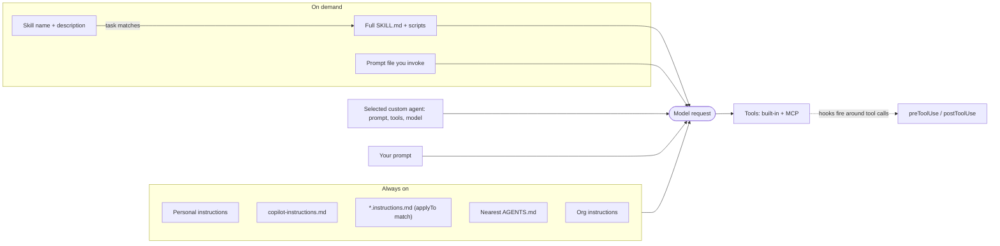

import { TLDR, DocsLinks, LastVerified, CompareTable, FlashCards } from '@components';
import { Aside, Badge, Tabs, TabItem } from '@astrojs/starlight/components';

<LastVerified date="2026-10" />

<TLDR>
- **Always on:** custom instructions — `.github/copilot-instructions.md`, `.github/instructions/*.instructions.md` (with `applyTo`), `AGENTS.md`, plus personal and organization instructions.
- **Loaded when relevant:** agent skills (`.github/skills/<name>/SKILL.md`). Copilot reads the name and description first and loads the full skill only when it matches the task.
- **You invoke them:** prompt files (`.github/prompts/*.prompt.md`) and custom agents (`.github/agents/<name>.agent.md`). Org- and enterprise-level agents live in a `.github-private` repo.
- **Code, not prompts:** hooks (`.github/hooks/*.json`) run shell commands at lifecycle events. MCP servers add tools. Plugins bundle all of the above.
- Support varies by surface. Check the [cheat sheet table](#which-surface-supports-what) before promising a feature.
</TLDR>

## Common booth questions

<details>
<summary>What's the difference between custom instructions, prompt files, custom agents and skills?</summary>

GitHub's own one-liners:
- **Instructions** tell Copilot *how to behave* in general.
- **Skills** tell it *how to handle a specific kind of task*, and load only when relevant.
- **Custom agents** *define specialized roles* with their own instructions and tools.
- **Prompt files** are reusable templates that *you* run for one focused interaction.

The quickest way to tell them apart is how each one is triggered: automatic, automatic-when-relevant, selected by you, or invoked by you.

</details>

<details>
<summary>Does Copilot read AGENTS.md? What about CLAUDE.md?</summary>

Yes. `AGENTS.md` files can live anywhere in the repo, and **the nearest one in the directory tree wins**. A single root-level `CLAUDE.md` or `GEMINI.md` is also accepted.

Support depends on the surface:

| Surface | Agent instruction files read |
|---|---|
| Copilot cloud agent | `AGENTS.md`, `CLAUDE.md`, `GEMINI.md` |
| Copilot CLI | `AGENTS.md`, `CLAUDE.md`, `GEMINI.md` |
| Copilot code review on GitHub.com | `AGENTS.md`, `CLAUDE.md`, `GEMINI.md`, `REVIEW.md` |
| VS Code Chat | `AGENTS.md` |

</details>

<details>
<summary>Can we define custom agents once for the whole company?</summary>

Yes, at two levels:
- **Organization:** put profiles in `/agents/NAME.md` in the org's `.github` or `.github-private` repo.
- **Enterprise:** put profiles in `/agents/NAME.md` in a designated `.github-private` repo.

When names collide across levels, the **lowest (most specific) level wins**. A repo agent therefore overrides an org agent with the same file name.

</details>

<details>
<summary>Are skills a Copilot-only format?</summary>

No. GitHub describes the Agent Skills specification as an **open standard** ([agentskills/agentskills](https://github.com/agentskills/agentskills)) that other AI systems also use. Copilot reads skills from `.github/skills`, `.claude/skills` and `.agents/skills`, so one skill folder can serve several agent harnesses.

Install shared skills with `gh skill install OWNER/REPO SKILL` <Badge text="Preview" variant="caution" /> (GitHub CLI 2.90.0+). Preview a skill first, because skills are **not verified by GitHub**.

</details>

<details>
<summary>Do custom instructions guarantee Copilot follows a rule?</summary>

No. GitHub says it plainly: *"Instructions guide the model, but do not guarantee that it will follow every rule."*

If a rule must always hold (for example "never run `rm -rf`" or "always format after edit"), enforce it with a **hook** (`preToolUse` can deny a tool call), a linter, CI or rulesets. Don't rely on prose.

</details>

<details>
<summary>Where do I configure MCP for the coding agent vs. my IDE?</summary>

- **IDE (VS Code):** `.vscode/mcp.json`, shared with the repo, or your user `settings.json`.
- **Cloud agent and code review:** repo **Settings → Copilot → MCP servers**, as JSON with an `mcpServers` object. The `mcp-servers` property in a custom agent profile also works.

The cloud agent uses the configured tools **without asking for approval**, so allowlist specific read-only tools.

</details>

<details>
<summary>Do VS Code agent "handoffs" work on GitHub.com?</summary>

Not on the cloud agent. GitHub's reference notes that the `argument-hint` and `handoffs` properties from VS Code/IDE custom agents are **ignored** by Copilot cloud agent on GitHub.com. The cloud agent ignores them rather than failing, so one profile can still be used on both.

</details>

## Which surface supports what?

This table comes from GitHub's customization cheat sheet. "Preview" means the surface supports it in preview.

<CompareTable
	title="Customization support by surface"
	columns={[
		{ key: 'vscode', label: 'VS Code' },
		{ key: 'vs', label: 'Visual Studio' },
		{ key: 'jb', label: 'JetBrains' },
		{ key: 'eclipse', label: 'Eclipse' },
		{ key: 'xcode', label: 'Xcode' },
		{ key: 'gh', label: 'GitHub.com' },
		{ key: 'cli', label: 'Copilot CLI' },
	]}
	rows={[
		{ feature: 'Custom instructions', category: 'Always on', values: { vscode: true, vs: true, jb: 'Preview', eclipse: 'Preview', xcode: 'Preview', gh: true, cli: true } },
		{ feature: 'Prompt files', category: 'Invoked by you', values: { vscode: true, vs: true, jb: 'Preview', eclipse: false, xcode: 'Preview', gh: false, cli: false } },
		{ feature: 'Custom agents', category: 'Invoked by you', values: { vscode: true, vs: true, jb: 'Preview', eclipse: 'Preview', xcode: 'Preview', gh: true, cli: true } },
		{ feature: 'Subagents (runtime)', category: 'Automatic', values: { vscode: true, vs: false, jb: 'Preview', eclipse: 'Preview', xcode: 'Preview', gh: false, cli: true } },
		{ feature: 'Agent skills', category: 'Loaded when relevant', values: { vscode: true, vs: true, jb: 'Preview', eclipse: false, xcode: false, gh: true, cli: true } },
		{ feature: 'Hooks', category: 'Deterministic', values: { vscode: 'Preview', vs: false, jb: false, eclipse: false, xcode: false, gh: true, cli: true } },
		{ feature: 'MCP servers', category: 'Tools', values: { vscode: true, vs: true, jb: true, eclipse: true, xcode: true, gh: true, cli: true } },
	]}
/>

<Aside type="caution">
"GitHub.com" here mostly means **Copilot cloud agent and Copilot code review**. Hooks on the cloud agent support **only a subset of events**. Prompt files are an IDE feature.
</Aside>

## How context gets assembled



When several instruction types apply, **personal instructions take the highest priority, then repository, then organization**, but *all* relevant sets are sent. GitHub advises avoiding conflicting instructions.

## Custom instructions

| Type | Location / format | Notes |
|---|---|---|
| Repository-wide | `.github/copilot-instructions.md` | Applies to every request in the repo context. The cloud agent can generate one for you. |
| Path-specific | `.github/instructions/**/NAME.instructions.md` with `applyTo` glob frontmatter | Stacks with repo-wide instructions. Optional `excludeAgent: "code-review"` or `"cloud-agent"`. On GitHub.com, used only by the cloud agent and code review. |
| Agent instructions | `AGENTS.md` anywhere (nearest wins), or a single root `CLAUDE.md` / `GEMINI.md` | Follows the community [agents.md](https://github.com/agentsmd/agents.md) format. |
| Code-review-only | `REVIEW.md` | Read by Copilot code review on GitHub.com. |
| Personal | GitHub.com settings UI. CLI: `~/.copilot/copilot-instructions.md` or `~/.copilot/instructions/**/*.instructions.md` | Highest priority. |
| Organization | Org settings UI (Business/Enterprise) | Used by Chat, cloud agent and code review on GitHub.com. **Not** used in VS Code Chat. |

<Tabs>
<TabItem label="copilot-instructions.md">

```markdown
This is a Go service with a Ruby client. Keep it short — Copilot reads this on every request.

## Build & test
- Build: `make build` · Test: `make test` · Full CI: `make ci`
- Run `make fmt` before committing.

## Non-obvious rules
- `proto/` changes require `make proto`.
- Bump `ruby/lib/billing-platform/version.rb` (semver) when touching `ruby/`.
```

</TabItem>
<TabItem label="Path-specific">

```markdown
---
applyTo: "**/tests/*.spec.ts"
excludeAgent: "code-review"
---
Use Playwright `getByRole()` / `getByTestId()` locators, never CSS selectors.
Each test must be independent; rely on auto-wait, never `setTimeout()`.
```

</TabItem>
<TabItem label="AGENTS.md">

```markdown
# AGENTS.md (packages/api/)
- Package manager: pnpm. Run `pnpm -F api test` before finishing.
- Never edit generated files in `src/gen/`.
```

</TabItem>
</Tabs>

<Aside type="tip">
**Code review reads instructions from the PR's head branch**, not the base branch. GitHub suggests keeping review instructions to roughly **1,000 lines or fewer**.
</Aside>

## Prompt files

Prompt files are reusable, **on-demand** templates for one focused interaction. They live in `.github/prompts/*.prompt.md`, and VS Code and JetBrains also let you configure another location. You run one by referencing or picking it in chat.

```markdown
---
description: Generate a React form component
---
Your goal is to generate a new React form component named ${input:formName}.
Ask for the fields if not provided.
- Use our design-system components: [Form.md](../../docs/design-system/Form.md)
- Use `react-hook-form` + `yup`; define TypeScript types for form data.
```

<Aside type="note">
Prompt files are an **IDE feature**: VS Code and Visual Studio GA; JetBrains and Xcode in preview. They are not supported in Eclipse, on GitHub.com or in the CLI. The `${input:...}` variable and extra frontmatter keys are IDE-specific, so check your IDE's docs.
</Aside>

## Custom agents

Custom agents are **agent profiles**: Markdown with YAML frontmatter that define a specialist role, its prompt (max 30,000 characters) and optionally restricted tools, a pinned model and MCP servers.

| Level | Location |
|---|---|
| Repository | `.github/agents/NAME.agent.md` |
| Organization | `/agents/NAME.md` in the org's `.github` or `.github-private` repo |
| Enterprise | `/agents/NAME.md` in a designated `.github-private` repo |
| Personal | User profile (IDE / Copilot CLI) |

```markdown
---
name: planner
description: Read-only planner. Researches the codebase and writes an implementation plan; never edits files.
tools: ["read", "search"]
# model: <a model name>   # optional; omit to inherit the default model
---
You are a planning specialist. Produce a numbered plan with files to touch,
risks, and a test strategy. Do not modify code.
```

| Frontmatter key | Purpose |
|---|---|
| `description` | **Required.** What the agent does. |
| `name` | Display name (optional). |
| `tools` | Allowlist, e.g. `["read","search","edit"]`, `github/*` or `some-mcp/tool`. Omit it for all tools; use `[]` for none. |
| `model` | Pin a model. If omitted, the default model is inherited. |
| `target` | `vscode` or `github-copilot`. If unset, both. |
| `disable-model-invocation` / `user-invocable` | Control auto-selection vs. manual selection. These replace the retired `infer`. |
| `mcp-servers` | Per-agent MCP servers. GitHub.com / CLI only; not used in IDE custom agents. |
| `handoffs`, `argument-hint` | VS Code/IDE properties. **Ignored by the cloud agent.** |

Tool aliases include `execute` (shell), `read`, `edit`, `search`, `agent`, `web` and `todo`. The last two are not applicable on the cloud agent.

<Aside type="note">
Copilot CLI ships **built-in agents** (`explore`, `task`, `general-purpose`, `code-review`, `research`, `rubber-duck`, `security-review`). Check these before writing your own.
</Aside>

## Agent skills

```text
.github/skills/
└── release-notes/
    ├── SKILL.md            # required; name + description frontmatter
    ├── template.md         # optional resources
    └── collect-changes.sh  # optional scripts
```

```markdown
---
name: release-notes
description: Drafts release notes using our template. Use when asked to write release notes or a changelog.
allowed-tools: shell   # optional; only pre-approve shell for skills you fully trust
---
1. Run `collect-changes.sh` from this skill's directory to list merged PRs.
2. Group them using `template.md`. Keep breaking changes first.
```

- **Locations:**
  - Project: `.github/skills`, `.claude/skills` or `.agents/skills`.
  - Personal: `~/.copilot/skills` or `~/.agents/skills`.
  - Personal skills aren't automatically available to cloud agents.
- **Progressive disclosure:** Copilot uses the skill's **name and description** to decide when to load it. Only then does the full body come in, and the files in the skill folder become available. This keeps the baseline context lean.
- **Supported in:** the Copilot app, CLI, cloud agent, code review, and agent mode in VS Code, Visual Studio and JetBrains (preview).

## Hooks

Hooks run **your shell commands** at agent lifecycle events. Unlike instructions, they execute code rather than asking the model.

```json
{
  "version": 1,
  "hooks": {
    "preToolUse": [
      { "type": "command", "bash": "./scripts/deny-dangerous.sh", "powershell": "./scripts/deny-dangerous.ps1", "timeoutSec": 15 }
    ],
    "postToolUse": [
      { "type": "command", "bash": "cat >> logs/tool-results.jsonl" }
    ]
  }
}
```

- **Location:** repo `.github/hooks/*.json` (CLI + cloud agent). The CLI also reads personal `~/.copilot/hooks/*.json`.
- **Events:** `sessionStart`, `sessionEnd`, `userPromptSubmitted`, `preToolUse` (can **approve/deny** a tool call), `postToolUse`, `agentStop`, `subagentStop`, `errorOccurred`. The cloud agent supports a subset.
- **Surfaces:** Copilot app, CLI, cloud agent, and VS Code <Badge text="Preview" variant="caution" />.
- **Performance:** hooks run synchronously and block the agent, so GitHub suggests keeping each one under ~5 s.

## MCP servers

<Tabs>
<TabItem label="VS Code (.vscode/mcp.json)">

```json
{
  "servers": {
    "github": { "type": "http", "url": "https://api.githubcopilot.com/mcp/" },
    "fetch": { "command": "uvx", "args": ["mcp-server-fetch"] }
  }
}
```

</TabItem>
<TabItem label="Cloud agent (repo settings)">

```json
{
  "mcpServers": {
    "sentry": {
      "type": "local",
      "command": "npx",
      "args": ["@sentry/mcp-server@latest"],
      "tools": ["get_issue_details"],
      "env": { "SENTRY_ACCESS_TOKEN": "$COPILOT_MCP_SENTRY_TOKEN" }
    }
  }
}
```

</TabItem>
</Tabs>

Cloud agent and code review specifics:
- **Defaults:** the GitHub MCP server (read-only, scoped to the current repo) and the Playwright MCP server (localhost only) are on by default.
- **Supported features:** tools only, no resources or prompts. Remote servers that use OAuth are not supported.
- **Secrets:** they must be named `COPILOT_MCP_*`.
- **Code review:** each tool must declare `annotations.readOnlyHint: true`.
- **Firewall:** the agent firewall does **not** cover MCP server processes.

Server names and package arguments in these samples are illustrative, so use each server's own docs.

## Plugins

**Plugins** are installable packages that bundle skills, custom agents, hooks and MCP configurations for distribution. They are supported in the Copilot app, CLI, cloud agent and VS Code. Use a plugin to share a team-wide bundle. For a single small workflow, a lone skill is simpler.

## Gotchas

- Path-specific instructions on GitHub.com are used **only** by the cloud agent and code review, not by Chat on GitHub.com.
- VS Code Chat doesn't use **organization** instructions. JetBrains Chat supports personal instructions; VS Code Chat's support list doesn't include them.
- In Copilot CLI, repository instructions are **not** passed to a custom agent running as a *subagent* by default. This is opt-in.
- Custom agent file name (minus `.md` / `.agent.md`) is the de-duplication key across repo/org/enterprise.
- `copilot-setup-steps.yml` is not a customization file in this sense, but it is how you give the cloud agent the right tools. See the [Copilot overview](/github-cheatsheet/copilot/).

<FlashCards
	title="File-path quiz"
	cards={[
		{ q: 'Repo-wide instructions file?', a: '`.github/copilot-instructions.md`' },
		{ q: 'Path-specific instructions file + key?', a: '`.github/instructions/NAME.instructions.md` with `applyTo` glob frontmatter' },
		{ q: 'Repo custom agent file?', a: '`.github/agents/NAME.agent.md`' },
		{ q: 'Enterprise-wide custom agents?', a: '`/agents/NAME.md` in a designated `.github-private` repo' },
		{ q: 'Skill file name and project location?', a: '`SKILL.md` inside `.github/skills/<skill-name>/` (or `.claude/skills`, `.agents/skills`)' },
		{ q: 'Hook config location and required field?', a: '`.github/hooks/*.json` with `"version": 1`' },
		{ q: 'Which hook can block a tool call?', a: '`preToolUse`' },
		{ q: 'Prefix for cloud-agent MCP secrets?', a: '`COPILOT_MCP_`' },
	]}
/>

<DocsLinks
	links={[
		{ label: 'Copilot customization cheat sheet', href: 'https://docs.github.com/en/copilot/reference/customization-cheat-sheet' },
		{ label: 'Comparing Copilot customization features', href: 'https://docs.github.com/en/copilot/concepts/customizations/comparing-customizations' },
		{ label: 'Adding repository custom instructions', href: 'https://docs.github.com/en/copilot/how-tos/copilot-on-github/customize-copilot/add-custom-instructions/add-repository-instructions' },
		{ label: 'Support for different types of custom instructions', href: 'https://docs.github.com/en/copilot/reference/custom-instructions-support' },
		{ label: 'Prompt files', href: 'https://docs.github.com/en/copilot/concepts/prompting-and-context/prompt-files' },
		{ label: 'Custom agents configuration reference', href: 'https://docs.github.com/en/copilot/reference/custom-agents-configuration' },
		{ label: 'Adding agent skills', href: 'https://docs.github.com/en/copilot/how-tos/copilot-on-github/customize-copilot/customize-cloud-agent/add-skills' },
		{ label: 'Hooks for GitHub Copilot', href: 'https://docs.github.com/en/copilot/concepts/customizations/hooks' },
		{ label: 'Configure MCP servers for your repository', href: 'https://docs.github.com/en/copilot/how-tos/copilot-on-github/customize-copilot/configure-mcp-servers' },
		{ label: 'Customization library (examples)', href: 'https://docs.github.com/en/copilot/tutorials/customization-library' },
	]}
/>
