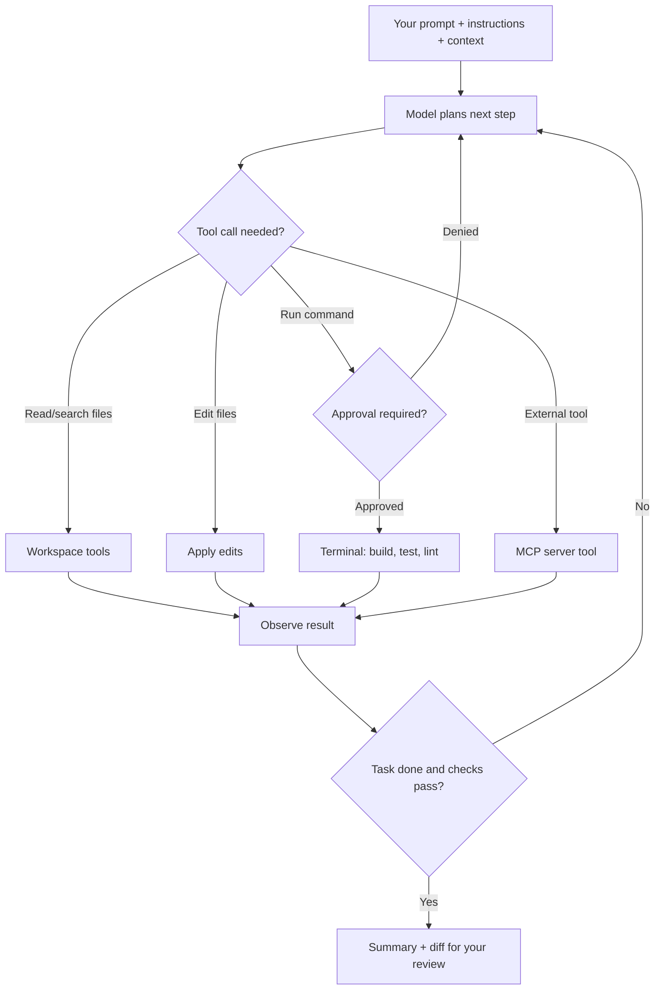
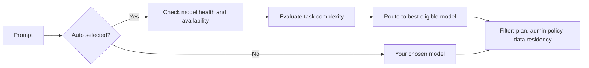

import { TLDR, DocsLinks, LastVerified, CompareTable, DecisionTree } from '@components';
import { Aside, Badge, Tabs, TabItem } from '@astrojs/starlight/components';

<LastVerified date="2026-10" />

<TLDR>
- The three ways you work with Copilot in an IDE:
  - **Inline**: completions and **next edit suggestions (NES)**. These cost no AI Credits on paid plans.
  - **Chat**: the chat panel and inline chat.
  - **Agents**: **agent mode**, which edits files, runs terminal commands and iterates; and **plan mode**, which drafts a plan before any code changes.
- **VS Code** gets new features first. **Visual Studio, JetBrains, Eclipse and Xcode** support chat, agent mode and MCP. **Neovim supports completions only.**
- **Auto model selection is GA.** It routes each prompt by task complexity and model health, and gives paid plans 10% off. Free and Student plans get Auto only.
- Agent mode can call **MCP tools**. Treat every MCP server like a dependency you install: vet it first.
</TLDR>

## Common booth questions

<details>
<summary>Is JetBrains / Eclipse / Xcode at parity with VS Code?</summary>

They are close for the core features. **Completions, chat, agent mode and MCP are GA in all of them.**

The differences:
- **NES** is GA in VS Code and Visual Studio. It is in **public preview** in JetBrains, Eclipse and Xcode.
- **Custom instructions** and **prompt files** are in preview in JetBrains and Xcode. Prompt files are not supported in Eclipse.
- **Edit mode** exists only in VS Code and JetBrains.

The feature matrix is itself marked public preview, so check it live. See the [support matrix](#ide-support-matrix).

</details>

<details>
<summary>Ask vs edit vs agent vs plan — which should I use?</summary>

- **Ask (chat):** questions and explanations. Nothing changes until you apply it.
- **Edit:** you choose the files and Copilot proposes multi-file edits that you review. Available only in VS Code and JetBrains.
- **Agent:** Copilot decides which files to touch, runs commands and tests, reads errors and iterates until the task is done.
- **Plan:** Copilot researches with **read-only** tools, asks clarifying questions and writes a step-by-step plan. You then click *Start Implementation* to hand it to agent mode.

</details>

<details>
<summary>Do completions use up my AI Credits?</summary>

**No.** Code completions and next edit suggestions are **not billed in AI Credits** and are unlimited on paid plans. Copilot Free is capped at **2,000 completions per month**. Chat, inline chat, agent mode and plan mode **do** consume credits.

</details>

<details>
<summary>How does Copilot know about my whole project?</summary>

Copilot uses several sources of context:
- **Workspace indexing**, which is GA in VS Code, Visual Studio, JetBrains and Eclipse, but **not** in Xcode.
- What's **open or selected** in the editor.
- **`#` references** to files, symbols, the selection and so on.
- **Custom instructions**, such as `.github/copilot-instructions.md`.

In agent mode, Copilot also **searches and reads files itself** with its tools.

</details>

<details>
<summary>Can I pick the model? Why is the picker missing for some users?</summary>

On **Free and Student**, only **Auto** is available, so there is no manual picker.

On paid plans, the picker shows the models your plan includes **minus the ones your admin has disabled** by policy. Auto never picks a model that is outside your plan, blocked by policy or excluded by data-residency rules.

The **Efficiency / Balance / Intelligence** tiers for Auto exist only in **VS Code, Copilot CLI and the Copilot app**.

</details>

<details>
<summary>Is agent mode safe? Can it run `rm -rf`?</summary>

Agent mode asks for approval before it runs terminal commands and sensitive tools. You can auto-approve specific tools, but that is a trade-off.

For risky work:
- Use **plan mode** first.
- Keep auto-approve narrow.
- Prefer the **cloud agent**, which runs in an isolated, firewalled Actions environment.

Note that **content exclusion does not apply to agent mode in IDEs**, per the content-exclusion docs.

</details>

<details>
<summary>Does Copilot work in Neovim / Vim?</summary>

**Only code completion.** Chat, agent mode, MCP and NES are not supported there. For a terminal-first workflow, point people to the **Copilot CLI** instead. See [CLI & more](/github-cheatsheet/copilot/cli-and-more/).

</details>

## The building blocks

| Feature | What it does | Credits? |
|---|---|---|
| **Code completion** | Ghost-text suggestions as you type | No (unlimited on paid; 2,000/mo on Free) |
| **Next edit suggestions (NES)** | Predicts the *next* edit location and change, e.g. after a rename | No |
| **Chat** | Side-panel conversation with the workspace as context | Yes |
| **Inline chat** | Prompt in place, in the editor (or terminal in VS Code) | Yes |
| **Edit mode** | Multi-file edits on a working set *you* choose | Yes |
| **Agent mode** | Autonomous loop: plan, edit, run, read errors, fix | Yes (often many model calls per task) |
| **Plan mode** | Read-only research, then a reviewable plan, then hand-off to agent | Yes |
| **Code review in IDE** | Review the selection or uncommitted changes | Yes |

Gotcha: In **Visual Studio**, NES must be **enabled manually**.

## Agent mode loop



Talking point: agent mode is **iterative and self-correcting**. It reads compiler and test output and tries again. That is also why one agent task can use **many** model calls, which matters under token billing.

## Context: `#` references, `@` participants, `/` commands

<Tabs>
<TabItem label="VS Code">

- **`#` chat variables** attach context: `#file`, `#selection`, `#function`, `#class`, `#block`, `#sym`, `#project`, `#path`…
- **`@` participants** route the prompt to a domain expert:
  - `@github`: GitHub skills.
  - `@terminal`: the terminal.
  - `@vscode`: editor commands.
  - `@azure` <Badge text="Preview" variant="caution" />.
- **`/` commands**: `/explain`, `/fix`, `/tests`, `/fixTestFailure`, `/new`, `/clear`, `/help`.

</TabItem>
<TabItem label="Visual Studio">

- **`#` references**: `#MyFile.cs`, `#MyFile.cs: 66-72` for a line range, and `#solution`.
- **`/` commands**: `/doc`, `/explain`, `/fix`, `/optimize`, `/tests`, `/help`.

</TabItem>
<TabItem label="GitHub.com">

- **`@` mentions** attach issues, PRs, files, repositories and discussions.
- Chat on GitHub.com has built-in GitHub MCP skills such as `create_branch`, `create_or_update_file` and `merge_pull_request`.

</TabItem>
</Tabs>

Type `/`, `#` or `@` in the chat box to see what's available. The lists differ by IDE and version.

## Models: Auto vs manual



**Auto status:**
- GA with **task optimization** in Chat on GitHub.com, VS Code, the Copilot CLI, the Copilot app and JetBrains.
- GA in a **reliability/availability-optimized** variant in Eclipse, Xcode and Visual Studio.

**Tiers:** Efficiency, Balance and Intelligence bias routing toward cost or quality. They exist only in VS Code, the CLI and the app.

**Model guidance from the docs:** small, fast models suit quick, repetitive tasks. The larger Codex, Opus and Astra-class models suit deep reasoning and long agentic work. See [model comparison](https://docs.github.com/en/copilot/reference/ai-models/model-comparison).

## MCP in agent mode

- MCP is GA in VS Code, Visual Studio, JetBrains, Eclipse and Xcode, and is included on **all plans**, including Free.
- **VS Code** needs version 1.99 or later. You can install servers from the Extensions view with `@mcp <name>` (the GitHub MCP Registry, <Badge text="Preview" variant="caution" />) or configure them in `.vscode/mcp.json`.
- **Business and Enterprise** admins control MCP with the **"MCP servers in Copilot"** policy, which is **disabled by default**. That policy does not govern Free, Pro, Pro+ or Max users.
- Enterprises can restrict *which* servers are allowed:
  - **`managed-settings.json` allowlist (GA):** this is the recommended method.
  - **Custom MCP registry** <Badge text="Preview" variant="caution" />.

```json title=".vscode/mcp.json"
{
  "servers": {
    "github": {
      "type": "http",
      "url": "https://api.githubcopilot.com/mcp/"
    }
  }
}
```

## IDE support matrix

<Aside type="note">Source: [Copilot feature matrix](https://docs.github.com/en/copilot/reference/copilot-feature-matrix). The matrix page itself is labeled public preview and subject to change.</Aside>

<CompareTable
	title="Copilot features by IDE"
	columns={[
		{ key: 'vsc', label: 'VS Code' },
		{ key: 'vs', label: 'Visual Studio' },
		{ key: 'jb', label: 'JetBrains' },
		{ key: 'ecl', label: 'Eclipse' },
		{ key: 'xc', label: 'Xcode' },
		{ key: 'nvim', label: 'Neovim' },
	]}
	rows={[
		{ feature: 'Code completion', category: 'Inline', values: { vsc: 'GA', vs: 'GA', jb: 'GA', ecl: 'GA', xc: 'GA', nvim: 'GA' } },
		{ feature: 'Next edit suggestions', category: 'Inline', values: { vsc: 'GA', vs: 'GA (enable manually)', jb: 'Preview', ecl: 'Preview', xc: 'Preview', nvim: false } },
		{ feature: 'Chat', category: 'Chat', values: { vsc: 'GA', vs: 'GA', jb: 'GA', ecl: 'GA', xc: 'GA', nvim: false } },
		{ feature: 'Vision (images in chat)', category: 'Chat', values: { vsc: 'Preview', vs: 'GA', jb: 'Preview', ecl: 'GA', xc: 'Preview', nvim: false } },
		{ feature: 'Edit mode', category: 'Agents', values: { vsc: 'GA', vs: false, jb: 'GA', ecl: false, xc: false, nvim: false } },
		{ feature: 'Agent mode', category: 'Agents', values: { vsc: 'GA', vs: 'GA', jb: 'GA', ecl: 'GA', xc: 'GA', nvim: false } },
		{ feature: 'Plan mode', category: 'Agents', values: { vsc: true, vs: false, jb: true, ecl: true, xc: true, nvim: false } },
		{ feature: 'Copilot code review', category: 'Agents', values: { vsc: 'GA', vs: 'GA', jb: 'GA', ecl: false, xc: 'GA', nvim: false } },
		{ feature: 'MCP', category: 'Extensibility', values: { vsc: 'GA', vs: 'GA', jb: 'GA', ecl: 'GA', xc: 'GA', nvim: false } },
		{ feature: 'Custom agents', category: 'Customization', values: { vsc: 'GA', vs: 'GA', jb: 'Preview', ecl: 'GA', xc: 'Preview', nvim: false } },
		{ feature: 'Custom instructions', category: 'Customization', values: { vsc: 'GA', vs: 'GA', jb: 'Preview', ecl: 'Preview', xc: 'Preview', nvim: false } },
		{ feature: 'Prompt files', category: 'Customization', values: { vsc: 'GA', vs: 'GA', jb: 'Preview', ecl: false, xc: 'Preview', nvim: false } },
		{ feature: 'Workspace indexing', category: 'Context', values: { vsc: 'GA', vs: 'GA', jb: 'GA', ecl: 'GA', xc: false, nvim: false } },
		{ feature: 'Auto model selection', category: 'Models', values: { vsc: 'GA (with tiers)', vs: 'GA (availability-optimized)', jb: 'GA', ecl: 'GA (availability-optimized)', xc: 'GA (availability-optimized)', nvim: false } },
	]}
/>

Copilot also appears in **SQL Server Management Studio**, which is listed in the billing client-version table, and in **GitHub Desktop**, where it helps write commit messages.

<DecisionTree
	title="Which IDE mode should I suggest?"
	tree={{
		start: 'q1',
		nodes: {
			q1: {
				question: 'Does the visitor want to **change code**, or just understand it?',
				options: [
					{ label: 'Just understand / ask', next: 'ask' },
					{ label: 'Change code', next: 'q2' },
				],
			},
			q2: {
				question: 'Is the task **well-defined and small**, e.g. one function or a few known files?',
				options: [
					{ label: 'Yes', next: 'q3' },
					{ label: 'No, it is fuzzy or large', next: 'plan' },
				],
			},
			q3: {
				question: 'Does it need to **run builds/tests** and iterate?',
				options: [
					{ label: 'Yes', next: 'agent' },
					{ label: 'No', next: 'edit' },
				],
			},
			ask: { answer: '**Ask / chat** (or inline chat). Use `#` references for precise context.' },
			edit: { answer: '**Inline chat or edit mode** (edit mode: VS Code and JetBrains only). You stay in control of which files change.' },
			agent: { answer: '**Agent mode**. Keep tool auto-approval narrow.' },
			plan: { answer: '**Plan mode first**, then *Start Implementation* in agent mode. If it can run unattended, consider delegating to the **cloud agent**.', links: [{ label: 'Use plan mode', href: 'https://docs.github.com/en/copilot/how-tos/copilot-in-your-ide/use-copilot-agents/use-plan-mode' }] },
		},
	}}
/>

## Gotchas and talking points

- **Delegation from the IDE:** VS Code, JetBrains, Eclipse and Visual Studio can start a **cloud agent** session, so you can hand off long tasks and keep coding. See [Coding agent](/github-cheatsheet/copilot/coding-agent/).
- **Session sharing:** local IDE and CLI agent sessions are **unshared by default**. Cloud-agent sessions are shared with people who have repo access.
- **Content exclusion** does not cover agent mode in IDEs. Customers with strict exclusion needs should know this; the privacy & security page in this section has details.
- **Update clients.** Usage-based billing displays correctly only on newer clients, for example VS Code 1.120 or later and JetBrains plugin 1.9.1 or later. See [Plans & billing](/github-cheatsheet/copilot/plans-billing/#update-your-clients).

<DocsLinks links={[
  { label: 'Copilot feature matrix', href: 'https://docs.github.com/en/copilot/reference/copilot-feature-matrix' },
  { label: 'Copilot Chat cheat sheet', href: 'https://docs.github.com/en/copilot/reference/chat-cheat-sheet' },
  { label: 'Using agent mode in your IDE', href: 'https://docs.github.com/en/copilot/how-tos/copilot-in-your-ide/use-copilot-agents/use-agent-mode' },
  { label: 'Using plan mode in your IDE', href: 'https://docs.github.com/en/copilot/how-tos/copilot-in-your-ide/use-copilot-agents/use-plan-mode' },
  { label: 'Auto model selection', href: 'https://docs.github.com/en/copilot/concepts/models/auto-model-selection' },
  { label: 'Supported AI models', href: 'https://docs.github.com/en/copilot/reference/ai-models/supported-models' },
  { label: 'Extend Copilot Chat with MCP', href: 'https://docs.github.com/en/copilot/how-tos/copilot-in-your-ide/customize-copilot/extend-copilot-with-tools-and-context/extend-copilot-chat-with-mcp' },
]} />
