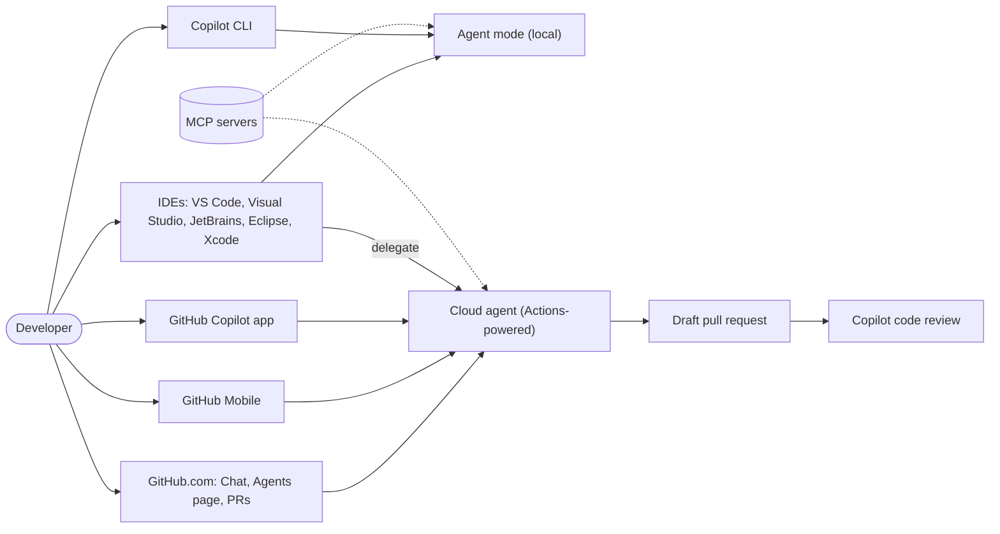
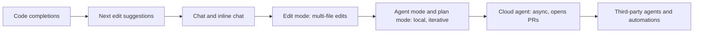

import { TLDR, DocsLinks, LastVerified } from '@components';
import { Aside, Badge, LinkCard, CardGrid } from '@astrojs/starlight/components';

<LastVerified date="2026-10" />

<TLDR>
- Copilot is no longer only an IDE plugin. It runs in **IDEs, GitHub.com, the Copilot CLI, the GitHub Copilot app, GitHub Mobile and the SDK**, and it powers **agents** that open pull requests on their own.
- **Billing changed on June 1, 2026.** Premium requests are now *legacy*. Usage is metered in **GitHub AI Credits**, where 1 credit = $0.01 and the cost depends on the model and the tokens used. Completions and next edit suggestions remain unlimited on paid plans.
- There are six plans to know: **Free, Pro, Pro+, Max (new, $100/mo), Business and Enterprise**. Student is a seventh, free plan for verified students.
- **Auto model selection is GA.** Paid plans get a 10% discount on model costs when they use Auto.
- Copilot is **not available on GitHub Enterprise Server**. Copilot Enterprise requires GitHub Enterprise Cloud.
</TLDR>

## Common booth questions

What changed with Copilot since last Universe?

The billing model is the biggest change. On June 1, 2026, request-based billing (premium requests and multipliers) was replaced by **usage-based billing in GitHub AI Credits**. Other changes:
- A new **Copilot Max** individual plan at $100/month.
- **Auto model selection** is now GA.
- A unified **Agents** page and tab where you start, steer and track agent sessions.
- **Third-party coding agents** (Anthropic Claude, OpenAI Codex) <Badge text="Preview" variant="caution" />.
- Copilot CLI now has **plan mode** and **cloud sandboxes** <Badge text="Preview" variant="caution" />.

See [Plans & billing](/github-cheatsheet/copilot/plans-billing/).

Can we use Copilot with GitHub Enterprise Server?

Not directly. The docs state: *"Copilot is not currently available for GitHub Enterprise Server."* Copilot Enterprise is designed for **GitHub Enterprise Cloud** (including GHE.com). GHES customers usually license Copilot through a GHEC enterprise account. Note that the remote GitHub MCP server is not supported on GHES either.

What's the difference between agent mode and the coding agent?

**Agent mode** runs **in your IDE (or the CLI)**. It works synchronously: you watch it edit files and run commands on *your* machine.

The **Copilot coding agent** works asynchronously. Current docs call it the **Copilot cloud agent**. It runs **in the cloud** in an ephemeral environment powered by GitHub Actions, and it delivers its work as a **pull request**. You can assign it an issue and walk away.

See [Coding agent & code review](/github-cheatsheet/copilot/coding-agent/).

Does Copilot train on our code?

For **Business/Enterprise** (volume-licensed) customers, no. The GitHub Generative AI Services Terms say GitHub will not use Inputs or Outputs to train generative AI models unless the customer instructs it to. Individual plans are covered by different terms, which include an opt-out setting. Details are on the privacy & security page, linked below.

Which plan do I need for the coding agent?

Any plan **except Free**. The cloud agent is included in Student, Pro, Pro+, Max, Business and Enterprise. On Business and Enterprise, an admin must enable the cloud agent policy first.

## The Copilot surface map

## From completions to agents

Talking point: each step **delegates more autonomy**. The human review checkpoint moves from *each keystroke* to *each pull request*. Copilot's safeguards move along with it:
- Branch protections.
- Workflows that need approval before they run.
- The rule that the requester can't approve the agent's PR.

## Pages in this section

<CardGrid>
	<LinkCard title="Plans & billing" href="/github-cheatsheet/copilot/plans-billing/" description="AI Credits, plan comparison, Auto discount, budgets, what happens when you run out." />
	<LinkCard title="IDE features" href="/github-cheatsheet/copilot/ide-features/" description="Completions, NES, chat, edit/agent/plan mode, model picker, IDE support matrix." />
	<LinkCard title="Coding agent & code review" href="/github-cheatsheet/copilot/coding-agent/" description="Cloud agent lifecycle, copilot-setup-steps.yml, firewall, security model, code review." />
	<LinkCard title="CLI, Spaces, MCP & more" href="/github-cheatsheet/copilot/cli-and-more/" description="Copilot CLI, Spaces, GitHub.com and mobile, Extensions → MCP, GitHub MCP server." />
	<LinkCard title="Customization" href="/github-cheatsheet/copilot/customization/" description="Instructions, prompt files, custom agents, skills, hooks." />
	<LinkCard title="Best practices" href="/github-cheatsheet/copilot/best-practices/" description="Getting good results from agents in 2026." />
	<LinkCard title="Admin & governance" href="/github-cheatsheet/copilot/admin-governance/" description="Policies, AI controls, metrics, audit log." />
	<LinkCard title="Privacy & security" href="/github-cheatsheet/copilot/privacy-security/" description="Data handling, training, IP, content exclusion." />
</CardGrid>

<Aside type="caution" title="Naming">
Docs now say **"Copilot cloud agent"** where older material says **"Copilot coding agent"**. Both names refer to the same product. Press coverage also used names such as "Agent HQ" and "Mission Control", which we could **not** confirm as current official names. Use "Agents page/tab" at the booth.
</Aside>

<DocsLinks links={[
  { label: 'Where to use GitHub Copilot', href: 'https://docs.github.com/en/copilot/get-started/where-to-use-github-copilot' },
  { label: 'Plans for GitHub Copilot', href: 'https://docs.github.com/en/copilot/get-started/plans' },
  { label: 'Copilot feature matrix', href: 'https://docs.github.com/en/copilot/reference/copilot-feature-matrix' },
  { label: 'GitHub Copilot on GitHub.com (cloud agent)', href: 'https://docs.github.com/en/copilot/concepts/agents/cloud-agent/about-cloud-agent' },
  { label: 'What changed with billing (June 2026)', href: 'https://docs.github.com/en/copilot/reference/copilot-billing/request-based-billing-legacy/what-changed-with-billing' },
]} />
