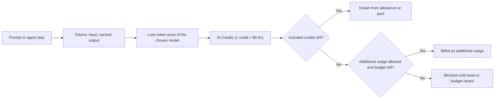

import { TLDR, DocsLinks, LastVerified, CompareTable, FlashCards, DecisionTree } from '@components';
import { Aside, Badge, Tabs, TabItem } from '@astrojs/starlight/components';

<LastVerified date="2026-10" />

<TLDR>
- **Since June 1, 2026**, Copilot is billed in **GitHub AI Credits**, where **1 credit = $0.01 USD**. The cost of an interaction depends on the **model** and the **tokens** it uses. "Premium requests" and multipliers are now **legacy** and apply only to some annual Pro/Pro+ holdouts.
- **Code completions and next edit suggestions cost no credits.** They are unlimited on paid plans. Free gets 2,000 completions a month.
- **Monthly credits per plan:**
  - Pro **1,500** (1,000 base + 500 flex).
  - Pro+ **7,000**.
  - Max **20,000**.
  - Business **1,900 per user** and Enterprise **3,900 per user**, both **pooled** across the billing entity.
- **Auto model selection** gives paid plans **10% off** model costs.
- Running out does **not** fall back to a cheaper model. Individuals can upgrade or set a budget for more usage. In organizations, additional usage is **on by default** unless an admin disables the "AI credits paid usage" policy.
</TLDR>

## Common booth questions

How much does each plan cost and what's included?

| Plan | Price | Monthly AI Credits |
|---|---|---|
| Free | $0 | An allowance (amount not published on the plans page) |
| Student | $0 (verified students) | An allowance |
| Pro | $10/month | 1,000 base + 500 flex = **1,500** |
| Pro+ | $39/month | 3,900 base + 3,100 flex = **7,000** |
| Max | $100/month | 10,000 base + 10,000 flex = **20,000** |
| Business | $19 per granted seat/month | **1,900 per user**, pooled |
| Enterprise | $39 per granted seat/month | **3,900 per user**, pooled |

Talking point: the base credits equal the subscription price. Pro's $10 buys 1,000 credits, which is $10 of usage.

What's the difference between AI Credits and the old premium requests?

**Premium requests (legacy):**
- Each chat or agent request counted as 1 request × a model **multiplier**.
- Pro included 300 requests a month and Pro+ included 1,500. Extra requests cost $0.04 each.

**AI Credits (current):**
- You pay for the **actual tokens** you use (input, cached and output) at each model's per-token price, converted to credits.
- A short question to a small model can cost a fraction of a credit. A long cloud-agent session on a frontier model costs much more.

What happens when we run out of credits? Does it fall back to a cheaper model?

**No.** The docs say: *"There is no automatic fallback to lower-cost models when a budget is exhausted."*

**Individuals** have three choices:
- **Upgrade.** You pay only the price difference, and the larger allowance applies immediately.
- **Set a dollar budget** for additional usage.
- **Wait** for the reset at 00:00 UTC on the 1st of the month.

**Organizations and enterprises:**
- If additional usage is allowed (the **default**), usage continues at $0.01 per credit.
- If it is not allowed, usage is blocked until the next cycle.
- A user who hits their **user-level budget** is blocked, even if the shared pool still has credits.

Do unused credits roll over? Do they reset on my billing date?

**No rollover.** Unused credits are forfeited. The allowance or pool resets at **00:00:00 UTC on the 1st of each calendar month**, whatever your billing date is.

How does pooling work for Business/Enterprise?

Every license adds its credits to a **shared pool** at the billing-entity level. For example, 100 Business seats give a pool of 190,000 credits. Heavy users draw more from the pool and light users offset them.
- **Adding seats** mid-cycle increases the pool **immediately**.
- **Removing seats** only shrinks the pool **next cycle**.

Is code review billed? What about the coding agent?

Both are billed in two parts: **AI Credits** for the model tokens and **GitHub Actions minutes** for the environment they run in.
- **Code review:** the docs estimate about **$0.05–$1** per review at "Lite" effort and **$0.25–$5** at "Balanced" effort (the default). Actions minutes are extra.
- **Cloud agent:** each session uses Actions minutes and AI Credits.
- **Self-hosted runners** don't consume Actions minutes.

See [Coding agent & code review](/github-cheatsheet/copilot/coding-agent/#billing).

I have Copilot Pro personally and my company gives me a Business seat. Do I pay twice?

No. When you're assigned a Business or Enterprise seat, your personal Pro, Pro+ or Max plan is **automatically canceled**, and you get a **prorated refund**.

Is the Auto discount worth mentioning?

Yes. Paid plans get **10% off model costs** when they use Auto in Chat, the CLI, the Copilot app and the cloud agent.

The docs also list a temporary **30% discount for Copilot Max** users on Auto, valid **through October 28, 2026**. That discount is about to expire, so check the docs before quoting it.

## Plan comparison

<Aside type="note">Values below come from the [Plans for GitHub Copilot](https://docs.github.com/en/copilot/get-started/plans) page as of October 2026. "Limited" or text values are quoted from that page.</Aside>

<CompareTable
	title="Copilot plans (Oct 2026)"
	columns={[
		{ key: 'free', label: 'Free' },
		{ key: 'student', label: 'Student' },
		{ key: 'pro', label: 'Pro' },
		{ key: 'proplus', label: 'Pro+' },
		{ key: 'max', label: 'Max' },
		{ key: 'biz', label: 'Business' },
		{ key: 'ent', label: 'Enterprise' },
	]}
	rows={[
		{ feature: 'Price', category: 'Pricing', values: { free: '$0', student: '$0 (verified)', pro: '$10/mo', proplus: '$39/mo', max: '$100/mo', biz: '$19/seat/mo', ent: '$39/seat/mo' } },
		{ feature: 'GitHub AI Credits / month', category: 'Pricing', values: { free: 'Allowance', student: 'Allowance', pro: '1,500 (1,000 + 500 flex)', proplus: '7,000 (3,900 + 3,100 flex)', max: '20,000 (10,000 + 10,000 flex)', biz: '1,900/user (pooled)', ent: '3,900/user (pooled)' } },
		{ feature: 'Code completions + next edit suggestions', category: 'IDE', values: { free: '2,000 completions/mo', student: 'Unlimited', pro: 'Unlimited', proplus: 'Unlimited', max: 'Unlimited', biz: 'Unlimited', ent: 'Unlimited' } },
		{ feature: 'Model access', category: 'Models', values: { free: 'Auto only', student: 'Auto only', pro: 'A selection of models', proplus: 'Premium models', max: 'Priority access to premium models', biz: 'Premium models', ent: 'Priority access to premium models' } },
		{ feature: 'Agent mode (IDE)', category: 'Agents', values: { free: true, student: true, pro: true, proplus: true, max: true, biz: true, ent: true } },
		{ feature: 'Copilot cloud (coding) agent', category: 'Agents', values: { free: false, student: true, pro: true, proplus: true, max: true, biz: true, ent: true } },
		{ feature: 'Copilot code review', category: 'Agents', values: { free: '"Review selection" in VS Code only', student: true, pro: true, proplus: true, max: true, biz: true, ent: true } },
		{ feature: 'Third-party agents (preview)', category: 'Agents', values: { free: false, student: false, pro: true, proplus: true, max: true, biz: true, ent: true } },
		{ feature: 'MCP', category: 'Agents', values: { free: true, student: true, pro: true, proplus: true, max: true, biz: true, ent: true } },
		{ feature: 'Copilot CLI + Copilot app', category: 'Surfaces', values: { free: true, student: true, pro: true, proplus: true, max: true, biz: true, ent: true } },
		{ feature: 'Repo & personal custom instructions, prompt files', category: 'Customization', values: { free: true, student: true, pro: true, proplus: true, max: true, biz: true, ent: true } },
		{ feature: 'Organization custom instructions', category: 'Customization', values: { free: false, student: false, pro: false, proplus: false, max: false, biz: true, ent: true } },
		{ feature: 'Content exclusion', category: 'Governance', values: { free: false, student: false, pro: false, proplus: false, max: false, biz: true, ent: true } },
		{ feature: 'Org-wide policy management', category: 'Governance', values: { free: false, student: false, pro: false, proplus: false, max: false, biz: true, ent: true } },
		{ feature: 'Audit logs', category: 'Governance', values: { free: false, student: false, pro: false, proplus: true, max: true, biz: true, ent: true } },
		{ feature: 'Block suggestions matching public code', category: 'Governance', values: { free: true, student: true, pro: true, proplus: true, max: true, biz: true, ent: true } },
		{ feature: 'PR summaries', category: 'GitHub.com', values: { free: false, student: true, pro: true, proplus: true, max: true, biz: true, ent: true } },
		{ feature: 'GitHub Spark (preview)', category: 'GitHub.com', values: { free: false, student: false, pro: false, proplus: true, max: false, biz: false, ent: true } },
	]}
/>

Gotchas:
- **Spark** <Badge text="Preview" variant="caution" /> is listed for **Pro+ and Enterprise only**. It is *not* listed for Max or Business.
- **Automatic code review** for your own PRs (a personal setting) needs Pro, Pro+, Max, Business or Enterprise, and it is **not available for managed user accounts (EMU)**. Repo and org rulesets can still enable automatic review.
- Free plans are only for individuals who **don't** already have Copilot through an organization. Verified teachers and maintainers of popular open source projects may get Pro free.

## How AI Credits work

**What consumes credits:** Copilot Chat, Copilot CLI, the cloud agent, Copilot Spaces, Spark, third-party coding agents and code review.
**What doesn't:** code completions and next edit suggestions.

**What makes usage go up:**
- Long conversations.
- Agentic sessions, which make many model calls per task.
- Large or extended context windows.
- Higher reasoning levels.
- Frontier models.

For individuals, **base credits** are used first, then the **flex allotment**. Flex is the variable part of the allowance that GitHub may tune as model economics change.

### Example per-token prices

These figures are USD per 1M tokens, taken from the [models and pricing](https://docs.github.com/en/copilot/reference/copilot-billing/models-and-pricing) page. Prices change, so verify them live before quoting.

| Model | Input | Cached input | Output |
|---|---|---|---|
| GPT-6 Luna | $0.10 | $0.01 | $0.50 |
| Claude Haiku 4.5 | $1.00 | $0.10 | $5.00 |
| GPT-5.3-Codex | $1.75 | $0.175 | $14.00 |
| Claude Sonnet 5 | $2.00 | $0.20 | $10.00 |
| Claude Opus 5 | $5.00 | $0.50 | $25.00 |
| GPT-6 Astra | $10.00 | $1.00 | $50.00 |

Talking point: the most expensive models in this sample cost about **100×** the cheapest on input. The cheapest output price is $0.50 and the most expensive is $50.00. That gap is why **Auto** and the right-sized model matter so much more under token billing.

## Budgets and controls

<Tabs>
<TabItem label="Individuals">

- Set an **additional usage budget** in USD. Credits draw it down at a fixed rate, so a $10 budget = 1,000 credits.
- Additional usage **may be capped**. If you hit the cap, you must pay what you've already used before you can continue.
- Upgrading mid-cycle charges only the **price difference**, and usage so far counts against the new, larger allowance.

</TabItem>
<TabItem label="Organizations & enterprises">

- The **AI credits paid usage** policy is **enabled by default**. Disable it in AI Controls if you want a hard stop at the pooled allowance.
- **User-level budgets (ULB)** cap how much one user consumes, from both the pool and additional usage. A **$0 ULB blocks the user immediately**. ULBs can be universal, per cost center or per individual. Individual ULBs can carry an expiry date.
- **Cost-center budgets** cap metered spend for a group of users *after* the pool is exhausted.
- **Organization budgets** and **enterprise spending limits** cap total metered charges after the pool is exhausted.
- A user can be blocked by an enterprise spending limit **before** they reach their own ULB.

</TabItem>
</Tabs>

<DecisionTree
	title="Visitor: 'Which Copilot plan should I get?'"
	tree={{
		start: 'q1',
		nodes: {
			q1: {
				question: 'Is this for a **company/organization** or for **yourself**?',
				options: [
					{ label: 'Company / organization', next: 'q2' },
					{ label: 'Myself', next: 'q4' },
				],
			},
			q2: {
				question: 'Do you need **GitHub Enterprise Cloud** features: a bigger pool per user, Spark, or enterprise-grade capabilities?',
				options: [
					{ label: 'Yes', next: 'ent' },
					{ label: 'No / not sure', next: 'q3' },
				],
			},
			q3: {
				question: 'Are users mostly **heavy agent users** (cloud agent, long agent-mode sessions)?',
				help: 'Business has 1,900 credits per user and Enterprise has 3,900. Both are pooled.',
				options: [
					{ label: 'Yes', next: 'ent' },
					{ label: 'No', next: 'biz' },
				],
			},
			q4: {
				question: 'Are you a verified **student**?',
				options: [
					{ label: 'Yes', next: 'student' },
					{ label: 'No', next: 'q5' },
				],
			},
			q5: {
				question: 'How heavily do you use chat and agents?',
				options: [
					{ label: 'Just trying it', next: 'free' },
					{ label: 'Daily, mostly completions + some chat', next: 'pro' },
					{ label: 'Daily agents, premium models', next: 'proplus' },
					{ label: 'Sustained, high-volume agent work', next: 'max' },
				],
			},
			ent: { answer: '**Copilot Enterprise**: $39/seat/month, 3,900 credits per user (pooled). Requires GitHub Enterprise Cloud.', links: [{ label: 'Choosing your enterprise plan', href: 'https://docs.github.com/en/copilot/tutorials/roll-out-at-scale/assign-licenses/choose-enterprise-plan' }] },
			biz: { answer: '**Copilot Business**: $19/seat/month, 1,900 credits per user (pooled). Includes policy management, content exclusion and org custom instructions.' },
			student: { answer: '**Copilot Student**: free, Auto model only, unlimited completions, cloud agent included (no third-party agents).' },
			free: { answer: '**Copilot Free**: 2,000 completions/month, Auto model only, an AI-credit allowance, agent mode and MCP included. No cloud agent.' },
			pro: { answer: '**Copilot Pro**: $10/month, 1,500 credits, unlimited completions.' },
			proplus: { answer: '**Copilot Pro+**: $39/month, 7,000 credits, premium models, audit logs, Spark (preview).' },
			max: { answer: '**Copilot Max**: $100/month, 20,000 credits, priority access to premium models.' },
		},
	}}
/>

## Legacy premium requests (for annual-plan holdouts)

<Aside type="caution">Only some annual **Pro/Pro+** subscribers who did not move to usage-based billing are still on request-based billing. GitHub states they **won't receive access to new models and features**.</Aside>

- Allowances: **Pro 300** and **Pro+ 1,500** premium requests a month. Overage costs **$0.04 per request**.
- Each model has a **multiplier**. Examples: Claude Haiku 4.5 = 0.33×, GPT-5.3-Codex = 6×, Claude Opus 4.8 = 27×.
- Since June 1, 2026, a Copilot code review costs a flat **13 premium requests**.
- Request-based billing originally started on June 18, 2025 (GitHub.com) and August 1, 2025 (GHE.com).

## Update your clients

Older clients keep working, but they may show wrong prices or usage, and usage alerts may not appear. For the usage-based model, the minimum versions are:

| Client | Minimum version |
|---|---|
| VS Code | 1.120 |
| Visual Studio 2022 | 17.14.33 |
| Visual Studio 2026 | 18.6.0 |
| JetBrains plugin | 1.9.1 |
| Eclipse plugin | 0.18.0 |
| Xcode extension | 0.50.0 |
| Copilot CLI | 1.0.48 |

## Quiz yourself

<FlashCards
	title="Copilot billing trivia"
	cards={[
		{ q: 'What is 1 GitHub AI Credit worth?', a: '**$0.01 USD**.' },
		{ q: 'When did usage-based billing replace premium requests?', a: '**June 1, 2026**.' },
		{ q: 'How many credits does Copilot Pro+ include per month?', a: '**7,000**: 3,900 base + 3,100 flex.' },
		{ q: 'How many credits does Copilot Max include?', a: '**20,000**: 10,000 base + 10,000 flex, for $100/month.' },
		{ q: 'Do completions consume AI Credits?', a: '**No.** Completions and next edit suggestions are unlimited on paid plans. Free gets 2,000 completions a month.' },
		{ q: 'Credits per Business user? Enterprise user?', a: '**1,900** and **3,900**, pooled across the billing entity.' },
		{ q: 'When do credits reset?', a: '00:00:00 **UTC on the 1st** of every month, with no rollover.' },
		{ q: 'Discount for using Auto model selection?', a: '**10%** on paid plans. Max also had a temporary 30% discount through Oct 28, 2026.' },
		{ q: 'Is overage on by default for orgs?', a: '**Yes.** To stop it, disable the **AI credits paid usage** policy.' },
		{ q: 'What does a $0 user-level budget do?', a: 'It **blocks the user immediately**.' },
		{ q: 'Which plans list Spark?', a: '**Pro+** and **Enterprise** only (public preview).' },
		{ q: 'Is Copilot available on GHES?', a: '**No.** Copilot Enterprise requires GitHub Enterprise Cloud.' },
	]}
/>

<DocsLinks links={[
  { label: 'Plans for GitHub Copilot', href: 'https://docs.github.com/en/copilot/get-started/plans' },
  { label: 'Usage-based billing for individuals', href: 'https://docs.github.com/en/copilot/concepts/billing-and-usage/individuals/billing' },
  { label: 'Usage-based billing for organizations and enterprises', href: 'https://docs.github.com/en/copilot/concepts/billing-and-usage/organizations-and-enterprises/billing' },
  { label: 'Budgets for usage-based billing', href: 'https://docs.github.com/en/copilot/concepts/billing-and-usage/organizations-and-enterprises/budgets' },
  { label: 'Models and pricing', href: 'https://docs.github.com/en/copilot/reference/copilot-billing/models-and-pricing' },
  { label: 'Auto model selection', href: 'https://docs.github.com/en/copilot/concepts/models/auto-model-selection' },
  { label: 'What changed with billing', href: 'https://docs.github.com/en/copilot/reference/copilot-billing/request-based-billing-legacy/what-changed-with-billing' },
]} />
