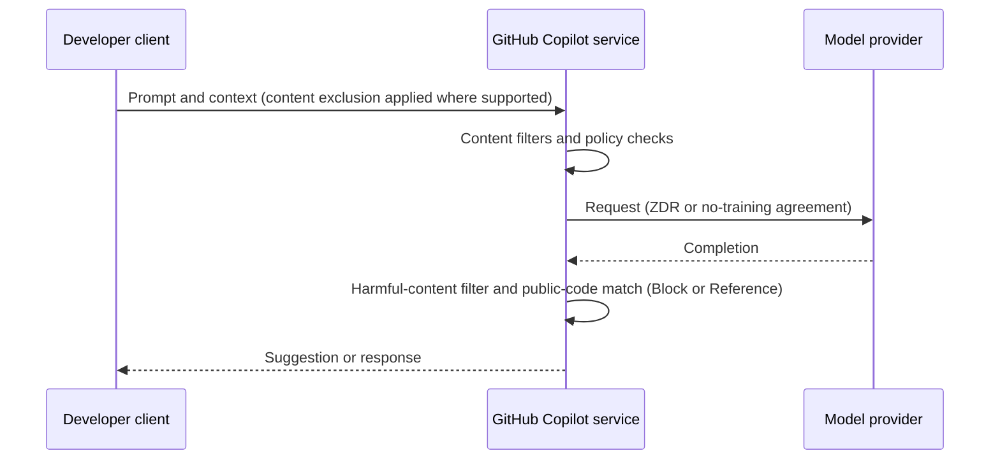
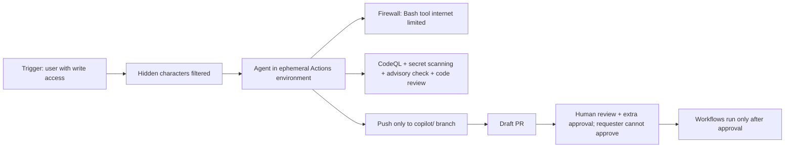

import { TLDR, DocsLinks, LastVerified, CompareTable, FlashCards } from '@components';
import { Aside, Badge } from '@astrojs/starlight/components';

<LastVerified date="2026-10" />

<TLDR>
- **Business/Enterprise:** *"GitHub will not use Inputs or Outputs to train generative AI models"* unless you instruct it to (Generative AI Services Terms §3, plus the DPA). You also keep ownership of your Inputs.
- **Free/Pro/Pro+/Max:** **since 24 April 2026**, GitHub *may* use interactions to train models **unless the user opts out**. This is the #1 reason to put developers on Business/Enterprise seats.
- **Model providers:** zero-data-retention or no-training agreements cover OpenAI, Anthropic (**except Claude Fable 5/5.1 by default**), Google, AWS and xAI. Everything still passes through GitHub's content filters.
- **IP:** the public-code filter can **Block** matches or show **references**. Defense of third-party claims covers Outputs *if your agreement provides it*, subject to Microsoft's "Required Mitigations". **Previews are excluded.**
- **Coding agent:**
  - Only users with write access can trigger it.
  - It pushes only to a `copilot/` branch.
  - Humans must approve its PRs, and Actions workflows don't run until approved.
  - A firewall limits internet access.
  - Hidden characters are stripped from issues and comments.
  - It runs built-in CodeQL, secret scanning and dependency checks.
</TLDR>

<Aside type="caution" title="Booth rule">
For contractual questions (indemnity, DPA, retention periods), **point to the documents below and the account team**. Don't paraphrase legal terms from memory. Every answer on this page links its source.
</Aside>

## Common booth questions

### Data and training

Does GitHub train AI models on our code?

- **Copilot Business / Enterprise (volume licensing):** No. The GitHub Generative AI Services Terms §3 say *"GitHub will not use Inputs or Outputs to train generative AI models, unless you have given us documented instructions to do so."* The docs add that the data is protected under the **Data Protection Agreement**, which prohibits such use without customer authorization.
- **Copilot Free / Pro / Pro+ / Max:** **Possibly.** Starting **24 April 2026**, GitHub *may* use inputs, outputs, code snippets and associated context to train and improve models. Users can opt out under **Copilot settings → "Allow GitHub to use my data for AI model training" → Disabled**. Business/Enterprise users don't see this setting.
- **Bought through Microsoft?** Then the Microsoft Product Terms for GitHub Offerings govern instead.

Who owns the code Copilot generates?

The Generative AI Services Terms §2 say *"GitHub does not own Inputs or Outputs. You retain any ownership you already have in your Inputs."*

Whether a given Output is protectable is a legal question for your counsel. Don't answer it at the booth.

Are our prompts and code retained? For how long?

It depends on the surface. Here's what's documented:

| Surface | What's stored |
|---|---|
| Copilot CLI and the Copilot app | Full session records stored locally under `~/.copilot/session-state/`. **Synced to the user's GitHub account by default**. Business/Enterprise need the *Store local sessions in the Cloud* policy for syncing; without it, sessions stay local. Synced data is private to the user, and **admins can't read it**. |
| Copilot cloud agent | Runs in an **ephemeral** environment that is destroyed at the end. The **session log stays on GitHub.com** and is visible to anyone with repo access. |
| IDE chat sessions | Storage is IDE-specific. |
| Model providers | Zero-data-retention with OpenAI, Anthropic (GA features) and xAI. Gemini uses encrypted durable caching for **up to 24 h**, and cached data is never used for training. |

The Generative AI Services Terms §6 say some services *retain Inputs and Outputs to provide the service* and that the details are in each product's documentation.

**Exact per-surface retention periods** are in the [Copilot Trust Center FAQ](https://copilot.github.trust.page/faq). Check it live rather than quoting numbers from memory.

Which AI companies see our prompts?

Per GitHub's model hosting page:

| Models | Hosted by | Commitment |
|---|---|---|
| OpenAI GPT family | OpenAI and GitHub's Azure infrastructure | No training on business data, **ZDR** agreement |
| Anthropic Claude | AWS Bedrock, Anthropic, Google Cloud | No training. **ZDR for GA Anthropic features, except Claude Fable 5/5.1** |
| Google Gemini | Google Cloud | No training. Durable cache ≤24 h |
| xAI Grok | xAI | Zero-data-retention API policy |

All requests and responses still go through **GitHub's content filters**, which cover harmful content and public-code matching when enabled.

What's the catch with Claude Fable 5 / 5.1?

When Claude Fable 5 or 5.1 is used, **Anthropic retains data, including prompts and outputs, by default** to run its safety classifiers. These models are **not covered** by GitHub's Anthropic ZDR agreement by default.

- **Exemption:** eligible enterprises can request ZDR **through the end of 2026** under a time-bound exemption. After that, Anthropic's *Enterprise Frontier Safeguards* will be required.
- **Enablement:** an admin must still enable each model.
- **Usage restriction:** customers who use a Fable model with ZDR agree to use it only for internal operations.

For strict data-handling customers, keep these models disabled in model policies unless the exemption is in place.

### IP and licensing

What does the public code filter actually do?

For inline suggestions, Copilot compares the suggestion plus **about 150 characters** of surrounding code against an index of **public GitHub repositories**. Private repos and code hosted outside GitHub aren't in the index.

There are two policy settings:
- **Block:** matches and near-matches are not shown.
- **Allow:** suggestions are shown with **code references** (file URLs and detected licenses), and Chat responses link to the match details.

Matches occur in **less than 1%** of suggestions. Copilot Business defaults to **Allowed**, so change it under AI controls → Copilot → Privacy if you want Block.

Does GitHub indemnify us for IP claims?

The Generative AI Services Terms §4 say: *"If your Agreement provides for the defense of third party claims, that provision will apply to your use of Generative AI Services, including to Outputs."*

Use is also subject to the **Required Mitigations**, meaning the Microsoft Customer Copyright Commitment mitigations at `aka.ms/AIfilters`. Note:
- **Pre-release (preview) features are governed by the Pre-Release License Terms** instead.
- Personal-plan users are under the standard Terms of Service, not these terms.

<Badge text="Verify" variant="caution" /> Customers often ask whether the public-code filter must be set to **Block** to qualify. Confirm the exact conditions in their agreement with the account team.

### Compliance and residency

Is Copilot GDPR-compliant? Can data stay in the EU or Japan?

- **DPA:** Copilot Business/Enterprise is covered by the **GitHub Data Protection Agreement** (`gh.io/dpa`) for GA features and for previews listed at `gh.io/dpa-previews`.
- **Data residency:** **GitHub Enterprise Cloud with data residency (GHE.com)** offers **EU** (including EFTA Azure regions: Norway, Switzerland), **Australia**, **US** and **Japan**. Copilot Business/Enterprise is available there, with some setup differences and some features unavailable. Previews may not be available until GA.
- **Model inference location:** the residency docs we checked don't say where *model inference* runs for GHE.com. Treat it as unverified and ask the account team.

Where do I get SOC 2 / ISO reports and the security FAQ?

- **GitHub Enterprise Trust Center** at `ghec.github.trust.page` has the compliance FAQ and attestations under "Resources".
- The **Copilot Trust Center** FAQ is at `copilot.github.trust.page`.
- GitHub's *resources for approval* page bundles these for security reviews.

### Agent security

Can the coding agent push straight to main or merge its own PR?

**No.** The cloud agent:
- **Can only push to one branch:** a new `copilot/…` branch, or the PR branch when you @mention it.
- **Can only do simple pushes.** It can't run arbitrary `git push`.
- **Follows rulesets.** Branch protection and required checks apply to it.

Its draft PRs **must be reviewed and merged by a human**. Copilot can't mark them ready, approve them or merge them.

**The person who asked for the PR can't approve it**, and an **extra approval** is required when the PR isn't attributed to a person.

**Actions workflows don't run** on its PRs until someone with write access clicks *Approve and run workflows*.

What about prompt injection, e.g. a malicious issue comment?

GitHub's documented mitigations:
- **Only users with write access** can trigger the agent. Comments from others are **never shown** to it.
- **Hidden characters are filtered.** For example, HTML comments in issues and PR comments aren't passed to the agent.
- A **firewall** limits internet access to reduce exfiltration risk.
- **Automations** let you choose exactly which tools they can use, and **ignore events from users without write access** by default.

Gaps to state honestly:
- The firewall covers only processes started by the agent's **Bash tool**. It doesn't cover **MCP servers** or `copilot-setup-steps.yml`.
- GitHub says *"sophisticated attacks may bypass the firewall"*.
- Third-party **skills are not verified** by GitHub and can contain prompt injections, so review them with `gh skill preview`.
- **MCP tools run without approval** on the cloud agent.

Does the agent check its own code for vulnerabilities?

Yes, by default and **without needing a GHAS license**. The agent runs:
- **CodeQL**.
- **Secret scanning**.
- **GitHub Advisory Database** checks on new dependencies, for malware and High/Critical CVEs.
- A **Copilot code review** second opinion.

It tries to fix the findings before finishing, and the results appear in the session log. Admins can disable individual checks. For the full program, see [GHAS](/github-cheatsheet/ghas/).

Can we tell which code was written by an agent?

Yes:
- Agent commits are **authored by Copilot**, with the requesting developer as **co-author**.
- They are **signed (Verified)**.
- Each commit message **links to the session log**.
- Agent activity appears in the **audit log** (`actor:Copilot`).

## How a request flows

## Coding agent security model

<CompareTable
	title="Risk → built-in mitigation → what you should add"
	columns={[
		{ key: 'builtin', label: 'Built in (documented)' },
		{ key: 'you', label: 'You add' },
	]}
	rows={[
		{ feature: 'Vulnerable or secret-leaking code', values: { builtin: 'CodeQL, secret scanning, advisory DB check, code review', you: 'Required checks, GHAS on the repo, human review' } },
		{ feature: 'Unauthorized pushes', values: { builtin: 'Single `copilot/` branch, rulesets apply, no self-merge', you: 'Rulesets with required approvals' } },
		{ feature: 'Data exfiltration', values: { builtin: 'Firewall on Bash-tool traffic', you: 'Keep the allowlist tight; vet MCP servers (not firewalled)' } },
		{ feature: 'Prompt injection', values: { builtin: 'Write-access-only triggers, hidden-char filtering', you: 'Tool allowlists, `preToolUse` hooks, no blanket `shell` pre-approval' } },
		{ feature: 'Supply-chain via skills/MCP', values: { builtin: 'Enterprise MCP allowlist (managed settings)', you: '`gh skill preview`, pin versions, review `.github/skills` in PRs' } },
		{ feature: 'Loss of oversight', values: { builtin: 'Signed commits, session logs, audit events', you: 'Stream the audit log to a SIEM; OTel for local agents' } },
	]}
/>

## Talking points

- "On Business/Enterprise, your code isn't used for training. That's in the contract terms, not just a setting."
- "Individual plans are different since April 2026. If developers use personal Pro accounts for work code, that's a governance gap."
- "The agent can't merge its own work. Every PR still goes through your rulesets and human review."
- "The firewall and filters reduce risk; they don't eliminate it. Layer hooks, rulesets and least-privilege tools on top."

<FlashCards
	title="Security quiz"
	cards={[
		{ q: 'Does GitHub train on Copilot Business data?', a: 'No, unless the customer gives documented instructions (Gen AI Services Terms §3, DPA).' },
		{ q: 'Since when may GitHub train on Free/Pro/Pro+/Max data (opt-out)?', a: '24 April 2026.' },
		{ q: 'Which Claude models are NOT under ZDR by default?', a: 'Claude Fable 5 and 5.1.' },
		{ q: 'How much code does the public-code check compare?', a: 'The suggestion plus ~150 characters of surrounding code, against public GitHub repos.' },
		{ q: 'Are previews covered by the Gen AI Services Terms?', a: 'No, they fall under the Pre-Release License Terms.' },
		{ q: 'What does the cloud agent firewall NOT cover?', a: 'MCP server processes and `copilot-setup-steps.yml` steps.' },
		{ q: 'Who can trigger the cloud agent?', a: 'Only users with write access to the repo.' },
		{ q: 'GHE.com data residency regions?', a: 'EU (incl. Norway and Switzerland), Australia, US, Japan.' },
	]}
/>

<DocsLinks
	links={[
		{ label: 'GitHub Generative AI Services Terms', href: 'https://github.com/customer-terms/github-generative-ai-services-terms' },
		{ label: 'Managing Copilot policies as an individual (model training opt-out)', href: 'https://docs.github.com/en/copilot/how-tos/manage-your-account/manage-policies' },
		{ label: 'Hosting of models for GitHub Copilot', href: 'https://docs.github.com/en/copilot/reference/ai-models/model-hosting' },
		{ label: 'About Copilot session data', href: 'https://docs.github.com/en/copilot/concepts/security-governance-and-network-settings/session-data' },
		{ label: 'Code referencing (public code matches)', href: 'https://docs.github.com/en/copilot/concepts/completions/code-referencing' },
		{ label: 'Risks and mitigations for Copilot cloud agent', href: 'https://docs.github.com/en/copilot/concepts/security-governance-and-network-settings/risks-and-mitigations' },
		{ label: 'Customizing the cloud agent firewall', href: 'https://docs.github.com/en/copilot/how-tos/copilot-on-github/customize-copilot/customize-the-firewall' },
		{ label: 'Resources for approval (Trust Center, DPA)', href: 'https://docs.github.com/en/copilot/tutorials/roll-out-at-scale/govern-at-scale/resources-for-approval' },
		{ label: 'GHE.com data residency', href: 'https://docs.github.com/en/enterprise-cloud@latest/admin/data-residency/about-github-enterprise-cloud-with-data-residency' },
		{ label: 'Copilot Trust Center FAQ', href: 'https://copilot.github.trust.page/faq' },
	]}
/>
