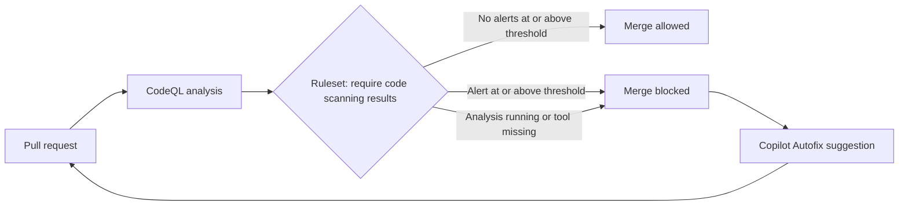

import { TLDR, DocsLinks, LastVerified, DecisionTree, YamlBuilder, CompareTable } from '@components';
import { Aside, Badge, Tabs, TabItem } from '@astrojs/starlight/components';
import codeqlBase from '../../../snippets/ghas-codeql-base.yml?raw';

export const codeqlOptions = [
  { id: 'schedule', label: 'Weekly scheduled scan', section: 'on', default: true, snippet: `schedule:
  - cron: '30 1 * * 1'`, explanation: 'Catches alerts from newly released CodeQL queries even when nobody pushes.' },
  { id: 'mergegroup', label: 'Run in merge queue', section: 'on', snippet: 'merge_group:', explanation: 'Needed if the branch uses a merge queue and code scanning merge protection.' },
  { id: 'concurrency', label: 'Cancel superseded PR runs', section: 'top', snippet: `concurrency:
  group: codeql-\${{ github.ref }}
  cancel-in-progress: \${{ github.event_name == 'pull_request' }}` },
  { id: 'timeout', label: 'Job timeout', section: 'job', snippet: 'timeout-minutes: 120' },
  { id: 'extended', label: 'security-extended query suite', section: 'init', snippet: 'queries: security-extended', explanation: 'More queries with slightly lower precision. Expect more alerts.' },
  { id: 'config', label: 'Use a CodeQL config file', section: 'init', snippet: 'config-file: ./.github/codeql/codeql-config.yml', explanation: 'Use it for paths-ignore, query-filters, extra packs and similar settings. See the CodeQL advanced page.' },
  { id: 'cache', label: 'Dependency caching', section: 'init', snippet: 'dependency-caching: true', explanation: 'Off by default in advanced setup and speeds up dependency resolution.' },
  { id: 'cpp', label: 'Add C/C++ with a manual build', section: 'matrix', snippet: `- language: c-cpp
  build-mode: manual` },
  { id: 'build', label: 'Manual build step', section: 'build', snippet: `- if: matrix.build-mode == 'manual'
  name: Build C/C++
  run: |
    make bootstrap
    make release`, explanation: 'Only runs for matrix entries that use build-mode: manual.' },
];

<LastVerified date="2026-10" />

<TLDR>
- **Default setup** is a single toggle. GitHub picks the languages, query suite and triggers, and no YAML is involved. **Advanced setup** commits a `codeql.yml` workflow so you control everything. Start with default and move to advanced only for the repos that need it.
- CodeQL supports **C/C++, C#, Go, Java/Kotlin, JavaScript/TypeScript, Python, Ruby, Rust, Swift and GitHub Actions workflows**. It does not support PHP or Scala. For those, use third-party SARIF or **AI Scan for PRs**.
- With **build-mode `none`**, C/C++, C#, Java and Rust are analyzed without a build. Default setup uses it automatically.
- **Copilot Autofix** suggests fixes on PRs and alerts without a Copilot license. **Agentic autofix** lets you assign alerts to Copilot, which opens a draft PR.
- To block merges on findings, use the **ruleset rule "Require code scanning results"** (code scanning merge protection).
</TLDR>

## Common booth questions

<details>
<summary>Default or advanced setup: which should we use?</summary>

Use **default setup** everywhere first: it takes one click, can be enabled org-wide and needs zero maintenance. Switch to **advanced** for repos that need a manual build, custom query packs, a config file (`paths-ignore`, query filters), custom triggers, or multiple analyses in one repo (monorepos). The [decision tree below](#default-vs-advanced-setup) walks through this.

</details>

<details>
<summary>Do we have to build our Java / C# / C++ code?</summary>

Not necessarily. **build-mode `none`** creates the CodeQL database straight from the source for **C/C++, C#, Java and Rust**, and default setup uses it automatically. The trade-offs: generated code is not analyzed, and accuracy is "good" rather than "best". **Kotlin needs a build**, so a repo that has both Java and Kotlin falls back to `autobuild`. For high-risk apps, use advanced setup with `manual` build steps.

</details>

<details>
<summary>We write PHP / Scala / something CodeQL doesn't support. Now what?</summary>

You have two options:

- Upload results from any SARIF-producing tool (Semgrep, Checkmarx, Snyk Code and others) as code scanning alerts.
- Turn on **AI Scan for pull requests**, an AI engine that finds vulnerabilities in languages and frameworks CodeQL doesn't cover. Its findings are **advisory only**. They appear on PRs, don't fail the "Code scanning" check and can't be enforced with rulesets. Usage is billed under Code Security AI Credits.

</details>

<details>
<summary>Can we block a PR that introduces a high-severity vulnerability?</summary>

Yes. Create a **branch ruleset** with **"Require code scanning results"**, choose the tool (for example CodeQL) and set severity thresholds such as "High or higher" for security alerts. The PR is also blocked while the analysis is still running, or if the required tool isn't configured for that repo. Target repos with custom properties so the rule applies org-wide.

</details>

<details>
<summary>Does Copilot Autofix work for third-party tool alerts?</summary>

**Copilot Autofix** generates suggestions for **CodeQL** alerts. **Agentic autofix** (assigning alerts to Copilot) tries to validate fixes by re-running CodeQL. GitHub states that it *can't confirm* fixes for third-party tool alerts, custom queries or the `security-extended` suite. Treat third-party autofix as best-effort and **verify current support before you promise it**.

</details>

<details>
<summary>Scans are slow on our big repo. How do we speed them up?</summary>

- Use `build-mode: none` where it applies.
- Turn on `dependency-caching` in advanced setup.
- Run on **larger runners**. In advanced setup, change `runs-on`. Default setup can use org larger runners <Badge text="Preview" variant="caution" />, and self-hosted runners labeled `code-scanning`.
- Incremental PR analysis (diff-informed plus overlay) is automatic in default setup and in `codeql-action`.
- Exclude generated and vendored code with a config file. Note that `paths-ignore` doesn't apply to compiled languages that are built.
- Split a monorepo into multiple analyses that each have their own `category`.

</details>

<details>
<summary>Does CodeQL scan our GitHub Actions workflows?</summary>

Yes. **GitHub Actions** is a supported CodeQL language (`actions`). It finds workflow problems such as script injection from untrusted input, and `pull_request_target` misuse. Enable it in default setup or add `actions` to your advanced-setup matrix.

</details>

## Default vs advanced setup

<CompareTable
  title="CodeQL default vs advanced setup"
  columns={[
    { key: 'def', label: 'Default setup' },
    { key: 'adv', label: 'Advanced setup' },
  ]}
  rows={[
    { feature: 'Workflow file in repo', category: 'Setup', values: { def: false, adv: '.github/workflows/codeql.yml' } },
    { feature: 'Enable at org scale (security configurations)', category: 'Setup', values: { def: true, adv: 'Per repo (or via reusable workflow / required workflows)' } },
    { feature: 'Language auto-detection', category: 'Setup', values: { def: true, adv: 'You list them in the matrix' } },
    { feature: 'Build modes', category: 'Build', values: { def: 'none, falling back to autobuild', adv: 'none / autobuild / manual' } },
    { feature: 'Query suites', category: 'Queries', values: { def: 'default or security-extended', adv: 'Any suite or custom packs' } },
    { feature: 'CodeQL model packs', category: 'Queries', values: { def: 'Yes (org-level)', adv: true } },
    { feature: 'Config file (paths-ignore, query-filters)', category: 'Queries', values: { def: false, adv: true } },
    { feature: 'Custom triggers / schedules', category: 'Triggers', values: { def: 'Push, PR, weekly', adv: true } },
    { feature: 'Multiple analyses per repo (categories)', category: 'Triggers', values: { def: false, adv: true } },
    { feature: 'Larger / self-hosted runners', category: 'Runners', values: { def: 'Larger runners (preview), self-hosted label "code-scanning"', adv: true } },
    { feature: 'Copilot Autofix', category: 'Fixes', values: { def: true, adv: true } },
  ]}
/>

<DecisionTree
  title="Default or advanced setup?"
  tree={{
    start: 'lang',
    nodes: {
      lang: {
        question: 'Are your languages supported by CodeQL (C/C++, C#, Go, Java/Kotlin, JS/TS, Python, Ruby, Rust, Swift, Actions)?',
        options: [
          { label: 'Yes', next: 'custom' },
          { label: 'No / partly', next: 'other' },
        ],
      },
      custom: {
        question: 'Do you need **custom query packs**, a **config file** (`paths-ignore`, `query-filters`) or custom triggers?',
        options: [
          { label: 'Yes', next: 'advanced' },
          { label: 'No', next: 'build' },
        ],
      },
      build: {
        question: 'Is this a **compiled, high-risk** app where generated code or an unusual build makes `build-mode: none` inaccurate?',
        options: [
          { label: 'Yes', next: 'manual' },
          { label: 'No', next: 'mono' },
        ],
      },
      mono: {
        question: 'Is it a **monorepo** that needs separate analyses per app, or does analysis have to run in **another CI** (Jenkins, ADO)?',
        options: [
          { label: 'Monorepo', next: 'advanced' },
          { label: 'Other CI', next: 'cli' },
          { label: 'Neither', next: 'default' },
        ],
      },
      default: {
        answer: '**Use default setup.** Enable it org-wide with a security configuration and let GitHub manage it. Optionally recommend the `security-extended` suite.',
        links: [{ label: 'Configure default setup', href: 'https://docs.github.com/en/code-security/code-scanning/enabling-code-scanning/configuring-default-setup-for-code-scanning' }],
      },
      advanced: {
        answer: '**Use advanced setup.** Commit `codeql.yml` and reference a `codeql-config.yml`. For monorepos, give each analysis its own `category`.',
        links: [{ label: 'Configure advanced setup', href: 'https://docs.github.com/en/code-security/code-scanning/creating-an-advanced-setup-for-code-scanning/configuring-advanced-setup-for-code-scanning' }],
      },
      manual: {
        answer: '**Use advanced setup with `build-mode: manual`** and your real build commands. This gives the best accuracy.',
        links: [{ label: 'CodeQL for compiled languages', href: 'https://docs.github.com/en/code-security/how-tos/find-and-fix-code-vulnerabilities/manage-your-configuration/codeql-for-compiled-languages' }],
      },
      cli: {
        answer: 'Run the **CodeQL CLI** in your CI and upload SARIF with `codeql github upload-results`. You still need a Code Security license for private repos.',
        links: [{ label: 'CodeQL CLI', href: 'https://docs.github.com/en/code-security/concepts/code-scanning/codeql/codeql-cli' }],
      },
      other: {
        answer: 'Use CodeQL for the languages it supports and add **third-party SARIF** uploads for the rest. Consider **AI Scan for PRs** for advisory coverage of unsupported languages.',
        links: [
          { label: 'Upload a SARIF file', href: 'https://docs.github.com/en/code-security/how-tos/find-and-fix-code-vulnerabilities/integrate-with-existing-tools/upload-sarif-file' },
          { label: 'AI Scan for pull requests', href: 'https://docs.github.com/en/code-security/concepts/code-scanning/ai-powered-security-detections' },
        ],
      },
    },
  }}
/>

## Supported languages

| CodeQL language id | Covers | Default build mode |
|---|---|---|
| `actions` | GitHub Actions workflows | n/a (interpreted) |
| `c-cpp` | C, C++ | `none` |
| `csharp` | C# | `none` |
| `go` | Go | `autobuild` |
| `java-kotlin` | Java, Kotlin | `none` (Java only) or `autobuild` if Kotlin is present |
| `javascript-typescript` | JS, TS | n/a (interpreted) |
| `python` | Python | n/a |
| `ruby` | Ruby | n/a |
| `rust` | Rust | `none` |
| `swift` | Swift (needs macOS runner) | `autobuild` |

## Build modes for compiled languages

| | `none` | `autobuild` | `manual` |
|---|---|---|---|
| Used by default setup | Yes (C/C++, C#, Java, Rust) | Where `none` isn't supported | No |
| Works without configuration | Yes | Usually | No |
| Completeness | Generated code not analyzed | Variable | You control it |
| Accuracy | Good | Good | **Best** |

<Aside type="tip">
A good rollout pattern: use default setup with `none` everywhere to burn down the backlog quickly, then move the crown-jewel apps to advanced setup with `manual` builds.
</Aside>

## Query suites

- **`default`**: high-precision queries with few false positives. This is what default setup runs.
- **`security-extended`**: `default` plus queries that have slightly lower precision or severity. It is called **"Extended"** in the UI and is available in default setup. Org owners and security managers can *recommend* a suite for default setup across the org.
- **`security-and-quality`**: `security-extended` plus maintainability queries. Available in advanced setup only. For code-health findings, also look at GitHub Code Quality.

## Build your advanced setup workflow

<YamlBuilder title="CodeQL advanced setup" filename=".github/workflows/codeql.yml" base={codeqlBase} options={codeqlOptions} />

## Copilot Autofix vs agentic autofix

| | Copilot Autofix | Agentic autofix |
|---|---|---|
| What it does | One suggested code change for one alert, which you apply yourself | Copilot investigates one or more alerts and opens a **draft PR** |
| Enablement | On by default wherever CodeQL runs. Admins can disable it, and the setting cascades down | Org owners and security managers must enable it, and the enterprise must allow it |
| Copilot license needed | No | No |
| Cost | No AI credits used | **Code Security AI Credits plus Actions minutes** |
| EMU user namespaces | Available | Not available |
| Works from security campaigns | Auto-triggered for campaign code alerts | Assign up to 25 campaign alerts to Copilot |

## Third-party SARIF upload

Any tool that emits **SARIF 2.1.0** can show its results as code scanning alerts. Give each tool a unique `category`.

```yaml
- name: Run my scanner
  run: my-scanner --format sarif --output results.sarif
- name: Upload SARIF
  uses: github/codeql-action/upload-sarif@v4
  with:
    sarif_file: results.sarif
    category: my-scanner
```

The job needs `permissions: security-events: write`. You can also use the REST API or the CodeQL CLI (`codeql github upload-results`) from other CI systems. Alerts from all tools appear in the same UI, rulesets and security overview.

## Alert triage

- **Severity:** security alerts have a *security severity* of Critical, High, Medium or Low. Other alerts are Error, Warning or Note.
- **Dismiss reasons:** *False positive*, *Used in tests*, *Won't fix*. **Delegated alert dismissal** lets you require approval before an alert is dismissed.
- **PR experience:** alerts appear as check annotations on the changed lines, together with Autofix suggestions.
- **Tool status page:** shows per-language scan health and is the first place to look when "alerts disappeared".

## PR checks and merge protection



- Configure this under **Rulesets → Require code scanning results → tool plus security and alert severity thresholds**.
- If you use a merge queue, add `merge_group` to the workflow triggers.
- **Gotcha:** a ruleset that requires a tool which isn't configured on the repo blocks every PR. Target rulesets with custom properties so they only hit repos that have scanning enabled.

## Monorepos

- Default setup runs one analysis per language for the whole repo.
- In advanced setup, run multiple jobs, or a matrix, with different `paths` (via config file) or working directories. Give each one a distinct `category`, for example `/language:javascript-typescript;app:web`. Results with different categories don't overwrite each other.
- **Gotcha:** if you rename or drop a category, alerts from the old configuration can linger. Clean up stale configurations from the alert's "Affected configurations" or the tool status page.

## Performance tips

| Lever | Notes |
|---|---|
| `build-mode: none` | Removes build time for C/C++, C#, Java and Rust |
| Larger runners | Advanced: change `runs-on`. Default: org larger runners (public preview) or self-hosted runners labeled `code-scanning` |
| `dependency-caching: true` | Off by default in advanced setup |
| Exclude generated and vendored code | `paths-ignore` (interpreted languages and `none` mode) |
| Incremental PR analysis | Diff-informed and overlay analysis are automatic with default setup and `codeql-action`. With the CLI in other CI you must opt in (GitHub cites up to 10x faster) |
| Split monorepos | Run parallel jobs, one category per app |

<DocsLinks links={[
  { label: 'About CodeQL code scanning', href: 'https://docs.github.com/en/code-security/concepts/code-scanning/codeql/codeql-code-scanning' },
  { label: 'CodeQL for compiled languages (build modes)', href: 'https://docs.github.com/en/code-security/how-tos/find-and-fix-code-vulnerabilities/manage-your-configuration/codeql-for-compiled-languages' },
  { label: 'CodeQL query suites', href: 'https://docs.github.com/en/code-security/concepts/code-scanning/codeql/codeql-query-suites' },
  { label: 'About autofix for code scanning', href: 'https://docs.github.com/en/code-security/concepts/code-scanning/copilot-autofix-for-code-scanning' },
  { label: 'AI Scan for pull requests', href: 'https://docs.github.com/en/code-security/concepts/code-scanning/ai-powered-security-detections' },
  { label: 'Upload a SARIF file', href: 'https://docs.github.com/en/code-security/how-tos/find-and-fix-code-vulnerabilities/integrate-with-existing-tools/upload-sarif-file' },
  { label: 'Available rules for rulesets', href: 'https://docs.github.com/en/repositories/configuring-branches-and-merges-in-your-repository/managing-rulesets/available-rules-for-rulesets' },
]} />
