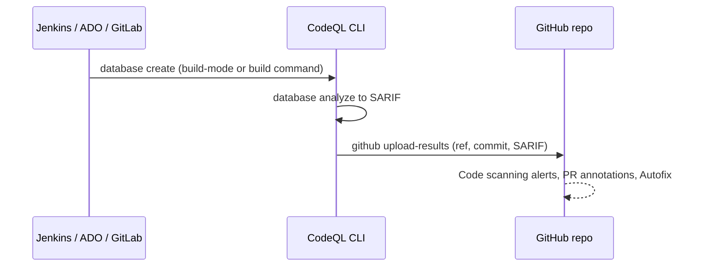

import { TLDR, DocsLinks, LastVerified, FlashCards } from '@components';
import { Aside, Badge, Tabs, TabItem } from '@astrojs/starlight/components';

<LastVerified date="2026-10" />

<TLDR>
- The **CodeQL CLI** creates a database, runs queries, writes SARIF and uploads it with `codeql github upload-results`. Use it in Jenkins, Azure Pipelines, GitLab or anywhere else. Private repos still need a **Code Security** license. The CLI doesn't run on Alpine or other musl distros because it needs glibc.
- **CodeQL packs** are versioned bundles of queries or libraries. You publish them to the **GitHub Container registry** with `codeql pack publish` and reference them in `packs:`.
- **Model packs** <Badge text="Preview" variant="caution" /> teach CodeQL about in-house or niche frameworks without writing QL. You build them in VS Code with the **CodeQL model editor**.
- Use a **`codeql-config.yml`** to control `paths`, `paths-ignore`, `queries`, `packs` and `query-filters`.
- With **MRVA** (multi-repository variant analysis), you run one query across up to **1,000 repos** from VS Code to hunt variants of a bug.
</TLDR>

## Common booth questions

<details>
<summary>We use Jenkins / Azure Pipelines / GitLab CI. Can we still use CodeQL?</summary>

Yes. Download the CodeQL bundle to the build agent, then run `codeql database create` and `codeql database analyze`, and push results with `codeql github upload-results` using a token with `security_events` scope. The code must live in a **GitHub repo**, because that's where alerts appear. If your code lives in Azure Repos, look at **GitHub Advanced Security for Azure DevOps**, a separate Microsoft product.

</details>

<details>
<summary>Our team wrote a custom query. How do we roll it out to all repos?</summary>

Follow these steps:

1. Package the query: run `codeql pack init my-org/my-queries` and add your `.ql` files.
2. Test it with `codeql test run`.
3. Publish it with `codeql pack publish` to GHCR as `ghcr.io/my-org/my-queries`.
4. Reference the pack in advanced setup (`packs:` in the workflow or config file).

Make the package visible to the repos that consume it.

</details>

<details>
<summary>CodeQL doesn't know our in-house web framework, so we miss taint flows. Fix?</summary>

Build a **model pack** <Badge text="Preview" variant="caution" />. In VS Code, open the **CodeQL model editor** on a database of your app and mark framework methods as sources, sinks, summaries or neutral. The editor saves YAML data extensions. Publish the model pack, and it works with **advanced setup**, and with **default setup** at org level. Model packs support C/C++, C#, Java/Kotlin, Python, Ruby and Rust. The model editor UI supports C#, Java/Kotlin, Python and Ruby.

</details>

<details>
<summary>How do we exclude tests, vendored or generated code?</summary>

Add `paths-ignore` to `codeql-config.yml`. **Gotcha:** for compiled languages analyzed with `autobuild` or `manual` builds, path filters don't limit extraction. Control what gets built instead. Path filters do apply to interpreted languages, and to `build-mode: none`. To mute specific rules rather than files, use `query-filters`.

</details>

<details>
<summary>We found a bug pattern in one repo. Is it anywhere else?</summary>

Use **MRVA** from the CodeQL extension for VS Code. Pick a controller repo, choose a list of up to 1,000 repos (your org, a custom list, or top public repos), and run the query. The work runs on GitHub Actions in the controller repo, and results stream back to VS Code. It needs a CodeQL database on GitHub for each target repo, which exists for any repo that runs CodeQL code scanning.

</details>

<details>
<summary>Is all of this available on GitHub Enterprise Server?</summary>

Mostly, but with caveats:

- Code scanning on GHES needs **GitHub Actions enabled with self-hosted runners**, or the CLI in other CI.
- Air-gapped instances must sync the CodeQL action and bundle using the **CodeQL Action sync tool**.
- Newer features (AI-powered features, some rules, metrics) arrive on GHES later or not at all. Check the release notes for the customer's GHES version. 3.22 is the latest release as of this writing.

</details>

## Advanced setup with a config file

```yaml
# .github/workflows/codeql.yml
name: CodeQL
on:
  push:
    branches: [main]
  pull_request:
    branches: [main]
  schedule:
    - cron: '30 1 * * 1'
jobs:
  analyze:
    name: Analyze (${{ matrix.language }})
    runs-on: ubuntu-latest
    permissions:
      security-events: write
      packages: read        # needed to download private CodeQL packs from GHCR
      actions: read
      contents: read
    strategy:
      fail-fast: false
      matrix:
        include:
          - language: java-kotlin
            build-mode: manual
          - language: javascript-typescript
            build-mode: none
    steps:
      - uses: actions/checkout@v6
      - uses: github/codeql-action/init@v4
        with:
          languages: ${{ matrix.language }}
          build-mode: ${{ matrix.build-mode }}
          config-file: ./.github/codeql/codeql-config.yml
          dependency-caching: true
      - if: matrix.build-mode == 'manual'
        run: ./mvnw -B -DskipTests package
      - uses: github/codeql-action/analyze@v4
        with:
          category: "/language:${{ matrix.language }}"
```

```yaml
# .github/codeql/codeql-config.yml
name: "Org CodeQL config"
queries:
  - uses: security-extended
packs:
  java-kotlin:
    - my-org/java-security-queries@~1.2.0   # custom query pack (GHCR)
    - my-org/java-inhouse-models             # model pack
  javascript-typescript:
    - my-org/js-security-queries
paths:
  - src
paths-ignore:
  - '**/test/**'
  - '**/vendor/**'
  - '**/*.generated.ts'
query-filters:
  - exclude:
      id: js/missing-rate-limiting
  - exclude:
      tags contain: maintainability
```

<Aside type="tip">
You can also inline the config with `config: |` on the `init` step, or load it from another repo (`config-file: org/repo/path/codeql-config.yml@main`). The second option lets one central config serve many repos.
</Aside>

## CodeQL packs

<Tabs>
<TabItem label="Query pack">

```yaml
# qlpack.yml
name: my-org/java-security-queries
version: 1.2.0
dependencies:
  codeql/java-all: "*"
```

```bash
codeql pack install          # resolve dependencies
codeql test run tests/       # run query unit tests
codeql pack publish          # pushes to ghcr.io/my-org/java-security-queries
```

</TabItem>
<TabItem label="Model pack (preview)">

```yaml
# qlpack.yml: library: true, no dependencies, one or more extensionTargets
name: my-org/java-inhouse-models
version: 0.1.0
library: true
extensionTargets:
  codeql/java-all: "*"
dataExtensions:
  - models/**/*.yml
```

The model editor generates the files under `models/`. Each one is a data extension that declares sources, sinks and summaries for your framework's methods.

</TabItem>
</Tabs>

- Packs are stored as **container packages on GHCR**, using that registry's permissions and visibility. Workflows need `packages: read` to download private packs.
- Pin pack versions with semver ranges (`@~1.2.0`) for reproducible scans.
- Built-in suites live inside GitHub's packs, for example `codeql/java-queries:codeql-suites/java-security-extended.qls`.

## CodeQL CLI in other CI systems



```bash
# Example for any CI agent (Linux, glibc)
codeql database create codeql-db \
  --language=java-kotlin --build-mode=none --source-root=.

codeql database analyze codeql-db \
  codeql/java-queries:codeql-suites/java-security-extended.qls \
  --format=sarif-latest --output=results.sarif \
  --sarif-category=java

GITHUB_TOKEN="$CODEQL_UPLOAD_TOKEN" codeql github upload-results \
  --repository=my-org/my-repo \
  --ref=refs/heads/main \
  --commit="$GIT_COMMIT" \
  --sarif=results.sarif
```

- For PR analysis, upload with `--ref=refs/pull/<n>/head` (or `merge`) so the results show up on the PR.
- When you run the CLI yourself, opt in to **incremental analysis** (diff-informed plus overlay) for faster PR scans. GitHub cites up to 10x. `codeql-action` and default setup handle it automatically.
- Scan several languages at once with `--db-cluster --language=java-kotlin,javascript-typescript`.

## Variant analysis (MRVA)

| Item | Detail |
|---|---|
| Where | CodeQL extension for VS Code |
| Scale | Up to 1,000 repos per run |
| Compute | GitHub Actions in a **controller repo** you choose |
| Targets | Any repo with a CodeQL database on GitHub (all repos that use CodeQL code scanning, plus thousands of top public repos) |
| Typical use | A security researcher finds a bug, writes a query, and checks the whole org for variants |

## Code Security on GHES

- Licensing works the same way: per active committer, with Secret Protection and Code Security as separate products.
- **Requirements:** Actions enabled, plus runners with enough CPU and RAM (see "Hardware resources for CodeQL"). Default setup also works on GHES with self-hosted runners labeled `code-scanning`.
- **Offline:** use the CodeQL Action sync tool to bring newer CodeQL bundles from GitHub.com, or turn on **GitHub Connect** to download actions automatically.
- **Feature lag:** compare with GitHub.com in each GHES release's notes before promising AI Scan, agentic autofix or preview rules.

<FlashCards
  title="CodeQL advanced quiz"
  cards={[
    { q: 'Where are CodeQL packs published?', a: 'The **GitHub Container registry** (GHCR), via `codeql pack publish`.' },
    { q: 'Which permission does a workflow need to download private packs?', a: '`packages: read`' },
    { q: 'What makes a pack a model pack?', a: '`library: true`, no dependencies, `extensionTargets`, and `dataExtensions` YAML files.' },
    { q: 'Max repos per MRVA run?', a: '**1,000**' },
    { q: 'Does `paths-ignore` work for Java built with autobuild?', a: 'No. Path filters do not limit extraction for compiled languages that are built.' },
    { q: 'Can the CodeQL CLI run on Alpine?', a: 'No. It needs glibc, so non-glibc Linux distributions are unsupported.' },
  ]}
/>

<DocsLinks links={[
  { label: 'CodeQL CLI', href: 'https://docs.github.com/en/code-security/concepts/code-scanning/codeql/codeql-cli' },
  { label: 'Create and work with CodeQL packs', href: 'https://docs.github.com/en/code-security/tutorials/customize-code-scanning/create-and-work-with-codeql-packs' },
  { label: 'Use the CodeQL model editor', href: 'https://docs.github.com/en/code-security/how-tos/find-and-fix-code-vulnerabilities/scan-from-vs-code/use-the-model-editor' },
  { label: 'Multi-repository variant analysis', href: 'https://docs.github.com/en/code-security/concepts/code-scanning/multi-repository-variant-analysis' },
  { label: 'Incremental analysis with the CodeQL CLI', href: 'https://docs.github.com/en/code-security/how-tos/find-and-fix-code-vulnerabilities/scan-from-the-command-line/incremental-analysis' },
  { label: 'CodeQL for compiled languages', href: 'https://docs.github.com/en/code-security/how-tos/find-and-fix-code-vulnerabilities/manage-your-configuration/codeql-for-compiled-languages' },
  { label: 'Upload a SARIF file', href: 'https://docs.github.com/en/code-security/how-tos/find-and-fix-code-vulnerabilities/integrate-with-existing-tools/upload-sarif-file' },
]} />
