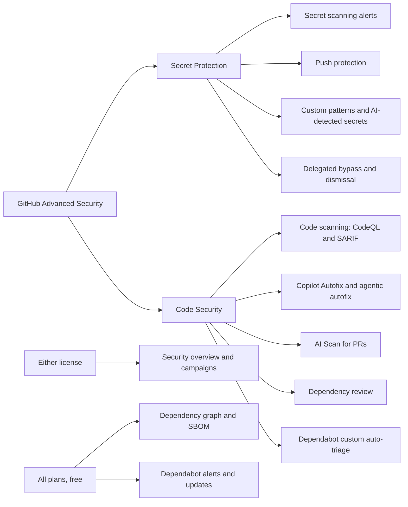

import { TLDR, DocsLinks, LastVerified, CompareTable } from '@components';
import { Aside, Badge, LinkCard, CardGrid } from '@astrojs/starlight/components';

<LastVerified date="2026-10" />

<TLDR>
- Since **April 2025**, GHAS has been sold as **two separate products**. **GitHub Secret Protection** covers secret scanning, push protection, AI-detected secrets, custom patterns and delegated bypass. **GitHub Code Security** covers CodeQL code scanning, Copilot Autofix, AI Scan, dependency review, custom Dependabot auto-triage rules and security campaigns.
- Both are available on **GitHub Team** and **GitHub Enterprise** (Cloud and Server), so GitHub Enterprise is no longer required. Licenses are billed per **unique active committer** (anyone who pushed in the last 90 days). Bots built as GitHub Apps are not counted.
- **Public repositories get these for free:** code scanning, CodeQL CLI, Copilot Autofix, secret scanning and push protection. **Every plan gets these for free:** dependency graph, Dependabot alerts, security updates and version updates, and SBOM export.
- AI features that run as agents or scanners (**AI Scan for PRs** and **agentic autofix**) are billed separately as **Code Security AI Credits**. Classic **Copilot Autofix needs no Copilot license** and uses no AI credits.
- Not sure where to start? Run the **free secret risk assessment** (and the code security risk assessment), then turn on **Secret Protection with push protection** first.
</TLDR>

<Aside type="caution" title="Pricing">
Do not quote a per-committer price from memory. Send customers to the live pricing page: [github.com/enterprise/advanced-security](https://github.com/enterprise/advanced-security#pricing).
</Aside>

## Common booth questions

Do I still have to buy "GHAS" as one bundle?

No. Since April 2025 you can buy **Secret Protection** and **Code Security** separately, or buy both. You can also enable each one per repository, so you only consume licenses where you need them. Existing GHAS customers still get both.

Do we need GitHub Enterprise to buy it?

No. Both products can be purchased on **GitHub Team** as well as on GitHub Enterprise Cloud and Server. GitHub Free and Pro accounts get the public-repo features only.

How are we billed? Who counts as a committer?

You pay for each **unique, active committer**: someone who pushed a commit in the last **90 days** to a repo that has the product enabled. A person who commits to many repos still counts once. GitHub App bots are excluded. After a GitHub Enterprise Importer migration, only commits pushed *after* the migration count. AI Scan and agentic autofix are metered separately as **Code Security AI Credits**. Those draw first on any AI-credit allowance included with Copilot.

Does Copilot Autofix require a Copilot license?

No. **Copilot Autofix** is part of Code Security, is on by default wherever CodeQL runs, and uses no AI credits. **Agentic autofix**, where you assign alerts to Copilot and it opens a draft PR, also needs no Copilot license. However, it uses Code Security AI Credits plus Actions minutes, and it is not available in Enterprise Managed Users (EMU) user namespaces.

What can we get for free before we buy?

Organizations on Team or Enterprise can run free **risk assessments**:

- The **secret risk assessment** scans the whole org and shows leaked secrets and how many push protection would have prevented.
- The **code security risk assessment** scans up to 20 of your most active repos and shows how many findings Copilot Autofix could fix.

Dependabot alerts and updates, the dependency graph and SBOM export are free on every plan.

Is this the same as "GitHub Advanced Security for Azure DevOps"?

No. GHAS for Azure DevOps is a separate Microsoft product, configured and billed through Azure DevOps. The GitHub products on this page run on GitHub.com, GHE.com and GHES.

## How the pieces fit

## What is included where

<CompareTable
  title="Secret Protection vs Code Security: availability"
  columns={[
    { key: 'product', label: 'Product / SKU' },
    { key: 'pub', label: 'Public repos (free)' },
    { key: 'priv', label: 'Private / internal repos' },
  ]}
  rows={[
    { feature: 'Secret scanning (provider patterns)', category: 'Secret Protection', values: { product: 'Secret Protection', pub: true, priv: 'Needs Secret Protection' } },
    { feature: 'Push protection (repository)', category: 'Secret Protection', values: { product: 'Secret Protection', pub: true, priv: 'Needs Secret Protection' } },
    { feature: 'AI-detected (generic) secrets', category: 'Secret Protection', values: { product: 'Secret Protection', pub: false, priv: 'Needs Secret Protection' } },
    { feature: 'Custom patterns', category: 'Secret Protection', values: { product: 'Secret Protection', pub: false, priv: 'Needs Secret Protection' } },
    { feature: 'Delegated bypass for push protection', category: 'Secret Protection', values: { product: 'Secret Protection', pub: false, priv: 'Needs Secret Protection' } },
    { feature: 'Push protection for users (account-level)', category: 'Secret Protection', values: { product: 'Free, on by default', pub: true, priv: 'Applies to public repos only' } },
    { feature: 'Code scanning (CodeQL or third-party SARIF)', category: 'Code Security', values: { product: 'Code Security', pub: true, priv: 'Needs Code Security' } },
    { feature: 'CodeQL CLI', category: 'Code Security', values: { product: 'Code Security', pub: true, priv: 'Needs Code Security' } },
    { feature: 'Copilot Autofix', category: 'Code Security', values: { product: 'Code Security', pub: true, priv: 'Needs Code Security' } },
    { feature: 'AI Scan for pull requests', category: 'Code Security', values: { product: 'Code Security + AI Credits', pub: 'Org-owned public repos', priv: 'Needs Code Security' } },
    { feature: 'Dependency review', category: 'Code Security', values: { product: 'Code Security', pub: true, priv: 'Needs Code Security' } },
    { feature: 'Custom Dependabot auto-triage rules', category: 'Code Security', values: { product: 'Code Security', pub: true, priv: 'Needs Code Security' } },
    { feature: 'Security campaigns', category: 'Either', values: { product: 'Secret Protection or Code Security', pub: false, priv: 'Needs either product' } },
    { feature: 'Security overview (full dashboards)', category: 'Either', values: { product: 'Secret Protection or Code Security', pub: false, priv: 'Needs either product' } },
    { feature: 'Dependency graph and SBOM export', category: 'All plans', values: { product: 'Free', pub: true, priv: true } },
    { feature: 'Dependabot alerts, security and version updates', category: 'All plans', values: { product: 'Free', pub: true, priv: true } },
    { feature: 'Secret and code security risk assessments', category: 'All plans', values: { product: 'Free (Team and Enterprise orgs)', pub: true, priv: true } },
  ]}
/>

| | GitHub Free / Pro | GitHub Team | GitHub Enterprise Cloud | GitHub Enterprise Server |
|---|---|---|---|---|
| Buy Secret Protection / Code Security | ❌ (public repos only) | ✅ | ✅ | ✅ (feature set depends on GHES version) |

<Aside type="note">
GitHub's summary table on "About GitHub Advanced Security" marks dependency review as unavailable on public repos without a license. The dependency review feature page, however, lists public repositories as supported. Check the docs before promising this to someone.
</Aside>

## Pages in this section

<CardGrid>
  <LinkCard title="Code scanning" description="Default vs advanced setup, build modes, Autofix, SARIF, and merge protection." href="/github-cheatsheet/ghas/code-scanning/" />
  <LinkCard title="Secret scanning & push protection" description="Alerts, bypass flows, custom patterns, AI detection, and validity checks." href="/github-cheatsheet/ghas/secret-scanning/" />
  <LinkCard title="Supply chain (Dependabot)" description="dependabot.yml, auto-triage, dependency review, and SBOM." href="/github-cheatsheet/ghas/supply-chain/" />
  <LinkCard title="Rollout at scale" description="Security configurations, overview, campaigns, and metrics." href="/github-cheatsheet/ghas/rollout-at-scale/" />
  <LinkCard title="CodeQL advanced" description="CLI, custom packs, config files, model packs, MRVA, and other CI." href="/github-cheatsheet/ghas/codeql-advanced/" />
</CardGrid>

## Talking points

- **"Shift left, but prevent first."** Push protection stops secrets *before* they leak. That is cheaper than any amount of triage after the fact.
- **"Fix, don't just find."** Copilot Autofix and security campaigns aim to cut mean time to remediate. They are not about piling up more alerts.
- **"Developer-native."** Results appear in the PR, in the developer's normal workflow, rather than in a separate portal.

<DocsLinks links={[
  { label: 'About GitHub Advanced Security', href: 'https://docs.github.com/en/get-started/learning-about-github/about-github-advanced-security' },
  { label: 'GitHub Advanced Security license billing', href: 'https://docs.github.com/en/billing/concepts/product-billing/github-advanced-security' },
  { label: 'GitHub security features', href: 'https://docs.github.com/en/code-security/getting-started/github-security-features' },
  { label: 'About autofix for code scanning', href: 'https://docs.github.com/en/code-security/concepts/code-scanning/copilot-autofix-for-code-scanning' },
  { label: 'Secret security with GitHub (risk assessment)', href: 'https://docs.github.com/en/code-security/concepts/secret-security/secret-security-with-github' },
]} />
