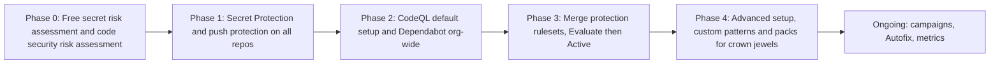

import { TLDR, DocsLinks, LastVerified, DecisionTree } from '@components';
import { Aside, Badge, Steps } from '@astrojs/starlight/components';

<LastVerified date="2026-10" />

<TLDR>
- Enable features with **security configurations**: named bundles of settings that you attach to many repos, at org or enterprise level. Start from **GitHub recommended** and **enforce** it so repo admins can't turn features off.
- Roll out in this order:
  1. Run the free **risk assessment**.
  2. Turn on **Secret Protection with push protection** everywhere.
  3. Enable **CodeQL default setup**.
  4. Move to **advanced setup** for the crown jewels.
- Use **custom properties**, such as `business-criticality` or `data-classification`, to target configurations, rulesets and campaigns.
- Burn down the existing backlog with **security campaigns**. They auto-trigger Copilot Autofix, and you can assign up to 25 code alerts to Copilot.
- Measure **prevention** (push protection blocks, PR alerts fixed before merge) and **MTTR**, not just raw alert counts.
</TLDR>

## Common booth questions

We have 5,000 repos. How do we turn this on without a ticket per repo?

Create one or more **security configurations**, for example "Production apps" and "Sandbox". Then:

- Apply them to all repos, or to a filtered set based on custom properties, visibility or other filters.
- Set one as the **default for new repos**.
- **Enforce** it so repo admins cannot override it.

Global settings, such as the recommended CodeQL query suite or AI-detected secrets, sit on top. Enterprise owners can create configurations at the enterprise level and apply them across orgs.

Won't turning everything on bury developers in alerts?

That's why the order matters:

- Push protection only affects **new** secrets, so it adds no backlog.
- CodeQL `default` suite results are high-precision.
- Code scanning alerts on PRs only cover **changed lines**.

Handle the historical backlog separately, with **campaigns** that a security team curates. Don't throw it at every developer on day one.

Where do we see whether it's working?

Open **Security overview** at org or enterprise level:

- The **Overview** tab shows trends in detection, remediation and prevention.
- The **Risk** and **Coverage** views show which repos lack which features.
- The **Code scanning on pull requests** report shows alerts caught before merge, the Autofix acceptance rate, and MTTR with and without Autofix.
- Per-feature alert views are also available.

All of it can be exported to CSV.

How do campaigns work with Copilot?

You pick a related set of alerts, either from a built-in template or with filters such as "all SQL injection in critical repos". You then set a due date and a point of contact. Developers are notified in their normal flow. **Copilot Autofix** is triggered automatically for the code alerts in the campaign. With **agentic autofix** enabled, you can assign up to 25 code scanning alerts to Copilot, and it opens draft PRs. Campaigns for secret scanning alerts are <Badge text="Preview" variant="caution" />.

How do we stop insecure code from merging, org-wide?

Use **org rulesets** targeted by custom property, and combine these rules:

- **Require code scanning results**: block merges on alerts above a severity threshold.
- **Require secret scanning alerts are resolved** <Badge text="Preview" variant="caution" />.
- **Require status checks**, for example the dependency review workflow.

Start in **Evaluate** mode (GitHub Enterprise) to see what *would* be blocked before you enforce.

How do we prove ROI to leadership?

Show four things:

- **Secrets prevented**: push protection blocks that were not bypassed.
- **Vulnerabilities prevented**: PR alerts fixed before merge.
- **MTTR trend**: with Autofix vs without.
- **Backlog burn-down**: from campaigns.

Compare the secret risk assessment before and after rollout.

## Phased rollout

<Steps>

1. **Assess.** Run the free risk assessments, and inventory repos with **custom properties** such as owner, criticality and internet-facing.
2. **Pilot.** Pick 2 or 3 friendly teams. Tune custom patterns and delegated bypass reviewers.
3. **Prevent.** Enable push protection org-wide with an **enforced** security configuration, and keep the bypass rate visible.
4. **Detect.** Enable default setup and dependency review, then add merge protection rulesets in Evaluate mode.
5. **Remediate.** Run campaigns on the highest-risk alerts (critical or high, internet-facing, active secrets), using Autofix.
6. **Deepen.** Move high-risk repos to advanced setup (manual build, `security-extended`, custom packs).

</Steps>

## Security configurations cheat sheet

| Concept | What to know |
|---|---|
| **GitHub recommended** configuration | A ready-made config that enables the recommended features. It is the fastest way to start |
| Custom configuration | Choose each feature: secret scanning, push protection, AI-detected secrets, validity checks, CodeQL default setup, Dependabot, dependency review and more |
| Enforcement | An enforced config blocks repo admins from changing those settings |
| Default for new repos | Can be set per visibility (public vs private and internal) |
| Configuration status | Each repo shows attached, enforced, failed, removed and so on. Check this when "it didn't turn on" |
| Global settings | Org-wide behavior, for example the recommended query suite, AI-detected secrets, and who can bypass or dismiss |
| Enterprise-level configurations | Created by enterprise owners and applied across orgs |
| Production context | Integrations with Microsoft Defender for Cloud, JFrog Artifactory and CI/CD deployment data help prioritize alerts on code that is actually deployed |

<Aside type="caution" title="License gotcha">
Applying a configuration that includes Secret Protection or Code Security to private repos **consumes licenses** for their active committers. Check license headroom on the licensing page before you hit "Apply to all".
</Aside>

## Developer-first remediation culture

- **Fix in the flow.** PR annotations plus an Autofix suggestion beat a PDF report.
- **Small, curated asks.** A campaign of 20 related alerts with a due date beats a list of 4,000.
- **Make bypass visible, not impossible.** Delegated bypass with fast reviewers keeps trust high.
- **Security champions** in each team act as the campaign point of contact.
- **Celebrate prevention metrics**, not alert counts.

## Measuring success

| Metric | Where to find it | Good direction |
|---|---|---|
| Coverage (% repos with each feature) | Security overview → Coverage | ↑ |
| Secrets blocked by push protection / bypass rate | Security overview → secret scanning / push protection metrics | Blocks ↑, bypass ↓ |
| Vulnerabilities caught in PRs | Security overview → Code scanning on pull requests | ↑ |
| Autofix acceptance rate | Same report | ↑ |
| MTTR (with vs without Autofix) | Same report / CSV export | ↓ |
| Open critical/high alerts on default branches | Security overview → Overview / Risk | ↓ |
| Campaign completion | Campaign tracking | ↑ |

## Where do we start?

<DecisionTree
  title="Customer asks: where do we start?"
  tree={{
    start: 'q1',
    nodes: {
      q1: {
        question: 'Do you already own Secret Protection or Code Security licenses?',
        options: [
          { label: 'No, evaluating', next: 'assess' },
          { label: 'Yes', next: 'q2' },
        ],
      },
      assess: {
        answer: 'Run the **free secret risk assessment** (and the code security risk assessment, which covers up to 20 repos). Use the "preventable leaks" number to build the business case. Secret Protection is usually the quickest win.',
        links: [{ label: 'Secret risk assessment', href: 'https://docs.github.com/en/code-security/concepts/secret-security/secret-security-with-github' }],
      },
      q2: {
        question: 'Is push protection enforced on all repos?',
        options: [
          { label: 'No', next: 'pp' },
          { label: 'Yes', next: 'q3' },
        ],
      },
      pp: {
        answer: 'Start there. Create a **security configuration** with secret scanning plus push protection, **enforce** it, and make it the default for new repos. Add **delegated bypass** if compliance needs approvals.',
        links: [{ label: 'Enabling security features at scale', href: 'https://docs.github.com/en/code-security/concepts/security-at-scale/organization-security' }],
      },
      q3: {
        question: 'Is CodeQL default setup enabled broadly?',
        options: [
          { label: 'No', next: 'cq' },
          { label: 'Yes', next: 'q4' },
        ],
      },
      cq: {
        answer: 'Add **CodeQL default setup** and dependency review to the configuration and roll it out by custom property, starting with critical apps.',
      },
      q4: {
        question: 'Do you have a large existing backlog?',
        options: [
          { label: 'Yes', next: 'camp' },
          { label: 'No / under control', next: 'gate' },
        ],
      },
      camp: {
        answer: 'Run **security campaigns** on a focused slice, for example critical and high alerts in internet-facing repos, and lean on **Copilot Autofix** and agentic autofix. Track MTTR in security overview.',
        links: [{ label: 'About security campaigns', href: 'https://docs.github.com/en/code-security/concepts/security-at-scale/about-security-campaigns' }],
      },
      gate: {
        answer: 'Add **merge protection rulesets** (code scanning results, secret alerts resolved). Run them in Evaluate mode first, then enforce. Move crown jewels to **advanced setup**.',
      },
    },
  }}
/>

<DocsLinks links={[
  { label: 'Enabling security features at scale', href: 'https://docs.github.com/en/code-security/concepts/security-at-scale/organization-security' },
  { label: 'Security overview', href: 'https://docs.github.com/en/code-security/concepts/security-at-scale/security-overview' },
  { label: 'About security campaigns', href: 'https://docs.github.com/en/code-security/concepts/security-at-scale/about-security-campaigns' },
  { label: 'Code scanning on pull requests (metrics)', href: 'https://docs.github.com/en/code-security/concepts/code-scanning/code-scanning-on-pull-requests' },
  { label: 'Custom properties', href: 'https://docs.github.com/en/organizations/managing-organization-settings/managing-custom-properties-for-repositories-in-your-organization' },
  { label: 'About rulesets', href: 'https://docs.github.com/en/repositories/configuring-branches-and-merges-in-your-repository/managing-rulesets/about-rulesets' },
]} />
