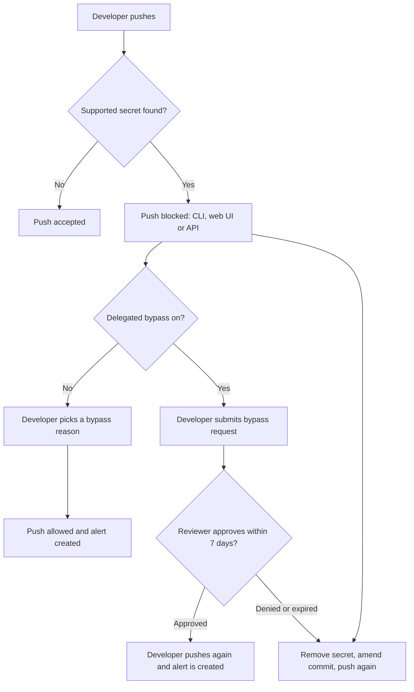

import { TLDR, DocsLinks, LastVerified, FlashCards, CompareTable } from '@components';
import { Aside, Badge, Steps } from '@astrojs/starlight/components';

<LastVerified date="2026-10" />

<TLDR>
- **Secret scanning** finds secrets that are already in the repo: the full git history, issues, PRs, discussions and wikis. **Push protection** blocks new secrets *before* they land. Sell prevention first.
- Detection covers three kinds of secret. **Provider patterns** come from GitHub's partner program and can be checked for validity. **Custom patterns** are your regex, and Copilot can write it. **Generic** secrets are found either by non-provider patterns (such as private keys) or by AI (such as passwords) and appear in a separate list.
- **Delegated bypass** turns "click to bypass" into "request approval", and **delegated alert dismissal** does the same for closing alerts.
- Public repos get scanning and push protection free. **Push protection for users** is on by default for every account and covers pushes to public repos. The org-wide **secret risk assessment** is free.
- If a secret leaks, **rotate it first**. Cleaning git history comes second.
</TLDR>

## Common booth questions

What's the difference between secret scanning alerts and push protection?

- **Alerts** are detective. They scan the whole git history on enablement and every push after that, plus issue and PR titles, descriptions and comments, Discussions, wikis and secret gists.
- **Push protection** is preventive. It blocks a `git push`, a web UI commit or upload, and supported REST API calls when they contain a supported secret.

Bypassing push protection creates an alert. To see those alerts, filter with `bypassed: true`.

Can developers just click "bypass"?

By default, yes. They choose a reason: *it's used in tests*, *it's a false positive* or *I'll fix it later*. That push succeeds and an alert is created. With **delegated bypass**, only designated roles, teams or users can bypass. Everyone else must **submit a bypass request**, and the request **expires after 7 days** if nobody reviews it. You can also grant full exemptions, for example to a bot.

Can we detect our own internal token formats?

Yes, with **custom patterns** at repo, org or enterprise level. You can write the regex yourself, or describe the secret in plain language (with optional example strings) and let **Copilot generate the regex**. Always click **Save and dry run** first. It shows up to 1,000 sample matches without creating alerts. After you publish a pattern, you can **enable push protection for it**.

What about plain passwords that don't match any pattern?

Use **AI-detected secrets** (generic secret detection). An AI model finds unstructured credentials such as passwords. Results go to a separate **Generic** alerts list because the false-positive rate is higher. You must enable it, and it needs Secret Protection. Note that the "Require secret scanning alerts are resolved" ruleset rule does **not** cover AI-detected secrets.

How do we know which leaked secrets are still dangerous?

Turn on **validity checks**. GitHub periodically tests partner-pattern secrets against the provider and labels them *active*, *inactive* or *unknown*, so you can triage the active ones first. **Extended metadata checks** add owner and scope context for some token types <Badge text="Preview" variant="caution" />.

Is anything free?

Several things are free:

- On **public repos**, secret scanning and push protection.
- **Push protection for users**, an account setting that is on by default and blocks your pushes to *any* public repo. It only creates alerts if the repo has push protection enabled too.
- The **secret risk assessment**, a point-in-time org scan for Team and Enterprise orgs.
- **Partner alerts**: leaks in public content are reported directly to the provider.

Can we block a PR that already contains a secret?

Yes. Use the ruleset rule **"Require secret scanning alerts are resolved"** <Badge text="Preview" variant="caution" />. It blocks the merge while the head commit hasn't been scanned yet, or when a commit in the PR introduced an open alert for a selected secret type. It supports provider, custom and generic patterns, but not AI-detected secrets.

## Push protection flow

<Aside type="tip" title="Talking point">
"The cheapest secret to rotate is the one that never left the laptop." Push protection blocks before history is written, so nothing has to be cleaned up.
</Aside>

## What gets detected

<CompareTable
  title="Secret detection types"
  columns={[
    { key: 'how', label: 'How it works' },
    { key: 'list', label: 'Alert list' },
    { key: 'pp', label: 'Push protection' },
    { key: 'valid', label: 'Validity checks' },
  ]}
  rows={[
    { feature: 'Provider (partner) patterns', values: { how: 'Patterns from secret scanning partners', list: 'Default', pp: true, valid: 'Yes (supported providers)' } },
    { feature: 'Custom patterns', values: { how: 'Your regex (or Copilot-generated)', list: 'Default', pp: 'Opt-in per pattern', valid: false } },
    { feature: 'Non-provider (generic) patterns', values: { how: 'Deterministic patterns, e.g. private keys, connection strings', list: 'Generic', pp: 'Verify per pattern', valid: false } },
    { feature: 'AI-detected secrets', values: { how: 'AI model for unstructured secrets (passwords)', list: 'Generic', pp: 'Verify before promising', valid: false } },
  ]}
/>

- **Generic list limits:** 5,000 alerts per repo, counting open and closed. These alerts are not in the security overview summary views. Generic patterns show the first 5 locations, and AI-detected secrets show only the first location.
- **Paired credentials**, such as an AWS key ID plus secret, only alert when both parts are found in the same file.

## Delegated controls

| Control | What it does | Covers |
|---|---|---|
| **Delegated bypass** (push protection) | A bypass list of roles, teams or users can bypass. Others submit requests, which expire in 7 days. You can also grant exemptions | Push protection |
| **Delegated alert dismissal** | Only approved reviewers can dismiss alerts outright. Others submit dismissal requests | Code scanning, secret scanning (GitHub.com and GHES 3.17+) and Dependabot (GHES 3.21+) |

## Remediation workflow

<Steps>

1. **Rotate or revoke the credential at the provider immediately.** Assume it has already been copied. Use validity checks to confirm it is now *inactive*.
2. **Check for use.** Review the provider's access logs for the exposure window.
3. **Replace it in code** with a reference to a secret store (Actions secrets, OIDC, a vault).
4. **Optionally clean the history** with `git filter-repo` or BFG. This is only necessary for compliance or for public repos, because rewriting history does *not* un-leak a secret.
5. **Close the alert as *Revoked*.** Other dismissal reasons are *False positive*, *Used in tests* and *Won't fix*.

</Steps>

<Aside type="caution">
A common mistake is force-pushing to remove the secret and stopping there. Forks, clones, caches and CI logs may still hold it. **Rotation is the fix.**
</Aside>

## Automation: API and webhooks

- **REST API:** list, get and update secret scanning alerts and their locations at repo, org and enterprise level. Push protection also applies to some content-creating REST endpoints.
- **Webhooks:** `secret_scanning_alert` (created, resolved, reopened and so on) and `secret_scanning_alert_location`. Use them to open tickets or trigger automated rotation.
- **Security campaigns** for secret alerts are <Badge text="Preview" variant="caution" />. They group leaks, assign an owner and track remediation.

<FlashCards
  title="Secret scanning quick quiz"
  cards={[
    { q: 'Push protection was bypassed. Where does the alert show up?', a: 'In the repo secret scanning alerts list. Filter with `bypassed: true`.' },
    { q: 'How long does a delegated bypass request stay open?', a: '**7 days**, then it expires.' },
    { q: 'Which detection type has a higher false-positive rate and its own list?', a: '**Generic**: non-provider patterns and AI-detected secrets.' },
    { q: 'First thing to do after a secret leaks?', a: '**Rotate or revoke** it at the provider. Cleaning history comes later and is optional.' },
    { q: 'Does push protection for users create alerts?', a: 'Only if the target repo has push protection enabled too.' },
    { q: 'How do you safely test a new custom pattern?', a: '**Save and dry run**. It shows up to 1,000 matches without creating alerts.' },
    { q: 'Does validity checking work for custom patterns?', a: 'No. It covers supported **provider** patterns only.' },
  ]}
/>

<DocsLinks links={[
  { label: 'About secret scanning', href: 'https://docs.github.com/en/code-security/concepts/secret-security/secret-scanning' },
  { label: 'About secret scanning alerts', href: 'https://docs.github.com/en/code-security/concepts/secret-security/about-alerts' },
  { label: 'Push protection', href: 'https://docs.github.com/en/code-security/concepts/secret-security/push-protection' },
  { label: 'Define custom patterns', href: 'https://docs.github.com/en/code-security/how-tos/secure-your-secrets/customize-leak-detection/define-custom-patterns' },
  { label: 'Validity checks', href: 'https://docs.github.com/en/code-security/concepts/secret-security/validity-checks' },
  { label: 'Delegated bypass', href: 'https://docs.github.com/en/code-security/concepts/secret-security/delegated-bypass' },
  { label: 'Delegated alert dismissal', href: 'https://docs.github.com/en/code-security/concepts/security-at-scale/delegated-alert-dismissal' },
  { label: 'Secret risk assessment', href: 'https://docs.github.com/en/code-security/concepts/secret-security/secret-security-with-github' },
]} />
