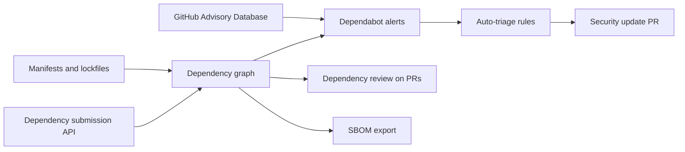

import { TLDR, DocsLinks, LastVerified, CompareTable } from '@components';
import { Aside, Badge, Tabs, TabItem } from '@astrojs/starlight/components';

<LastVerified date="2026-10" />

<TLDR>
- These are **free on every plan, private repos included**: the dependency graph, Dependabot alerts, Dependabot security updates, Dependabot version updates and SBOM export.
- **Code Security** adds the following for private and internal repos: **dependency review** (block risky dependencies in PRs), **custom auto-triage rules** and enterprise **license compliance** rulesets.
- To cut PR noise, use `groups`, `cooldown` (by default a new version must be 3 days old before a version update is proposed) and `open-pull-requests-limit`, which defaults to 5.
- Use the **dependency submission API** to include build-time dependencies (Maven, Gradle and others) that manifests alone don't reveal.
</TLDR>

## Common booth questions

<details>
<summary>Is Dependabot part of GHAS? Do we pay for it?</summary>

Mostly not. Alerts, security updates and version updates are free on all repos. Code Security adds **custom auto-triage rules**, **dependency review** and **license compliance** on private and internal repos.

</details>

<details>
<summary>Dependabot opens way too many PRs. How do we tame it?</summary>

- **Group** related updates into one PR with `groups`, filtered by pattern, dependency type or update type.
- Add a **cooldown** so brand-new releases have time to settle. This also helps against hijacked-release attacks.
- Lower `open-pull-requests-limit`, and use a weekly or monthly `schedule`.
- Use **auto-triage rules** to auto-dismiss low-impact alerts, such as dev-only dependencies.

</details>

<details>
<summary>Can Dependabot reach our private Artifactory / Nexus / npm registry?</summary>

Yes. Define them under top-level `registries` in `dependabot.yml`, reference them per ecosystem, and store the credentials as **Dependabot secrets**. Org-level Dependabot secrets can be shared across repos. If the registry sits on a private network, look at running Dependabot on self-hosted or larger runners with network access.

</details>

<details>
<summary>Can we block PRs that add vulnerable or GPL-licensed packages?</summary>

Yes. The **dependency review action** fails the PR above a severity threshold and enforces `allow-licenses` or `deny-licenses` (choose one, not both). Make the action a required check with a ruleset. On GitHub Enterprise Cloud with Code Security, you can instead manage **license policy centrally** with the ruleset rule "Require license compliance results before merging".

</details>

<details>
<summary>Does it understand transitive dependencies?</summary>

Yes, when they appear in a lockfile. Build-resolved dependencies, such as Maven and Gradle trees without a lockfile, need the **dependency submission API**. Use one of the community submission actions or the automatic dependency submission feature for the supported ecosystems, so that alerts and dependency review see the full tree.

</details>

<details>
<summary>Can we get an SBOM?</summary>

Yes, on every plan. Go to **Insights → Dependency graph → Export SBOM** to get SPDX JSON, or use the REST API. To go further, sign the SBOM with an **artifact attestation** (`actions/attest`) so consumers can verify its provenance.

</details>

<details>
<summary>What about malicious packages, not just vulnerable ones?</summary>

**Dependabot malware alerts** flag known-malicious package versions (GitHub.com, and GHES 3.22 and later). The built-in auto-triage preset "Dismiss package malware alerts" is off by default. Leave it off unless you have another control in place.

</details>

## What does what

<CompareTable
  title="Supply-chain features"
  columns={[
    { key: 'what', label: 'What it does' },
    { key: 'trigger', label: 'Trigger' },
    { key: 'cost', label: 'Private repos' },
  ]}
  rows={[
    { feature: 'Dependency graph', values: { what: 'Inventory of manifests and lockfiles (plus submitted dependencies)', trigger: 'Push', cost: 'Free' } },
    { feature: 'Dependabot alerts', values: { what: 'Matches dependencies against the GitHub Advisory Database', trigger: 'New advisory or new dependency', cost: 'Free' } },
    { feature: 'Dependabot security updates', values: { what: 'PR that bumps to the minimum patched version', trigger: 'Alert (default branch only)', cost: 'Free' } },
    { feature: 'Dependabot version updates', values: { what: 'PRs to keep dependencies current', trigger: 'Schedule in dependabot.yml', cost: 'Free' } },
    { feature: 'Auto-triage presets', values: { what: 'Built-in dismiss rules', trigger: 'Alert creation', cost: 'Free' } },
    { feature: 'Custom auto-triage rules', values: { what: 'Dismiss, snooze or reopen by severity, package, CWE, scope; control which alerts open PRs', trigger: 'Alert creation', cost: 'Code Security' } },
    { feature: 'Dependency review', values: { what: 'Dependency diff in the PR, plus an action to enforce it', trigger: 'Pull request', cost: 'Code Security' } },
    { feature: 'License compliance (ruleset)', values: { what: 'Central license policy that blocks PRs', trigger: 'Pull request', cost: 'Code Security (GHEC)' } },
    { feature: 'SBOM export', values: { what: 'SPDX export of the dependency graph', trigger: 'On demand / API', cost: 'Free' } },
  ]}
/>



## dependabot.yml example

```yaml
# .github/dependabot.yml
version: 2
registries:
  npm-internal:
    type: npm-registry
    url: https://npm.example.com
    token: ${{ secrets.NPM_INTERNAL_TOKEN }}   # a Dependabot secret
updates:
  - package-ecosystem: npm
    directory: "/"
    registries:
      - npm-internal
    schedule:
      interval: weekly
      day: monday
    open-pull-requests-limit: 10
    cooldown:
      default-days: 5
      semver-major-days: 30
      semver-minor-days: 7
      semver-patch-days: 3
      exclude:
        - "@my-org/*"          # our own packages: no delay
    groups:
      dev-dependencies:
        dependency-type: development
        update-types: [minor, patch]
      aws-sdk:
        patterns: ["@aws-sdk/*"]
      security:
        applies-to: security-updates
        patterns: ["*"]
  - package-ecosystem: github-actions
    directory: "/"
    schedule:
      interval: weekly
    groups:
      actions:
        patterns: ["*"]
```

**Gotchas**

- `cooldown` applies to **version updates only**, never to security updates. Even without a `cooldown` block, Dependabot applies a **3-day default cooldown** to version updates.
- `groups` default to version updates. Set `applies-to: security-updates` to group security PRs.
- Security updates only target the **default branch**.
- Keep `github-actions` in `dependabot.yml`, because it keeps SHA-pinned actions up to date.

## Dependency review action

```yaml
# .github/workflows/dependency-review.yml
name: Dependency review
on: [pull_request]
permissions:
  contents: read
  pull-requests: write   # only needed for comment-summary-in-pr
jobs:
  dependency-review:
    runs-on: ubuntu-latest
    steps:
      - uses: actions/checkout@v6
      - uses: actions/dependency-review-action@v4
        with:
          fail-on-severity: high          # critical | high | moderate | low
          fail-on-scopes: runtime         # development | runtime | unknown
          deny-licenses: GPL-3.0, AGPL-3.0   # or allow-licenses, not both
          allow-ghsas: GHSA-xxxx-xxxx-xxxx   # accepted risk
          comment-summary-in-pr: on-failure
```

<Aside type="tip">
You can keep this configuration in one shared file (`config-file: org/repo/dependency-review-config.yml@main`) and require the workflow through a ruleset. That gives you one policy for every repo.
</Aside>

## Auto-triage rules

- **GitHub presets:** "Dismiss low impact issues for development-scoped dependencies" is on by default for public repos. "Dismiss package malware alerts" is off by default.
- **Custom rules** (Code Security on private repos): filter by severity, package, ecosystem, CWE, scope and more, then **auto-dismiss**, **snooze**, **reopen**, or **choose which alerts open security update PRs**. You can define them at org level.
- Rules run *before* notifications go out, so auto-dismissed alerts don't spam developers.

## Dependency graph, submission API and SBOM

- **Dependency graph:** built automatically from supported manifests and lockfiles.
- **Dependency submission API:** push dependencies resolved at build time from CI. Submitted data feeds alerts and dependency review.
- **SBOM:** export SPDX from the UI or with `GET /repos/{owner}/{repo}/dependency-graph/sbom`, or generate one in CI with SBOM actions.
- **Provenance:** for artifact attestations (`actions/attest`, SLSA build provenance and SBOM attestations), see the [GitHub Actions section](/github-cheatsheet/actions/).

<DocsLinks links={[
  { label: 'Dependabot security updates', href: 'https://docs.github.com/en/code-security/concepts/supply-chain-security/dependabot-security-updates' },
  { label: 'Dependabot pull requests (version updates)', href: 'https://docs.github.com/en/code-security/concepts/supply-chain-security/dependabot-pull-requests' },
  { label: 'Dependabot options reference (groups, cooldown, registries)', href: 'https://docs.github.com/en/code-security/reference/supply-chain-security/dependabot-options-reference' },
  { label: 'Dependabot auto-triage rules', href: 'https://docs.github.com/en/code-security/concepts/supply-chain-security/dependabot-auto-triage-rules' },
  { label: 'Dependency review', href: 'https://docs.github.com/en/code-security/concepts/supply-chain-security/dependency-review' },
  { label: 'Configure the dependency review action', href: 'https://docs.github.com/en/code-security/how-tos/secure-your-supply-chain/manage-your-dependency-security/configure-dependency-review-action' },
  { label: 'Export dependencies as SBOM', href: 'https://docs.github.com/en/code-security/how-tos/secure-your-supply-chain/establish-provenance-and-integrity/export-dependencies-as-sbom' },
]} />
