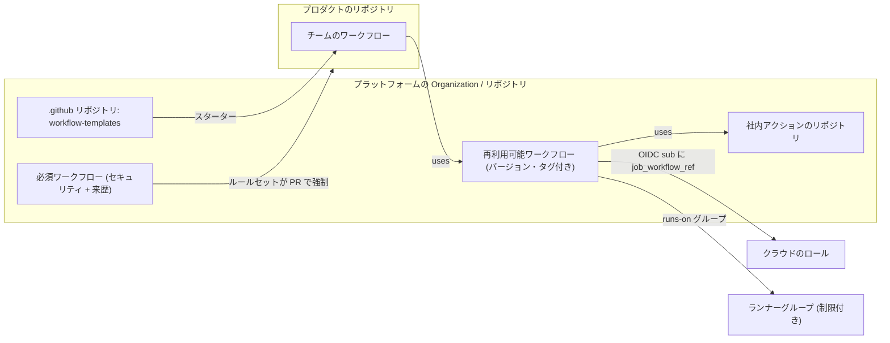

import { TLDR, DocsLinks, LastVerified, CompareTable } from '@components';
import { Aside, Badge, Steps } from '@astrojs/starlight/components';

<LastVerified date="2026-10" />

<TLDR>
- **CI を強制する**: Organization のルールセットで **「Require workflows to pass before merging」** を使います。ワークフローは中央リポジトリに置かれ、対象リポジトリのすべての PR で実行されます。対象はリポジトリ名または **カスタムプロパティ** で指定します。
- **チームを導く**: **ワークフローテンプレート**（`.github` リポジトリ → `workflow-templates/`）と、バージョン管理された **再利用可能ワークフロー** をゴールデンパスとして提供します。
- **サプライチェーンを統制する**: **許可するアクションのポリシー**（Enterprise → Organization → リポジトリ）、**SHA ピン留めの必須化**、**Actions のイベント／アクターポリシー** を使います。社内アクションは **internal／private** リポジトリに置き、「Organization／Enterprise 内のリポジトリからアクセス可能」で共有します。
- **インフラと ID**: **ランナーグループ** を Organization、リポジトリ、ワークフロー単位で制限します。OIDC の信頼関係は `job_workflow_ref` の subject テンプレートや `repo_property_*` クレームで一元化します。
- **コンプライアンスを証明する**: **監査ログ**（`workflows.*`、`org.required_workflow_*`、ランナーやシークレットのイベント）を SIEM にストリーミングします。
</TLDR>

## ブースでよくある質問

すべてのリポジトリで、マージ前にセキュリティスキャンを必ず実行させるには？

**Organization のルールセット**（既定ブランチを対象とするブランチルールセット）を作成し、**「Require workflows to pass before merging」** ルールを追加します。中央リポジトリのワークフローファイルを、ブランチ、タグ、SHA のいずれかに固定して指定します。対象リポジトリはパターンか **カスタムプロパティ**（例: `compliance = pci`）で選びます。ワークフローは各対象リポジトリのコンテキストで PR に対して実行され、チームが自分のリポジトリから外すことはできません。まず **Evaluate** モードで影響を確認してから **Active** にしてください。<Badge text="プランの提供状況を要確認" variant="caution" />

ルールセットの必須ワークフローと必須ステータスチェックの違いは？

**必須ステータスチェック** が保証するのは「`X` という名前のチェックが成功していること」だけです。`X` を生成するワークフローはリポジトリ側に*存在*しなければならず、ワークフローを編集できる人なら偽装や名前変更ができます。チェックの送信元を GitHub App に固定することもできますが、それでもリポジトリの YAML を信頼していることに変わりはありません。**必須ワークフロー** は *中央リポジトリから提供* されるため、リポジトリ側でスキップしたり改変したりできません。

Marketplace を使わずに、社内でプライベートなアクションを共有するには？

アクションや再利用可能ワークフローを **private または internal** リポジトリに置き、**Settings → Actions → General → Access** で *Organization 内のリポジトリからアクセス可能*（internal なら Enterprise）を選びます。ワークフローからは `uses: my-org/actions-repo/path@ref` で参照します。注意: 利用側リポジトリの外部コラボレーターは、それを使った実行のログを閲覧できます。

チームが Marketplace のアクションを無秩序に使うのを防ぐには？

**Enterprise → Policies → Actions** で *Allow enterprise, and select non-enterprise, actions and reusable workflows* を選び、次を設定します。
- 必要に応じて **GitHub 製** や **Marketplace の検証済み作成者** を許可する。
- 明示的な許可リストを追加する（`aws-actions/*`、`docker/build-push-action@*`）。先頭に `!` を付けるとブロックになる。
- **「Require actions to be pinned to a full-length commit SHA」** を有効にする。

Organization は Enterprise が許可した範囲をさらに絞ることしかできません。ポリシーはロックされたコミットを検査するため、**ワークフロー依存関係ロックファイル** <Badge text="プレビュー" variant="caution" /> と組み合わせてください。

ワークフローを*誰が*、*どのイベントで*トリガーできるかを制御できますか？

できます。Enterprise、Organization、リポジトリの各レベルで **Actions ポリシー → ワークフロー実行の保護** を使います。**アクタールール** はユーザー、ロール、アプリ、Copilot、Dependabot を対象とし、「コードを push できる」と「CI を実行できる」を分けられます。**イベントルール** では、たとえば `pull_request_target` や `workflow_dispatch` を制限できます。許可されていない実行はエラーで失敗し、監査ログに `workflows.actions_policy_violation` が記録されます。

GHES を使っています。Marketplace のアクションを使うには？

推奨は **GitHub Connect** です。GitHub.com のアクションに自動でアクセスでき、同じ許可アクションポリシーで統制されます。エアギャップ環境やより厳密な管理が必要な場合は、**`actions-sync`** ツールで特定のアクションのリポジトリをインスタンスに手動でミラーします。GHES には独自のランナー（セルフホストまたは ARC）が必要です。イミュータブルな OIDC subject などの機能が GHES で使えるかも確認してください。この機能は **使えません**。

プラットフォームチームが、チームの作業を壊さずに「ゴールデンパス」を展開するには？

**バージョン管理された再利用可能ワークフロー**（例: `platform/.github/workflows/build.yml@v3`）と、それを呼び出す **ワークフローテンプレート** を公開します。**必須ワークフロー** で強制するのは、セキュリティスキャンや来歴などの譲れない項目だけにします。OIDC の `job_workflow_ref` で、クラウドへのデプロイ権限をゴールデンワークフローに紐付けます。導入状況は監査ログや `uses: platform/` のコード検索で測定します。

## ゴールデンパスのアーキテクチャ

## CI 標準を強制する方法

<CompareTable
  title="CI 標準を強制する方法"
  columns={[
    { key: 'req', label: '必須ワークフロー（ルールセット）' },
    { key: 'tpl', label: 'ワークフローテンプレート' },
    { key: 'reuse', label: '再利用可能ワークフロー' },
    { key: 'check', label: '必須ステータスチェック' },
  ]}
  rows={[
    { feature: 'チームがオプトアウト／編集できる', category: '強制力', values: { req: 'できない（中央のファイル）', tpl: 'できる（一度コピーされるだけ）', reuse: 'できる（呼び出すかは呼び出し側次第）', check: '一部できる（YAML はチームが管理）' } },
    { feature: '失敗時にマージをブロック', category: '強制力', values: { req: true, tpl: false, reuse: '必須チェックにも設定した場合のみ', check: true } },
    { feature: '中央の更新が反映される', category: '保守', values: { req: true, tpl: false, reuse: '反映される（呼び出し側が可変の参照を使う場合）', check: false } },
    { feature: 'カスタムプロパティで対象指定', category: '対象指定', values: { req: true, tpl: false, reuse: false, check: 'できる（ルールセット経由）' } },
    { feature: 'Evaluate（ドライラン）モード', category: '展開', values: { req: true, tpl: false, reuse: false, check: 'あり（ルールセット）' } },
    { feature: '最適な用途', category: '用途', values: { req: '譲れないゲート（SAST、ライセンス、来歴）', tpl: '素早いオンボーディング、舗装された道', reuse: 'ビルド／デプロイのロジックの共通化、SLSA L3', check: 'シンプルなリポジトリ単位のゲート' } },
  ]}
/>

<Aside type="tip" title="トークポイント">
おすすめのパターンは、**テンプレートで始め、再利用可能ワークフローで最新を保ち、必須ワークフローで強制し、カスタムプロパティでどのリポジトリに何を適用するかを決める** ことです。
</Aside>

## ガバナンスの構成要素

| 構成要素 | レベル | ブースでの説明 |
| --- | --- | --- |
| **許可するアクションと再利用可能ワークフローのポリシー** | Enterprise → Organization → リポジトリ | `!` による拒否パターン付きの許可リスト。SHA ピン留めを必須にすることも可能 |
| **Actions ポリシー（ワークフロー実行の保護）** | Enterprise / Organization / リポジトリ | アクターとイベントの許可リスト。パブリックリポジトリでは `pull_request_target` が既定でブロック（2026年11月2日から強制） |
| **ワークフロー権限の既定値** | Enterprise / Organization | `GITHUB_TOKEN` の既定を読み取り専用に。Actions による PR の作成・承認をブロック |
| **フォーク PR のポリシー** | Enterprise / Organization / リポジトリ | 外部コントリビューターには承認を必須に。プライベートリポジトリでのフォークのワークフローを制御 |
| **ランナーグループ** | Enterprise / Organization | ランナーを選択した Organization、リポジトリ、**ワークフロー** に限定。本番デプロイ用ランナーを分離 |
| **環境** | リポジトリ | 必須レビュー担当者（最大6）、待機タイマー、ブランチルール、環境シークレット |
| **成果物、ログ、キャッシュの保持** | Enterprise / Organization / リポジトリ | 既定は90日（プライベートは最大400日）。キャッシュのサイズと保持のポリシー |
| **カスタムプロパティ** | Organization / Enterprise | ルールセットの対象指定と OIDC の `repo_property_*` クレームの**両方**に使える |

### OIDC の一元化

<Steps>

1. Organization 管理者が、`job_workflow_ref`（と `environment`）を含む **OIDC subject テンプレート** を REST API で設定します。
2. クラウドのロールは `...:job_workflow_ref:platform/deploy/.github/workflows/deploy.yml@refs/tags/v3` だけを信頼します。
3. 必要に応じて、`business_unit` などのカスタムプロパティを `repo_property_*` クレームとして追加し、ABAC の条件に使います。
4. 各リポジトリが Organization のテンプレートにオプトインします（`use_default: false`）。既存の OIDC 利用者が自動で切り替わることは **ありません**。

</Steps>

### ランナーグループ

- `prod-deploy`、`general`、`gpu` のように信頼ゾーンごとにグループを作り、それぞれを特定の Organization、リポジトリ、**特定のワークフロー** に限定します。
- セルフホストランナーと **GitHub ホストの大きいランナー** の両方をグループに入れられます（Team または Enterprise Cloud）。
- 環境と組み合わせ、本番の認証情報が本番用ランナーにしか存在しないようにします。

## Actions の監査ログイベント

| 領域 | イベントの例 |
| --- | --- |
| ワークフローの実行 | `workflows.created_workflow_run`、`workflows.completed_workflow_run`、`workflows.rerun_workflow_run`、`workflows.approve_workflow_job` |
| ポリシー | `workflows.actions_policy_violation`、`org.update_actions_settings`、`org.set_default_workflow_permissions` |
| 必須ワークフロー | `org.required_workflow_create`、`org.required_workflow_update`、`org.required_workflow_delete` |
| シークレットと変数 | `org.update_actions_secret`、`repo.create_actions_secret`、`environment.update_actions_secret` |
| ランナー | `org.register_self_hosted_runner`、`org.runner_group_created`、`org.self_hosted_runner_offline` |
| 環境 | `environment.add_protection_rule`、`environment.update_protection_rule` |

これらのイベントを Splunk、Datadog、S3、Azure Blob または Event Hubs、GCS にストリーミングし、SIEM で相関分析します。

## GHES での考慮事項

- アクションの入手には **GitHub Connect**（自動、ポリシーで制御）か **`actions-sync`**（手動ミラー、エアギャップ環境でも可）を使います。
- **ランナー** はセルフホストか ARC が必要です。GHES には GitHub ホストランナーはありません。
- **機能の遅れ**: 新しい Actions の機能は後続の GHES リリースで提供されます。お使いのバージョンのリリースノートを確認してください（2026年10月時点の最新は 3.22）。
- OIDC は使えますが、**イミュータブルな subject 形式は GHES では使えません**。
- GHES からの移行を検討中なら、データレジデンシー付きの GHE.com で、アップグレード作業なしに GitHub ホストランナーと新機能を利用できます。

<DocsLinks links={[
  { label: 'Enterprise で GitHub Actions のポリシーを適用する', href: 'https://docs.github.com/ja/enterprise-cloud@latest/admin/enforcing-policies/enforcing-policies-for-your-enterprise/enforcing-policies-for-github-actions-in-your-enterprise' },
  { label: 'Organization 内のリポジトリのルールセットを作成する', href: 'https://docs.github.com/ja/organizations/managing-organization-settings/creating-rulesets-for-repositories-in-your-organization' },
  { label: '依存関係レビューの強制（必須ワークフローの例）', href: 'https://docs.github.com/ja/code-security/how-tos/secure-at-scale/configure-organization-security/configure-specific-tools/enforce-dependency-review' },
  { label: 'Actions ポリシーについて', href: 'https://docs.github.com/ja/actions/concepts/about-actions-policies' },
  { label: 'Organization でアクションとワークフローを共有する', href: 'https://docs.github.com/ja/actions/how-tos/reuse-automations/share-with-your-organization' },
  { label: 'ワークフローテンプレートを作成する', href: 'https://docs.github.com/ja/actions/how-tos/reuse-automations/create-workflow-templates' },
  { label: 'ランナーグループ', href: 'https://docs.github.com/ja/actions/concepts/runners/runner-groups' },
  { label: 'OpenID Connect リファレンス', href: 'https://docs.github.com/ja/actions/reference/security/oidc' },
  { label: 'Organization の監査ログイベント', href: 'https://docs.github.com/ja/organizations/keeping-your-organization-secure/managing-security-settings-for-your-organization/audit-log-events-for-your-organization' },
  { label: 'GHES でのアクションの利用について', href: 'https://docs.github.com/ja/enterprise-server@latest/admin/managing-github-actions-for-your-enterprise/managing-access-to-actions-from-githubcom/about-using-actions-in-your-enterprise' },
]} />
