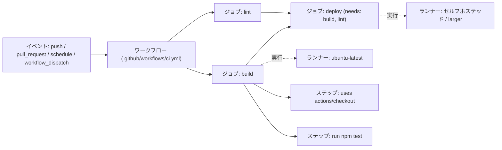

import { Aside, Badge } from '@astrojs/starlight/components';
import { TLDR, DocsLinks, LastVerified, FlashCards } from '@components';

<LastVerified date="2026-10" />

<TLDR>
- **イベント**（push、PR、スケジュール、手動実行など）が 1 つ以上の**ワークフロー**（`.github/workflows/*.yml`）をトリガーします。
- ワークフローは**ジョブ**で構成されます。ジョブはデフォルトで並列に実行され、それぞれ新しい**ランナー**を使います。順序を付けるには `needs:` を使います。
- ジョブは**ステップ**の並びです。各ステップはシェルコマンド（`run:`）か**アクション**（`uses:`）のどちらかで、ジョブ内のファイルシステムを共有します。
- 各ジョブには短命の **`GITHUB_TOKEN`** が発行されます。`permissions:` で権限を絞り込んでください。
- ジョブ間のデータ受け渡しには、小さな文字列なら**出力 (outputs)**、ファイルなら**アーティファクト**を使います。依存関係のインストールを速くするには**キャッシュ**を使います。
</TLDR>

## ブースでよくある質問

<details>
<summary>ジョブ同士でマシンやファイルシステムを共有しますか？</summary>

しません。各ジョブは新しいランナーで実行されます。GitHub ホステッドランナーでは、ジョブごとに新しい VM が使われます。**同じジョブ内の**
ステップはワークスペースを共有します。ジョブ間では、小さな値には `outputs` を、ファイルには `actions/upload-artifact` / `actions/download-artifact` を使います。

</details>

<details>
<summary>GITHUB_TOKEN で何ができますか？有効期限は？</summary>

リポジトリにスコープされた GitHub App のインストールトークンです。ジョブが終了すると失効し、最長でも 24 時間で失効します。
デフォルトの権限はエンタープライズ・Organization・リポジトリのいずれかのレベルで設定され、「permissive」（読み書き）か
「restricted」（`contents` と `packages` の読み取りのみ）のどちらかです。そのデフォルトに依存しないよう、必ず明示的な
`permissions:` ブロックを書いてください。

</details>

<details>
<summary>別のワークフローがコミットを push したのに、ワークフローがトリガーされないのはなぜですか？</summary>

`GITHUB_TOKEN` によって発生したイベントでは、新しいワークフロー実行は**開始されません**。再帰的なループを防ぐための仕様です。
例外は `workflow_dispatch` と `repository_dispatch` です。ワークフローを連鎖させるには、GitHub App トークン、`workflow_run`、
または reusable workflow を使います。[高度なワークフローパターン](/github-cheatsheet/ja/actions/advanced-workflows/)を参照してください。

</details>

<details>
<summary>アーティファクトとキャッシュはどう使い分けますか？</summary>

- **アーティファクト**は、残しておきたい・ダウンロードしたい・後続ジョブに渡したいビルドの**成果物**（バイナリ、テストレポート）に使います。
- **キャッシュ**は、作り直せるが取得に時間がかかる**入力**（`node_modules`、`~/.m2`）に使います。ベストエフォートで、エントリは削除されることがあります。上限はリポジトリあたり 10 GB です。

</details>

<details>
<summary>コンテキストと環境変数の違いは？</summary>

**コンテキスト**（`github`、`env`、`vars`、`secrets`、`matrix`、`needs`、`steps`、`runner`、`inputs` など）は、ステップがランナーに
送られる**前に** Actions エンジンが評価します。**環境変数**（`$GITHUB_SHA`、`$MY_VAR`）は、ランナー**上の**シェルが読み取ります。
`if:` や `with:` の入力にはコンテキストを、スクリプト内では環境変数を使います。

</details>

<details>
<summary>PR タイトルの式を run: スクリプトに直接埋め込んでも安全ですか？</summary>

安全ではありません。これは**スクリプトインジェクション**です。式はシェルが実行される前にスクリプトへ展開されるため、細工された PR タイトルで
任意のコマンドを実行されるおそれがあります。先に環境変数へマッピングしてください。
`env: TITLE: ${{ github.event.pull_request.title }}` と書き、スクリプト内では `"$TITLE"` を使います。
詳しくは [Actions 概要](/github-cheatsheet/ja/actions/)とそこから辿れるセキュリティページを参照してください。

</details>

## アーキテクチャ全体図



| 概念 | 記述場所 | ポイント |
| --- | --- | --- |
| イベント | `on:` | ブランチ、タグ、パス、アクティビティの `types` で絞り込めます。 |
| ワークフロー | `.github/workflows/*.yml` | イベントが参照する ref にワークフローファイルが存在する必要があります（`schedule` や `workflow_run` などはデフォルトブランチのみを使います）。 |
| ジョブ | `jobs.<id>` | デフォルトで並列実行です。それぞれ独自の `runs-on`、`permissions`、`env`、`if`、`timeout-minutes` を持ちます。 |
| ステップ | `jobs.<id>.steps[]` | `run:`（シェル）か `uses:`（アクション）です。ジョブ内で順番に実行されます。 |
| ランナー | `runs-on:` | GitHub ホステッド、larger、セルフホステッドがあります。[ランナー](/github-cheatsheet/ja/actions/runners/)を参照してください。 |

## 注釈付きの最小ワークフロー

```yaml
name: CI
on:
  pull_request:
  push:
    branches: [main]

permissions:
  contents: read            # GITHUB_TOKEN を最小権限に

jobs:
  build:
    runs-on: ubuntu-latest
    timeout-minutes: 15     # デフォルトは 360 分。必ず短く設定する
    outputs:
      version: ${{ steps.ver.outputs.version }}
    steps:
      - uses: actions/checkout@v7
      - id: ver
        run: echo "version=$(cat VERSION)" >> "$GITHUB_OUTPUT"
      - run: make build
      - uses: actions/upload-artifact@v7
        with:
          name: dist
          path: dist/

  deploy:
    needs: build                       # build を待ち、失敗時はスキップ
    if: github.ref == 'refs/heads/main'
    runs-on: ubuntu-latest
    steps:
      - uses: actions/download-artifact@v8
        with:
          name: dist
      - run: echo "Deploying ${{ needs.build.outputs.version }}"
```

<Aside type="tip">
ここで示しているメジャーバージョン（`checkout@v7`、`upload-artifact@v7`、`download-artifact@v8`）は 2026-10 時点の最新リリースです。
GitHub Docs の例の多くはまだ古いメジャーバージョンを使っています。本番では**コミット SHA で完全にピン留め**し、Dependabot で SHA を
最新に保ってください。
</Aside>

## コンテキストと式

- 構文は `${{ <式> }}` です。`if:` の中では `${{ }}` を省略できます。
- よく使う関数: `contains()`、`startsWith()`、`format()`、`join()`、`toJSON()`、`fromJSON()`、`hashFiles()`。
- ステータス関数: `success()`（暗黙のデフォルト）、`always()`、`failure()`、`cancelled()`。
- `vars` / `secrets` の優先順位: 環境 > リポジトリ > Organization（最も具体的なものが優先されます）。

```yaml
if: github.event_name == 'push' && startsWith(github.ref, 'refs/tags/v')
```

## GITHUB_TOKEN の基本

```yaml
permissions:          # ワークフローレベル — 全ジョブに適用
  contents: read
jobs:
  release:
    permissions:      # ジョブレベル — ワークフローの設定と統合されず、置き換える
      contents: write
      id-token: write # クラウドへの OIDC とアーティファクト構成証明に必要
```

- `permissions:` ブロックに書かなかったスコープは `none` になります。
- **フォーク**からの PR には読み取り専用のトークンが渡され、シークレットは（`GITHUB_TOKEN` 以外）渡されません。

## ジョブの出力と `needs` グラフ

- ステップの出力は `echo "key=value" >> "$GITHUB_OUTPUT"` で設定し、`jobs.<id>.outputs` で公開します。
- 後続のジョブでは `needs.<job>.outputs.<key>` で読み取ります。
- 上限は、ワークフロー実行ごとに**ジョブあたり 1 MB**、**合計 50 MB** です。
- `needs` 内のジョブが失敗またはスキップされると、依存するジョブもスキップされます。これを変えるには `if: always()` または `if: ${{ !cancelled() }}` を使います。

## アーティファクトとキャッシュ（各 1 行）

- **アーティファクト:** 実行で生成したファイルを保持し、後でダウンロードしたり別のジョブに渡したりします（`actions/upload-artifact@v7` / `download-artifact@v8`）。
- **キャッシュ:** `hashFiles('**/lockfile')` をキーに、実行をまたいで依存関係を再利用します（`actions/cache@v6`、または `setup-*` アクションの組み込み `cache:` 入力）。上限はリポジトリあたり 10 GB です。

## セルフチェック

<FlashCards
	title="基礎フラッシュカード"
	cards={[
		{ q: '同じワークフローの 2 つのジョブはファイルシステムを共有しますか？', a: 'しません。各ジョブは新しいランナーで動きます。**アーティファクト**か**出力**を使います。' },
		{ q: 'ジョブ B をジョブ A の完了まで待たせるには？', a: 'ジョブ B に `needs: A` を指定します。' },
		{ q: 'OIDC トークンの要求に必要な権限は？', a: '`id-token: write`' },
		{ q: 'ジョブのデフォルトタイムアウトは？', a: '360 分（6 時間）です。`timeout-minutes` を短く設定しましょう。' },
		{ q: '`GITHUB_TOKEN` による push で `on: push` のワークフローはトリガーされますか？', a: 'されません（`workflow_dispatch` / `repository_dispatch` イベントは例外）。' },
		{ q: 'ジョブ出力のサイズ上限は？', a: 'ジョブあたり 1 MB、ワークフロー実行あたり 50 MB です。' },
	]}
/>

<DocsLinks
	links={[
		{ label: 'GitHub Actions を理解する', href: 'https://docs.github.com/ja/actions/get-started/understand-github-actions' },
		{ label: 'ワークフロー構文', href: 'https://docs.github.com/ja/actions/reference/workflows-and-actions/workflow-syntax' },
		{ label: 'コンテキストリファレンス', href: 'https://docs.github.com/ja/actions/reference/workflows-and-actions/contexts' },
		{ label: '式', href: 'https://docs.github.com/ja/actions/reference/workflows-and-actions/expressions' },
		{ label: 'GITHUB_TOKEN を使った認証', href: 'https://docs.github.com/ja/actions/tutorials/authenticate-with-github_token' },
		{ label: 'データの保存と共有（アーティファクト）', href: 'https://docs.github.com/ja/actions/tutorials/store-and-share-data' },
		{ label: '依存関係キャッシュのリファレンス', href: 'https://docs.github.com/ja/actions/reference/workflows-and-actions/dependency-caching' },
	]}
/>
