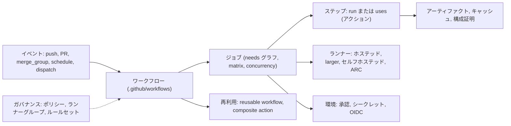

import { LinkCard, CardGrid, Badge } from '@astrojs/starlight/components';
import { TLDR, DocsLinks, LastVerified } from '@components';

<LastVerified date="2026-10" />

<TLDR>
- GitHub Actions は GitHub に組み込まれた自動化基盤です。**イベント → ワークフロー → ジョブ → ステップ**の順に構成され、**GitHub ホステッド**ランナーまたは**セルフホステッド**ランナー上で実行されます。
- ホステッドランナーには標準 VM のほか、**Arm64** と **GPU**（いずれも GA）、静的 IP・Azure プライベートネットワーク・カスタムイメージに対応した **larger runners** があります。
- 再利用には **reusable workflow**（パイプライン全体）と **composite action**（ステップの束）を使い、ランナーグループ・環境・ルールセットで統制します。
- デフォルトで安全に保つには、最小権限の `GITHUB_TOKEN`、クラウドキーの代わりの **OIDC**、SHA ピン留めしたアクション、**アーティファクト構成証明**を使います。
- ブースで難しい質問の多くは、**パスフィルター付きの必須チェック**、**モノレポ**、**ARC**、**コスト**に関するものです。下のページを参照してください。
</TLDR>

## Actions マップ

## このセクションのページ

<CardGrid>
	<LinkCard title="基礎" description="イベント、ジョブ、ステップ、コンテキスト、GITHUB_TOKEN、出力、アーティファクトとキャッシュの違い。" href="/github-cheatsheet/ja/actions/fundamentals/" />
	<LinkCard title="ランナー" description="ホステッド、larger、Arm64、GPU、プライベートネットワーク、セルフホステッド、ARC、ランナーグループ。" href="/github-cheatsheet/ja/actions/runners/" />
	<LinkCard title="高度なワークフローパターン" description="reusable と composite の比較、動的マトリックス、concurrency、環境、マージキュー、モノレポ。" href="/github-cheatsheet/ja/actions/advanced-workflows/" />
	<LinkCard title="本番 CI ワークフロービルダー" description="堅牢な CI/CD ワークフローと reusable workflow の呼び出し側・呼び出される側を組み立てるインタラクティブビルダー。" href="/github-cheatsheet/ja/actions/yaml-builder/" />
	<LinkCard title="セキュリティ強化" description="OIDC、最小権限トークン、ピン留めとロックファイル、pull_request_target、スクリプトインジェクション、構成証明。" href="/github-cheatsheet/ja/actions/security/" />
	<LinkCard title="パフォーマンスとコスト" description="キャッシュ、concurrency、適切なランナーサイズ、タイムアウト、課金管理。" href="/github-cheatsheet/ja/actions/performance-cost/" />
	<LinkCard title="エンタープライズパターン" description="ルールセットによる必須ワークフロー、許可アクションポリシー、テンプレート、ゴールデンパスワークフロー。" href="/github-cheatsheet/ja/actions/enterprise-patterns/" />
	<LinkCard title="トラブルシューティング" description="デバッグログ、よくあるエラー、ワークフローがトリガーされない理由、gh run コマンド。" href="/github-cheatsheet/ja/actions/troubleshooting/" />
</CardGrid>

## ブースでよくある質問

必須チェックが「Expected — Waiting for status」のまま止まっています。なぜですか？

ワークフローが `paths` または `branches` フィルターでスキップされたため、ステータスが一度も報告されていません。`if:` で
スキップされた**ジョブ**は Success を報告しますが、フィルターでスキップされた**ワークフロー**は何も報告しません。常に実行される集約ジョブを 1 つ用意し、それだけを必須チェックにしてください。
詳しくは[高度なワークフローパターン](/github-cheatsheet/ja/actions/advanced-workflows/)を参照してください。

reusable workflow と composite action、どちらを使うべきですか？

**reusable workflow** はパイプライン全体です。複数のジョブ、独自のランナー、環境、シークレットを持てて、一元的に統制できます。
**composite action** は呼び出し元のジョブ内で実行されるステップの集まりです。reusable workflow は最大 10 階層までネストでき、
1 ファイルから呼び出せるユニークな reusable workflow は最大 50 個です。
[比較表](/github-cheatsheet/ja/actions/advanced-workflows/)を参照してください。

ホステッドランナーから社内のプライベートネットワークに接続するには？

larger runners の **Azure プライベートネットワーク**、**OIDC 認証付き API ゲートウェイ**、または **WireGuard** を使います。
ファイアウォールの許可リストに登録したいだけなら、larger runners の**静的 IP**（Linux/Windows）が使えます。どれも合わない場合は
セルフホステッドランナーか ARC を使います。[ランナー](/github-cheatsheet/ja/actions/runners/)を参照してください。

クラウドのキーを GitHub シークレットに保存しないで済む方法は？

**OIDC** を使います。`permissions: id-token: write` を付与し、クラウド側のロールで `token.actions.githubusercontent.com` を信頼させます。
その際、`sub` 条件をリポジトリと環境に限定してください。2026-07-15 以降に作成されたリポジトリでは、owner ID と repo ID を含む
変更不可能な `sub` 形式が使われます。[ワークフロービルダー](/github-cheatsheet/ja/actions/yaml-builder/)で試せます。

2026 年に Actions やセルフホステッドランナーの料金は変わりましたか？

<Badge text="回答前に要確認" variant="caution" /> 2026-10 時点の GitHub Docs では、セルフホステッドランナーは引き続き無料で
利用できる（インフラ費用は自己負担）と説明されています。2026 年の料金変更は確認できていません。回答する前に、
GitHub の料金ページと changelog をその場で確認してください。

<DocsLinks
	links={[
		{ label: 'GitHub Actions ドキュメント', href: 'https://docs.github.com/ja/actions' },
		{ label: 'GitHub Actions を理解する', href: 'https://docs.github.com/ja/actions/get-started/understand-github-actions' },
		{ label: 'ワークフロー構文', href: 'https://docs.github.com/ja/actions/reference/workflows-and-actions/workflow-syntax' },
		{ label: 'Actions の制限', href: 'https://docs.github.com/ja/actions/reference/limits' },
		{ label: 'Actions ランナーの料金', href: 'https://docs.github.com/ja/billing/reference/actions-runner-pricing' },
	]}
/>
