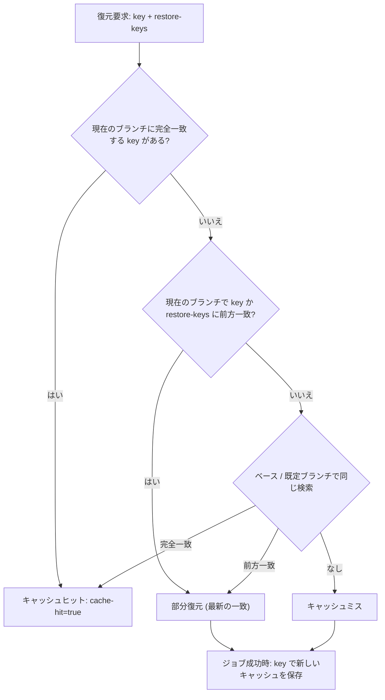
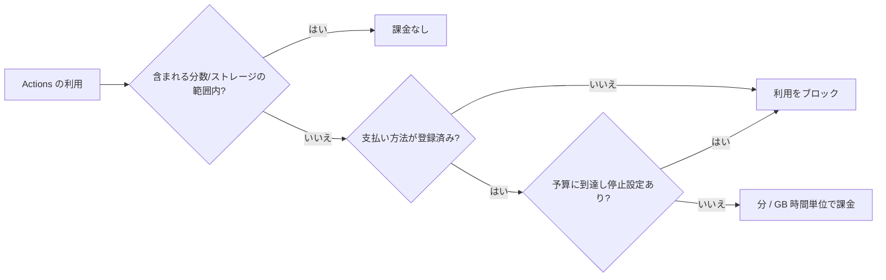

import { TLDR, DocsLinks, LastVerified, CompareTable, FlashCards } from '@components';
import { Aside, Badge } from '@astrojs/starlight/components';

<LastVerified date="2026-10" />

<TLDR>
- **依存関係をキャッシュする**: `setup-*` の `cache:` か `actions/cache@v4` を使います。キャッシュは **リポジトリあたり 10 GB** まで含まれており、管理者は上限を引き上げられます（超過分は課金）。**7日間** アクセスのないエントリは削除されます。
- **無駄な分数を減らす**: `concurrency` と `cancel-in-progress`、`timeout-minutes`、`paths` / `paths-ignore` フィルターを使います。
- **課金は SKU ごとの分単価**: Linux 2コア **$0.006/分**、Windows **$0.010**、macOS **$0.062**、Linux arm64 **$0.005**。標準ランナーはパブリックリポジトリなら無料です。ジョブは1分単位に切り上げられます。
- **含まれる分数は大きいランナーには使えません**: 大きいランナーはパブリックリポジトリでも常に課金されます。
- **予算を設定する**: Actions などの従量課金製品では、予算に達した時点で利用を **停止** できます。
</TLDR>

## ブースでよくある質問

<details>
<summary>GitHub ホストランナーの料金は？</summary>

分単位の課金で、ジョブごとに **切り上げ** られます。標準ランナーの単価（GitHub Docs、2026年10月時点）:

| ランナー | SKU | USD／分 |
| --- | --- | --- |
| Linux 1コア x64 | `actions_linux_slim` | $0.002 |
| Linux 2コア x64 | `actions_linux` | $0.006 |
| Linux 2コア arm64 | `actions_linux_arm` | $0.005 |
| Windows 2コア x64 / arm64 | `actions_windows` / `_arm` | $0.010 |
| macOS 3/4コア（M1 または Intel） | `actions_macos` | $0.062 |

現在の Docs は **SKU ごとのドル単価** を掲載しています。以前の「2倍／10倍」という OS 別の分数乗数ではなく、こちらを案内してください。大きいランナーは [Actions ランナーの価格](https://docs.github.com/ja/billing/reference/actions-runner-pricing) を参照してください（例: Linux 4コアは $0.012、Linux 64コアは $0.162）。

</details>

<details>
<summary>無料枠は何分ですか？</summary>

**プライベートリポジトリ** で標準ランナーを使う場合:

| プラン | 分数／月 | 成果物＋Packages ストレージ | キャッシュ（リポジトリあたり） |
| --- | --- | --- | --- |
| Free / Free for organizations | 2,000 | 500 MB | 10 GB |
| Pro | 3,000 | 1 GB | 10 GB |
| Team | 3,000 | 2 GB | 10 GB |
| Enterprise Cloud | 50,000 | 50 GB | 10 GB |

標準ランナーは **パブリックリポジトリ**、GitHub Pages、Dependabot では無料です。含まれる分数を大きいランナーに使うことは **できません**。

</details>

<details>
<summary>セルフホストランナーに費用はかかりますか？</summary>

GitHub Docs（2026年10月時点）では、セルフホストランナーは引き続き **Actions で無料で利用可能** とされています。マシン、ネットワーク、ストレージ、運用作業の費用は利用者の負担です。<Badge text="案内前に要確認" variant="caution" /> 2026年のセルフホストの「プラットフォーム料金」は Docs で確認できませんでした。話題にする前に github.com/pricing と changelog を確認してください。

</details>

<details>
<summary>キャッシュがすぐに削除されてしまいます。どうすればよいですか？</summary>

1. **Actions → Caches** でスラッシングが起きていないか確認します。合計が上限を超えると、最終アクセスが古いものから削除されます。
2. 他から復元できない PR 単位や SHA 単位のキーでキャッシュするのをやめます。PR のキャッシュは `refs/pull/N/merge` にスコープされ、その PR の再実行でしか使えません。
3. `main` への `push` でキャッシュを温めます。既定ブランチのキャッシュはすべてのブランチから読めます。
4. Actions の設定で **リポジトリのキャッシュ上限を引き上げ** ます。上限は Organization／Enterprise が決め（ユーザー所有のリポジトリは最大 10 TB）、支払い方法の登録が必要で、10 GB を超えた分は課金されます（約 $0.07/GB-月）。

</details>

<details>
<summary>別の PR のキャッシュが復元されないのはなぜ？</summary>

仕様です。実行が復元できるのは **自分のブランチ**、**ベースブランチ**、**既定ブランチ** のキャッシュだけで、兄弟ブランチ、子ブランチ、他の PR のキャッシュは復元できません。これはセキュリティ境界です。

</details>

<details>
<summary>大きいランナーと並列化、どちらがよいですか？</summary>

- **大きいランナー** は、分割しにくい CPU 律速のビルド（コンパイル、Docker ビルド）に向いています。コア数が2倍になると分単価もおおむね2倍になるため、メリットはウォールクロック時間の短縮か、線形以上にスケールする場合に得られます。
- **マトリックス／シャーディング** は、きれいに分割できるテストスイートに向いています。各ジョブがチェックアウト、キャッシュ復元、ツールチェーンのセットアップ費用をそれぞれ負担します。
- プランごとの総同時ジョブ数である **同時実行の上限** に注意してください。標準ランナーは Free が 20、Team が 60、Enterprise が 500 で、macOS は 5 または 50 が上限です。サポートに依頼すれば引き上げられます。

</details>

<details>
<summary>想定外の請求を防ぐには？</summary>

新しい課金プラットフォームで、Enterprise、Organization、コストセンター、リポジトリの各レベルに **予算** を設定します。Actions のような **従量課金** 製品では、予算に達した時点で **利用を停止** できます。アラートは予算の 75%／90%／100% で届き、**含まれる** 分数の 90%／100% でもメールが届きます。支払い方法が未登録の場合は、無料枠を使い切った時点で利用が止まり、大きいランナーはまったく使えません。

</details>

## キャッシュキーの解決



```yaml
- uses: actions/cache@v4
  with:
    path: ~/.npm
    key: ${{ runner.os }}-npm-${{ hashFiles('**/package-lock.json') }}
    restore-keys: |
      ${{ runner.os }}-npm-
```

**押さえておくべき事実**
- キャッシュは **イミュータブル** です。内容を変えるには新しいキーで保存します。キーは最大 512 文字です。
- リポジトリの無料枠は **10 GB** です。管理者は上限を引き上げられ、10 GB を超えた分は課金されます。**7日間使われないエントリは削除** されます。リポジトリが上限に達すると、最終アクセスが古いものから削除されます。
- リポジトリあたりのレート制限は **アップロード 200回/分、ダウンロード 1,500回/分、削除 400回/分** です。
- `pull_request_target`、`issue_comment`、`workflow_run` などの低信頼トリガーは、既定ブランチのキャッシュに **読み取り専用** でアクセスします。新しい `cache-mode` キー（`read`、`write`、`write-only`、`none`）で明示的に設定できます。
- 範囲が広すぎる `restore-keys` は古いデータを復元することがあります。ロックファイルのハッシュをキーに使ってください。

### `setup-*` の組み込みキャッシュ

| エコシステム | アクション | 入力 |
| --- | --- | --- |
| npm / Yarn / pnpm | `actions/setup-node` | `cache: npm` |
| pip / pipenv / Poetry | `actions/setup-python` | `cache: pip` |
| Gradle / Maven | `actions/setup-java` | `cache: gradle` |
| Go | `actions/setup-go` | 最近のバージョンでは既定で有効 |
| .NET NuGet | `actions/setup-dotnet` | `cache: true` |
| RubyGems | `ruby/setup-ruby` | `bundler-cache: true` |

## 成果物（v4）

- `actions/upload-artifact@v4` と `actions/download-artifact@v5` を使います。v4 の成果物は **イミュータブル** で、同じ名前に2回アップロードすることはできません。マトリックスの各ジョブで一意の名前を付け、ダウンロード時に `merge-multiple` / `pattern` を使います。
- **保持期間** は既定で **90日** です。パブリックリポジトリは 1〜90日、プライベートリポジトリは 1〜400日の範囲で設定できます。アップロードごとに `retention-days` で上書きできますが、リポジトリや Organization の上限は超えられません。
- 成果物のストレージは GitHub Packages と無料枠を **共有** し、GB 時間単位で1時間ごとに加算されます。成果物を削除しても止まるのは*今後*の課金だけで、当該サイクルですでに加算された分は残ります。
- **成果物とキャッシュの違い**: ビルド出力をジョブ間で受け渡したり人のために残したりするには成果物を、依存関係の再インストールを高速化するにはキャッシュを使います。

## 分数を節約する: concurrency、タイムアウト、フィルター

```yaml
on:
  pull_request:
    paths-ignore: ['docs/**', '**.md']
concurrency:
  group: ${{ github.workflow }}-${{ github.ref }}
  cancel-in-progress: true
jobs:
  test:
    runs-on: ubuntu-latest
    timeout-minutes: 20   # GitHub ホストの既定は 360（6時間）
```

- `cancel-in-progress` は古くなった PR の実行を中止します。デプロイにはキャンセル**なし**の別グループを使ってください。
- `concurrency.queue: max` を使うと、保留中の実行が置き換えられる代わりに、1グループで最大 **100** 件まで待機できます。`cancel-in-progress: true` との併用は **できません**。
- **パスフィルター** はワークフロー全体をスキップします。そのワークフローが *必須チェック* だと PR は永遠に待機します。[トラブルシューティング](/github-cheatsheet/ja/actions/troubleshooting/)を参照してください。
- Docker レイヤーをキャッシュ（`cache-from`/`cache-to: type=gha`）し、速い lint ジョブを遅いジョブより先に実行します（`needs:`）。

## 大きいランナー vs 並列化 vs セルフホスト

<CompareTable
  title="このジョブはどこで実行すべきか？"
  columns={[
    { key: 'std', label: '標準ホスト' },
    { key: 'large', label: '大きいホスト' },
    { key: 'self', label: 'セルフホスト / ARC' },
  ]}
  rows={[
    { feature: '分単位の課金', category: 'コスト', values: { std: 'あり（パブリックリポジトリは無料）', large: '常にあり（パブリックも）', self: 'GitHub の分課金なし*' } },
    { feature: '含まれる分数を使用', category: 'コスト', values: { std: true, large: false, self: '該当なし' } },
    { feature: 'インフラと運用の費用を負担', category: 'コスト', values: { std: false, large: false, self: true } },
    { feature: '最大 96 コア / GPU', category: '機能', values: { std: false, large: true, self: '自前のハードウェア次第' } },
    { feature: '静的 IP / Azure プライベートネットワーク', category: '機能', values: { std: false, large: true, self: true } },
    { feature: 'カスタムイメージ', category: '機能', values: { std: false, large: true, self: true } },
    { feature: 'ジョブごとにクリーンなエフェメラル VM', category: 'セキュリティ', values: { std: true, large: true, self: '構成した場合のみ（JIT / ARC）' } },
    { feature: '必要なプラン', category: '利用条件', values: { std: 'すべて', large: 'Team または Enterprise Cloud', self: 'すべて' } },
  ]}
/>

\* セルフホスト: 2026-10 時点の Docs では「GitHub Actions で無料で利用可能」。価格に関する発表は最新情報を再確認してください。

**セルフホストのコストモデル**: コンピュート（VM／Kubernetes ノード、アイドル容量）、ストレージとエグレス、イメージの保守とパッチ適用、オートスケーリング（ARC）、セキュリティ強化、オンコール対応の時間。セルフホストが割に合うのは、非常に大量のジョブ、特殊なハードウェア、ネットワークの近接性が必要な場合です。運用負荷ゼロで分課金の大きいランナーと比較してください。

## 課金コントロール



- **予算** は Enterprise、Organization、コストセンター、リポジトリに設定でき、75%／90%／100% でアラートが届きます。従量課金製品では、それ以降の利用をブロックできます。
- **コストセンター** を使うと、Actions の費用をリポジトリや Organization に基づいて事業部門に配賦できます。
- **使用状況レポート**、REST の「billing usage」エンドポイント、**Actions メトリクス**（使用状況とパフォーマンス）で、最も費用のかかるワークフローを特定します。
- 無料枠を超えたストレージの料金は、成果物と Packages が **$0.25/GB-月**、キャッシュが **$0.07/GB-月** です。

## コストとパフォーマンスの落とし穴

<FlashCards
  title="パフォーマンスとコストの落とし穴"
  cards={[
    { q: 'ジョブが 61 秒かかりました。何分課金されますか？', a: '**2分** です。各ジョブは1分単位に切り上げられます。' },
    { q: '大きいランナーは含まれる分数を消費しますか？', a: '**いいえ。** パブリックリポジトリでも常に分単位で課金されます。' },
    { q: 'PR #12 は PR #11 が保存したキャッシュを復元できますか？', a: 'できません。PR のキャッシュは `refs/pull/N/merge` にスコープされます。共有キャッシュは既定ブランチへの `push` で温めてください。' },
    { q: 'キャッシュが削除されるのはいつ？', a: '**7日間** 使われなかった場合、またはリポジトリの上限（既定 10 GB）を超えたときに最終アクセスが古いものから削除されます。' },
    { q: 'GitHub ホストランナーのジョブの既定タイムアウトは？', a: '**6時間**（360分）です。ハングしたジョブで分数を浪費しないよう `timeout-minutes` を設定してください。' },
    { q: 'v4 で同じ成果物名に2回アップロードできますか？', a: 'できません。v4 の成果物はイミュータブルなので、マトリックスの各ジョブで一意の名前を使ってください。' },
    { q: '成果物を削除すると今月の請求は減りますか？', a: '減るのは今後の時間分だけです。当該サイクルですでに加算されたストレージは課金されます。' },
  ]}
/>

<DocsLinks links={[
  { label: 'GitHub Actions の課金', href: 'https://docs.github.com/ja/billing/concepts/product-billing/github-actions', description: '含まれる分数とストレージ、ストレージの加算' },
  { label: 'Actions ランナーの価格', href: 'https://docs.github.com/ja/billing/reference/actions-runner-pricing', description: '全 SKU の分単価' },
  { label: '依存関係キャッシュのリファレンス', href: 'https://docs.github.com/ja/actions/reference/workflows-and-actions/dependency-caching', description: 'キーの照合、スコープ、制限、cache-mode' },
  { label: 'ワークフロー成果物でデータを保存・共有する', href: 'https://docs.github.com/ja/actions/tutorials/store-and-share-data' },
  { label: 'Actions の制限', href: 'https://docs.github.com/ja/actions/reference/limits', description: '同時実行、タイムアウト、レート制限' },
  { label: 'ワークフロー構文: concurrency', href: 'https://docs.github.com/ja/actions/reference/workflows-and-actions/workflow-syntax#concurrency' },
  { label: '予算とアラート', href: 'https://docs.github.com/ja/billing/concepts/budgets-and-alerts' },
]} />
