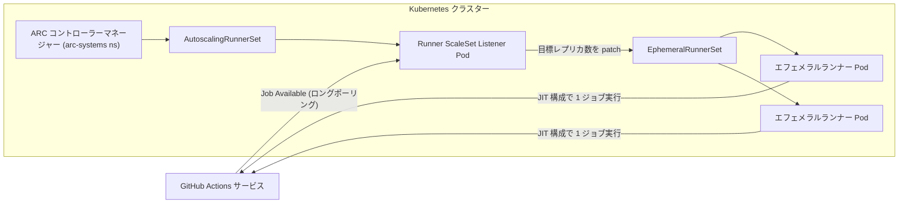

import { Aside, Badge, Tabs, TabItem } from '@astrojs/starlight/components';
import { TLDR, DocsLinks, LastVerified, DecisionTree, CompareTable } from '@components';

<LastVerified date="2026-10" />

<TLDR>
- **標準の GitHub ホステッド**ランナー（`ubuntu-latest`、`windows-latest`、`macos-latest`、`*-arm`）は、ジョブごとに新しい VM を使い、GitHub が管理します。パブリックリポジトリでは無料・無制限です。
- **larger runners**（GitHub Team / Enterprise Cloud）では、より多くの CPU/RAM、**GPU**、**静的 IP**、**Azure プライベートネットワーク**、**カスタムイメージ**、ランナーグループを使えます。常に分単位で課金されます。
- **セルフホステッド**ランナーでは、ハードウェア・ネットワーク・パッチ適用を自分で管理します。Kubernetes では **Actions Runner Controller (ARC)** と**ランナースケールセット**を使います。
- セルフホステッドランナーは**エフェメラル**（1 ジョブごと）または **JIT** で運用してください。永続的なセルフホステッドランナーを**パブリック**リポジトリに接続してはいけません。
- ジョブのルーティングは `runs-on:`（ラベル、ランナー名、または `group:` と `labels:`）で行い、アクセスは**ランナーグループ**で制御します。
</TLDR>

## ブースでよくある質問

<details>
<summary>ubuntu-latest は現在どのバージョンを指していますか？</summary>

**Ubuntu 24.04** です。`windows-latest` は **Windows Server 2025**、`macos-latest` は **macOS 26 (arm64/M1)** を指します。
イメージが知らないうちに変わるとビルドが壊れる場合は、明示的なラベル（`ubuntu-24.04`）でピン留めしてください。`ubuntu-26.04`、`*-vs2026`、
`xcode-27` は新しいイメージです。使う前に runner-images リポジトリでステータスを確認してください。GitHub は、ベータイメージは
サポート対象外の場合があると明記しています。

</details>

<details>
<summary>GitHub ホステッドランナーから社内のプライベートネットワークやオンプレミスに接続できますか？</summary>

できます。ドキュメントに記載されている方法は 3 つです。

1. **Azure プライベートネットワーク**（larger runners）: ランナーが**お客様の Azure VNET** 内に NIC を持ちます。GitHub Team では Organization レベルで、Enterprise Cloud ではエンタープライズまたは Organization レベルで構成できます。
2. **OIDC を使った API ゲートウェイ**: ゲートウェイ側で GitHub の OIDC トークンを信頼させます。
3. **WireGuard** によるオーバーレイネットワーク。

ファイアウォールの許可リストに登録したいだけなら、**静的 IP**（larger runners、Linux/Windows）を使います。

</details>

<details>
<summary>Arm64 や GPU のランナーはありますか？</summary>

あります。どちらも GA です。

- **Arm64:** 標準ランナーとして `ubuntu-24.04-arm`、`ubuntu-22.04-arm`、`windows-11-arm` が使えます。`macos-latest` はすでに Apple シリコンです。
- **GPU:** Linux/Windows 向けの larger runners で、4 コアと NVIDIA Tesla T4 ×1（VRAM 16 GB）を搭載しています。

マルチアーキテクチャのコンテナビルドでは、Arm64 ランナーを使うと QEMU エミュレーションが不要になり、手軽に高速化できます。

</details>

<details>
<summary>セルフホステッドランナーは無料ですか？</summary>

GitHub Docs（2026-10 確認）では、セルフホステッドランナーは引き続き「GitHub Actions で無料で使用できるが、ランナーマシンの
維持費用はお客様の負担」と説明されています。<Badge text="回答前に要確認" variant="caution" /> セルフホステッドの利用に
2026 年の料金変更が適用されるかどうかは確認できていません。料金について回答する前に、[料金ページ](https://github.com/pricing)と
GitHub changelog をその場で確認してください。

</details>

<details>
<summary>ARC と VM オートスケーラー（Terraform や Philips モジュールなど）、どちらを使うべきですか？</summary>

- **ARC**（Kubernetes オペレーター、ランナースケールセットモード）は、GitHub が**サポートし推奨する** Kubernetes 向けオートスケーラーです。
- Kubernetes 以外では、同じスケールセット API を使うオープンソースの **Runner Scale Set Client**（`actions/scaleset`）を使えます。
- コミュニティ製の VM オートスケーラーも動作しますが、GitHub のサポート対象外です。

</details>

<details>
<summary>高価な GPU ランナーや本番ネットワークのランナーを、全リポジトリから使えないようにするには？</summary>

それらのランナーを**ランナーグループ**に入れます。グループは特定のリポジトリに制限でき、さらに特定の**ワークフロー**（たとえば中央の
reusable なデプロイワークフローのみ）に制限することもできます。larger runners にはランナーごとの**最大同時実行数**の設定もあります。

</details>

<details>
<summary>ジョブが「Waiting for a runner to pick up this job」のまま止まっています。なぜですか？</summary>

よくある原因は 4 つです。

- `runs-on` のラベルを**すべて**満たすランナーがない。
- リポジトリがそのランナーグループの使用を許可されていない。
- ランナーグループまたは larger runners の同時実行数の上限に達している。
- ランナーがオフラインになっている。

ジョブは失敗するまで最大 **24 時間**キューに残ります。

</details>

## ランナーの種類一覧

<CompareTable
	title="ランナーの種類"
	columns={[
		{ key: 'std', label: '標準ホステッド' },
		{ key: 'larger', label: 'larger runners' },
		{ key: 'self', label: 'セルフホステッド (VM)' },
		{ key: 'arc', label: 'ARC スケールセット' },
	]}
	rows={[
		{ feature: 'GitHub が管理・パッチ適用', category: '運用', values: { std: true, larger: true, self: false, arc: false } },
		{ feature: 'ジョブごとにクリーンな環境', category: '運用', values: { std: true, larger: true, self: 'エフェメラルなら可', arc: '可（エフェメラル Pod）' } },
		{ feature: 'オートスケール', category: '運用', values: { std: true, larger: true, self: '自前で構築', arc: true } },
		{ feature: '必要なプラン', category: '運用', values: { std: 'すべて', larger: 'Team / Enterprise Cloud', self: 'すべて', arc: 'すべて' } },
		{ feature: 'Arm64', category: 'ハードウェア', values: { std: true, larger: true, self: true, arc: true } },
		{ feature: 'GPU', category: 'ハードウェア', values: { std: false, larger: 'Linux/Windows T4', self: true, arc: true } },
		{ feature: 'カスタムイメージ', category: 'ハードウェア', values: { std: false, larger: 'Linux/Windows', self: true, arc: '独自コンテナイメージ' } },
		{ feature: '静的な送信元 IP', category: 'ネットワーク', values: { std: false, larger: 'Linux/Windows', self: '自社ネットワーク', arc: '自社ネットワーク' } },
		{ feature: 'プライベートネットワーク接続', category: 'ネットワーク', values: { std: 'OIDC ゲートウェイ / WireGuard', larger: 'Azure プライベートネットワーク', self: true, arc: true } },
		{ feature: '課金', category: 'コスト', values: { std: '無料枠の後は分単位', larger: '常に分単位', self: '自社インフラ（最新の料金を要確認）', arc: '自社インフラ（最新の料金を要確認）' } },
		{ feature: 'パブリックリポジトリで安全', category: 'セキュリティ', values: { std: true, larger: true, self: false, arc: '厳格な分離が前提' } },
	]}
/>

## どのランナーを使うべき？

<DecisionTree
	title="どのランナーを使うべき？"
	tree={{
		start: 'q1',
		nodes: {
			q1: {
				question: 'ジョブから**プライベートネットワーク**（オンプレミス、プライベート VNET）上のリソースにアクセスする必要がありますか？',
				options: [
					{ label: 'はい', next: 'q2' },
					{ label: 'いいえ', next: 'q4' },
				],
			},
			q2: {
				question: 'そのプライベートネットワークは **Azure** 上にありますか？または Azure VNET から到達できますか？',
				options: [
					{ label: 'はい', next: 'vnet' },
					{ label: 'いいえ', next: 'q3' },
				],
			},
			q3: {
				question: '**Kubernetes** を運用していて、それを運用するプラットフォームチームがいますか？',
				options: [
					{ label: 'はい', next: 'arc' },
					{ label: 'いいえ', next: 'selfvm' },
				],
			},
			q4: {
				question: '**ファイアウォール許可リスト**（静的 IP）、**GPU**、より多くの CPU/RAM、**事前構築済みイメージ**のいずれかが必要ですか？',
				options: [
					{ label: 'はい', next: 'larger' },
					{ label: 'いいえ', next: 'q5' },
				],
			},
			q5: {
				question: '**Arm64** 向けの成果物（マルチアーキテクチャコンテナ、Graviton、Apple シリコン）をビルドしますか？',
				options: [
					{ label: 'はい', next: 'arm' },
					{ label: 'いいえ', next: 'standard' },
				],
			},
			vnet: {
				answer: '**Azure プライベートネットワーク付きの larger runners** を使います。ランナーは引き続き GitHub が管理し、お客様の VNET 内に NIC を持ちます。Team（Organization レベル）と Enterprise Cloud で利用できます。',
				links: [{ label: 'Azure プライベートネットワークについて', href: 'https://docs.github.com/ja/organizations/managing-organization-settings/about-azure-private-networking-for-github-hosted-runners-in-your-organization' }],
			},
			arc: {
				answer: 'ランナースケールセットを使った **Actions Runner Controller (ARC)** を使います。ジョブの需要に応じてエフェメラル Pod がオートスケールします。',
				links: [{ label: 'ARC クイックスタート', href: 'https://docs.github.com/ja/actions/tutorials/use-actions-runner-controller/get-started' }],
			},
			selfvm: {
				answer: '**セルフホステッド VM ランナー**を `--ephemeral` または JIT で登録し、ジョブごとに作り直します。運用負荷を下げたい場合は、ホステッドランナーから **OIDC API ゲートウェイ**や **WireGuard** を使う方法も検討してください。',
				links: [{ label: 'プライベートネットワークの選択肢', href: 'https://docs.github.com/ja/actions/concepts/runners/private-networking' }],
			},
			larger: {
				answer: '**GitHub ホステッドの larger runners** を使います。静的 IP、カスタムイメージ、GPU は Linux/Windows のみです。ランナーグループに入れて、アクセスとコストを制御してください。',
				links: [{ label: 'larger runners', href: 'https://docs.github.com/ja/actions/concepts/runners/larger-runners' }],
			},
			arm: { answer: '**Arm64 ホステッドランナー**を使います: `runs-on: ubuntu-24.04-arm`（または `windows-11-arm`、`macos-latest`）。ネイティブにビルドすれば、遅い QEMU エミュレーションが不要です。' },
			standard: { answer: '**標準ホステッドランナー**（`ubuntu-latest`）で十分です。ラベル付けや通知などの非常に軽いジョブには、`ubuntu-slim`（1 vCPU のコンテナ）も検討してください。' },
		},
	}}
/>

## GitHub ホステッドランナー

### 標準ラベル（2026-10 時点）

| OS | ラベル | 備考 |
| --- | --- | --- |
| Linux x64 | `ubuntu-latest`（= 24.04）、`ubuntu-24.04`、`ubuntu-22.04`、`ubuntu-26.04` | パブリックリポジトリ: 4 vCPU / 16 GB。プライベート: 2 vCPU / 8 GB。 |
| Linux 軽量 | `ubuntu-slim` | 共有 VM 上の 1 vCPU / 5 GB の**コンテナ**です。軽い補助ジョブ向け。 |
| Linux arm64 | `ubuntu-24.04-arm`、`ubuntu-22.04-arm`、`ubuntu-26.04-arm` | GA。 |
| Windows x64 | `windows-latest`（= 2025）、`windows-2025`、`windows-2022` | `windows-2025-vs2026` もあります。 |
| Windows arm64 | `windows-11-arm`、`windows-11-vs2026-arm` | GA。 |
| macOS | `macos-latest`（= 26、M1）、`macos-14`、`macos-15`、`macos-26`。Intel は `macos-15-intel`、`macos-26-intel` | Apple シリコンではネストされた仮想化は使えません。 |

### larger runners

<Badge text="Team / Enterprise Cloud" variant="note" />

- **サイズ:** ランナーを作成して名前を付け、サイズを選びます。その後、`runs-on: <ランナー名>` またはグループ経由で指定します。
- **GPU:** 4 コア、Tesla T4 ×1、RAM 28 GB、VRAM 16 GB（Linux/Windows）。
- **静的 IP** と**カスタムイメージ**は Linux と Windows で使えます。macOS の larger runners はどちらにも対応しておらず、Azure プライベートネットワークも使えません。
- **カスタムイメージ:** GitHub のベースイメージからワークフローで VM イメージを作成します。ストレージは別途（GB 時間単位で）課金されます。
- **課金:** larger runners は、パブリックリポジトリであっても無料枠を**一切**使いません。課金されるのはジョブ実行中の分単位の料金のみです。

```yaml
jobs:
  build:
    runs-on:
      group: gpu-runners          # ランナーグループ（アクセス制御あり）
      labels: [linux-gpu-t4]      # グループ内のランナー名/ラベル
```

## セルフホステッドランナー

- オープンソースのランナーエージェントを自社のマシンにインストールします。エージェントは GitHub への**アウトバウンド** HTTPS 通信のみを行うため、インバウンドのポート開放は不要です。
- **デフォルトのラベル:** `self-hosted`、OS ラベル（`linux`、`windows`、`macOS`）、アーキテクチャラベル（`x64`、`ARM`、`ARM64`）。`gpu` や `prod-net` のようなカスタムラベルも追加できます。
- `runs-on: [self-hosted, linux, prod-net]` は、これらのラベルを**すべて**持つランナーで実行するという意味です。
- **エフェメラル:** `./config.sh --ephemeral` で登録すると、ランナーは 1 ジョブを処理した後に自動で登録解除されます。GitHub はオートスケールにはエフェメラルランナーを推奨しています。永続ランナーではシャットダウン中にジョブが割り当てられることがあるためです。
- **JIT（just-in-time）:** REST API（`generate-jitconfig`）で使い捨てのランナー構成を作成します。マシン上に登録トークンは不要で、ARC も内部で JIT を使っています。
- **アップデート:** ランナーはデフォルトで自動更新されます。無効にした場合は、サポート期間内に自分で更新を適用する必要があります。

<Aside type="danger" title="パブリックリポジトリ">
パブリックリポジトリに接続したセルフホステッドランナーでは、誰でもフォークから PR を作成してコードを実行できます。パブリックリポジトリには
GitHub ホステッドランナーを使ってください。どうしてもセルフホステッドを使う場合は、エフェメラルかつ分離された環境にし、フォークからの
ワークフロー実行には承認を必須にしてください。
</Aside>

## Actions Runner Controller (ARC)

ARC は Kubernetes オペレーターです。現在ドキュメント化されている**ランナースケールセット**モードでは、リスナー Pod が GitHub との間で
HTTPS ロングポーリングを維持します。ジョブが届くと、**JIT** 構成で登録される**エフェメラルランナー Pod** の数をスケールします。



<Tabs>
<TabItem label="インストール">

```bash
# 1. コントローラー（クラスターごとに 1 回）
helm install arc \
  --namespace arc-systems --create-namespace \
  oci://ghcr.io/actions/actions-runner-controller-charts/gha-runner-scale-set-controller

# 2. ランナースケールセット（プール / ランナーグループごとに 1 つ）
helm install arc-runner-set \
  --namespace arc-runners --create-namespace \
  --set githubConfigUrl="https://github.com/my-org" \
  --set githubConfigSecret=my-github-app-secret \
  --set minRunners=0 --set maxRunners=20 \
  oci://ghcr.io/actions/actions-runner-controller-charts/gha-runner-scale-set
```

</TabItem>
<TabItem label="ワークフローでの利用">

```yaml
jobs:
  build:
    runs-on: arc-runner-set   # Helm のインストール名（ARC 0.14.0 以降はラベルも可）
    steps:
      - uses: actions/checkout@v7
```

</TabItem>
<TabItem label="注意点">

- 認証には PAT ではなく **GitHub App** を使ってください。
- 各スケールセットが所属できるランナーグループは **1 つ**だけです。
- Docker ビルドが必要な場合は、**`dind`** か **Kubernetes モード**（`containerMode`）を選びます。Kubernetes モードは永続的な作業ボリュームが必要で、ジョブコンテナは別の Pod として実行されます。
- ウォームな待機容量が必要なら `minRunners` を 0 より大きくします。0 の場合、ジョブごとに Pod の起動時間がかかります。
- エフェメラル Pod は消えてしまうため、ランナーログは外部ストレージへ転送してください。
- ARC 自体は GitHub のサポート対象ですが、Kubernetes クラスターはお客様の責任範囲です。

</TabItem>
</Tabs>

## ランナーグループ

- セルフホステッドランナー、ARC スケールセット、larger runners で使えます（Team / Enterprise プラン）。
- ランナーを使える **Organization**（エンタープライズレベルの場合）、**リポジトリ**、**ワークフロー**を制御します。たとえば、`my-org/platform/.github/workflows/deploy.yml@refs/heads/main` のみを許可できます。
- 各ランナーはちょうど 1 つのグループに所属します。新しいランナーは `Default` グループに入ります。
- パターン: **本番ネットワーク**用のグループを中央の reusable なデプロイワークフローのみに制限します。こうすると、アプリのリポジトリは承認済みのパイプライン経由でしかデプロイできなくなります。

<DocsLinks
	links={[
		{ label: 'GitHub ホステッドランナーのリファレンス', href: 'https://docs.github.com/ja/actions/reference/runners/github-hosted-runners' },
		{ label: 'larger runners', href: 'https://docs.github.com/ja/actions/concepts/runners/larger-runners' },
		{ label: 'GitHub ホステッドランナーでのプライベートネットワーク', href: 'https://docs.github.com/ja/actions/concepts/runners/private-networking' },
		{ label: 'セルフホステッドランナーのリファレンス', href: 'https://docs.github.com/ja/actions/reference/runners/self-hosted-runners' },
		{ label: 'Actions Runner Controller', href: 'https://docs.github.com/ja/actions/concepts/runners/actions-runner-controller' },
		{ label: 'ARC クイックスタート', href: 'https://docs.github.com/ja/actions/tutorials/use-actions-runner-controller/get-started' },
		{ label: 'ランナーグループ', href: 'https://docs.github.com/ja/actions/concepts/runners/runner-groups' },
		{ label: 'Actions ランナーの料金', href: 'https://docs.github.com/ja/billing/reference/actions-runner-pricing' },
	]}
/>
