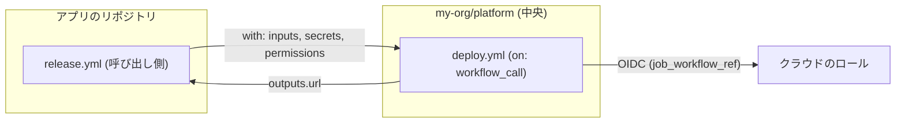

import { Aside, Badge, Tabs, TabItem } from '@astrojs/starlight/components';
import { TLDR, DocsLinks, LastVerified, YamlBuilder } from '@components';

export const ciBase = `name: CI
on:
  pull_request:
    # @pr
  push:
    branches: [main]
  # @on
# @top
jobs:
  build:
    runs-on: ubuntu-latest
    # @job
    steps:
      - uses: actions/checkout@v7
        with:
          persist-credentials: false   # .git/config にトークンを残さない
      # @steps
  # @jobs
`;

export const ciOptions = [
	{
		id: 'sha',
		label: 'SHA ピン留めの注記',
		section: 'top',
		default: true,
		snippet: `
# サプライチェーン対策: 本番ではすべてのアクションをコミット SHA で完全にピン留めし、
# 例: "uses: actions/checkout@<40 桁の SHA> # v7.0.1"、Dependabot で更新する。
# Organization で強制可能: Settings > Actions > "Require actions to be pinned to a full-length commit SHA"`,
		description: 'ファイル先頭にリマインダーのコメントを追加します。',
		explanation: '`@v7` のようなタグは付け替えられるため、タグが侵害されるとパイプラインで新しいコードが実行されてしまいます。完全な SHA は変更できません。Dependabot（`package-ecosystem: github-actions`）は SHA ピンとバージョンコメントを理解し、最新に保ちます。',
	},
	{
		id: 'permissions',
		label: '最小権限の GITHUB_TOKEN',
		section: 'top',
		default: true,
		snippet: `
permissions:
  contents: read`,
		description: 'ワークフロー全体で読み取り専用のトークンにします。追加の権限はジョブごとに付与します。',
		explanation: '書かなかったスコープはすべて `none` になります。より多くの権限（OIDC、構成証明）が必要なジョブは独自の `permissions:` ブロックを宣言し、そのジョブではこのブロックが**置き換え**られます。ステップが侵害された場合の被害を抑えられます。',
	},
	{
		id: 'concurrency',
		label: '古い PR 実行をキャンセル',
		section: 'top',
		default: true,
		snippet: `
concurrency:
  group: \${{ github.workflow }}-\${{ github.event.pull_request.number || github.ref }}
  cancel-in-progress: \${{ github.event_name == 'pull_request' }}`,
		explanation: 'PR に新しく push すると古い実行がキャンセルされ、実行時間を節約できます。`main` での実行はキャンセルされないため、すべてのマージが確実にビルド・デプロイされます。',
	},
	{
		id: 'paths',
		label: 'ドキュメントのみの PR をスキップ（paths-ignore）',
		section: 'pr',
		snippet: `
paths-ignore:
  - 'docs/**'
  - '**.md'`,
		explanation: '**注意:** このワークフローが*必須*ステータスチェックの場合、ドキュメントのみの PR ではワークフローが実行されず、チェックが **Pending** のままになります。必須ワークフローでは、ジョブレベルの `if:` でスキップするか、常に実行される集約ジョブを使ってください。「高度なワークフローパターン → パスフィルターと必須チェック」を参照してください。',
	},
	{
		id: 'mergegroup',
		label: 'マージキュー対応（merge_group）',
		section: 'on',
		snippet: `
merge_group:
  types: [checks_requested]`,
		explanation: 'リポジトリで**マージキュー**を使う場合は必須です。これがないと、キューがこのチェックを永遠に待ち続けます。',
	},
	{
		id: 'timeout',
		label: 'ジョブのタイムアウト',
		section: 'job',
		default: true,
		snippet: 'timeout-minutes: 15',
		explanation: 'デフォルトは 360 分です。テストがハングすると、ランナー時間を 6 時間も消費してしまいます。上限を短く設定してください。',
	},
	{
		id: 'matrix',
		label: 'Node.js バージョンのマトリックス',
		section: 'job',
		snippet: `
strategy:
  fail-fast: false
  matrix:
    node: [20, 22, 24]`,
		explanation: 'サポート対象のすべてのランタイムを並列でテストします。`fail-fast: false` にするとすべてのレグが最後まで実行されるため、失敗をまとめて確認できます。',
	},
	{
		id: 'node',
		label: '依存関係キャッシュ付きの Node.js セットアップ',
		default: true,
		snippet: `
- uses: actions/setup-node@v7
  with:
    node-version: \${{ matrix.node || 22 }}
    cache: npm
- run: npm ci
- run: npm test
- run: npm run build`,
		explanation: '`cache: npm` は Actions キャッシュを使い、ロックファイルのハッシュをキーにします。キャッシュの上限はリポジトリあたり 10 GB です。`matrix.node || 22` と書いておけば、マトリックスの有無にかかわらず動作します。',
	},
	{
		id: 'upload',
		label: 'ビルドアーティファクトをアップロード',
		default: true,
		snippet: `
- uses: actions/upload-artifact@v7
  if: strategy.job-index == 0     # マトリックスでも 1 回だけアップロード
  with:
    name: dist
    path: dist/
    retention-days: 7`,
		explanation: '`dist/` を後続のジョブ（来歴、デプロイ）に渡します。アーティファクト名は 1 実行内で一意である必要があるため、最初のマトリックスレグだけがアップロードします。',
	},
	{
		id: 'depreview',
		label: 'PR での依存関係レビュー',
		section: 'jobs',
		snippet: `
dependency-review:
  if: github.event_name == 'pull_request'
  runs-on: ubuntu-latest
  permissions:
    contents: read
  steps:
    - uses: actions/checkout@v7
      with:
        persist-credentials: false
    - uses: actions/dependency-review-action@v5
      with:
        fail-on-severity: high`,
		explanation: '重大度が high または critical の既知の脆弱性を持つ依存関係（およびオプションで許可されていないライセンス）を追加する PR をブロックします。パブリックリポジトリでは無料です。プライベートリポジトリでは **GitHub Code Security** が必要です。',
	},
	{
		id: 'attest',
		label: 'ビルド来歴の構成証明',
		section: 'jobs',
		snippet: `
provenance:
  needs: build
  if: github.event_name == 'push'
  runs-on: ubuntu-latest
  permissions:
    contents: read
    id-token: write
    attestations: write
  steps:
    - uses: actions/download-artifact@v8
      with:
        name: dist
        path: dist
    - uses: actions/attest@v4
      with:
        subject-path: 'dist/**'`,
		explanation: '各ファイルに SLSA のビルド来歴の構成証明（Sigstore）を署名します。利用者は `gh attestation verify` で検証できます。アーティファクトのアップロードのオプションが必要です。ビルドを reusable workflow に移すと SLSA Build L3 になります。',
	},
	{
		id: 'deploy',
		label: 'デプロイ: 保護された環境 + AWS への OIDC',
		section: 'jobs',
		snippet: `
deploy:
  needs: build
  if: github.event_name == 'push' && github.ref == 'refs/heads/main'
  runs-on: ubuntu-latest
  environment:
    name: production              # Settings > Environments で必須レビュー担当者を追加
    url: https://example.com
  concurrency:
    group: deploy-production
    cancel-in-progress: false     # デプロイを途中で止めない
  permissions:
    contents: read
    id-token: write               # ジョブが OIDC トークンを要求できるようにする
  steps:
    - uses: actions/download-artifact@v8
      with:
        name: dist
        path: dist
    - uses: aws-actions/configure-aws-credentials@v6
      with:
        role-to-assume: arn:aws:iam::123456789012:role/gha-deploy-prod
        aws-region: us-east-1
    - run: aws s3 sync dist/ s3://my-bucket/ --delete`,
		explanation: '**環境:** 必須レビュー担当者が承認するまでジョブは一時停止し（プライベートリポジトリでは Enterprise が必要）、承認後に初めて環境シークレットが渡されます。**OIDC:** AWS のキーを保存する必要はありません。AWS が `token.actions.githubusercontent.com` を信頼し、その信頼ポリシーで `sub` を `repo:ORG/REPO:environment:production` に固定します。2026-07-15 以降に作成されたリポジトリでは、owner ID と repo ID を含む変更不可能な `sub` 形式が使われます。',
	},
];

export const calleeBase = `name: Reusable deploy
on:
  workflow_call:
    # @call
# @top
jobs:
  deploy:
    runs-on: ubuntu-latest
    # @job
    outputs:
      url: \${{ steps.deploy.outputs.url }}
    steps:
      - uses: actions/checkout@v7
      # @steps
      - id: deploy
        run: |
          ./deploy.sh
          echo "url=https://app.example.com" >> "$GITHUB_OUTPUT"
`;

export const calleeOptions = [
	{
		id: 'inputs',
		label: '型付きの入力',
		section: 'call',
		default: true,
		snippet: `
inputs:
  environment:
    type: string
    required: true`,
		explanation: '入力には型があります（`string`、`number`、`boolean`）。呼び出し元の `env:` は**引き継がれない**ため、すべて inputs か `vars` で渡す必要があります。',
	},
	{
		id: 'secrets',
		label: 'シークレットの宣言',
		section: 'call',
		snippet: `
secrets:
  DEPLOY_TOKEN:
    required: true`,
		explanation: '必要なシークレットを宣言します。呼び出し側は明示的に渡すか、`secrets: inherit` を使います（同じ Organization/エンタープライズ内のみ）。',
	},
	{
		id: 'outputs',
		label: 'ワークフローの出力',
		section: 'call',
		default: true,
		snippet: `
outputs:
  url:
    description: Deployed URL
    value: \${{ jobs.deploy.outputs.url }}`,
		explanation: 'ジョブの出力をワークフローの出力にマッピングします。呼び出し側は `needs.<job>.outputs.url` で読み取ります。',
	},
	{
		id: 'perms',
		label: '最小権限の permissions',
		section: 'top',
		default: true,
		snippet: `
permissions:
  contents: read
  id-token: write`,
		explanation: '呼び出される側は、呼び出し側から付与された権限を**狭める**ことしかできず、広げることはできません。',
	},
	{
		id: 'env',
		label: '保護された環境',
		section: 'job',
		default: true,
		snippet: 'environment: \${{ inputs.environment }}',
		explanation: '承認と環境シークレットを一元的に適用します。このワークフローに限定したランナーグループと、`job_workflow_ref` を条件にした OIDC 信頼ポリシーを組み合わせれば、デプロイはここから**しか**行えなくなります。',
	},
	{
		id: 'conc',
		label: '環境ごとの concurrency',
		section: 'job',
		snippet: `
concurrency:
  group: deploy-\${{ inputs.environment }}
  cancel-in-progress: false`,
		explanation: 'ここで `github.workflow` だけを使わないでください。呼び出される側ではこれが**呼び出し元**の名前になるため、呼び出し元をキャンセルしてしまうおそれがあります。',
	},
];

export const callerBase = `name: Release
on:
  push:
    branches: [main]
# @top
jobs:
  deploy:
    uses: my-org/platform/.github/workflows/deploy.yml@v3
    # @job
  # @jobs
`;

export const callerOptions = [
	{
		id: 'with',
		label: '入力を渡す',
		section: 'job',
		default: true,
		snippet: `
with:
  environment: production`,
	},
	{
		id: 'inherit',
		label: 'secrets: inherit',
		section: 'job',
		default: true,
		snippet: 'secrets: inherit',
		explanation: '呼び出し側のシークレットをすべて渡します。同じ Organization/エンタープライズ内でのみ機能します。Organization をまたぐ場合や最小権限にしたい場合は、`secrets:` の下に `DEPLOY_TOKEN: ${{ secrets.PROD_DEPLOY_TOKEN }}` のような明示的なマッピングを書いて置き換えてください。',
	},
	{
		id: 'cperms',
		label: '呼び出される側に権限を付与',
		section: 'job',
		default: true,
		snippet: `
permissions:
  contents: read
  id-token: write`,
		explanation: '呼び出し側のジョブが、呼び出される側の `GITHUB_TOKEN` の上限を決めます。省略すると、呼び出される側にはデフォルトのトークン権限が付与されます。',
	},
	{
		id: 'smoke',
		label: '呼び出される側の出力を使う',
		section: 'jobs',
		snippet: `
smoke-test:
  needs: deploy
  runs-on: ubuntu-latest
  steps:
    - run: curl -fsS "\${{ needs.deploy.outputs.url }}/health"`,
	},
];

<LastVerified date="2026-10" />

<TLDR>
- 下のオプションを切り替えて**堅牢な CI/CD ワークフロー**を組み立て、YAML をコピーしてください。
- デフォルトの設定だけで、しっかりしたベースラインになります。SHA ピン留めの注記、読み取り専用の `GITHUB_TOKEN`、古い実行のキャンセル、ジョブのタイムアウト、キャッシュ付きインストール、アーティファクトが含まれます。
- 追加オプション: **マージキュー**、**依存関係レビュー**、**ビルド来歴の構成証明**、承認付き環境と AWS への **OIDC**（キーの保存不要）を使う**デプロイジョブ**。
- 2 つ目のビルダーでは、中央の呼び出される側とアプリチームの呼び出し側の間の **reusable workflow** の契約を示します。
</TLDR>

## ブースでよくある質問

すべてのワークフローに最低限追加すべきものは？

次の 4 つです。

- `permissions:`（デフォルトは読み取り専用）。
- `timeout-minutes`。
- 古い PR 実行をキャンセルする `concurrency` グループ。
- SHA でピン留めしたサードパーティ製アクション。

この 4 つはコストがかからず、「想定外の高額請求」と「過剰な権限を持つトークン」のリスクの大半を取り除けます。

checkout で persist-credentials: false にするのはなぜですか？

デフォルトでは、後続の `git push` が動くように、`actions/checkout` が `GITHUB_TOKEN` を `.git/config` に書き込みます。そのため、後続のステップ
（サードパーティ製アクションや、`.git` を含むアップロードされたアーティファクトなど）からトークンを読み取られるおそれがあります。ジョブで push しないなら無効にしてください。

GitHub 製のアクションを信頼していても、SHA ピン留めは必要ですか？

すべてのアクションに対するベストプラクティスです。Organization ポリシーの **「Require actions to be pinned to a full-length commit SHA」** は
GitHub 製のアクションにも適用されます。reusable workflow は対象外です。代替手段として**ワークフロー依存関係ロックファイル**
<Badge text="パブリックプレビュー" variant="caution" />（`gh actions-lock` で `.github/workflows/actions.lock` を生成）もあります。推移的な依存関係もピン留めされ、
GitHub によれば、その場合はワークフローファイル内での SHA ピン留めは不要になります。

OIDC でクラウドのシークレットは完全に不要になりますか？

AWS、Azure、GCP、HashiCorp Vault、JFrog、PyPI などでは、不要になります。ジョブは短命の GitHub OIDC トークンを短命のクラウド資格情報と交換します。
セキュリティは**信頼ポリシーの条件**次第です。`sub` は必ずリポジトリと環境またはブランチに限定し、Organization だけで絞り込むのは避けてください。

500 個のリポジトリに展開するには？

手段は 3 つあります。

- ビルド/デプロイのロジックを中央リポジトリの **reusable workflow** にまとめる（2 つ目のビルダーを参照）。
- Organization の `.github` リポジトリで**ワークフローテンプレート**を公開し、新しいリポジトリがベースラインから始められるようにする。
- Organization レベルの**ルールセット**でステータスチェックを必須にする。

ガバナンスの詳細は [Actions 概要](/github-cheatsheet/ja/actions/)を参照してください。

構成証明を別のジョブに分けるのはなぜですか？

`npm install` やテストのようにサードパーティのコードを実行するジョブから、`id-token: write` と `attestations: write` を切り離すためです。
署名できるのは、小さく信頼できるジョブだけになります。

## 本番レベルの CI ワークフローを組み立てる

<YamlBuilder
	title="本番レベルの CI/CD ワークフロー"
	filename=".github/workflows/ci.yml"
	base={ciBase}
	options={ciOptions}
/>

<Aside type="tip">
ここで示しているメジャーバージョンは 2026-10 時点の最新リリースです: `checkout@v7`、`setup-node@v7`、`upload-artifact@v7`、
`download-artifact@v8`、`attest@v4`、`dependency-review-action@v5`、`configure-aws-credentials@v6`。GitHub Docs の例の多くはまだ古い
メジャーバージョンを使っています。アップグレード前にリリースノートで破壊的変更を確認し、その後 SHA でピン留めしてください。
</Aside>

### 各オプションの用途

| オプション | ユースケース | 注意点 |
| --- | --- | --- |
| SHA ピン留めの注記 | サプライチェーンの完全性（タグは付け替えられる）。 | Organization ポリシーで強制できます。Dependabot が SHA ピンを更新します。 |
| 最小権限トークン | 侵害されたステップができることを制限する。 | ジョブレベルの `permissions:` はワークフローのブロックを完全に置き換えます。 |
| 古い実行のキャンセル | 忙しい PR で実行時間を節約する。 | `main` やデプロイではキャンセルしないでください。 |
| `paths-ignore` | ドキュメントのみの変更で CI をスキップする。 | **必須**チェックが Pending のままになり、壊れます。 |
| `merge_group` | マージキューを使うリポジトリ。 | これがないと、キュー内の PR にチェックが報告されません。 |
| `timeout-minutes` | ハングしたジョブを止める。 | デフォルトは 6 時間です。 |
| マトリックス | 複数バージョンのサポート。 | 1 実行あたり最大 256 ジョブ。アーティファクト名は一意にする必要があります。 |
| setup-node のキャッシュ | インストールの高速化。 | リポジトリあたり 10 GB で、LRU で削除されます。 |
| アーティファクトのアップロード | ジョブ間でビルド成果物を受け渡す。 | `retention-days` でストレージコストを制御します。 |
| 依存関係レビュー | 脆弱な依存関係や許可されていないライセンスの依存関係を PR 時点でブロックする。 | プライベートリポジトリでは GitHub Code Security が必要です。 |
| 構成証明 | 検証可能な来歴（SLSA）。 | `id-token` と `attestations: write` が必要です。 |
| 環境 + OIDC | 承認付きでキーレスな本番デプロイ。 | 信頼ポリシーの `sub` を環境と一致させる必要があります。 |

## reusable workflow: 呼び出し側と呼び出される側

<Tabs>
<TabItem label="呼び出される側（中央）">

<YamlBuilder
	title="reusable workflow（呼び出される側）"
	filename="my-org/platform/.github/workflows/deploy.yml"
	base={calleeBase}
	options={calleeOptions}
/>

</TabItem>
<TabItem label="呼び出し側（アプリのリポジトリ）">

<YamlBuilder
	title="呼び出し側のワークフロー"
	filename=".github/workflows/release.yml"
	base={callerBase}
	options={callerOptions}
/>

</TabItem>
</Tabs>

<Aside type="caution">
reusable workflow を呼び出すジョブには、`runs-on`、`steps`、`env` を指定できません。使えるのは `name`、`uses`、`with`、`secrets`、
`strategy`、`needs`、`if`、`concurrency`、`permissions`、`cache-mode` だけです。その他のパターンについては
[高度なワークフローパターン](/github-cheatsheet/ja/actions/advanced-workflows/#reusable-workflow-と-composite-action-の比較)を参照してください。
</Aside>

<DocsLinks
	links={[
		{ label: 'セキュアな使用方法のリファレンス（強化）', href: 'https://docs.github.com/ja/actions/reference/security/secure-use' },
		{ label: 'AWS での OIDC', href: 'https://docs.github.com/ja/actions/how-tos/secure-your-work/security-harden-deployments/oidc-in-aws' },
		{ label: 'アーティファクト構成証明の使用', href: 'https://docs.github.com/ja/actions/how-tos/secure-your-work/use-artifact-attestations/use-artifact-attestations' },
		{ label: '依存関係レビューアクションの構成', href: 'https://docs.github.com/ja/code-security/how-tos/secure-your-supply-chain/manage-your-dependency-security/configure-dependency-review-action' },
		{ label: 'ワークフロー依存関係ロックファイル（プレビュー）', href: 'https://docs.github.com/ja/actions/concepts/security/workflow-dependency-lockfiles' },
		{ label: 'ワークフローの再利用', href: 'https://docs.github.com/ja/actions/how-tos/reuse-automations/reuse-workflows' },
		{ label: 'GitHub Actions の設定の管理（SHA ピン留めポリシー）', href: 'https://docs.github.com/ja/repositories/managing-your-repositorys-settings-and-features/enabling-features-for-your-repository/managing-github-actions-settings-for-a-repository' },
	]}
/>
