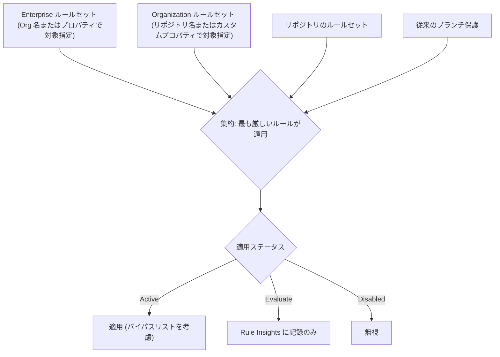
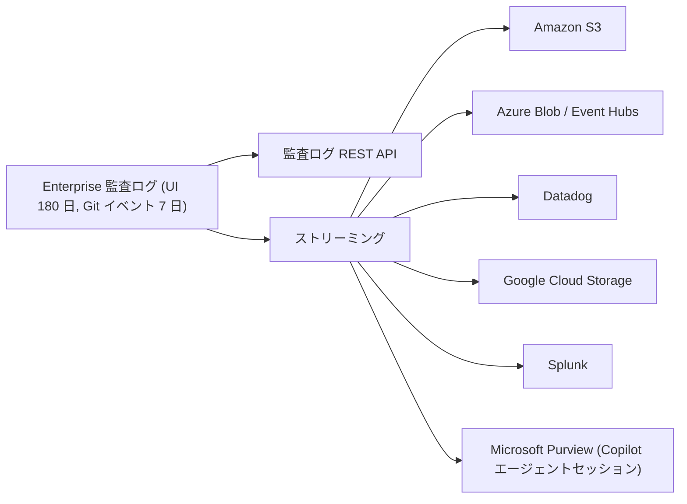

import { TLDR, DocsLinks, LastVerified, DecisionTree, CompareTable, FlashCards } from '@components';
import { Aside, Badge, Steps } from '@astrojs/starlight/components';

<LastVerified date="2026-10" />

<TLDR>
- **大規模運用ではルールセットがブランチ保護より優れています。** **リポジトリ、Organization、Enterprise** のレベルで定義し、**カスタムプロパティ**で対象を指定し、**Evaluate**（評価）モードで展開し、バイパスリストは最小限にします。ルールセットが重なった場合は**集約**され、最も厳しいルールが適用されます。
- **プッシュルールセット**は、ファイルパス、拡張子、サイズ、パスの長さに基づくプッシュを**フォークネットワーク全体**でブロックします（プライベート/内部リポジトリ）。
- **最小権限:** **カスタム Organization ロール**（最大 20 個）、カスタム Enterprise ロール <Badge text="プレビュー" variant="caution" />、Enterprise チームを使います。
- **監査ログ:** UI では 180 日（Git イベントは 7 日）保持されます。S3、Azure Blob、Event Hubs、Datadog、GCS、Splunk、Microsoft Purview に**ストリーミング**できます。
- **自動化:** PAT より **GitHub Apps**（短期間のインストールトークン）を優先します。PAT が必要な場合は **fine-grained** を使い、承認と最大有効期間のポリシーを設定します。
</TLDR>

## ブースでよくある質問

ルールセットとブランチ保護ルール、どちらを使うべきですか？

大規模に運用するなら**ルールセット**です。理由は次のとおりです。
- Organization や Enterprise のレベルで一度定義すれば、多数のリポジトリに適用できます。
- **カスタムプロパティ**や名前パターンで対象を動的に指定できます。
- Rule Insights 付きの **Evaluate** モードがあります。
- バイパスリストを階層的に設定でき、タグやプッシュも対象にできます。
- アクセス権のある全員が内容を閲覧できます。

2 つの仕組みは**共存して集約される**ため、段階的に移行できます。作成済みのルールセットは [`github/ruleset-recipes`](https://github.com/github/ruleset-recipes) にあります。

2 つのルールセットが矛盾しています（レビュー 1 件と 2 件）。どちらが優先されますか？

ルールセットに優先順位はありません。該当するすべてのルールセット**と**ブランチ保護のルールが集約され、**最も厳しい**ものが適用されます。つまりレビュー 2 件です。

2,000 のリポジトリを壊さずに新しいルールを展開するには？

**Evaluate** モードで作成し、**Rule Insights** で「失敗していたはず」のイベントを確認します。違反しているリポジトリを修正するかルールを調整してから、**Active** に切り替えます。最初は `tier = pilot` のようなカスタムプロパティでパイロット対象に絞ってください。

`.env` ファイルや 500 MB のバイナリのコミットを防げますか？

はい、**プッシュルールセット**（プライベート/内部リポジトリ）で防げます。ファイルパス、拡張子、パスの長さ、ファイルサイズに基づいてブロックし、フォークを含むすべてのプッシュに適用されます。正当な例外がある場合は**委任バイパス**を使ってください。シークレットそのものには**シークレットスキャンのプッシュ保護**を使います。

監査部門からログを 7 年保管するよう求められています。

UI での保持は **180 日**（Git イベントは 7 日）なので、SIEM やストレージに**ストリーミング**してください。対応先は Amazon S3、Azure Blob Storage、Azure Event Hubs、Datadog、Google Cloud Storage、Splunk、Microsoft Purview（Copilot エージェントセッションのイベントのみ）です。ストリームを一時停止した場合、GitHub は **7 日分**のデータをバッファします。**複数エンドポイント**へのストリーミングは <Badge text="プレビュー" variant="caution" /> です。

IP 許可リストを有効にしたら GitHub Actions や連携が壊れました。なぜですか？

許可リストは **`GITHUB_TOKEN` を含む GitHub App のトークン**にも適用されるため、標準のホステッドランナーやサードパーティの App からの通信がブロックされます。対処法は次のとおりです。
- インストール済みの GitHub Apps 向けの許可リスト設定を有効にし、App が宣言した IP を追加します。
- **静的 IP 付きの大きいランナー**かセルフホストランナーを使います。
- **EMU + Entra ID OIDC** の場合は、GitHub の許可リストの代わりに IdP の条件付きアクセスを使います。インストールトークンは CAP の対象外です。

自動化には PAT と GitHub App のどちらを使うべきですか？

共有するものや長期間使うものには **GitHub App** を使います。個人に紐付かず、インストールトークンは 1 時間で失効し、リポジトリごとに権限を細かく設定でき、レート制限もスケールします。個人用スクリプトには **fine-grained PAT** を使います。Organization オーナーは、**承認の必須化**、**classic PAT の制限**、**最大有効期間**の設定ができます（fine-grained のデフォルトは 366 日。classic PAT には有効期限の要件がありません）。

オーナーではないセキュリティ責任者に監査ログを閲覧させられますか？

はい。「View organization audit log」権限を持つ**カスタム Organization ロール**を作成します（Organization あたり最大 20 個）。Enterprise レベルの**カスタム Enterprise ロール**は <Badge text="プレビュー" variant="caution" /> です。

## ルールセット

| ルールセットの種類 | 対象 | 代表的なルール |
|---|---|---|
| **ブランチ** | `fnmatch` パターンのブランチ、デフォルトブランチ、全ブランチ | PR とレビューの必須化、ステータスチェック（Actions ワークフローを含む）、デプロイ、署名付きコミット、直線的な履歴、マージキュー、コードスキャン結果、フォースプッシュ/削除のブロック、コミットメタデータの正規表現 |
| **タグ** | パターンに一致するタグ | 作成/更新/削除の制限、命名規則 |
| **プッシュ** | リポジトリ**とそのフォークネットワーク**へのすべてのプッシュ（プライベート/内部） | ファイルパス、拡張子、最大パス長、最大ファイルサイズの制限 |

**押さえておきたい詳細**
- 上限は**リポジトリあたり 75 個**、**Organization 全体で 75 個**です。
- **バイパスリスト:** リポジトリのロール、チーム、Enterprise チーム、GitHub Apps、デプロイキーを指定できます。バイパスは「常に」か「プルリクエストのみ」を選べます。**委任バイパス**では、リクエストが承認者に送られます。
- **適用ステータス:** Active、**Evaluate**（適用せず、結果を Rule Insights に表示）、Disabled。
- **Enterprise ルールセット**（Enterprise → Policies → Code）は、まず **Organization** を対象に指定し（すべて、一覧から選択、名前パターン、**Organization のカスタムプロパティ**）、次にリポジトリ（すべて、プロパティ、デプロイコンテキスト）、最後にブランチ/タグを指定します。
- 新しいルール <Badge text="プレビュー" variant="caution" />: **個人に帰属しない Copilot の PR に追加の承認を必須にする**。
- ルールセットは GEI で**移行されない**ため、コード（REST API、Terraform）で管理し、移行後に再適用してください。

## カスタムプロパティ

- **リポジトリ**（Enterprise での対象指定には **Organization** も）に付ける構造化メタデータです。例: `team`、`data-classification`、`tier`、`compliance=pci`。
- **ルールセット**、**セキュリティ構成**、Copilot などのポリシーの対象を動的に指定できます。`compliance=pci` を付けた新しいリポジトリには、自動的に適切なルールが適用されます。
- プロパティを**必須**にしてデフォルト値を設定すれば、すべてのリポジトリを確実に分類できます。
- <Badge text="プレビュー" variant="caution" /> **外部カスタムプロパティ**は、ソフトウェアカタログなどの外部システムから値を同期します。<Badge text="プレビュー" variant="caution" /> **Copilot による値の提案**には Copilot Business または Enterprise が必要です。

## リポジトリとメンバーのポリシー（Enterprise レベル）

Enterprise オーナーはポリシーを**強制**するか、Organization オーナーに任せる（「No policy」）かを選べます。よく使うものは次のとおりです。

| 分野 | 例 |
|---|---|
| リポジトリの作成 | パブリック/プライベート/内部リポジトリを誰が作成できるか |
| 可視性の変更、削除、移管 | Organization オーナーに限定 |
| フォーク | プライベート/内部リポジトリのフォークの可否と、フォーク先 |
| 基本権限 | Organization メンバーのリポジトリに対するデフォルト権限（なし/読み取り/書き込み/管理者） |
| Actions | 許可するアクション（GitHub 製のみ、検証済み作成者、許可リスト、**SHA 固定の必須化**）、ランナーポリシー、フォーク PR のワークフロー承認 |
| Copilot / AI | **AI controls** タブ: 機能、モデル、エージェント、MCP |
| コードセキュリティ | セキュリティ構成、プッシュ保護のデフォルト |

## ロール

| ロールの種類 | スコープ | 備考 |
|---|---|---|
| 定義済みの Organization ロール | Organization | オーナー、メンバー、モデレーター、支払いマネージャー、セキュリティマネージャー、およびリポジトリロール（read、triage、write、maintain、admin） |
| **カスタムリポジトリロール** | Organization | リポジトリロールをベースに、細かな権限を追加 |
| **カスタム Organization ロール** | Organization | Organization あたり最大 **20** 個。例: 「Organization の Webhook の管理」「監査ログの閲覧」 |
| **Enterprise ロール** | Enterprise | オーナー、メンバー、支払いマネージャーなど。**Enterprise チーム**に割り当て可能 |
| **カスタム Enterprise ロール** <Badge text="プレビュー" variant="caution" /> | Enterprise | 完全なオーナー権限を与えずに Enterprise 管理タスクを委任 |

## 監査ログとストリーミング

- **ヘルスチェックは 24 時間ごと**に実行されます。設定に問題のあるストリームは、データの欠落を避けるため **6 日以内**に修正してください。
- **一時停止**したストリームは **7 日分**のデータをバッファします。3 週間以上停止するとリセットされます。
- 便利な検索クエリには `action:repo.destroy`、`action:copilot`（プランや設定のイベント）、`actor:Copilot`（エージェントのアクティビティ）があります。
- <Badge text="プレビュー" variant="caution" /> **複数エンドポイント**へのストリーミングと、Copilot エージェントのセッションアクティビティを同じ宛先にストリーミングする機能。

## IP 許可リスト

<Steps>

1. 許可する CIDR を **Enterprise** レベル（Organization に継承されます）または Organization ごとに定義します。
2. **インストール済みの GitHub Apps 向けの IP 許可リスト設定**を有効にし、App が宣言した IP が自動的に追加されるようにします。
3. **Actions** について計画します。**静的 IP 範囲**を持つ大きいランナーかセルフホストランナーを使ってください。標準のホステッドランナーは許可リストに一致しません。
4. **EMU + Entra ID OIDC** の場合は、GitHub の許可リスト**か** IdP の条件付きアクセスのどちらかを選びます。IdP を選ぶと、すべての Organization で GitHub の許可リスト設定が無効になります。
5. 許可リストは EMU のプロビジョニング（SCIM、SAML、OIDC）を制限**しない**点に注意してください。

</Steps>

## GitHub Apps と個人用アクセストークンの比較

<CompareTable
	title="自動化に使う ID"
	columns={[
		{ key: 'app', label: 'GitHub App' },
		{ key: 'fg', label: 'Fine-grained PAT' },
		{ key: 'classic', label: 'Classic PAT' },
	]}
	rows={[
		{ feature: '個人に紐付く', values: { app: false, fg: true, classic: true } },
		{ feature: 'リポジトリ単位・権限単位のスコープ', values: { app: true, fg: true, classic: false } },
		{ feature: '短期間のトークン', values: { app: 'インストールトークン 約 1 時間', fg: '有効期限が必須（Organization の最大有効期間ポリシー）', classic: '有効期限は任意' } },
		{ feature: 'Organization による承認フロー', values: { app: 'インストールの承認', fg: true, classic: false } },
		{ feature: 'Organization が完全にブロック可能', values: { app: true, fg: true, classic: true } },
		{ feature: '従業員が退職しても使える', values: { app: true, fg: false, classic: false } },
		{ feature: '推奨用途', values: { app: 'CI/CD、ボット、連携', fg: '個人用スクリプト', classic: 'レガシーのみ' } },
	]}
/>

<Aside type="tip" title="トークポイント">
Actions のワークフローでは、リポジトリ内の作業には明示的な `permissions:` を付けた `GITHUB_TOKEN` を使います。リポジトリをまたぐ作業には、ワークフロー内で短期間の **GitHub App トークン**を発行します。クラウドへのアクセスには **OIDC** を使います。どれも PAT は不要です。
</Aside>

## GHES のバージョンとアップグレード

| | |
|---|---|
| **最新** | **3.22**（GA 2026-09-08）— 当日に[リリースノート](https://docs.github.com/ja/enterprise-server@latest/admin/release-notes)を再確認 |
| **サポート対象** | 3.22、3.21、3.20、3.19。**3.18 は 2026-10-16 にサポート終了** |
| **アップグレードのルール** | アップグレード元は**最大 2 つ前まで**のフィーチャーリリース（例: 3.20 または 3.21 → 3.22）。アップグレードパスは Upgrade assistant で計画する |
| **パッチ** | 同じフィーチャーシリーズ内は**ホットパッチ**。フィーチャーアップグレードにはメンテナンスウィンドウが必要 |
| **アップグレード前** | 容量チェック（必須）、バックアップ（backup-utils）、VM スナップショット、ステージングでのテスト。バックグラウンドジョブの完了を待つ（`ghe-check-background-upgrade-jobs`） |
| **Copilot** | GHES では利用不可 |

<DecisionTree
	title="どの制御を使うべき？"
	tree={{
		start: 'q1',
		nodes: {
			q1: {
				question: '何を制御したいですか？',
				options: [
					{ label: 'ブランチ / タグへのコードの取り込み方', next: 'rules' },
					{ label: 'そもそもプッシュできるファイル', next: 'push' },
					{ label: '誰が何を管理できるか', next: 'roles' },
					{ label: 'どこから接続できるか', next: 'ip' },
					{ label: '何が起きて誰がやったか', next: 'audit' },
				],
			},
			rules: { answer: 'Organization または Enterprise レベルの**ブランチ/タグルールセット**を、カスタムプロパティで対象指定し、まず **Evaluate** で展開します。' },
			push: { answer: '**プッシュルールセット**（プライベート/内部リポジトリ、フォークネットワーク全体）と、認証情報には**シークレットスキャンのプッシュ保護**を使います。' },
			roles: { answer: '**カスタム Organization ロール**（最大 20 個）、**カスタムリポジトリロール**、**Enterprise チーム**、カスタム Enterprise ロール（プレビュー）を使います。' },
			ip: { answer: '**IP 許可リスト**を使います。EMU + Entra ID OIDC の場合は代わりに**条件付きアクセス**も使えます。' },
			audit: { answer: '**監査ログ**（180 日）と、長期保存のための SIEM への**ストリーミング**を使います。' },
		},
	}}
/>

<FlashCards
	title="ガバナンスクイズ"
	cards={[
		{ q: 'リポジトリあたりのルールセットの上限は？', a: 'リポジトリあたり **75 個**、Organization 全体で 75 個。' },
		{ q: 'ルールセットが矛盾したらどちらが優先？', a: '優先順位はありません。ルールは集約され、**最も厳しい**ものが適用されます。' },
		{ q: '監査ログの UI での保持期間は？', a: '**180 日**。Git イベントは **7 日**。' },
		{ q: 'fine-grained PAT の最大有効期間ポリシーのデフォルトは？', a: '**366 日**。' },
		{ q: '3.22 に直接アップグレードできる最も古い GHES のバージョンは？', a: '**3.20**（最大 2 つ前のフィーチャーリリースまで）。' },
	]}
/>

<DocsLinks
	links={[
		{ label: 'ルールセットについて', href: 'https://docs.github.com/ja/repositories/configuring-branches-and-merges-in-your-repository/managing-rulesets/about-rulesets' },
		{ label: 'ルールセットで使用できるルール', href: 'https://docs.github.com/ja/repositories/configuring-branches-and-merges-in-your-repository/managing-rulesets/available-rules-for-rulesets' },
		{ label: 'ルールセットによる Enterprise のコードガバナンス', href: 'https://docs.github.com/ja/enterprise-cloud@latest/admin/enforcing-policies/enforcing-policies-for-your-enterprise/enforcing-policies-for-code-governance' },
		{ label: 'カスタムプロパティ', href: 'https://docs.github.com/ja/organizations/managing-organization-settings/managing-custom-properties-for-repositories-in-your-organization' },
		{ label: 'カスタム Organization ロール', href: 'https://docs.github.com/ja/organizations/managing-peoples-access-to-your-organization-with-roles/managing-custom-organization-roles' },
		{ label: 'Enterprise のロール', href: 'https://docs.github.com/ja/enterprise-cloud@latest/admin/concepts/enterprise-fundamentals/roles-in-an-enterprise' },
		{ label: '監査ログのストリーミング', href: 'https://docs.github.com/ja/enterprise-cloud@latest/admin/monitoring-activity-in-your-enterprise/reviewing-audit-logs-for-your-enterprise/streaming-the-audit-log-for-your-enterprise' },
		{ label: 'IP 許可リスト', href: 'https://docs.github.com/ja/enterprise-cloud@latest/admin/configuring-settings/hardening-security-for-your-enterprise/restricting-network-traffic-to-your-enterprise-with-an-ip-allow-list' },
		{ label: 'Organization の PAT ポリシー', href: 'https://docs.github.com/ja/organizations/managing-programmatic-access-to-your-organization/setting-a-personal-access-token-policy-for-your-organization' },
		{ label: 'GHES のアップグレード要件', href: 'https://docs.github.com/ja/enterprise-server@latest/admin/upgrading-your-instance/preparing-to-upgrade/upgrade-requirements' },
	]}
/>
