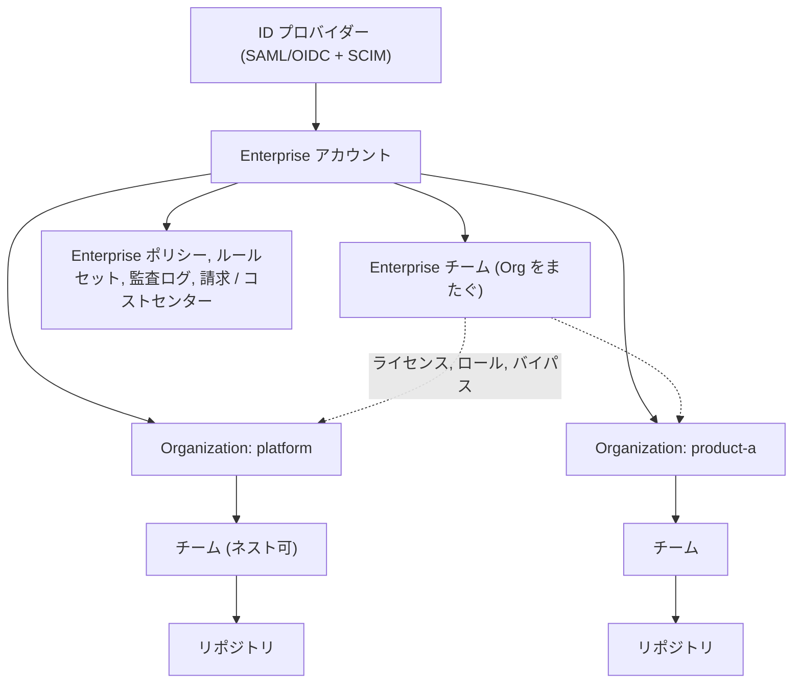

import { TLDR, DocsLinks, LastVerified, DecisionTree, CompareTable } from '@components';
import { Aside, Badge, LinkCard, CardGrid } from '@astrojs/starlight/components';

<LastVerified date="2026-10" />

<TLDR>
- **階層:** Enterprise → Organization → チーム → リポジトリ。**Enterprise チーム**は Organization をまたぎ、Copilot ライセンス、Enterprise ロール、ルールセットのバイパスを付与できます。
- **Enterprise の種類はアカウント作成の**前に**決めます:** 個人アカウント型（SAML SSO 付き）か **Enterprise Managed Users**（IdP がプロビジョニングするアカウントで、パブリックコンテンツは作成不可）か。後から切り替えるには移行が必要です。
- **GHE.com のデータレジデンシー**（EU、オーストラリア、米国、日本）は常に **EMU** を使い、専用の `SUBDOMAIN.ghe.com` で動きます。
- **EMU のパートナー IdP:** Entra ID（SAML または OIDC）、Okta と PingFederate（SAML）、および SCIM。Okta と Entra ID の組み合わせは**サポートされていません**。
- **GHES** はセルフホスト型です。最新は **3.22** ですが、当日にリリースノートを確認してください。
</TLDR>

## ブースでよくある質問

Enterprise Managed Users を使うべきですか？

アカウント、ユーザー名、Organization のメンバーシップ、アクセス権について **IdP を信頼できる唯一の情報源**にしたく、かつ開発者がそのアカウントでパブリックリポジトリや社外のリポジトリに貢献する必要がない場合に向いています。マネージドユーザーは**パブリックリポジトリ、Gist、公開 Pages サイトを作成できず、Enterprise 外とのコラボレーションもできません**。GitHub 自身も、EMU がすべてのお客様に適しているわけではないと述べています。下のデシジョンツリーで確認してください。

個人アカウント型の GHEC Enterprise を EMU に切り替えられますか？

いいえ。EMU を導入するには**新しい Enterprise アカウント**への移行（GEI）が必要なので、GitHub の営業に相談してください。まず ID 基盤を設計します。[移行](/github-cheatsheet/ja/migration/)を参照してください。

SAML SSO と SCIM の違いは何ですか？

**SAML/OIDC** は*認証*（本人であることの証明）です。**SCIM** は*プロビジョニング*（アカウントの作成・停止、グループの同期）です。**EMU** では SCIM が GitHub アカウントそのものを作成します。**個人アカウント型**では、ユーザーは自分の GitHub アカウントを持ち込み、SAML がそれを IdP の ID に紐付けます。この場合、SCIM がプロビジョニング/デプロビジョニングするのは **Organization へのアクセス**だけです。

Entra ID の条件付きアクセスを GitHub で使えますか？

はい、**EMU + OIDC（Entra ID）** の場合に使えます。GitHub は、Web セッションとユーザートークンについて IdP の**条件付きアクセスポリシー (CAP)** を検証します。GitHub App の**インストール**トークンには適用されません。GitHub の IP 許可リストの**代わりに** IdP の IP 条件を使うこともできます。

Enterprise チームと Organization チームの違いは？

**Enterprise チーム**は Organization をまたぎます（最大 2,500 チーム、1 チームあたり 5,000 ユーザー、最大 1,000 Organization に割り当て可能）。Copilot ライセンス、Enterprise ロールやカスタムロール、ルールセットのバイパスを付与でき、@メンション（`@/ent:team`）もできます。一方、CODEOWNERS への指定、ネスト、シークレットチーム、チームメンテナーには**対応していません**。これらが必要な場合は Organization チームを使います。

GHE.com は GitHub.com と同じですか？

選択したリージョンの専用サブドメインでホストされる GitHub Enterprise Cloud で、**常に EMU** です。GHES のアップグレードを管理せずに、Copilot を含むクラウドの機能を利用できます。リージョンや展開状況によって一部の機能が異なる場合があるため、案内する前にドキュメントで該当機能の「機能の利用可能性」を確認してください。

## Enterprise アカウントの構成

| レベル | 主な管理者 | 管理する内容 |
|---|---|---|
| **Enterprise** | Enterprise オーナー | ID（SSO/SCIM/EMU）、ポリシー、Enterprise ルールセット、Copilot と AI controls、請求、コストセンター、監査ログのストリーミング、Enterprise ロール |
| **Organization** | Organization オーナー | Organization ルールセット、カスタムプロパティ、カスタム Organization ロール、セキュリティ構成、ランナー、シークレット |
| **チーム** | チームメンテナー | メンバーシップ（または IdP グループとの同期）、リポジトリへのアクセス権 |
| **リポジトリ** | リポジトリ管理者 | リポジトリのルールセット、環境、ブランチ保護、設定 |

<Aside type="tip" title="トークポイント: Organization はいくつ必要？">
通常は少ないほうがよいです。Organization は組織図をなぞるのではなく、**管理やセキュリティの境界**（ポリシー、オーナー、コンプライアンス要件が異なる場合）として使います。それ以外は**カスタムプロパティ**とチームで表現します。
</Aside>

## Enterprise の種類の比較

<CompareTable
	title="Enterprise のデプロイオプション"
	columns={[
		{ key: 'personal', label: 'GHEC（個人アカウント）' },
		{ key: 'emu', label: 'GHEC + EMU' },
		{ key: 'dr', label: 'GHE.com（データレジデンシー）' },
		{ key: 'ghes', label: 'GHES（セルフホスト）' },
	]}
	rows={[
		{ feature: 'GitHub がホスト', category: 'ホスティング', values: { personal: true, emu: true, dr: true, ghes: false } },
		{ feature: 'データの保存リージョンを選択', category: 'ホスティング', values: { personal: false, emu: false, dr: 'EU、オーストラリア、米国、日本', ghes: 'ホストする場所次第' } },
		{ feature: 'URL', category: 'ホスティング', values: { personal: 'github.com', emu: 'github.com', dr: '`SUBDOMAIN.ghe.com`', ghes: '自社のホスト名' } },
		{ feature: 'IdP がアカウントを作成（SCIM）', category: 'ID', values: { personal: false, emu: true, dr: true, ghes: '任意（GHES の SCIM）' } },
		{ feature: 'ユーザーが自分の GitHub アカウントを持ち込む', category: 'ID', values: { personal: true, emu: false, dr: false, ghes: false } },
		{ feature: 'SSO', category: 'ID', values: { personal: 'SAML（SAML 2.0 準拠の任意の IdP）', emu: 'SAML または OIDC（Entra ID）', dr: 'SAML または OIDC（Entra ID）', ghes: 'SAML、LDAP、CAS、ビルトイン' } },
		{ feature: 'パブリックリポジトリ / 社外とのコラボレーション', category: 'コラボレーション', values: { personal: true, emu: false, dr: false, ghes: 'インスタンス内のみ' } },
		{ feature: 'GitHub Copilot', category: '機能', values: { personal: true, emu: true, dr: true, ghes: false } },
		{ feature: 'アップグレード / バックアップを自社で実施', category: '運用', values: { personal: false, emu: false, dr: false, ghes: true } },
		{ feature: 'リリースを待たずに最新機能を利用', category: '運用', values: { personal: true, emu: true, dr: 'あり（機能ごとの利用可否を確認）', ghes: false } },
	]}
/>

## どの Enterprise の種類を選ぶか

<DecisionTree
	title="どの Enterprise の種類？"
	tree={{
		start: 'q1',
		nodes: {
			q1: {
				question: 'コードとデータを**特定のリージョンに保存**する必要がありますか？ または**自社データセンター / エアギャップ環境**で運用する必要がありますか？',
				options: [
					{ label: '特定リージョン（EU、AU、US、JP）', next: 'dr' },
					{ label: '自社データセンター / エアギャップ', next: 'ghes' },
					{ label: 'どちらでもない', next: 'q2' },
				],
			},
			q2: {
				question: 'すべてのアカウント（ユーザー名、プロフィール、ライフサイクル）を **IdP で作成・管理**したいですか？',
				options: [
					{ label: 'はい', next: 'q3' },
					{ label: 'いいえ / わからない', next: 'q4' },
				],
			},
			q3: {
				question: '開発者が業務用アカウントで**パブリックリポジトリや社外のリポジトリ**に貢献する必要がありますか？',
				help: 'マネージドユーザーは Enterprise 内でしか貢献できません。社外での活動には別の個人アカウントが必要です。',
				options: [
					{ label: 'はい、日常的に', next: 'personal' },
					{ label: 'いいえ', next: 'emu' },
				],
			},
			q4: {
				question: 'IdP によるオンボーディング/オフボーディングの仕組み（SCIM 対応）は確立していますか？',
				options: [
					{ label: 'はい', next: 'q3' },
					{ label: 'いいえ', next: 'personal' },
				],
			},
			dr: {
				answer: '**GHE.com のデータレジデンシー**です。常に **EMU** を使います。',
				links: [{ label: 'データレジデンシーについて', href: 'https://docs.github.com/ja/enterprise-cloud@latest/admin/data-residency/about-github-enterprise-cloud-with-data-residency' }],
			},
			ghes: {
				answer: '**GitHub Enterprise Server** です。Copilot は GHES では利用できず、アップグレードは自社で行う点に注意してください。',
				links: [{ label: 'GHES のリリース', href: 'https://docs.github.com/ja/enterprise-server@latest/admin/all-releases' }],
			},
			emu: {
				answer: '**GHEC + Enterprise Managed Users** です。認証と SCIM の両方に単一のパートナー IdP（Entra ID、Okta、PingFederate）を使ってください。',
				links: [{ label: 'EMU について', href: 'https://docs.github.com/ja/enterprise-cloud@latest/admin/concepts/identity-and-access-management/enterprise-managed-users' }],
			},
			personal: {
				answer: '**GHEC（個人アカウント型）** + Enterprise レベルの **SAML SSO** です。必要に応じて、Organization へのアクセスとチーム同期に SCIM を追加します。',
				links: [{ label: 'Enterprise の種類の選択', href: 'https://docs.github.com/ja/enterprise-cloud@latest/admin/concepts/enterprise-fundamentals/choose-an-enterprise-type' }],
			},
		},
	}}
/>

## SSO、SCIM、IdP のサポート

| | 個人アカウント型 Enterprise | Enterprise Managed Users |
|---|---|---|
| **認証** | SAML 2.0（準拠する任意の IdP。一部は公式にテスト済み）。Enterprise または Organization レベルで設定 | SAML、または **OIDC（Entra ID）**。全ユーザーに必須 |
| **プロビジョニング** | SCIM が管理するのは **Organization へのアクセス**のみ。ユーザーは自分のアカウントを使い続ける | SCIM が**アカウントを作成・更新・停止**し、IdP グループをチームに対応付ける |
| **パートナー IdP** | — | **Entra ID**（SAML + OIDC）、**Okta**（SAML）、**PingFederate**（SAML） |
| **その他の IdP** | SAML 2.0 準拠なら可 | SCIM 2.0 準拠なら可。ただし混在構成や未テストの構成では GitHub のサポートが限定される場合がある |
| **条件付きアクセス** | — | OIDC（Entra ID）で IdP の CAP を検証 |

<Aside type="caution" title="注意点">
- **Okta と Entra ID** を SSO と SCIM で組み合わせる構成（順序を問わず）は、明示的に**サポートされていません**。
- GitHub のフルサポートを受けるには、認証とプロビジョニングの**両方に 1 つのパートナー IdP** を使ってください。
- EMU では、**緊急用のセットアップユーザー**（`_admin` アカウント）とそのリカバリーコードを安全に保管してください。
</Aside>

## このセクションのページ

<CardGrid>
	<LinkCard title="ガバナンスとポリシー" description="ルールセット、カスタムプロパティ、ロール、監査ログのストリーミング、IP 許可リスト、Apps と PAT、GHES のバージョン。" href="/github-cheatsheet/ja/administration/governance/" />
	<LinkCard title="移行" description="新しい Enterprise への移行。" href="/github-cheatsheet/ja/migration/" />
</CardGrid>

<DocsLinks
	links={[
		{ label: 'Enterprise の種類の選択', href: 'https://docs.github.com/ja/enterprise-cloud@latest/admin/concepts/enterprise-fundamentals/choose-an-enterprise-type' },
		{ label: 'Enterprise Managed Users について', href: 'https://docs.github.com/ja/enterprise-cloud@latest/admin/concepts/identity-and-access-management/enterprise-managed-users' },
		{ label: 'GHE.com のデータレジデンシー', href: 'https://docs.github.com/ja/enterprise-cloud@latest/admin/data-residency/about-github-enterprise-cloud-with-data-residency' },
		{ label: 'Enterprise のチーム', href: 'https://docs.github.com/ja/enterprise-cloud@latest/admin/concepts/enterprise-fundamentals/teams-in-an-enterprise' },
		{ label: 'Enterprise の SAML SSO の構成', href: 'https://docs.github.com/ja/enterprise-cloud@latest/admin/managing-iam/using-saml-for-enterprise-iam/configuring-saml-single-sign-on-for-your-enterprise' },
		{ label: 'マネージドユーザーアカウントの機能と制限', href: 'https://docs.github.com/ja/enterprise-cloud@latest/admin/managing-iam/understanding-iam-for-enterprises/abilities-and-restrictions-of-managed-user-accounts' },
	]}
/>
