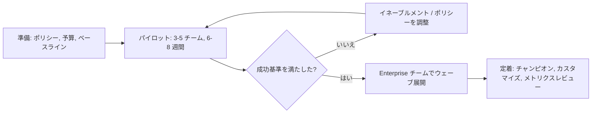
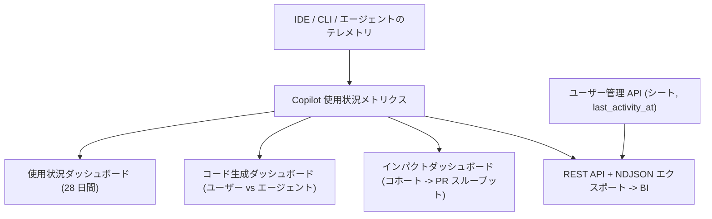

import { TLDR, DocsLinks, LastVerified, DecisionTree, FlashCards } from '@components';
import { Aside, Badge, Steps } from '@astrojs/starlight/components';

<LastVerified date="2026-10" />

<TLDR>
- **パイロット:** 経験レベルの異なる有志チームで 6〜8 週間ほど行います。先にベースラインを取り、テレメトリとアンケートを組み合わせ、成功基準を事前に決めます。
- **ライセンスを配るだけでなくイネーブルメントを行います。** ハンズオン、プロンプトと指示のライブラリ、チャンピオン、社内チャンネルを用意します。使われないシートは最大の失敗要因です。
- **測定**には **Copilot 使用状況メトリクス**のダッシュボード（使用状況、コード生成、**インパクト**コホート → PR スループット）、REST API、NDJSON エクスポートを使います。「Copilot usage metrics」ポリシーを**有効**にする必要があります。
- **本番展開前にポリシーを決めます:** 機能とモデル（AI controls）、パブリックコード一致、コンテンツ除外、MCP、クラウドエージェント、予算、セッションデータ、監査ログのストリーミング。
- **2026 年 6 月 1 日に課金が変わりました。** 使用量は **GitHub AI Credits** ベースになったため、予算とコストセンターを早めに設定してください。
</TLDR>

## ブースでよくある質問

パイロットの規模と期間はどのくらいが適切ですか？

公式な数字はありません。実践的には、言語や経験レベルの異なる **3〜5 チーム、50〜200 人**で **6〜8 週間**（オンボーディング 2 週間 + 定常利用 4〜6 週間）がよく使われるパターンです。主要な技術スタックと IDE をカバーできる規模にし、物珍しさが落ち着くまでの期間を確保してください。

価値を証明するには何を測定すべきですか？

3 つの層で追跡します。
1. **導入**: 日次/週次アクティブユーザーと、機能別（補完、チャット、エージェントモード、CLI、コードレビュー）のエンゲージメント。
2. **アウトプット**: ユーザーとエージェント別の AI によるコード変更行数（コード生成ダッシュボード）と、導入コホート別の **PR スループットとマージまでの時間**（インパクトダッシュボード）。
3. **体験**: 満足度、フロー、体感の時間短縮に関するアンケート。

パイロット前にベースラインを取ります。受け入れ率などの単一の数値はシグナルとして扱い、ROI とは見なさないでください。

ダッシュボードと API で数値が違うのはなぜですか？

それぞれの用途が異なるためです。ほとんどのメトリクスは **IDE のクライアント側テレメトリ**に基づくので、ユーザーのテレメトリが有効になっている必要があり、プロキシで欠落することもあります。サーバー側テレメトリは**アクティブユーザー**数を補完しますが、機能別やコード行数の内訳は補完しません。GitHub.com 上の Copilot Chat と Mobile は含まれません。シート情報の正は**ユーザー管理 API** で、使用状況メトリクスではありません。GitHub はメトリクスの突き合わせガイドを公開しています。

どこまでさかのぼってレポートできますか？

使用状況メトリクス API のレポートは **2025 年 10 月 10 日**以降のデータがあり、最大 **1 年**分の履歴を取得できます。Organization レベルのレポートは **2025 年 12 月 12 日**以降です。ダッシュボードは **28 日間**のトレンドを表示します。長期保存には BI ツールにエクスポートしてください。

使用量が複数の Organization に表示されます。二重計上ですか？

Organization レベルのメトリクスは、シートが割り当てられた場所ではなく **Organization のメンバーシップ**に基づきます。ユーザーの使用量は**所属するすべての Organization** に表示されますが、Enterprise レベルでは 1 回だけ数えられます。また、その Enterprise 内でシートを持っている場合に限られます。

事業部の責任者に自分の Organization のメトリクスだけを見せられますか？

はい。「View organization Copilot metrics」権限を含む**カスタム Organization ロール**を作成してください。Enterprise レベルのアクセスは不要です。

法務から「自社のコードがモデルの学習に使われるか」と聞かれました。

**Business/Enterprise**（GitHub Generative AI Services Terms）では、指示がない限り GitHub は入力/出力をモデルの学習に使いません。また、入力の所有権はお客様に残ります。**パブリックコード一致**の制御（ブロック、またはコード参照付きで許可）を有効にしてください。補償条項の文言は Customer Agreement または Trust Center を案内し、ブースで言い換えないでください。

## 展開のタイムライン

## パイロット設計

| 要素 | 推奨 |
|---|---|
| **対象者** | 有志に加えて懐疑的な人も数名。技術スタック、IDE、経験レベルを混ぜ、コードレビューの多いチームも入れる |
| **ベースライン** | シート割り当て前の 4 週間以上の PR スループット、マージまでの時間、DORA 指標と、短いアンケート |
| **比較** | 似た業務の非パイロットチームと比較するか、同じコホートの前後で比較する。**インパクトダッシュボード**のコホートを使う |
| **成功基準** | 例: 週次アクティブユーザー X% 以上、アンケートの改善、変更失敗率の悪化なし。スポンサーと**事前に**合意しておく |
| **ライセンス** | **Enterprise チーム**または Organization チームでシートを割り当てる。後の拡大がメンバー変更だけで済む |
| **フィードバックループ** | 週 15 分のチャンピオンミーティングと、うまくいった/いかなかったプロンプトを共有するチャンネル |

## 効果的なイネーブルメントコンテンツ

- **キックオフ（60〜90 分、ハンズオン）:** 補完 → チャット → エージェントモード / プランモード → Copilot コードレビュー → CLI を、*自社の*コードベースで実施します。
- **リポジトリのカスタム指示**（`.github/copilot-instructions.md`）と、コーディング規約やセキュリティガイドラインのための **Organization のカスタム指示**。
- **プロンプトファイルとカスタムエージェント**を共有リポジトリに置き、「うちでのテストの書き方」のようなプロンプトを再利用できるようにします。
- **ロール別トラック:** フロントエンド、バックエンド、データ、SRE（定型作業向けの CLI とクラウドエージェント）、レビュアー（Copilot コードレビュー）。
- チャンピオンによる**オフィスアワーと事例共有会**。良い活用事例は公に称えます。
- **ガードレール:** コードの責任は人間にあります。AI が生成した変更も通常の変更と同様にレビューし、CodeQL とシークレットスキャンを実行してください。

## 効果の測定

| 目的 | 使うもの |
|---|---|
| 経営層向けのトレンド | 使用状況メトリクスダッシュボード（Enterprise の **Insights** タブ） |
| AI とエージェントによるコードの割合 | コード生成ダッシュボード |
| 導入の深さ → PR の成果 | **Copilot impact** ダッシュボード（導入コホート） |
| 独自の BI / 長期保存 | REST `/enterprises/{enterprise}/copilot/metrics/reports/...`（`enterprise-1-day`、`enterprise-28-day/latest`）と NDJSON エクスポート |
| 使われていないシートの回収 | ユーザー管理 API の `last_activity_at` |

<Aside type="caution">
API のレポートを使うには **「Copilot usage metrics」** ポリシーを有効にし、`manage_billing:copilot` または `read:enterprise` スコープのトークンを用意する必要があります。新しい連携には、GitHub が最も網羅的なソースとして推奨している**使用状況メトリクス API** を使ってください。
</Aside>

## チェンジマネジメント

- **エグゼクティブスポンサー**と明確な「**なぜ**」を用意します。人員削減ではなく、定型作業をなくす取り組みとして位置付けます。
- **不安に正面から答えます。** 雇用、コード品質（「責任はあなたにある」）、知的財産（Business/Enterprise の規約）についてです。
- **デフォルトにします。** dev container や Codespaces にプリインストールし、テンプレートにカスタム指示を含め、ゴールデンパスのリポジトリで Copilot コードレビューを有効にします。
- **ループを閉じます。** 毎月メトリクスと事例を公開し、使われていないシートを再配分します。

## ポリシー決定のチェックリスト

<Steps>

1. **プランとライセンス:** Copilot Business と Enterprise のどちらにするかを決めます（Copilot は **GHEC 専用**で、GHES では使えません）。シートの割り当て方法も決めます（Enterprise チーム、Organization チーム、Enterprise への直接割り当て）。
2. **課金のガードレール:** ユーザー単位の予算（全体、コストセンター、個人）、コストセンターの予算、「AI credits paid usage」ポリシーを設定します。予算を使い切っても、安価なモデルへの**自動フォールバックはありません**。
3. **機能とモデル:** **AI controls** タブで設定します。それぞれについて、有効化、無効化、または *Organization に任せる*かを選びます。新しい機能やモデルを「デフォルトで利用可能」に従わせるか、明示的なオプトインを必須にするかも決めます。
4. **エージェント:** Copilot クラウドエージェント（どの Organization で使うか）、サードパーティエージェント <Badge text="プレビュー" variant="caution" />、Copilot コードレビュー（自動レビューを含む）について決めます。
5. **MCP:** MCP の許可リスト（GA）か、カスタム MCP レジストリ <Badge text="プレビュー" variant="caution" /> かを決めます。
6. **パブリックコード一致:** ブロックするか、コード参照付きで許可するかを決めます。
7. **コンテンツ除外:** 除外するパスを決めます。⚠ Copilot CLI と IDE のエージェントモードでは**適用されない**ため、シークレット対策として頼らないでください。
8. **データ:** 「Store local sessions in the Cloud」ポリシーを設定し、クラウドエージェントのセッションログを誰が閲覧できるかを決めます。
9. **監査:** 監査ログで `action:copilot` と `actor:Copilot` を使います。保持期間は **180 日**なので、長期保存には SIEM にストリーミングします。
10. **カスタマイズ:** Organization のカスタム指示、Organization/Enterprise のカスタムエージェント、共有プロンプトライブラリのリポジトリを用意します。

</Steps>

<DecisionTree
	title="Business と Enterprise のどちら？"
	tree={{
		start: 'q1',
		nodes: {
			q1: {
				question: '**GitHub Enterprise Cloud** を使っていますか？',
				options: [
					{ label: 'はい', next: 'q2' },
					{ label: 'いいえ — GHES のみ', next: 'ghes' },
					{ label: 'いいえ — GitHub Team / Free の Organization', next: 'biz' },
				],
			},
			q2: {
				question: 'ヘビーユーザーに、**シートあたりの月間 AI クレジット枠の拡大**やプレミアムモデルへの優先アクセスが必要ですか？',
				options: [
					{ label: 'はい、多くのユーザーに必要', next: 'ent' },
					{ label: 'それほど広くは不要', next: 'mix' },
				],
			},
			ghes: { answer: 'ドキュメント上、Copilot は**現在 GitHub Enterprise Server では利用できません**。ライセンスは GitHub Enterprise Cloud アカウント経由になるため、GHEC や GHE.com の選択肢をアカウントチームと相談してください。' },
			biz: { answer: '**Copilot Business** です（Copilot Enterprise には GitHub Enterprise Cloud が必要）。' },
			ent: { answer: '該当ユーザーには **Copilot Enterprise**。案内する前にドキュメントでプランを比較してください。', links: [{ label: 'Copilot のプラン', href: 'https://docs.github.com/ja/copilot/get-started/plans' }] },
			mix: { answer: 'まずは **Copilot Business** を広く展開し、ヘビーユーザーには予算を設定します。Organization ごとにプランを混在させたい場合は、案内前に現在のプラン割り当てオプションを確認してください。', links: [{ label: 'Copilot のプラン', href: 'https://docs.github.com/ja/copilot/get-started/plans' }] },
		},
	}}
/>

<FlashCards
	title="Copilot 展開クイズ"
	cards={[
		{ q: '使用状況メトリクスに必要なポリシーは？', a: '**「Copilot usage metrics」** ポリシー。' },
		{ q: '導入状況と PR スループットを結び付けるダッシュボードは？', a: '**Copilot impact** ダッシュボード（導入コホート）。' },
		{ q: 'シート情報の正となるソースは？', a: '**Copilot ユーザー管理 API**（`last_activity_at`）。' },
		{ q: 'コンテンツ除外は Copilot CLI に適用される？', a: '**いいえ**。IDE のエージェントモードにも適用されません。' },
		{ q: 'Copilot の監査ログの保持期間は？', a: '**180 日**。それ以上は SIEM にストリーミングします。' },
	]}
/>

<DocsLinks
	links={[
		{ label: 'Copilot を大規模に展開する', href: 'https://docs.github.com/ja/copilot/tutorials/roll-out-at-scale' },
		{ label: 'Copilot トライアルの成功を測定する', href: 'https://docs.github.com/ja/copilot/tutorials/roll-out-at-scale/measure-success' },
		{ label: 'Copilot 使用状況メトリクス（概念）', href: 'https://docs.github.com/ja/copilot/concepts/copilot-usage-metrics/copilot-metrics' },
		{ label: 'Copilot インパクトダッシュボード', href: 'https://docs.github.com/ja/copilot/how-tos/administer-copilot/view-impact-dashboard' },
		{ label: 'REST: Copilot 使用状況メトリクス', href: 'https://docs.github.com/ja/rest/copilot/copilot-usage-metrics' },
		{ label: 'Enterprise の Copilot ポリシーの管理', href: 'https://docs.github.com/ja/copilot/how-tos/administer-copilot/manage-for-enterprise/manage-enterprise-policies' },
		{ label: 'Copilot の予算', href: 'https://docs.github.com/ja/copilot/concepts/billing-and-usage/organizations-and-enterprises/budgets' },
		{ label: '承認のためのリソース（法務/コンプライアンス）', href: 'https://docs.github.com/ja/copilot/tutorials/roll-out-at-scale/govern-at-scale/resources-for-approval' },
	]}
/>
