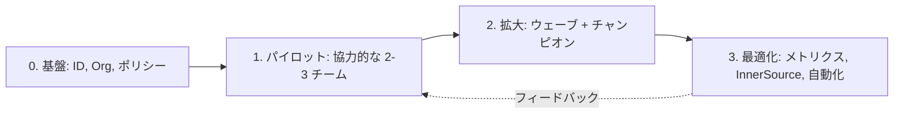

import { TLDR, DocsLinks, LastVerified, FlashCards } from '@components';
import { Aside, LinkCard, CardGrid } from '@astrojs/starlight/components';

<LastVerified date="2026-10" />

<TLDR>
- 導入はライセンスの購入ではなく**変革プログラム**です。**基盤 → パイロット → 拡大 → 最適化**の順に、各フェーズの完了条件を決めて進めます。
- **チャンピオン**（チームまたは事業部ごとに 1 人程度）を置くほうが、中央のトレーニングだけに頼るよりもイネーブルメントがスケールします。
- **InnerSource**（デフォルト可視性 `internal`、CONTRIBUTING.md、CODEOWNERS、good first issue）によって、GitHub は単なる Git ホストからコラボレーション基盤に変わります。
- 活動量ではなく**成果を測定**します。デリバリーには **DORA**、開発者体験には **SPACE**、AI の導入状況には **Copilot 使用状況メトリクス**（ダッシュボードと API）を使います。
</TLDR>

## ブースでよくある質問

どこから始めればよいですか？ 開発者が 3,000 人います。

まず**基盤**を整えます。ID（EMU または SSO）、Organization 構成、基本のルールセット、セキュリティ構成です。次に、技術スタックの異なる**協力的な 2〜3 チームでパイロット**を行い、その後チャンピオン主導で**ウェーブ**ごとに拡大します。各フェーズの完了条件を明文化してください。例:「パイロットチームが GitHub Actions から本番デプロイしており、リポジトリの 80% にデフォルトのセキュリティ構成が適用されている」。

うまくいっていることを経営層にどう示せばよいですか？

開始**前に** 3〜5 個の指標を選び、ベースラインを取ります。
- **DORA**: デプロイ頻度、変更のリードタイム、変更失敗率、復旧時間。
- PR サイクルタイム。
- セキュリティの MTTR（セキュリティ概要から）。
- Copilot のアクティブユーザーとエンゲージメント（Copilot 使用状況メトリクスのダッシュボードまたは API から）。

単発のスナップショットではなく、トレンドで報告します。AI 固有の指標は [Copilot の展開](/github-cheatsheet/ja/adoption/copilot-rollout/)を参照してください。

チャンピオン制度は実際にはどのような形ですか？

チャンピオンは、業務時間の一部（例: 約 10%）を確保された有志です。先行アクセス、専用チャンネル、プラットフォームチームとの月次ミーティングの機会を得て、各チームでデモやオフィスアワーを開催します。活躍は公に称えましょう。チャンピオンは、中央からは見えない現場の摩擦も吸い上げてくれます。

チーム間でコードを再利用してもらうには（InnerSource）？

- Enterprise 全体で見つけやすくするため、**`internal`** をデフォルトのリポジトリ可視性にします。
- テンプレートやルールセットで README、CONTRIBUTING.md、CODEOWNERS を必須にします。
- `good first issue` ラベルを付けます。
- 共有ライブラリと再利用可能なワークフローを公開します。
- **カスタムプロパティ**でオーナーやライフサイクルをタグ付けし、検索と統制をしやすくします。

開発者が「また新しいツールか」と抵抗します。何が効きますか？

古い経路を意図的になくします。旧 SCM と CI を読み取り専用にする日付を決めてください。テンプレート、スターターワークフロー、ゴールデンパスのリポジトリを用意して、新しい経路を一番楽な道にします。Copilot、オンボーディング用の Codespaces、自動マージなど、すぐに実感できる成果を見せましょう。

セキュリティ部門がレビュー完了まで全部止めたいと言います。どう進めますか？

初日からセキュリティ部門を巻き込みます。ルールセットの **Evaluate**（評価）モードで適用前に影響を確認でき、セキュリティ構成で GHAS の設定を大規模に適用でき、監査ログを SIEM にストリーミングすれば可視性も確保できます。セキュリティ部門はゲートではなく共同オーナーになります。[管理](/github-cheatsheet/ja/administration/)を参照してください。

## 展開フェーズ

| フェーズ | 目標 | 完了条件（例） |
|---|---|---|
| **0 基盤** | Enterprise の種類（EMU か個人アカウントか）、SSO/SCIM、Org 設計、基本のルールセット、セキュリティ構成、監査ログのストリーミング | IdP でプロビジョニングされたユーザーがサインインでき、Enterprise または Org レベルでポリシーが適用されている |
| **1 パイロット** | 多様な 2〜3 チームを移行（リポジトリ + CI）し、摩擦を収集してテンプレートを作る | パイロットチームが Actions からデプロイしている。ベースラインを取得済み |
| **2 拡大** | 移行ウェーブ、チャンピオンネットワーク、セルフサービスのオンボーディング（IssueOps、テンプレート） | 移行済みリポジトリの割合、チャンピオンのいるチームの割合、旧環境の読み取り専用化の日付が決まっている |
| **3 最適化** | InnerSource、再利用可能なワークフロー、Copilot のカスタマイズ、コスト管理 | DORA/SPACE のトレンドが改善し、旧環境を廃止済み |

## オンボーディングキット（新しいチームに渡すもの）

- **ゴールデンパスのテンプレートリポジトリ**: README、CONTRIBUTING、CODEOWNERS、Dependabot 設定、スターターワークフロー。
- **Organization レベルの再利用可能なワークフロー**（ビルド・テスト・デプロイ）と、それらのチェックを必須にするルールセット。
- **Codespaces / dev container** の定義。初日に最初のコミットができるようにします。
- **Copilot**: チームで有効化し、カスタム指示のテンプレートと社内プロンプトライブラリへのリンクを共有します。
- ブランチ戦略、PR のサイズ、レビューの SLA、セキュリティアラートのトリアージ手順をまとめた「**私たちの働き方**」ページ。

## 導入と効果の測定

| 観点 | わかること | データの出どころ |
|---|---|---|
| **DORA** | デリバリーのスループットと安定性 | Deployments API / 環境、PR とインシデントのデータ、オブザーバビリティツール |
| **SPACE** | 満足度、パフォーマンス、活動、コミュニケーション、効率 | 開発者アンケート + システムデータ。単一の指標だけで判断しないこと |
| **Copilot 使用状況メトリクス** | アクティブユーザー、機能/IDE/モデル別のエンゲージメント、コード行数、導入コホート別の PR スループット | Copilot 使用状況メトリクスのダッシュボード、コード生成/インパクトダッシュボード、REST API、NDJSON エクスポート |
| **セキュリティ態勢** | アラートの残数、MTTR、カバレッジ | セキュリティ概要 |
| **プラットフォームの健全性** | Actions の実行時間、待ち時間、コストセンター別のコスト | 請求の使用状況レポート、Actions メトリクス |

<Aside type="caution" title="トークポイント: メトリクスを武器にしない">
個人ではなく**チームとトレンド**を測定します。活動量の指標（コミット数、コード行数）は簡単に操作できてしまうため、成果の指標（リードタイム、変更失敗率）や開発者満足度アンケートと組み合わせてください。
</Aside>

## よくある障壁と回答

| 障壁 | 回答 |
|---|---|
| 「データを国外に出せない」 | **GHE.com のデータレジデンシー**（EU、オーストラリア、米国、日本）。[管理](/github-cheatsheet/ja/administration/)を参照 |
| 「ID を完全に管理したい」 | **Enterprise Managed Users**。IdP がアカウントをプロビジョニングし、パブリックコンテンツは作成できない |
| 「履歴を移行できない」 | GEI は GHES、ADO、Bitbucket Server、GitLab から履歴と PR を移行できる。[移行](/github-cheatsheet/ja/migration/)を参照 |
| 「法務が AI 生成コードを懸念している」 | Business/Enterprise の規約では入力/出力を学習に使わない。パブリックコード一致のフィルターもある。[Copilot の展開](/github-cheatsheet/ja/adoption/copilot-rollout/)を参照 |
| 「コストが膨らむ」 | 予算とアラート、コストセンター、ユーザー単位の AI クレジット予算 |
| 「チームが変わろうとしない」 | チャンピオン、ゴールデンパス、旧環境の読み取り専用化の日付の公表 |

<CardGrid>
	<LinkCard title="Copilot の展開" description="パイロット設計、イネーブルメント、効果測定、ポリシーのチェックリスト。" href="/github-cheatsheet/ja/adoption/copilot-rollout/" />
	<LinkCard title="移行" description="適切なツールを選び、移行プログラムを進める。" href="/github-cheatsheet/ja/migration/" />
	<LinkCard title="管理" description="Enterprise 構成、EMU、データレジデンシー、ガバナンス。" href="/github-cheatsheet/ja/administration/" />
</CardGrid>

<FlashCards
	title="導入クイズ"
	cards={[
		{ q: 'DORA の 4 つの指標は？', a: 'デプロイ頻度、変更のリードタイム、変更失敗率、サービス復旧時間。' },
		{ q: 'SPACE は何の略？', a: 'Satisfaction & well-being（満足度と幸福度）、Performance（パフォーマンス）、Activity（活動）、Communication & collaboration（コミュニケーションとコラボレーション）、Efficiency & flow（効率とフロー）。' },
		{ q: 'InnerSource に最適なデフォルトの可視性は？', a: '`internal`。Enterprise の全メンバーが閲覧できます。' },
	]}
/>

<DocsLinks
	links={[
		{ label: 'GitHub Copilot を大規模に展開する', href: 'https://docs.github.com/ja/copilot/tutorials/roll-out-at-scale' },
		{ label: 'GitHub Copilot 使用状況メトリクス', href: 'https://docs.github.com/ja/copilot/concepts/copilot-usage-metrics/copilot-metrics' },
		{ label: 'リポジトリの可視性について（internal）', href: 'https://docs.github.com/ja/repositories/creating-and-managing-repositories/about-repositories#about-internal-repositories' },
		{ label: 'Enterprise の種類の選択', href: 'https://docs.github.com/ja/enterprise-cloud@latest/admin/concepts/enterprise-fundamentals/choose-an-enterprise-type' },
		{ label: 'セキュリティの概要について', href: 'https://docs.github.com/ja/code-security/security-overview/about-security-overview' },
	]}
/>
