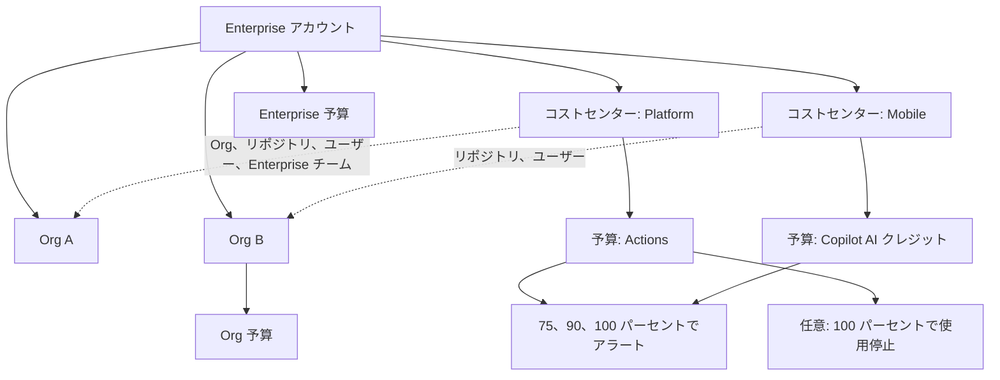

import { TLDR, DocsLinks, LastVerified, DecisionTree, FlashCards } from '@components';
import { Aside, LinkCard, CardGrid } from '@astrojs/starlight/components';

<LastVerified date="2026-10" />

<TLDR>
- 1 つの**課金プラットフォーム**で、**ライセンス**と**従量課金**の両方を扱います。
  - ライセンス: GHE/Team シート、Copilot シート、GHAS のアクティブコミッター
  - 従量課金: Actions、Packages、Codespaces、Git LFS、Copilot AI クレジット
- **コストセンター**で部門ごとに費用を配賦します。**予算**は 75/90/100% でアラートを出し、従量課金製品は**停止**もできます。
- GHE ライセンスは**使用量ベース**にできます。前払いのシート数ではなく、サイクル中に一度でもライセンスを保持したユニークユーザー数を毎月支払います。
- **Azure サブスクリプション**を接続すると、従量課金分を Azure の請求書にまとめられます。Microsoft EA 経由で GHEC を購入している場合、GHAS / Codespaces / Copilot を使うには接続が必須です。
- 数字は推測せず、**使用状況レポート**で確認します(UI の CSV、または REST `…/settings/billing/usage`)。
</TLDR>

## ブースでよくある質問

<details>
<summary>GitHub Enterprise Cloud のシートを消費するのは誰ですか?</summary>

**シートを消費する人:**

- Org のメンバーとオーナー
- 少なくとも 1 つの Org に所属する Enterprise オーナー
- **プライベート / internal** リポジトリの外部コラボレーター(フォークは除く。1 人 1 回のカウント)
- メンバーのままの休眠ユーザー

**消費しない人:**

- 支払いマネージャー
- どの Org にも所属しない Enterprise オーナー
- EMU のセットアップユーザー
- 停止中のマネージドユーザー
- パブリックリポジトリの外部コラボレーター
- Org メンバーでもリポジトリコラボレーターでもないゲストコラボレーター
- 未所属ユーザー
- 失敗した招待

**使用量ベース課金の場合:** サイクル中に**一度でも**ライセンスを保持したユーザーは、そのサイクルの課金対象になります。保留中の招待はカウント**されません**。

**EMU でも使用量ベースでもない場合:** 保留中の Org 招待やコラボレーター招待も**シートを消費**します。

</details>

<details>
<summary>GHAS の「アクティブコミッター」とは?</summary>

**Secret Protection** または **Code Security** が有効なリポジトリに、**過去 90 日以内にコミットを push した**ユニークユーザーのことです。

- SKU ごとに別々にカウントされます。
- GitHub App のボットは除外されます。
- GEI で移行したリポジトリは、移行**後**のコミットだけがカウントされます。
- パブリックリポジトリでは、コードスキャン、シークレットスキャン、依存関係レビューが無料です。
- AI 機能(AI Scan、エージェント型 autofix)は別 SKU の **Code Security AI Credits** で課金されます。

</details>

<details>
<summary>予算は本当に支出を止められますか? アラートだけですか?</summary>

製品の種類によって異なります。

- **従量課金製品**(Actions、Copilot AI クレジット、Codespaces、クラウドサンドボックスなど): 予算に達すると**使用を停止**できます。
- **ライセンス製品**(Copilot シート、GitHub Team/Enterprise シート): **アラートのみ**です。ただし **GHAS の SKU** は例外で、**ハード予算**を設定できます。
- **Copilot のユーザー単位予算**を **$0** にすると、そのユーザーは即座に停止されます。

</details>

<details>
<summary>Copilot の AI クレジットを使い切りました。安いモデルに自動で切り替わりますか?</summary>

**切り替わりません。** ドキュメントには「予算を使い切っても、低コストモデルへの自動フォールバックはない」と明記されています。

- Org / Enterprise では、管理者が「AI credits paid usage」ポリシーを無効にしない限り、**有料の超過利用が既定で有効**です。
- 上限を設けるには、コストセンターの**含まれる使用量(included usage)**制御とユーザー単位予算を使います。
- 各プランの割り当て量は [Copilot](/github-cheatsheet/ja/copilot/) を参照してください。

</details>

<details>
<summary>Azure 経由で GitHub の支払いはできますか?</summary>

できます。Org または Enterprise に **Azure サブスクリプション ID** を接続します(*Billing & licensing → Payment information → Metered billing via Azure*)。

- **必要な権限:** GitHub のオーナー**かつ** Azure サブスクリプションのオーナーであること。GitHub の SPV アプリにテナント全体の管理者同意も必要です。
- **請求タイミング:** 従量課金分は**毎月 1 日**に Azure から請求されます。プラン料金は従来どおり GitHub の請求日です。
- **使えないもの:** Azure 経由の前払い(prepaid)使用。

</details>

<details>
<summary>GHES と GHEC を併用しています。同じ人に二重課金されますか?</summary>

GHES と GHEC の間で**ライセンス使用状況を同期**していれば、二重課金されません。GHEC ライセンスを消費しているユーザーは、GHES 側で重複排除されます。

- **併用コスト:** GHES は GHEC の Enterprise アカウントと追加費用なしで組み合わせられます。
- **GHES でカウントされる人:** 認証済みのアクティブユーザーと休眠ユーザー。停止ユーザーはカウント**されない**ので、休眠ユーザーを停止するとシートを解放できます。

</details>

<details>
<summary>Actions や Copilot の費用をチームごとにチャージバックするには?</summary>

**コストセンター**を作成し、Org・リポジトリ・ユーザー・**Enterprise チーム**を割り当てます。Enterprise チームのメンバーシップは自動同期されます。

製品タイプ別の配賦方法:

- **使用量ベース**(例: Actions)→ **リポジトリ / Org** 単位
- **ライセンス製品**(例: Copilot シート)→ **ユーザー**単位
- **AI クレジット製品**(例: Copilot クラウドエージェント)→ **ユーザー**、または**付与元の Org**

上限: Enterprise あたりアクティブなコストセンター **1,000**、コストセンターあたりリソース **25,000**。

</details>

## 請求額が増えたのはなぜ?

<DecisionTree
	title="請求額が増えたのはなぜ?"
	tree={{
		start: 'q1',
		nodes: {
			q1: {
				question: '**使用状況レポート**(Billing & licensing → Usage)を開きます。増えたのはどの項目ですか?',
				help: '製品 / SKU でグループ化し、次に Org またはリポジトリで絞り込みます。',
				options: [
					{ label: 'Copilot', next: 'cop' },
					{ label: 'GitHub Actions', next: 'act' },
					{ label: 'GitHub Enterprise シート', next: 'ghe' },
					{ label: 'GHAS(Secret Protection / Code Security)', next: 'ghas' },
					{ label: 'Codespaces', next: 'cs' },
					{ label: 'Packages / ストレージ', next: 'pkg' },
				],
			},
			cop: {
				question: '増えたのは**シート**ですか、**AI クレジット**(使用量)ですか?',
				options: [
					{ label: 'シート', next: 'copSeats' },
					{ label: 'AI クレジット / 超過分', next: 'copCredits' },
				],
			},
			copSeats: {
				answer: 'Copilot Business/Enterprise は**付与されたシートごと**に課金されます。チームや Enterprise チームへの割り当てなど、新しい付与がないか確認してください。シートのアクティビティデータを見て、非アクティブなユーザーからシートを回収します。',
				links: [{ label: 'Org 向け Copilot の課金', href: 'https://docs.github.com/ja/copilot/concepts/billing-and-usage/organizations-and-enterprises/billing' }],
			},
			copCredits: {
				answer: '**プールされた AI クレジット枠**を超えています。有料の超過利用は**既定で有効**です。プレミアムモデルやエージェント型セッション(クラウドエージェント、CLI、サードパーティエージェント)はクレジットを多く消費します。対策は、**ユーザー単位予算**、**コストセンターの included usage** 制御、または「AI credits paid usage」ポリシーの無効化です。安いモデルへの自動フォールバックはありません。',
				links: [{ label: 'Copilot の予算', href: 'https://docs.github.com/ja/copilot/concepts/billing-and-usage/organizations-and-enterprises/budgets' }],
			},
			act: {
				question: '増えたのは、単価の高いランナー(larger、macOS、Windows、GPU)での**プライベートリポジトリの分数**ですか?',
				options: [
					{ label: 'はい、高単価のランナー', next: 'actRunners' },
					{ label: 'いいえ、通常の Linux の分数が増えた', next: 'actVolume' },
					{ label: '分数ではなくストレージ', next: 'actStorage' },
				],
			},
			actRunners: {
				answer: 'ランナーの種類ごとに**分単価の SKU が異なります**。`runs-on` のラベル、マトリックスの展開数、`timeout-minutes` を確認してください。パブリックリポジトリで標準ランナーを使う場合は無料です。',
				links: [{ label: 'Actions ランナーの料金', href: 'https://docs.github.com/ja/billing/reference/actions-runner-pricing' }],
			},
			actVolume: {
				answer: '新しいワークフローやスケジュール、`concurrency` によるキャンセル設定の漏れがないか確認します。**Copilot コードレビュー**も確認してください。プライベートリポジトリでは、レビューごとに AI クレジットに加えて Actions の分数も消費します。分数は実行したユーザーではなく**リポジトリのオーナー**に課金されます。',
				links: [{ label: 'GitHub Actions の課金', href: 'https://docs.github.com/ja/billing/concepts/product-billing/github-actions' }],
			},
			actStorage: {
				answer: '成果物(artifact)のストレージは**時間単位**で発生し、**Packages と共有**です。保持期間を短くし、古い成果物を削除してください。キャッシュはリポジトリごとの別枠です。',
				links: [{ label: 'GitHub Actions の課金', href: 'https://docs.github.com/ja/billing/concepts/product-billing/github-actions' }],
			},
			ghe: {
				answer: '**使用量ベース**のライセンスでは、サイクル中に**一度でも**シートを保持したユーザーが課金対象になります。よくある原因は、新しい Org、プライベート / internal リポジトリの外部コラボレーター、休眠メンバー、保留中の招待(使用量ベースでも EMU でもない場合)です。*Licensing → Consumed licenses* と休眠ユーザーレポートを確認してください。',
				links: [{ label: 'ライセンスを消費するユーザー', href: 'https://docs.github.com/ja/billing/reference/github-license-users' }],
			},
			ghas: {
				answer: 'SKU が有効なリポジトリで、**ユニークなアクティブコミッター**(過去 90 日に push した人)が増えています。セキュリティ構成の対象リポジトリを広げたときや、新しいコントリビューターが加わったときによく起こります。AI Scan と autofix は **Code Security AI Credits** として別に課金されます。GHAS の SKU には**ハード予算**を設定できます。',
				links: [{ label: 'GHAS の課金', href: 'https://docs.github.com/ja/billing/concepts/product-billing/github-advanced-security' }],
			},
			cs: {
				answer: 'Codespaces は**コンピューティング**(コア時間単位なので、大きいマシンほど高い)と**ストレージ**(GB 月。プレビルドを含む)で課金されます。Org 課金の設定、許可している**マシンタイプ**、**アイドルタイムアウト**、**保持期間**、プレビルドのトリガーを確認してください。プレビルドは Actions の分数も消費します。',
				links: [{ label: 'Codespaces の課金', href: 'https://docs.github.com/ja/billing/concepts/product-billing/github-codespaces' }],
			},
			pkg: {
				answer: 'プライベートパッケージの**ストレージ**(Actions の成果物と共有)と**データ転送**を確認してください。`GITHUB_TOKEN` を使った Actions からのダウンロードは無料ですが、**PAT を使うセルフホストランナー**からのダウンロードは課金されます。Container registry のストレージと帯域幅は**現在無料**です。',
				links: [{ label: 'Packages の課金', href: 'https://docs.github.com/ja/billing/concepts/product-billing/github-packages' }],
			},
		},
	}}
/>

## 課金プラットフォームの全体像



### 従量課金製品とライセンス製品

| 製品 | 課金単位 | 含まれる使用量 | 予算で停止できるか |
|---|---|---|---|
| **GitHub Enterprise / Team** | シート(または使用量ベースのライセンス) | 該当なし | いいえ(アラートのみ) |
| **Copilot Business / Enterprise** | 付与されたシートごと | シートごとにプールされる AI クレジット | シート: いいえ。AI クレジットの超過分: **はい** |
| **Copilot AI クレジット** | トークン使用量(1 クレジット = $0.01) | プランの割り当て量 | **はい** |
| **GHAS**(Secret Protection、Code Security) | 過去 90 日のユニークアクティブコミッター | パブリックリポジトリは一部機能が無料 | **はい**(ハード予算) |
| **Code Security AI Credits** | AI Scan / エージェント型 autofix | Copilot の AI クレジット枠から先に消費 | **はい** |
| **Actions** | ランナー SKU ごとの分数 + ストレージ(GB 時間) | プランの分数とストレージ(プライベートリポジトリ) | **はい** |
| **Packages** | ストレージ + データ転送 | プランの枠(プライベートのみ。パブリックは無料) | **はい** |
| **Codespaces** | コア時間 + ストレージ(GB 月) | 個人アカウントのみ | **はい** |
| **Git LFS** | ストレージ + 帯域幅 | プランの枠 | **はい** |

<Aside type="caution">
価格は変わるので、記憶で金額を答えないでください。[料金計算ツール](https://github.com/pricing/calculator)
か、GitHub Docs の各製品の課金ページで確認します。GHAS のコミッター単価は docs.github.com に**掲載されていない**ので、
github.com/enterprise/advanced-security を必ずその場で確認してください。
</Aside>

### 予算とアラートの目安

- **スコープ:** Enterprise、Org、**コストセンター**(Enterprise のみ)、ユーザー、リポジトリ。前払いのボリュームライセンスには使えません。
- **予算アラート:** **75%、90%、100%** で UI とメールに通知されます。
- **含まれる使用量のアラート:** 予算とは別に、Actions、Packages、Git LFS、Codespaces で 90% と 100% に通知されます。
- **Copilot のユーザー単位予算:** ユニバーサル、コストセンター、個別の 3 種類があります。個別予算には**有効期限**を設定できるので、一時的な「パワーユーザー」向けの増枠に便利です。
- **落とし穴:** *ライセンス*製品の予算では、誰も止まりません(GHAS のハード予算を除く)。ポリシー制御と組み合わせてください。

### GitHub Enterprise の使用量ベースライセンス

| 用語 | 意味 |
|---|---|
| **消費ライセンス(Consumed)** | **現在**ライセンスを保持しているユーザー |
| **課金対象ライセンス(Billable)** | サイクル中に**一度でも**ライセンスを保持したユニークユーザー(途中開始は日割り) |

- **2024 年 8 月 1 日**以降に作成された GHEC トライアルは自動で登録されます。
- 既存の請求書払い / ボリューム契約の顧客は、**更新時**まで現行モデルのままで、更新時にオプトインできます。
- 支払い方法: クレジットカード、PayPal、前払いクレジット、Azure サブスクリプション、営業経由の発注書(PO)。

### 使用状況レポートと API

- **UI:** *Billing & licensing → Usage* でグラフと CSV エクスポートを利用できます。製品、Org、リポジトリ、コストセンターで絞り込めます。
- **REST API:** ユーザー / Org / Enterprise の各スコープがあります。Org の例:

```bash
# 詳細な使用状況レポート(すべての従量課金製品)
gh api /organizations/ORG/settings/billing/usage
# サマリー
gh api /organizations/ORG/settings/billing/usage/summary
# Copilot AI クレジットの使用状況
gh api /organizations/ORG/settings/billing/ai_credit/usage
```

- **閲覧権限:** 課金データを見られるのは、オーナー、支払いマネージャー、および同等の権限を持つロールだけです。
- **データレジデンシー(GHE.com):** GHE.com の Enterprise は常に最新の課金プラットフォーム(コストセンター、柔軟な支払い方法)を使います。

## トークポイントと落とし穴

- **「シート」と「コミッター」は別物です。** GHE のシートはユーザー単位、GHAS は **SKU ごとのアクティブコミッター**で別にカウントされます。
- **internal / プライベートリポジトリの外部コラボレーターは GHE シートを消費します。** ただし Enterprise 全体で 1 人 1 回のカウントです。
- **Visual Studio サブスクリプション(GitHub Enterprise 付き):** アカウントをリンクしたサブスクライバーは、**バンドルされた VS ライセンス**を消費します。誰がカバーされているか把握できるよう、リンクを徹底してください。
- **Azure + Microsoft EA:** EA 経由で GHEC を購入した場合、GHAS、Codespaces、Copilot、そして含まれる量を超える Actions / LFS / Packages の利用には、Azure の接続が**唯一**の方法です。
- **サイクル途中で削除しても、そのサイクル分は返金されません**(使用量ベース課金の場合)。

<FlashCards
	title="請求クイズ"
	cards={[
		{ q: '支払いマネージャーは GHE シートを消費する?', a: '**しない。**' },
		{ q: 'GHAS のアクティブコミッターの判定期間は?', a: 'SKU が有効なリポジトリに**過去 90 日以内**に push したかどうか。' },
		{ q: 'ハード予算を設定できるライセンス SKU は?', a: '**GHAS**(Secret Protection / Code Security)' },
		{ q: 'Azure が GitHub の従量課金を請求するのはいつ?', a: '**毎月 1 日**' },
		{ q: 'GHCR のストレージは現在課金される?', a: 'Container registry のストレージと帯域幅は**現在無料**。変更時は少なくとも 1 か月前に通知されます。' },
	]}
/>

<CardGrid>
	<LinkCard title="Copilot" description="プラン、AI クレジット、管理制御。" href="/github-cheatsheet/ja/copilot/" />
	<LinkCard title="GitHub Advanced Security" description="Secret Protection と Code Security。" href="/github-cheatsheet/ja/ghas/" />
	<LinkCard title="管理" description="EMU、Enterprise チーム、ポリシー。" href="/github-cheatsheet/ja/administration/" />
	<LinkCard title="Codespaces" description="Org 課金とコストポリシー。" href="/github-cheatsheet/ja/codespaces/" />
</CardGrid>

<DocsLinks
	links={[
		{ label: '課金の概要', href: 'https://docs.github.com/ja/billing/get-started/introduction-to-billing' },
		{ label: 'コストセンター', href: 'https://docs.github.com/ja/billing/concepts/cost-centers' },
		{ label: '予算とアラート', href: 'https://docs.github.com/ja/billing/concepts/budgets-and-alerts' },
		{ label: 'Enterprise ライセンスの使用量ベース課金', href: 'https://docs.github.com/ja/billing/concepts/enterprise-billing/usage-based-licenses' },
		{ label: 'ライセンスを消費するユーザー', href: 'https://docs.github.com/ja/billing/reference/github-license-users' },
		{ label: 'GHAS の課金(アクティブコミッター)', href: 'https://docs.github.com/ja/billing/concepts/product-billing/github-advanced-security' },
		{ label: 'Azure サブスクリプションでの支払い', href: 'https://docs.github.com/ja/billing/concepts/azure-subscriptions' },
		{ label: 'REST API: 課金の使用状況', href: 'https://docs.github.com/ja/rest/billing/usage' },
		{ label: 'GitHub Enterprise のクラウドとサーバーの併用', href: 'https://docs.github.com/ja/billing/concepts/enterprise-billing/combined-enterprise-use' },
	]}
/>
