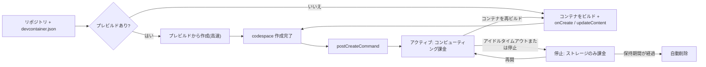

import { TLDR, DocsLinks, LastVerified, CompareTable, FlashCards } from '@components';
import { Aside, Tabs, TabItem, LinkCard, CardGrid, Code } from '@astrojs/starlight/components';

export const devcontainer = `{
  "name": "my-service",
  "image": "mcr.microsoft.com/devcontainers/typescript-node:22",
  "features": {
    "ghcr.io/devcontainers/features/docker-in-docker:2": {},
    "ghcr.io/devcontainers/features/azure-cli:1": {}
  },
  "hostRequirements": { "cpus": 4, "memory": "8gb" },
  "onCreateCommand": "npm ci",
  "updateContentCommand": "npm run build",
  "postCreateCommand": "npm run seed",
  "forwardPorts": [3000],
  "portsAttributes": { "3000": { "label": "web", "onAutoForward": "openPreview" } },
  "secrets": {
    "NPM_TOKEN": { "description": "Read token for the private registry" }
  },
  "customizations": {
    "vscode": {
      "extensions": ["dbaeumer.vscode-eslint", "GitHub.copilot"]
    },
    "codespaces": {
      "openFiles": ["README.md"]
    }
  }
}`;

<LastVerified date="2026-10" />

<TLDR>
- codespace は、GitHub がホストする**クラウド VM 上の Docker コンテナ**です。`.devcontainer/devcontainer.json` でコードとして構成し、ブラウザー、VS Code、JetBrains、`gh codespace` から接続します。
- マシンタイプは **2 コア / 8 GB RAM / 32 GB** から **32 コア / 128 GB / 128 GB** まで。OS は常に Linux です。
- **プレビルド**は Actions でセットアップを事前に実行しておく仕組みです。作成に 2 分以上かかるリポジトリで推奨されます。
- **課金:** コンピューティング(コア時間)とストレージ(GB 月)の 2 つです。請求先は Org の設定によって**ユーザー**か **Org** になります。無料枠があるのは個人アカウントだけです。
- **Org ポリシー:** マシンタイプ、アイドルタイムアウト、保持期間、ポートの公開範囲、1 ユーザーあたりの codespace 数を制限できます。ただし、適用されるのは **Org が支払う codespace だけ**です。
</TLDR>

## ブースでよくある質問

支払うのは開発者ですか、Org ですか?

Org がどちらにするかを選びます。

- **Org が支払う場合:** Org 課金を有効にすると、Org のリポジトリ(または Org 所有のフォーク)から、Codespaces の利用を許可されたメンバーやコラボレーターが作成した codespace は、**Org に課金され、Org の所有**になります。Org オーナーはそれらを削除できます。
- **それ以外の場合:** ユーザーの個人アカウントに課金されます。
- **無料枠(個人のみ):** GitHub Free は 120 コア時間と 15 GB 月、Pro は 180 コア時間と 20 GB 月です。Org / Enterprise プランに無料枠は**ありません**。
- **ユーザーを外した場合:** Org やリポジトリから外されたユーザーの codespace は**自動削除**されます。

マシンサイズ、アイドルタイムアウト、保持期間を強制できますか?

できます。Org レベルの **Codespaces ポリシー**を使い、必要に応じて特定のリポジトリだけを対象にします。

- **ポリシーの組み合わせ方:**
  - マシンタイプ: Org 全体のポリシーが許可範囲の上限になり、リポジトリのポリシーはそれを絞り込むことしかできません。
  - タイムアウトと保持期間: 複数のポリシーが該当する場合は**最も短い値**が適用されます。
- **既定値:** アイドルタイムアウトは **30 分**(ユーザーは 5〜240 分で設定可)、保持期間は **30 日**(最大 30 日)です。
- **最大稼働時間:** アイドル設定にかかわらず、codespace は**最大 12 時間**で停止します。
- **注意点:** ユーザーが自分で支払う codespace にはポリシーが**適用されません**。

IP 許可リストや EMU と併用できますか?

- **IP 許可リスト:** Org に IP 許可リストを設定すると、*「Org が所有するリポジトリでは GitHub Codespaces を使用できなくなる」*とドキュメントに明記されています。Codespaces 専用の許可リストはありません。
- **EMU:** **マネージドユーザーアカウントが所有するリポジトリ**(EMU ユーザーの個人リポジトリ)では、Codespaces を使えません。Org 所有のリポジトリは別の扱いなので、Enterprise の設定を確認してください。

GPU マシンは使えますか?

現在の Codespaces のドキュメントには CPU のマシンタイプ(2〜32 コア)しか記載されていないので、GPU の codespace は**利用できない**と考えてください。

- **GPU を使う CI / ML:** Actions の **GPU larger runner** を使います。
- **対話的な GPU 作業:** 自前のクラウド VM と dev container を組み合わせます。

シークレットはどう扱われますか?

**Codespaces シークレット**は Actions や Dependabot のシークレットとは別物で、実行時に**環境変数**として注入されます。

- **3 つのレベル:**
  - **ユーザー:** 使えるリポジトリを自分で選びます。
  - **リポジトリ:** 最大 **100** 個。
  - **Org:** 最大 **100** 個。どのリポジトリで使えるかをポリシーで指定します(すべて / プライベートのみ / 選択したもの)。
- **サイズ:** 各 48 KB までです。
- **推奨シークレット:** `devcontainer.json` の `secrets` に記載すると、codespace の作成時にユーザーへ入力を促します。

プレビルドで `postCreateCommand` が実行されないのはなぜ?

仕様です。プレビルドで実行されるのは `onCreateCommand` と `updateContentCommand` だけで、`postCreateCommand` はユーザーが codespace を作成したときに実行されます。

- **前の 2 つに入れるもの:** 依存関係のインストールやコンパイルなど、重くキャッシュできる処理。
- **`postCreateCommand` / `postStartCommand` に入れるもの:** ユーザー固有の処理。

Codespaces とローカルの Dev Containers、どちらを使うべき?

どちらも**同じ `devcontainer.json`** の仕様を使うので、1 つの構成で両方に対応できます。

- **ローカルの Dev Containers:** コンピューティングは無料です。ただしノート PC のリソースを使い、ローカルに Docker が必要です。オフラインでも使えます。
- **Codespaces:** ローカルのセットアップは不要です。高性能なマシン、プレビルド、ブラウザーからのアクセスが使え、ポリシーと課金を一元管理できます。

詳しくは下の比較表を参照してください。

## ライフサイクル

## devcontainer.json の例

`.devcontainer/devcontainer.json` に置きます。`.devcontainer/<name>/devcontainer.json` として複数の構成を用意し、作成時に選ぶこともできます。

<Tabs>
	<TabItem label="devcontainer.json">
		<Code code={devcontainer} lang="jsonc" title=".devcontainer/devcontainer.json" />
	</TabItem>
	<TabItem label="各キーの役割">

| キー | 目的 |
|---|---|
| `image` / `build.dockerfile` | ベース環境。構成がなければ既定のユニバーサルイメージが使われます |
| `features` | 組み合わせて使えるインストール単位(Docker-in-Docker、各種クラウド CLI など) |
| `hostRequirements` | 最小マシンスペック。これより小さいマシンタイプは選択肢から消えます |
| `onCreateCommand` / `updateContentCommand` | **プレビルド**中に実行(キャッシュ可能) |
| `postCreateCommand` | 作成後、ユーザーの codespace 内で実行 |
| `forwardPorts` / `portsAttributes` | ポートの自動転送とラベル付け |
| `secrets` | ユーザーに入力を促す**推奨**シークレット |
| `customizations.vscode.extensions` | 全員にインストールする拡張機能 |

	</TabItem>
</Tabs>

## プレビルド

- **構成単位:** プレビルドは**ブランチ、リージョン、devcontainer ファイル**ごとに構成し、専用の **GitHub Actions** ワークフローでビルドされます。
- **トリガー:** push ごと(既定)、構成の変更時、スケジュールから選べます。更新の多いリポジトリでは、スケジュールか構成変更時にすると Actions の分数を節約できます。
- **コスト:** プレビルドの**ストレージ**は codespace と同様に課金され、ビルドで **Actions の分数**も消費します。
- **トークポイント:** 大規模なモノレポでも、作成時間を数分からほぼ一瞬に短縮できます。

## Org のポリシーと制御

| 制御 | 場所 | 補足 |
|---|---|---|
| Codespaces の有効化 | Org 設定 → Codespaces | 全メンバー / 選択したメンバー / プライベートリポジトリでは無効 |
| 支払者 | Org 設定 → Codespaces → Billing | Org 所有 か ユーザー所有 |
| マシンタイプ | ポリシー | Org 全体が上限。リポジトリでは絞り込みのみ |
| 最大アイドルタイムアウト | ポリシー | 該当する中で最も短い値が適用 |
| 最大保持期間 | ポリシー | codespace ごとの「Keep codespace」例外も無効になる |
| ポートの公開範囲 | ポリシー | **Public** や **Org** を禁止できる。プライベート転送は SSH に必要なため無効化不可 |
| ユーザーあたりの最大 codespace 数 | ポリシー | 常に全リポジトリに適用 |
| 支出 | 予算 | 従量課金製品なので、予算で使用を**停止**できる |

<Aside type="tip">
定番のコスト管理セット: Org 課金 + マシンタイプポリシー(例: 8 コアまで)+ 最大アイドル 30 分 + 保持期間 7 日 + Codespaces の**予算**。
</Aside>

## Codespaces とローカル Dev Containers の比較

<CompareTable
	title="dev container をどこで動かすか?"
	columns={[
		{ key: 'cs', label: 'GitHub Codespaces' },
		{ key: 'local', label: 'ローカル Dev Containers' },
	]}
	rows={[
		{ feature: 'devcontainer.json を使用', category: '構成', values: { cs: true, local: true } },
		{ feature: 'ローカルに Docker が必要', category: 'セットアップ', values: { cs: false, local: true } },
		{ feature: 'プレビルド', category: '速度', values: { cs: true, local: 'イメージキャッシュのみ' } },
		{ feature: 'マシンサイズ', category: 'ハードウェア', values: { cs: '2〜32 コア', local: '手元の PC 次第' } },
		{ feature: 'GPU', category: 'ハードウェア', values: { cs: false, local: 'ホストにあれば可' } },
		{ feature: 'オフラインで動作', category: 'アクセス', values: { cs: false, local: true } },
		{ feature: 'ブラウザー / iPad からアクセス', category: 'アクセス', values: { cs: true, local: false } },
		{ feature: 'Org による一元的なポリシー', category: 'ガバナンス', values: { cs: true, local: false } },
		{ feature: 'コスト', category: '課金', values: { cs: 'コア時間 + GB 月', local: '無料(自前のハードウェア)' } },
		{ feature: 'ソースコードの所在', category: 'セキュリティ', values: { cs: 'ノート PC には置かれない', local: 'ローカルにクローン' } },
	]}
/>

## パーソナライズ

- **dotfiles:** 自分が所有する任意のリポジトリを [Codespaces の設定](https://github.com/settings/codespaces)で選ぶと、すべての codespace にクローンされ、`install.sh` などが自動実行されます。
- **Settings Sync:** VS Code の設定、キーバインド、拡張機能を同期します。
- **個人設定:** エディター、リージョン、既定のアイドルタイムアウトや保持期間はユーザー設定で指定できます。ただし Org ポリシーがある場合はそちらが優先されます。

<FlashCards
	title="Codespaces クイズ"
	cards={[
		{ q: '既定のアイドルタイムアウトは?', a: '**30 分**。ユーザーは 5〜240 分で設定でき、Org ポリシーで上限を下げられます。' },
		{ q: '停止した codespace の既定の保持期間は?', a: '**30 日**(最大値も 30 日)' },
		{ q: 'プレビルド中に実行されるライフサイクルコマンドは?', a: '`onCreateCommand` と `updateContentCommand`' },
		{ q: 'ユーザー払いの codespace に Org ポリシーは適用される?', a: '**されない。** Org 課金のものだけ。' },
		{ q: 'Org あたりのシークレット上限は?', a: '**100** 個(各 48 KB)' },
	]}
/>

<CardGrid>
	<LinkCard title="請求とライセンス" description="予算と使用状況レポート。" href="/github-cheatsheet/ja/billing/" />
	<LinkCard title="GitHub Actions" description="プレビルドは Actions で実行。GPU ランナーも。" href="/github-cheatsheet/ja/actions/" />
</CardGrid>

<DocsLinks
	links={[
		{ label: 'GitHub Codespaces とは', href: 'https://docs.github.com/ja/codespaces/about-codespaces/what-are-codespaces' },
		{ label: '開発コンテナーの概要', href: 'https://docs.github.com/ja/codespaces/setting-up-your-project-for-codespaces/adding-a-dev-container-configuration/introduction-to-dev-containers' },
		{ label: 'プレビルドについて', href: 'https://docs.github.com/ja/codespaces/prebuilding-your-codespaces/about-github-codespaces-prebuilds' },
		{ label: 'codespace の所有者と支払者の選択', href: 'https://docs.github.com/ja/codespaces/managing-codespaces-for-your-organization/choosing-who-owns-and-pays-for-codespaces-in-your-organization' },
		{ label: 'マシンタイプへのアクセス制限', href: 'https://docs.github.com/ja/codespaces/managing-codespaces-for-your-organization/restricting-access-to-machine-types' },
		{ label: 'アイドルタイムアウト期間の制限', href: 'https://docs.github.com/ja/codespaces/managing-codespaces-for-your-organization/restricting-the-idle-timeout-period' },
		{ label: '転送ポートの公開範囲の制限', href: 'https://docs.github.com/ja/codespaces/managing-codespaces-for-your-organization/restricting-the-visibility-of-forwarded-ports' },
		{ label: '開発環境シークレットの管理', href: 'https://docs.github.com/ja/codespaces/managing-codespaces-for-your-organization/managing-development-environment-secrets-for-your-repository-or-organization' },
		{ label: 'Codespaces の課金', href: 'https://docs.github.com/ja/billing/concepts/product-billing/github-codespaces' },
	]}
/>
