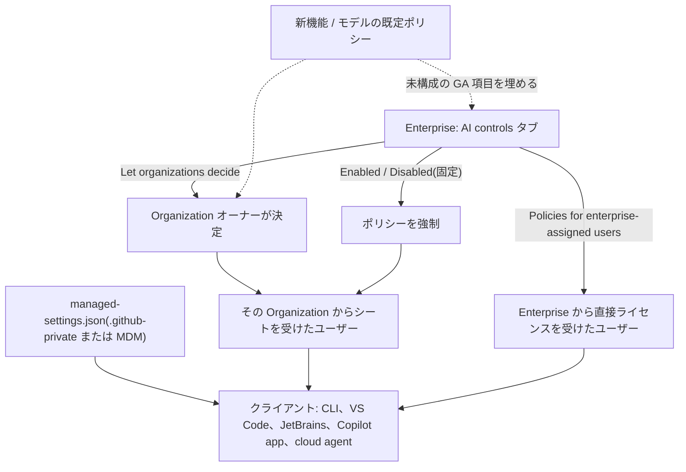
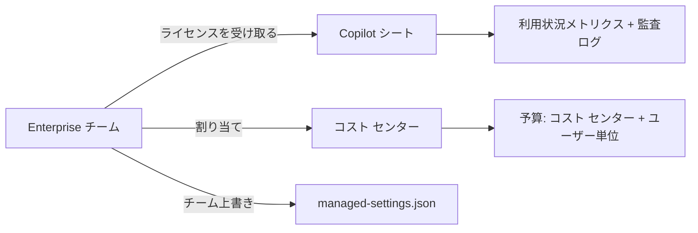

import { TLDR, DocsLinks, LastVerified, CompareTable, FlashCards } from '@components';
import { Aside, Badge, Steps } from '@astrojs/starlight/components';

<LastVerified date="2026-10" />

<TLDR>
- **ポリシー:** Copilot の機能・エージェント・モデル・MCP のポリシーは、Enterprise の **AI controls** タブと Organization の設定にまとまっています。Enterprise は Enabled / Disabled / **Let organizations decide** を選びます。cloud agent については、どの Organization に提供するかを Enterprise が個別に選べます。
- **新しいデフォルト(2026 年 10 月 22 日):** *Default policy for new features* が**未構成の GA 機能**に適用され始めます。このポリシーの既定値は**有効**なので、未構成のポリシーを今のうちに見直してください。
- **クライアントのガードレール:** `managed-settings.json` を `.github-private` リポジトリまたは MDM から配布します。既定モデル、MCP の許可 / 拒否リスト、サンドボックス、プラグインを設定でき、Enterprise チームごとに上書きもできます。
- **可視性:**
  - 監査ログは **180 日**保持され、設定・ライセンス・GitHub.com 上のエージェント活動を記録します。**プロンプトは含まれません。**
  - 利用状況メトリクスのダッシュボードと API で導入状況を把握できます。
  - OpenTelemetry でエージェントのトレースを取得できます。
- **支出:** AI クレジットの**予算**(ユーザー単位、コスト センター、Organization、Enterprise)と**コスト センター**で管理します。予算を使い切っても、安いモデルへの*自動フォールバックはありません*。
</TLDR>

## ブースでよくある質問

<details>
<summary>Enterprise と Organization でポリシーが違います。どちらが優先?</summary>

Enterprise 側の設定によって決まります。
- **Enabled または Disabled:** Enterprise の設定がすべての Organization に固定で適用されます。
- **Let organizations decide:** 各 Organization のオーナーが決めます。

**同じ Enterprise 内の複数の Organization** からシートを受けていて設定が異なる場合は、通常**最も制限の緩い**ポリシーが適用されます(例外は文書化されています)。

**異なる Enterprise** からライセンスを受けている場合は、ほぼ必ず**最も厳しい**ポリシーが適用されます。

**Enterprise から直接**ライセンスを受けたユーザーには「Let organizations decide」は適用されません。既定値は *Policies for enterprise-assigned users* 設定で決まります。

</details>

<details>
<summary>2026 年 10 月 22 日に何が起きますか?</summary>

Copilot Business / Enterprise で **Default policy for new features** が有効になります。
- 明示的に構成していない**GA** 機能(新規・既存とも)は、このポリシーの値に従います。
- ポリシー自体の既定値は**有効**です。何もしなければ、未構成の機能は**オン**になります。
- プレビュー機能には**適用されません**。
- **モデル**についての同様のポリシーは既に有効です。

ポリシー ページには、未構成のポリシー数を示すバナーが表示されます。

</details>

<details>
<summary>開発者が使える MCP サーバーを制限できますか?</summary>

はい、段階的に制限できます。

1. **MCP servers in Copilot** ポリシー。**既定で無効**で、Business / Enterprise ユーザーにだけ適用されます。Cursor や Claude などサードパーティ ホスト内の GitHub MCP サーバーは制御*しません*。
2. `managed-settings.json` の**許可リスト / 拒否リスト**(`allowedMcpServers` / `deniedMcpServers`)。GitHub が**推奨する GA の方法**です。クライアントは次の順にルールを評価します。
   1. 組み込みサーバーは常に許可されます。
   2. 拒否リストに一致したらブロックされます。
   3. 許可リストがある場合は、それに一致する必要があります。
   4. URL やコマンドに未解決の変数を含むサーバーはブロックされます。
   5. JSON が不正な場合は、組み込みサーバー以外がすべてブロックされます。
3. **カスタム MCP レジストリ** <Badge text="プレビュー" variant="caution" />。GitHub はこれを、アクセス制限の推奨方法では*ない*としています。

</details>

<details>
<summary>開発者が送ったプロンプトを見られますか?</summary>

<strong>監査ログでは見られません。</strong>監査ログが記録するのは、プラン・ポリシー・ライセンスの変更と GitHub.com 上のエージェント活動です。ローカルの CLI プロンプトのようなクライアントのセッション データは含まれません。

選択肢:
- クライアントからの **OpenTelemetry** エクスポート。プロンプト、応答、ツール引数は**既定でオフ**で、管理者がキャプチャ クラスごとに有効化します。
- **フック**。たとえば `userPromptSubmitted` で自社のログ基盤にイベントを送ります。

cloud agent の**セッション ログ**は、リポジトリにアクセスできる人なら GitHub.com で見られます。

</details>

<details>
<summary>コンテンツ除外で、エージェント モードから secrets フォルダーを守れますか?</summary>

<strong>確実には守れません。</strong>GitHub のドキュメントには、コンテンツ除外は VS Code などのエディターの Copilot Chat の **Edit モードと Agent モードでは非対応**と明記されています。

**Copilot CLI** についてはドキュメントの記述が食い違っています。
- How-to ページは CLI は非対応としています。
- 概念ページの表は CLI のチャット対応を示しています。

説明する前に確認してください。シンボリック リンクやリモート ファイル システムにも適用されず、IDE が提供するセマンティック情報(型やホバー)からは内容が漏れる可能性があります。

シークレットには本物の制御を使います。
- そもそもコミットしない。
- シークレット スキャンとプッシュ保護。
- リポジトリ権限。

</details>

<details>
<summary>Copilot の支出に上限をかけるには?</summary>

- **ユーザー単位の予算(ULB):** Enterprise 共通の既定値、コスト センターの既定値、ユーザーごとの上書き(`expires_at` で期限も設定可能)。ULB は**ハード ストップ**で、**$0 の ULB は即座にブロック**します。
- **コスト センター予算**は、プールされたクレジットを使い切った後の*従量課金*分に上限をかけます。
- **AI credits paid usage** ポリシーを無効にして、超過利用を完全に止めることもできます。
- 予算を使い切っても、安いモデルへの**自動フォールバックはありません**。

プランごとの付与量は [Copilot 概要](/github-cheatsheet/ja/copilot/)を参照してください。

</details>

<details>
<summary>導入状況と効果はどう測りますか?</summary>

使えるツール:
- **Copilot 利用状況メトリクス ダッシュボード**(28 日間の傾向)
- **コード生成ダッシュボード**
- **Copilot impact ダッシュボード**(導入コホート → PR アウトプット)
- **利用状況メトリクス REST API** と NDJSON エクスポート

注意点:
- メトリクスには **IDE のテレメトリ有効化**が必要です。
- GitHub.com の Copilot Chat と GitHub Mobile は含まれません。
- シート情報の正は**ユーザー管理 API** です。
- 1 つの Organization だけを見せたい場合は、*View organization Copilot metrics* 権限を持つ Organization カスタム ロールを作ります。

</details>

<details>
<summary>コーディング エージェントをパイロット グループだけに有効化できますか?</summary>

できます。
- Enterprise レベルでは、cloud agent のポリシーで**特定の Organization を選択**できます。
- リポジトリ管理者はリポジトリ単位で cloud agent を無効にできます。
- 一部のポリシーでは、シートの支払元にかかわらず、Enterprise のリポジトリで**全ユーザー**の cloud agent をブロックできます。
- さらに細かく絞るなら、**Enterprise チーム**でライセンスを割り当て、マネージド設定のチーム上書きを使います。

</details>

## ポリシーの継承



<Aside type="tip">
1 つの Enterprise 内の**複数ライセンス** → 通常は最も緩い設定。**Enterprise をまたぐ**場合 → ほぼ必ず最も厳しい設定。例外は *Feature availability when policies conflict* リファレンスに載っています。
</Aside>

## AI controls タブのポリシー領域

| サイドバーの領域 | 制御できる内容 | 備考 |
|---|---|---|
| **Agents** | Copilot cloud agent、サードパーティ エージェント <Badge text="プレビュー" variant="caution" />、エージェント アプリ <Badge text="プレビュー" variant="caution" /> | cloud agent は**選択した Organization**に付与できる |
| **Copilot**(管理、プライバシー、モデル、課金、利用状況) | モデルの可用性、*Suggestions matching public code*、AI credits paid usage、利用状況メトリクス、セッションのクラウド保存 | Copilot Business では *Suggestions matching public code* の既定値は **Allowed** |
| **Copilot → Features & clients** | IDE、GitHub.com、CLI、Copilot app の Copilot、プレビュー機能 | **CLI と Copilot app は別々のクライアント ポリシー** |
| **MCP** | *MCP servers in Copilot*、レジストリ URL、*Restrict MCP access to registry servers* | 既定でオフ |
| **Content exclusion** | Copilot が無視するパスやリポジトリ | Business / Enterprise のみ |

ポリシーを変更できるのは次の人です。
- **Enterprise:** オーナー、または *Manage enterprise AI controls* カスタム ロール権限を持つユーザー。
- **Organization:** オーナー、または細分化されたカスタム権限を持つユーザー。

設定のドリフトは監査ログで監視してください。

## Enterprise マネージド設定(クライアントのガードレール)

`managed-settings.json` は Copilot の**クライアント**(Copilot CLI、VS Code、Copilot app、Copilot cloud agent、JetBrains IDE)を一元的に構成します。すべてのクライアントがすべてのキーに対応しているわけではありません。

```text
.github-private/            # selected as the enterprise's source of client governance
└── copilot/
    ├── managed-settings.json   # { "model": { "overridable": "auto" }, "allowedMcpServers": [...] }
    ├── team-mappings.json      # { "no-auto.json": ["special-team"] }
    └── teams/
        └── no-auto.json        # { "model": "unmanaged" }
```

- **配布方法:** `.github-private` からの*サーバー管理*(推奨: 内部公開にして、編集は管理者に限定)、**MDM**、またはローカル ファイル。複数のレイヤーがある場合は*すべて*適用され、どこかのレイヤーの拒否が優先されます。
- **ドキュメントにある用途:**
  - 新しいチャットを **Auto** で開始する。
  - エージェントの機密性の高い操作をブロックする。
  - サンドボックス実行を必須にする。
  - 承認済みプラグインをインストールする。
  - MCP の許可 / 拒否リストを設定する。
  - OpenTelemetry を構成する。
- **フェイルセーフ:** クライアントがポリシーを取得できない場合は、前回適用したポリシーを維持します。ポリシーが厳しくなることはあっても、緩くなることはありません。

## シートと展開

<Steps>

1. <strong>ライセンスの割り当て元を決めます。</strong>Organization レベルの割り当て(ユーザーまたは Organization チーム)か、Copilot Business ライセンスを直接受け取れて複数の Organization にまたがれる **Enterprise チーム**です。
2. <strong>ガバナンスのベースラインを設定します。</strong>2026 年 10 月 22 日より前にすべてのポリシーを明示的に構成し、何も黙って変わらないようにします。パブリック コード一致と MCP ポリシーも設定します。
3. **マネージド設定を配布します。**`.github-private/copilot/managed-settings.json` に MCP 許可リスト、既定モデル、Enterprise チームごとの上書きを書きます。
4. <strong>支出を配分します。</strong>Organization、リポジトリ、ユーザー、**Enterprise チーム**を**コスト センター**に割り当て(チーム メンバーシップは自動同期)、ユーザー単位とコスト センターの予算を追加します。
5. <strong>cloud agent をパイロットします。</strong>選択した Organization に付与し、`copilot-setup-steps.yml` 用の Organization 既定ランナー種別を設定します。
6. <strong>測定して改善します。</strong>利用状況メトリクスのダッシュボードと API を使い、監査ログを SIEM にストリーミングします。

</Steps>



<Aside type="note">
**監査のヒント:** `action:copilot.cfb_seat_assignment_created` で新しいシート割り当てを検索できます。*チーム経由*の割り当てでは、`copilot.cfb_seat_added` の actor がチーム メンバーシップを変更した本人でない場合があります。
</Aside>

## コンテンツ除外

| 場所 | インライン提案 | Chat / エージェント |
|---|---|---|
| VS Code | ✅ | Chat ✅・**Edit ❌・Agent ❌** |
| Visual Studio、JetBrains | ✅ | ✅(How-to の注記によれば IDE の Agent モードは ❌) |
| Xcode | ✅ | ❌ |
| Eclipse | ✅ | ✅ |
| GitHub.com、GitHub Mobile | 該当なし | ✅ <Badge text="プレビュー" variant="caution" /> |
| Copilot code review(GitHub.com) | 該当なし | ✅ 除外ファイルはレビューされない |
| Copilot CLI | 該当なし | ⚠️ ドキュメントの記述が食い違うため要確認 |

- **設定できる人:**
  - リポジトリ管理者: 自分のリポジトリ。そのリポジトリで作業する Enterprise 内のすべての Copilot ユーザーに影響します。
  - Organization オーナー: その Organization からシートを受けたユーザー。
  - Enterprise オーナー。
- **制限事項:**
  - IDE のセマンティック情報を通じて、除外したデータが間接的に使われることがあります。
  - シンボリック リンクやリモート ファイル システムは対象外です。
  - cloud agent は対応表に載っていないため、約束しないでください。
- **プライバシー:** クライアントはポリシー取得のためにリポジトリ URL を送信しますが、この URL は記録されません。

## 監査、メトリクス、テレメトリ

<CompareTable
	title="どの可視化ツールがどの質問に答えるか"
	columns={[
		{ key: 'audit', label: '監査ログ' },
		{ key: 'metrics', label: '利用状況メトリクス' },
		{ key: 'otel', label: 'OpenTelemetry' },
		{ key: 'session', label: 'エージェント セッション ログ' },
	]}
	rows={[
		{ feature: 'ポリシー / 設定の変更', values: { audit: true, metrics: false, otel: false, session: false } },
		{ feature: 'ライセンスの付与 / 削除', values: { audit: true, metrics: false, otel: false, session: false } },
		{ feature: 'GitHub.com 上の cloud agent の活動', values: { audit: '`actor:Copilot`', metrics: 'PR メトリクス', otel: false, session: true } },
		{ feature: '導入状況(DAU、機能、言語、モデル)', values: { audit: false, metrics: true, otel: '一部', session: false } },
		{ feature: 'プロンプト / 応答', values: { audit: false, metrics: false, otel: 'オプトインのキャプチャ クラス', session: 'cloud agent のみ' } },
		{ feature: '保持期間', values: { audit: '180 日(SIEM へストリーム)', metrics: 'API で最大 1 年', otel: '自社バックエンド', session: 'GitHub.com 上' } },
	]}
/>

- **監査ログのストリーミング**先: S3、Azure Blob、Azure Event Hubs、Datadog、GCS、Splunk、Microsoft Purview(Copilot のエージェント セッション イベントのみ)。**エージェント セッション活動**のストリーミングと複数エンドポイントへの同時ストリーミングは <Badge text="プレビュー" variant="caution" /> です。
- **利用状況メトリクス API:** `/enterprises/{enterprise}/copilot/metrics/reports/...` を使うには *Copilot usage metrics* ポリシーが必要です。データは Enterprise レベルが **2025 年 10 月 10 日**から、Organization レベルが **2025 年 12 月 12 日**からです。
- メトリクスには**最低 IDE バージョン**があります。例: VS Code 1.107.1 と Copilot Chat 0.35.3。

## 注意点

- Business / Enterprise のシートを受けると、ユーザーの**個人プランは解約**されます。そのため、個人と組織のポリシーが衝突することはありません。
- **Copilot Enterprise は GitHub Enterprise Cloud 専用**です。GitHub Enterprise Server 自体では Copilot は使えません。
- **EMU** ユーザーは code review の自動設定を使えません。
- サードパーティ エージェントとエージェント アプリはプレビューで、それぞれ専用のポリシーがあります。
- 利用数はダッシュボード、API、課金の間で一致しないことがあります。理由は GitHub が文書化しているので、完全な一致は約束しないでください。

<FlashCards
	title="管理クイズ"
	cards={[
		{ q: 'Enterprise の Copilot ポリシーはどこにある?', a: 'Enterprise → **AI controls** タブ(Agents、Copilot、Features & clients、MCP)。' },
		{ q: '同じ Enterprise の 2 つの Organization で設定が違う — どちらが適用?', a: '通常は**最も緩い**設定。Enterprise をまたぐ場合は最も厳しい設定。' },
		{ q: '2026 年 10 月 22 日に何が変わる?', a: '*Default policy for new features* が未構成の GA 機能に適用される(既定は有効)。' },
		{ q: 'MCP サーバーを許可リスト化する GA の方法は?', a: '`managed-settings.json` の `allowedMcpServers` / `deniedMcpServers`。' },
		{ q: '監査ログの保持期間は?', a: '180 日。それ以上は SIEM にストリーミング。' },
		{ q: '監査ログにプロンプトは含まれる?', a: '含まれない。OTel(オプトインのプロンプト キャプチャ)かフックを使う。' },
		{ q: '$0 のユーザー単位予算の効果は?', a: 'ユーザーが即座にブロックされる(ハード ストップ)。' },
		{ q: 'IDE のエージェント モードでコンテンツ除外は効く?', a: '非対応。' },
	]}
/>

<DocsLinks
	links={[
		{ label: 'Enterprise と Organization の Copilot ポリシー', href: 'https://docs.github.com/ja/copilot/concepts/enterprise/policies' },
		{ label: 'Enterprise のポリシーを管理する', href: 'https://docs.github.com/ja/copilot/how-tos/administer-copilot/manage-for-enterprise/manage-enterprise-policies' },
		{ label: '機能とモデルのデフォルトの可用性', href: 'https://docs.github.com/ja/copilot/concepts/enterprise/default-availability' },
		{ label: 'Enterprise マネージド設定の概要', href: 'https://docs.github.com/ja/copilot/how-tos/administer-copilot/manage-for-enterprise/use-managed-settings/get-started' },
		{ label: 'Enterprise の MCP 許可リストを構成する', href: 'https://docs.github.com/ja/copilot/how-tos/administer-copilot/manage-mcp-usage/configure-enterprise-allowlist' },
		{ label: 'コンテンツ除外', href: 'https://docs.github.com/ja/copilot/concepts/security-governance-and-network-settings/content-exclusion' },
		{ label: 'Copilot の監査ログを確認する', href: 'https://docs.github.com/ja/copilot/how-tos/administer-copilot/manage-for-enterprise/review-audit-logs' },
		{ label: 'Copilot 利用状況メトリクス', href: 'https://docs.github.com/ja/copilot/concepts/billing-and-usage/copilot-usage-metrics/copilot-metrics' },
		{ label: 'エージェント監視のための OpenTelemetry', href: 'https://docs.github.com/ja/copilot/concepts/enterprise/opentelemetry' },
		{ label: 'AI クレジットの予算', href: 'https://docs.github.com/ja/copilot/concepts/billing-and-usage/organizations-and-enterprises/budgets' },
		{ label: 'コスト センター', href: 'https://docs.github.com/ja/billing/concepts/cost-centers' },
	]}
/>
