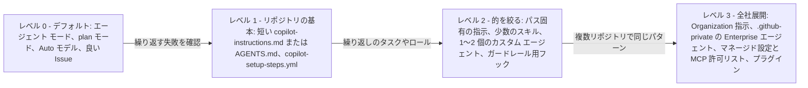

import { TLDR, DocsLinks, LastVerified, DecisionTree, FlashCards } from '@components';
import { Aside, Badge } from '@astrojs/starlight/components';

<LastVerified date="2026-10" />

<TLDR>
- **まずは何もしない。** エージェント モード、cloud agent、CLI はリポジトリのコンテキストを自分で見つけます。GitHub 自身も<em>「問題を解決できる最小のカスタマイズから始める」</em>よう勧めています。
- **カスタマイズは、同じ失敗が繰り返されるのを確認してから**追加し、問題に合った手段を選びます。
  - リポジトリの事実を間違える → 短い**指示**
  - 繰り返し発生する手順 → **スキル**
  - 別のロールやツール制限が必要 → **カスタム エージェント**
  - 必ず守らせたいルール → **フック**または CI
  - エージェントが届かないシステム → **MCP**
- **アンチパターン:**
  - 肥大化した指示ファイル
  - コードを見れば分かることの再記述
  - 大量の MCP ツール
  - 矛盾する指示
  - リンターの仕事を指示にやらせること
- **プロンプト エンジニアリングよりコンテキスト エンジニアリング:** まず計画、タスクは小さく、受け入れ基準を明記、テストをフィードバック ループに、モデルは **Auto** を既定に、そしてすべてレビューします。
</TLDR>

<Aside type="note" title="このページの読み方">
<Badge text="ドキュメント記載" variant="success" /> = GitHub Docs に記載(リンクあり)。<Badge text="現場の見解" variant="note" /> = 実務経験に基づく推奨で、GitHub の公式見解ではありません。お客様に話すときは、どちらを引用しているかを明示してください。
</Aside>

## ブースでよくある質問

Copilot のカスタマイズはまだ何もしていません。どこから始めればいいですか?

ファイルを書くことから始めないでください。まず 1〜2 スプリントはデフォルトのまま使います。
- エージェント モード、plan モード、Auto モデル選択。
- cloud agent にはよく書かれた Issue。

そのうえで:
1. <strong>繰り返し起きる失敗を書き留めます。</strong>例:「`make proto` を実行しない」「pnpm ではなく npm を使う」。
2. 最も多い失敗を、ビルド / テスト コマンドと分かりにくいルールだけを書いた**短い** `.github/copilot-instructions.md` で解消します。

このファイルは cloud agent に下書きさせることもできます。GitHub 自身の生成用プロンプトは長さを **2 ページ**に制限しています。<Badge text="ドキュメント記載" variant="success" />

大きく詳細な指示ファイルのほうが良いのでは? コンテキストは多いほど良い?

いいえ。指示は**常時適用**なので、すべての行がすべてのリクエストで本来のタスクとモデルの注意を奪い合います。
- GitHub は、指示が「目の前のタスクから注意をそらすほど詳細」なら最小限にし、専門的なガイダンスはスキルやカスタム エージェントに移すよう述べています。<Badge text="ドキュメント記載" variant="success" />
- GitHub のサンプル生成プロンプトは指示を 2 ページに制限しています。code review については約 1,000 行以下を推奨しています。<Badge text="ドキュメント記載" variant="success" />
- 経験上、コマンドと分かりにくいルールだけの 50〜150 行のファイルは、1,000 行のスタイル ガイドより良い結果を出します。<Badge text="現場の見解" variant="note" />

プロンプト ファイルとスキル、どちらに投資すべきですか?

**新規ならスキルを既定にしましょう。**<Badge text="現場の見解" variant="note" />

どちらも繰り返し行うタスクを表現しますが、届く範囲とトリガー方法が違います。<Badge text="ドキュメント記載" variant="success" />

| | スキル | プロンプト ファイル |
|---|---|---|
| トリガー | 関連するときに Copilot が自動で読み込む | ユーザーが明示的に呼び出す |
| 動作する場所 | cloud agent、code review、CLI、Copilot app、IDE のエージェント モード | IDE のみ(VS Code、Visual Studio。JetBrains と Xcode はプレビュー) |
| 同梱できるもの | スクリプトやテンプレート | プロンプト本体のみ |
| 移植性 | オープン標準 | GitHub のドキュメントに記載なし |

プロンプト ファイルは、「X という名前のフォームを作る」のような、**人が起動する IDE 専用の入力付きテンプレート**に使い続けましょう。

カスタム エージェントはいつ作る価値がありますか?

**ツールセットやモデルが異なる別ロール**が必要なときです。例:
- `tools: ["read","search"]` の読み取り専用プランナー
- 編集できないセキュリティ レビュアー
- 自社基準に従うドキュメント ライター

GitHub 自身のガイダンスでは、「タスク固有の指示だけが必要」ならスキル、「デフォルトのエージェントで十分」ならもっとシンプルな方法を選ぶよう述べています。<Badge text="ドキュメント記載" variant="success" />

VS Code では `handoffs` で計画 → 実装 → レビューのようにエージェントを連携できます。cloud agent は `handoffs` を無視します。<Badge text="ドキュメント記載" variant="success" />

エージェントに X を絶対にさせないにはどうすれば?

指示に頼らないでください。GitHub も、指示は「すべてのルールに従うことを保証しない」と述べています。<Badge text="ドキュメント記載" variant="success" />

代わりに**決定的な**制御を使います。
- ツール呼び出しを拒否する `preToolUse` **フック**
- ルールセットとブランチ保護
- 必須の CI チェック
- Enterprise の `managed-settings.json`(例: MCP 許可リストやサンドボックスの強制)

社内システムを全部 MCP でつなぐべきですか?

つなぐのは、エージェントが**まだ届かない**システムだけにしましょう。GitHub は、組み込みツールで足りるなら MCP サーバーを追加しないこと、そして cloud agent は確認なしでツールを使うので特定の読み取り専用ツールだけを許可リストに入れることを勧めています。<Badge text="ドキュメント記載" variant="success" />

ツールのスキーマはどれもコンテキストを消費し、ツールが多いとモデルが誤ったツールを選びやすくなります。タスクに必要なツールだけを有効にしてください。たとえばカスタム エージェントごとに `tools: ["jira/get_issue"]` のように絞ります。<Badge text="現場の見解" variant="note" />

モデルは開発者が手動で選ぶべき? Auto を使うべき?

既定は **Auto** です。
- VS Code、CLI、JetBrains、GitHub.com、Copilot app で GA です。
- タスクの複雑さと可用性に応じてリクエストごとにルーティングします。
- 有料プランでは Auto 利用時にモデル コストが **10% 割引**されます。<Badge text="ドキュメント記載" variant="success" />
- Enterprise はマネージド設定で `"model": "auto"` を既定にできます。<Badge text="ドキュメント記載" variant="success" />

再現性が必要なとき、特定の能力が必要なとき、範囲の狭いカスタム エージェントに安価で高速なモデルを使いたいときは、**モデルを固定**します。<Badge text="現場の見解" variant="note" />

cloud agent の PR の当たり外れが大きいです。一番効く対策は?

1. <strong>Issue の質を上げます。</strong>明確な問題記述、**完全な受け入れ基準**(例:「ユニット テストは必要か?」)、変更すべきファイルのヒントを書きます。<Badge text="ドキュメント記載" variant="success" />
2. **エージェントがビルドとテストを実行できるようにします。**`copilot-setup-steps.yml` で環境を整えます。GitHub によれば、Copilot が自分の環境で変更をビルド・テスト・検証できると、すぐにマージできる PR を作りやすくなります。<Badge text="ドキュメント記載" variant="success" />

## 2026 年の原則: 設定は少なく、フィードバック ループは強く

エージェント ハーネス(IDE のエージェント モード、Copilot cloud agent、Copilot CLI)は、今ではコンテキスト集めの多くを自分で行います。
- コードベースを検索します。cloud agent は**セマンティック コード検索**も使います。
- ファイルを読み、コマンドを実行します。
- 別コンテキストのサブエージェントに作業を委任します。
- スキルは関連するときだけ読み込みます。

GitHub のベスト プラクティス ページにも、ファイル パスを指定しなくても<em>「エージェントは多くの場合、正しいコードを自分で見つけられる」</em>とあります。<Badge text="ドキュメント記載" variant="success" />

そのため、チームの効果の大半はプロンプトの文章量ではなく、次の要素から生まれます。<Badge text="現場の見解" variant="note" />
1. **明確なタスク:** スコープと受け入れ基準。
2. **動く環境:** エージェントがインストール、ビルド、テストできること。
3. **速く信頼できるフィードバック:** エージェントが実行できるテスト、リンター、CI。
4. **少数の的を絞ったカスタマイズ:** 観察した失敗への対応として追加するもの。

## カスタム エージェント、スキル、プロンプト、指示のどれを作る? それとも何もしない?

<DecisionTree
	title="適切なカスタマイズを選ぶ(または何もしない)"
	tree={{
		start: 'q1',
		nodes: {
			q1: {
				question: '**実際に(2 回以上)観察した**問題はどれですか?',
				help: 'まだ繰り返し起きる失敗を挙げられないなら、最後の選択肢を選んでください。',
				options: [
					{ label: 'リポジトリの事実(ビルド / テスト コマンド、規約、構成)を間違える', next: 'qFacts' },
					{ label: '特定の繰り返しタスクの品質がばらつく', next: 'qTask' },
					{ label: '別のロール、ツール制限、別のモデルが欲しい', next: 'qRole' },
					{ label: '必ず守らせたいルールがある(フォーマット、禁止コマンド、ポリシー)', next: 'hook' },
					{ label: 'エージェントが外部システムのデータや操作を必要とする', next: 'qMcp' },
					{ label: '特にない — これから始めるところ', next: 'nothing' },
				],
			},
			qFacts: {
				question: '新しく参加したメンバーが、コード、README、設定ファイルから **1 分以内**に見つけられる事実ですか?',
				options: [
					{ label: 'はい — リポジトリを見れば明らか', next: 'discoverable' },
					{ label: 'いいえ — 暗黙知、または分かりにくい', next: 'qScope' },
				],
			},
			qScope: {
				question: '**リポジトリ全体**に当てはまりますか? それとも特定のパスやファイル種別だけですか?',
				options: [
					{ label: 'リポジトリ全体', next: 'instrRepo' },
					{ label: '特定のパス / ファイル種別 / サブプロジェクト', next: 'instrPath' },
				],
			},
			qTask: {
				question: '誰が起動し、どこで動く必要がありますか?',
				options: [
					{ label: 'Copilot が自動で拾うべき(cloud agent、CLI、code review でも)', next: 'skill' },
					{ label: 'スクリプトやテンプレートの同梱が必要', next: 'skill' },
					{ label: '開発者が IDE のチャットから毎回違う入力で明示的に実行する', next: 'prompt' },
				],
			},
			qRole: {
				question: '**異なるツールセットやモデル**が必要ですか? それとも特定のタスク用の指示だけで足りますか?',
				options: [
					{ label: '選択または委任する、別ツール / 別モデル / 別ペルソナが必要', next: 'agent' },
					{ label: 'タスク固有の指示だけで十分', next: 'skill' },
					{ label: '正直、デフォルトのエージェントで十分できている', next: 'nothing' },
				],
			},
			qMcp: {
				question: 'エージェントは**組み込みツール**(シェル、`gh` CLI、ファイル、デフォルトの GitHub MCP サーバー)で既にそこへ届きますか?',
				options: [
					{ label: 'はい', next: 'builtin' },
					{ label: 'いいえ — 新しい連携が必要', next: 'mcp' },
				],
			},
			nothing: {
				answer: '**(今は)何もしない。** エージェント モード / cloud agent / CLI を **Auto** モデル選択で使い、複雑な作業は **plan モード**から始め、受け入れ基準付きの Issue を書きます。繰り返し起きる失敗を記録し、パターンが見えたときだけカスタマイズします。',
				links: [
					{ label: 'Copilot cloud agent のベスト プラクティス', href: 'https://docs.github.com/ja/copilot/tutorials/cloud-agent/get-the-best-results' },
					{ label: 'IDE の plan モード', href: 'https://docs.github.com/ja/copilot/how-tos/copilot-in-your-ide/use-copilot-agents/use-plan-mode' },
				],
			},
			discoverable: {
				answer: '**書かないでください。** エージェントは自分で見つけますし、重複した事実は古くなり、毎回のリクエストでコンテキストを消費します。それでも同じ間違いが続く場合だけ、`copilot-instructions.md` に**1 行**のポインター(例:「Build: `make ci`」)を追加します。',
			},
			instrRepo: {
				answer: '**`.github/copilot-instructions.md`** に追加します(他のエージェントも使うなら `AGENTS.md`)。ファイル全体を短く保ち、コマンド、分かりにくい制約、どこに何があるかだけを書きます。GitHub の生成プロンプトは 2 ページが上限です。',
				links: [{ label: 'リポジトリの指示を追加する', href: 'https://docs.github.com/ja/copilot/how-tos/copilot-on-github/customize-copilot/add-custom-instructions/add-repository-instructions' }],
			},
			instrPath: {
				answer: '**パス固有**のファイル `.github/instructions/NAME.instructions.md`(`applyTo: "glob"`)か、そのサブフォルダーに置く入れ子の **`AGENTS.md`**(最も近いものが優先)を使います。該当ファイルを扱うときだけ読み込まれます。',
				links: [{ label: 'パス固有の指示', href: 'https://docs.github.com/ja/copilot/how-tos/copilot-on-github/customize-copilot/add-custom-instructions/add-repository-instructions' }],
			},
			skill: {
				answer: '**エージェント スキル**を作ります。`.github/skills/<name>/SKILL.md` に正確な `description`(これが読み込みのきっかけになります)と、必要なスクリプトやテンプレートを置きます。cloud agent、code review、CLI、IDE のエージェント モードで動き、必要になるまでコンテキストに入りません。',
				links: [{ label: 'エージェント スキルの追加', href: 'https://docs.github.com/ja/copilot/how-tos/copilot-on-github/customize-copilot/customize-cloud-agent/add-skills' }],
			},
			prompt: {
				answer: '明示的に起動する IDE 専用の入力付きテンプレートなら、**プロンプト ファイル**(`.github/prompts/NAME.prompt.md`)で十分です。後でエージェントに自動で適用させたい場合や、クラウドで使いたい場合はスキルに変換します。',
				links: [{ label: 'プロンプト ファイル', href: 'https://docs.github.com/ja/copilot/concepts/prompting-and-context/prompt-files' }],
			},
			agent: {
				answer: '**カスタム エージェント**(`.github/agents/NAME.agent.md`)を作り、`tools` の許可リストを絞り、必要なら `model` を指定します。例: 読み取り専用プランナー(`["read","search"]`)や、`edit` を持たないセキュリティ レビュアー。Organization 全体のロールは `.github-private` に置きます。',
				links: [{ label: 'カスタム エージェントの構成', href: 'https://docs.github.com/ja/copilot/reference/custom-agents-configuration' }],
			},
			hook: {
				answer: '指示ではなく**フック**を使います。`preToolUse` で危険なコマンドや保護パスの編集を拒否し、`postToolUse` でフォーマッターを実行したり記録を残したりします。あわせて **CI、ルールセット**、Enterprise の**マネージド設定**でも担保します。',
				links: [{ label: 'GitHub Copilot のフック', href: 'https://docs.github.com/ja/copilot/concepts/customizations/hooks' }],
			},
			builtin: {
				answer: '**MCP は不要です。** 組み込みツールで既に届きます。エージェントがそのシステムでツールを*どう使うか*を知らないなら、手順を説明する**スキル**を書きます。',
			},
			mcp: {
				answer: '**MCP サーバー**を追加します。ただし、タスクに必要なツールだけを公開し(`tools: ["server/tool"]`)、読み取り専用を優先し、サーバーを精査してください。Enterprise では `managed-settings.json` の許可リストで管理します。',
				links: [
					{ label: 'cloud agent の MCP を構成する', href: 'https://docs.github.com/ja/copilot/how-tos/copilot-on-github/customize-copilot/configure-mcp-servers' },
					{ label: 'Enterprise の MCP 許可リスト', href: 'https://docs.github.com/ja/copilot/how-tos/administer-copilot/manage-mcp-usage/configure-enterprise-allowlist' },
				],
			},
		},
	}}
/>

## 今でもカスタマイズする価値があるもの

| 仕組み | 向いている用途 | 向いていない用途 | 出典 |
|---|---|---|---|
| **リポジトリ指示**(`copilot-instructions.md` / `AGENTS.md`) | ビルド / テスト / lint コマンド、分かりにくい制約、どこに何があるか、「Y の前に必ず X を実行」 | リンターが強制するスタイル ガイド、アーキテクチャ論、コードから明らかな事実 | <Badge text="ドキュメント記載" variant="success" /> GitHub の例と生成プロンプト |
| **パス固有の指示** | 特定領域(テスト、マイグレーション、サブプロジェクト)のルール | リポジトリ全体のルール | <Badge text="ドキュメント記載" variant="success" /> |
| **スキル** | スクリプトやテンプレートを伴う繰り返しの多段手順: リリース ノート、Actions の失敗調査、デプロイ手順 | 常に当てはまる広いルール | <Badge text="ドキュメント記載" variant="success" /> カスタマイズ機能の比較 |
| **カスタム エージェント** | **ツールを制限**したロールや特定モデルのロール(プランナー、レビュアー、ドキュメント)、VS Code の handoffs | デフォルトのエージェントで十分なこと | <Badge text="ドキュメント記載" variant="success" /> |
| **プロンプト ファイル** | 人が明示的に起動する入力付きの IDE テンプレート | cloud agent や CLI で使う必要があるもの | <Badge text="ドキュメント記載" variant="success" /> 対応表・<Badge text="現場の見解" variant="note" /> スキルより優先度は低い |
| **フック** | 保証された動作: コマンド拒否、パス保護、自動フォーマット、監査ログ | ゆるい好み | <Badge text="ドキュメント記載" variant="success" /> |
| **MCP** | 組み込みツールで届かないシステム(チケット管理、監視、社内 API) | `gh`、シェル、GitHub MCP サーバーで既にできることの再ラップ | <Badge text="ドキュメント記載" variant="success" /> |

## アンチパターン

| アンチパターン | 害 | 代わりに |
|---|---|---|
| **肥大化した指示ファイル** | 常時適用のテキストが*すべての*リクエストでタスクの邪魔をする <Badge text="ドキュメント記載" variant="success" /> | 2 ページ以内にし、手順はスキルへ移す |
| **見れば分かることの再記述** | コンテキストを浪費し、古くなる。エージェントはどうせコードを検索する <Badge text="現場の見解" variant="note" /> | 分かりにくい暗黙知だけを書く |
| **MCP サーバー / ツールが多すぎる** | 精査していないツールが cloud agent で自律実行される <Badge text="ドキュメント記載" variant="success" />。大きなツール リストはコンテキストを消費し、ツール選択の精度を下げる <Badge text="現場の見解" variant="note" /> | エージェントごとのツール許可リスト、読み取り専用から始める、Enterprise 許可リスト |
| **矛盾する指示**(個人 / リポジトリ / Organization、ルートと入れ子の `AGENTS.md`) | 該当する指示はすべて送られる。GitHub は矛盾を避けるよう推奨 <Badge text="ドキュメント記載" variant="success" /> | 各レイヤーにオーナーを 1 人。Organization 指示は集中レビュー |
| **指示をリンター代わりに使う** | 指示は保証されない <Badge text="ドキュメント記載" variant="success" /> | CI でリンター + フォーマッター、`postToolUse` フック |
| **サードパーティ スキルで `shell` を事前承認** | プロンプト インジェクションや悪意あるスキルにコマンド実行を許しうる <Badge text="ドキュメント記載" variant="success" /> | `gh skill preview` で確認し、バージョンを固定する |
| **何でもやる巨大なカスタム エージェント 1 つ** | ツールを制限したロールという目的が台無しになる <Badge text="現場の見解" variant="note" /> | 小さなエージェントを複数、またはデフォルト エージェント + スキル |

## コンテキスト エンジニアリングのコツ

1. <strong>まず計画。</strong>単純でない作業には **plan モード**を使います(VS Code、JetBrains、Xcode、Eclipse、CLI では <kbd>Shift</kbd>+<kbd>Tab</kbd>)。GitHub.com では、PR を開く前に cloud agent にブランチ上で調査と計画をさせます。<Badge text="ドキュメント記載" variant="success" />
2. <strong>タスクは小さく絞る。</strong>cloud agent のセッションは最大 **59 分**で、GitHub は複雑なタスクを小さく分割するよう勧めています。また、広範なリファクタリング、曖昧な作業、セキュリティや個人情報に関わる作業は人が行うほうが良い例として挙げています。<Badge text="ドキュメント記載" variant="success" />
3. <strong>Issue はプロンプト。</strong>問題記述、受け入れ基準、ファイルのヒントを含めます。<Badge text="ドキュメント記載" variant="success" />
4. **テストがフィードバック ループ。**`copilot-setup-steps.yml` で依存関係をインストールし、エージェントがテストとリンターを実行できるようにします。失敗するテスト 1 つは、指示の段落 1 つより価値があります。<Badge text="現場の見解" variant="note" />
5. **PR へのフィードバックはまとめて。**「**Start a review**」を使えば、`@copilot` がすべてのコメントにまとめて対応します。<Badge text="ドキュメント記載" variant="success" />
6. **既定は Auto、固定は意図的に。**<Badge text="ドキュメント記載" variant="success" />(Auto は GA で、有料プランでは 10% 割引。)
7. <strong>タスクごとに新しいセッション。</strong>話題が混ざった長いセッションは古いコンテキストを引きずります。新しいタスクは新しいセッションで始め、寄り道はサブエージェントに任せます。<Badge text="現場の見解" variant="note" />
8. <strong>すべてレビューする。</strong>エージェントの PR は設計上、人の承認が必要です。PR を依頼した本人は承認できず、Actions ワークフローも承認されるまで実行されません。<Badge text="ドキュメント記載" variant="success" />

## 成熟度モデル

ほとんどのチームは、レベル 0〜1 に数週間とどまるべきです。具体的な失敗の繰り返しが根拠になったときだけ次のレベルへ進み、コンテキスト コストに見合わなくなったカスタマイズは**削除**しましょう。<Badge text="現場の見解" variant="note" />

## トーキング ポイント

- 「Copilot のカスタマイズはコードと同じように扱いましょう。小さく、レビューされ、オーナーがいて、古くなったら削除する。」
- 「指示は新人が初日に必要なこと、スキルは特定の仕事をするときに必要なこと、フックは覚えていてくれると信用できないことに使います。」
- 「lint できるなら、プロンプトに書かない。」
- 「MCP はカスタマイズではなく機能拡張です。ツールが 1 つ増えるたびに攻撃面とコンテキスト コストが増えます。」

<FlashCards
	title="ベスト プラクティス クイズ"
	cards={[
		{ q: 'カスタマイズ選びに関する GitHub の一行ルールは?', a: '「問題を解決できる最小のカスタマイズから始める」' },
		{ q: '指示とフック、動作を保証するのは?', a: '**フック**(コードを実行します)。指示は「すべてのルールに従うことを保証しない」。' },
		{ q: '手順を常時適用の指示ではなくスキルにする理由は?', a: '関連するまでは名前と説明だけが参照されるのでコンテキストが小さく済み、cloud agent・CLI・code review・IDE で動くため。' },
		{ q: 'プロンプト ファイルが動かない場所は?', a: 'cloud agent / GitHub.com、Copilot CLI、Eclipse。' },
		{ q: 'MCP サーバーを追加すべきでないのは?', a: '組み込みツールで既に足りるとき。' },
		{ q: '生成されるリポジトリ指示について GitHub が示す長さの目安は?', a: '2 ページ(code review 向けは最大約 1,000 行)。' },
		{ q: '良い cloud agent 用 Issue の 3 要素は?', a: '明確な問題、完全な受け入れ基準、変更すべきファイル。' },
		{ q: 'モデル選択の既定方針は?', a: '**Auto**(GA、有料プランは 10% 割引)。固定は意図があるときだけ。' },
	]}
/>

<DocsLinks
	links={[
		{ label: 'Copilot のカスタマイズ機能の比較', href: 'https://docs.github.com/ja/copilot/concepts/customizations/comparing-customizations', description: '使うべきとき / 使うべきでないときに関する GitHub 公式のガイダンス。' },
		{ label: 'Copilot カスタマイズ チートシート', href: 'https://docs.github.com/ja/copilot/reference/customization-cheat-sheet' },
		{ label: 'Copilot cloud agent のベスト プラクティス', href: 'https://docs.github.com/ja/copilot/tutorials/cloud-agent/get-the-best-results' },
		{ label: 'plan モードを使う', href: 'https://docs.github.com/ja/copilot/how-tos/copilot-in-your-ide/use-copilot-agents/use-plan-mode' },
		{ label: 'Auto モデル選択', href: 'https://docs.github.com/ja/copilot/concepts/models/auto-model-selection' },
		{ label: 'GitHub Copilot のフック', href: 'https://docs.github.com/ja/copilot/concepts/customizations/hooks' },
		{ label: 'Copilot cloud agent のリスクと軽減策', href: 'https://docs.github.com/ja/copilot/concepts/security-governance-and-network-settings/risks-and-mitigations' },
	]}
/>
