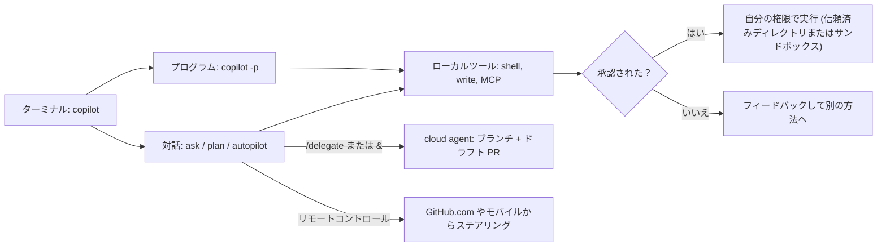
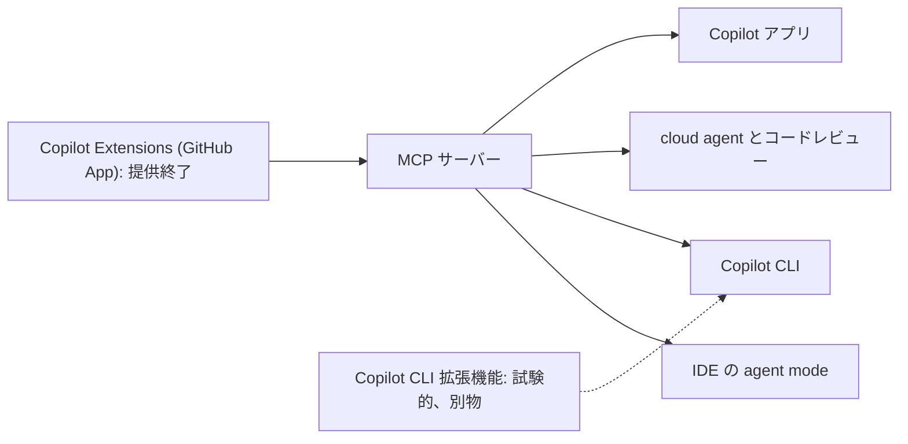

import { TLDR, DocsLinks, LastVerified, FlashCards } from '@components';
import { Aside, Badge, Tabs, TabItem, Steps } from '@astrojs/starlight/components';

<LastVerified date="2026-10" />

<TLDR>
- **Copilot CLI** はターミナルネイティブのエージェントで、**すべてのプランに含まれます**。モードは **ask/execute**、**plan** (Shift+Tab)、**autopilot** の 3 つです。
  - **プログラムからの利用:** `copilot -p "…"`。
  - **承認:** ツールの使用には承認が必要です。`--allow-tool`、`--deny-tool`、`--allow-all-tools` で緩めることができます。
  - **委任:** `/delegate` でタスクを **cloud agent** に引き渡します。
- **Copilot Spaces** は Copilot 用のコンテキスト (リポジトリ、PR、Issue、ファイル、メモ、画像) をまとめたものです。**Free を含む** Copilot ライセンスを持つ人なら誰でも作成できます。質問はチャットとして課金されます。
- 当初の GitHub App ベースの **Copilot Extensions** は**提供終了**しました。現在の拡張手段は **MCP** です。
- **GitHub MCP サーバー**には 2 つの形態があります:
  - **リモート:** `https://api.githubcopilot.com/mcp/`。GHEC のみで、GHES は非対応です。
  - **ローカル:** バイナリまたは Docker イメージ。
  - **ツールセット**と**読み取り専用**モードで、必要なものだけを公開します。
</TLDR>

## ブースでよくある質問

<details>
<summary>Copilot CLI は GA ですか？どのプランが必要ですか？</summary>

プランページには *"All plans include Copilot CLI and the Copilot app"* とあり、これには Free も含まれます。CLI 本体をプレビューと表記しているドキュメントはありません。表記が**ある**サブ機能は次のとおりです:
- **クラウドサンドボックス** <Badge text="プレビュー" variant="caution" />。
- **CLI 拡張機能** <Badge text="試験的" variant="caution" />。

CLI の利用は **AI Credits** を消費します。

CLI の GA 日を示す公式発表は見つけられなかったため、日付を案内する前に確認してください。

</details>

<details>
<summary>CI で CLI に危険なコマンドを実行させないにはどうすればよいですか？</summary>

明示的な許可／拒否ルールを付けて、プログラムから実行します。**拒否は常に許可より優先されます**:

```shell
copilot -p "Fix the lint errors" \
  --allow-tool='write' --allow-tool='shell(npm)' \
  --deny-tool='shell(rm)' --deny-tool='shell(git push)'
```

さらに隔離するには:
- `/sandbox enable` で**ローカルサンドボックス**を有効にする。
- `copilot --cloud` で**クラウドサンドボックス**を使う <Badge text="プレビュー" variant="caution" />。
- コンテナーや VM の中で実行する。

`--allow-all-tools`、`/allow-all`、`/yolo` には注意してください。Copilot に**あなた自身**の権限を与えることになります。

</details>

<details>
<summary>組織の MCP ポリシーは CLI にも適用されますか？</summary>

**完全には適用されません。管理者が見落としやすいポイントです。** ドキュメントには、CLI が**現時点では適用できない**組織レベルのポリシーが 2 つ挙げられています:
- **MCP servers in Copilot**。
- **MCP Registry URL**。

ターミナルでの MCP を厳しく管理する必要がある場合は、次を組み合わせてください:
- マネージド構成。
- フック。
- エンドポイントでの制御。

</details>

<details>
<summary>Copilot Extensions の後継は何ですか？</summary>

**MCP** です。従来の GitHub App ベースの Copilot Extensions 連携は**提供終了**しており、旧「Copilot Extensions の構築」ドキュメントは MCP の概念ページにリダイレクトされます。

現在「extensions」と言うと別のもの、つまり **Copilot CLI 拡張機能**を指します。これは CLI セッションにツールやスラッシュコマンドを追加する JS モジュールで、**試験的**機能です。

正確な提供終了日は確認できていません。

</details>

<details>
<summary>GitHub MCP サーバーは GitHub Enterprise Server で使えますか？</summary>

**リモート**サーバー (`api.githubcopilot.com/mcp/`) は **GHES に対応していません**。**ローカル**サーバー (バイナリまたは Docker) を実行し、GHES ホストを指定することはできます。

なお、Copilot 自体は GHES で使えません。これは、**他の MCP ホストやエージェント**から GHES のデータを扱うシナリオの話です。

</details>

<details>
<summary>Copilot Space とカスタム指示の違いは何ですか？</summary>

**カスタム指示**は、Copilot の振る舞いを決める常時有効な*ルール*です。

**Space** は、特定のテーマについて厳選した*知識*です。次のものを含められます:
- リポジトリ (常に**最新の `main`** を参照)。
- 特定のファイル、PR、Issue。
- 自由記述のメモや議事録。
- アップロードしたファイルや画像。

Space は組織全体 (admin、editor、viewer の権限) や一般に共有できます。GitHub MCP サーバー経由で IDE からも使えます。

</details>

<details>
<summary>CLI のセッションをスマホから操作できますか？</summary>

できます。**リモートコントロール**機能です。同期された CLI セッションは、自分のマシン上で動き続けたまま、**GitHub.com や GitHub Mobile** から監視・ステアリングできます。マシンはオンラインのままにしておく必要があります。Business と Enterprise では、**「Store local sessions in the Cloud」** ポリシーを少なくとも **View** に設定する必要があります。

報道では「Mission Control」と呼ばれましたが、ドキュメントではその名称は使われていません。

</details>

## Copilot CLI

<Tabs>
<TabItem label="インストール">

```shell
# npm (全プラットフォーム、Node.js 22 以降)
npm install -g @github/copilot

# macOS / Linux (Homebrew)
brew install --cask copilot-cli

# Windows
winget install GitHub.Copilot

# インストールスクリプト (macOS / Linux)
curl -fsSL https://gh.io/copilot-install | bash
```

その後 `copilot` を実行し、サインインを求められたら `/login` を使います。Linux、macOS、Windows (PowerShell と WSL) で動作します。従量課金を正しく表示するには **v1.0.48 以降**を使ってください。

</TabItem>
<TabItem label="モード">

| モード | 方法 | 動作 |
|---|---|---|
| Ask/execute (デフォルト) | `copilot` | 対話形式。リスクのあるツールの前に確認する |
| **Plan** | <kbd>Shift</kbd>+<kbd>Tab</kbd> | 確認の質問 → 構造化された計画。まだコードは書かない |
| **Autopilot** | <kbd>Shift</kbd>+<kbd>Tab</kbd> または `--autopilot` | フル権限でローカルにハンズフリー実行 (`--max-autopilot-continues` で上限設定) |
| プログラム実行 | `copilot -p "…"` | 1 つのプロンプトを実行して終了。承認フラグと組み合わせる |
| **委任** | `/delegate …` またはプロンプトの先頭に `&` | **cloud agent** に引き渡し → ブランチ + ドラフト PR |
| クラウドサンドボックス <Badge text="プレビュー" variant="caution" /> | `copilot --cloud` | セッション全体を隔離されたクラウド環境で実行。cloud agent のポリシー (ファイアウォールなど) を継承 |

</TabItem>
<TabItem label="権限">

**信頼済みディレクトリ。** セッションの開始時に、起動したディレクトリを信頼するかどうかを確認されます。**ホームディレクトリからは起動しないでください。**

**ツールごとの確認。** ツールの承認を求められたら、次のいずれかを選びます:
- **はい** (今回のみ)。
- **このセッションの間ははい。** そのツールの*あらゆる*使い方を承認します。たとえば `rm` を一度承認すると `rm -rf` も許可されます。
- **いいえ** (フィードバック付き)。

**フラグ:**
- `--allow-tool` と `--deny-tool` には `'shell(cmd)'`、`'shell(git push)'`、`'write'`、`'MyServer'`、`'MyServer(tool)'` を指定できます。
- `--allow-all-tools` はすべてを承認します。
- **拒否は許可より優先されます。**

**セッション内:** `/allow-all` と `/yolo` で承認を緩められます。

</TabItem>
<TabItem label="カスタマイズ">

- **MCP:** **GitHub MCP サーバーは設定済み**です。追加のサーバーは `copilot mcp add --transport http NAME URL` または `/mcp add` で追加でき、`~/.copilot/mcp-config.json` に保存されます。
- **カスタムエージェント:** エージェントプロファイルは `~/.copilot/agents`、リポジトリの `.github/agents`、組織の `.github-private` リポジトリの `/agents` に置きます。`/agent` で選択します。
- **組み込みエージェント:** `explore`、`task`、`general-purpose`、`code-review`、`research`、`rubber-duck`、`security-review`。
- **その他のカスタマイズ:** カスタム指示、**スキル**、**フック**、**Copilot Memory**。
- **モデル:** `/model` または `--model` で切り替えます。一部のモデルは **100 万トークンのコンテキスト**と推論レベルの設定に対応しており、どちらもクレジットの消費が増えます。`COPILOT_PROVIDER_*` 環境変数で**独自のプロバイダー** (OpenAI 互換、Azure OpenAI、Anthropic、Ollama などのローカルモデル) も使えます。
- **コンテキスト:** `/usage` でセッションで使ったクレジットを確認できます。`/context` と `/compact` でコンテキストウィンドウを管理します。約 95% に達すると自動圧縮が働きます。

</TabItem>
</Tabs>



<Aside type="caution" title="管理者向けの注意点">
- CLI は「MCP servers in Copilot」と「MCP Registry URL」のポリシーを**適用しません**。
- **監査ログにはローカルの CLI プロンプトは記録されません**。必要な場合は、フックやカスタムのロギング連携を使ってください。
- セッションはローカルに保存され、設定と「Store local sessions in the Cloud」ポリシーによっては **GitHub に同期される**場合があります。
</Aside>

## GitHub Copilot アプリと SDK

- **GitHub Copilot アプリ:** **複数の並行タスクやリポジトリ**にまたがるエージェント主導の作業を管理する専用ワークスペースで、ブラウザー、ターミナル、PR のライフサイクルをつなぎます。すべてのプランに含まれます。Auto model selection が GA で、Efficiency / Balance / Intelligence のティアも使えます。
- **GitHub Copilot SDK:** ファーストパーティの Copilot を支えているのと**同じプリミティブ**で、独自のアプリや社内ツールを構築できます。

## Copilot Spaces

- Space に含められるもの:
  - リポジトリ (常に **`main` の最新コード**を参照)。
  - 特定のコードファイル、PR、Issue。
  - メモや議事録などの自由記述。
  - 画像やアップロードしたファイル。
- **組織所有**の Space は、メンバーに **admin、editor、viewer** の権限で共有するか、非表示にできます。**個人所有**の Space は、公開 (デフォルトで閲覧のみ)、特定の人への共有、非公開のいずれかにできます。
- Space は **GitHub.com** の Copilot Chat で使い、**IDE からは GitHub MCP サーバー経由** (リモートサーバーの `copilot_spaces` ツールセット) で使います。
- **課金:** Space での質問はチャットと同様に AI Credits で課金されます。
- **ユースケース:** オンボーディング資料、「自社の認証の仕組み」のようなナレッジハブ、インシデント対応手順書、製品領域ごとの Space。

## GitHub.com とモバイルの Copilot

| サーフェス | 主な機能 |
|---|---|
| **GitHub.com のチャット** | 任意のリポジトリ、ファイル、Issue、PR、ディスカッションについて質問 (`@` で添付)。ブランチ、ファイル、Issue の作成などの GitHub ツールを内蔵。セマンティックコード検索。チャットから cloud agent へタスクを引き渡し |
| **Agents ページ／タブ** | cloud、サードパーティ、カスタムエージェントのセッションを開始・監視・ステアリング。**automations** の設定 |
| **プルリクエスト** | **PR サマリー** (Free は対象外)。Copilot コードレビュー。`@copilot` での反復 |
| **セッション履歴** | cloud agent、コードレビュー、CLI、VS Code、JetBrains、アプリの同期済みセッションを照会 (ポリシーで許可されている場合) |
| **パブリックコード参照** | パブリックコードとの一致を、チャットやエージェントのログにリポジトリとライセンス情報付きで表示 |
| **GitHub Mobile** | Copilot Chat。コードレビュー。cloud agent タスクの開始。リモート CLI セッションのステアリング |
| **GitHub Desktop** | コミットメッセージとサマリーの生成 |
| **Windows Terminal** | ターミナル内での Copilot Chat |

## Copilot Extensions → MCP



トーキングポイント: MCP は**主要なすべての Copilot サーフェス**で動作するため、連携は**一度**作るだけで済みます。GitHub 上で完全なエージェントのペルソナを提供したいパートナーは **Agent apps** <Badge text="プレビュー" variant="caution" /> を使います。

## GitHub MCP サーバー

<Tabs>
<TabItem label="リモート (ホスト型)">

```json title=".vscode/mcp.json"
{
  "servers": {
    "github": {
      "type": "http",
      "url": "https://api.githubcopilot.com/mcp/"
    }
  }
}
```

- GitHub がホストし、OAuth または PAT で認証します。**GHES には対応していません。**
- **URL でツールセットを指定:** `…/mcp/x/<toolset>` (例: `/mcp/x/actions`)。末尾に `/readonly` を付けると読み取りツールのみを公開します (例: `/mcp/readonly`)。
- **ヘッダー:** `X-MCP-Toolsets`、`X-MCP-Tools`、`X-MCP-Readonly`、`X-MCP-Lockdown`、`X-MCP-Insiders`。
- リモートサーバーにのみ存在するツールセット: `copilot`、`copilot_spaces`、`github_support_docs_search`。

</TabItem>
<TabItem label="ローカル">

```shell
# Docker
docker run -i --rm \
  -e GITHUB_PERSONAL_ACCESS_TOKEN=<token> \
  -e GITHUB_TOOLSETS="repos,issues,pull_requests,actions,code_security" \
  ghcr.io/github/github-mcp-server

# バイナリのフラグ
github-mcp-server --toolsets default,actions --read-only
github-mcp-server --lockdown-mode
```

- ホストとトークンを自分で指定するため、GHES でも使えます。
- `GITHUB_TOOLSETS` は `--toolsets` より優先されます。
- `--tools` で、ツールセットに加えて個別のツールを追加できます。

</TabItem>
</Tabs>

**ツールセット:**
- **`default`** = `context`、`repos`、`issues`、`pull_requests`、`users`。
- **その他:** `actions`、`code_security`、`code_quality`、`secret_protection`、`dependabot`、`security_advisories`、`discussions`、`gists`、`git`、`governance` (ルールセットとカスタムプロパティ)、`labels`、`notifications`、`orgs`、`projects`、`stargazers`、`copilot`。
- **`all`** ですべてが有効になります。

**安全のための設定:**
- **読み取り専用モード**は他のすべての設定より優先され、明示的に指定した書き込みツールもスキップされます。
- **ロックダウンモード**は、パブリックリポジトリのうち、**プッシュ権限を持たない**ユーザーが書いたコンテンツを非表示にします。プロンプトインジェクションのリスクは下がりますが、**認可の境界ではありません**。

**ガバナンス:**
- **「MCP servers in Copilot」** ポリシー。デフォルトでオフで、Business と Enterprise のユーザーに適用されます。
- OAuth App と GitHub App のポリシー。
- PAT のポリシー。
- SSO の適用。
- **`managed-settings.json` 許可リスト (GA)**、または v0.1 レジストリ仕様に基づく**カスタム MCP レジストリ** <Badge text="プレビュー" variant="caution" />。

**探し方:** `github.com/mcp` の **GitHub MCP Registry** は、パートナーとコミュニティの MCP サーバーを厳選した一覧です。

トーキングポイント: **ツールが少ないほど、ツール選択が正確になり、コンテキストも小さくなります**。サーバー自身のドキュメントも、必要なツールセットだけを有効にすることを推奨しています。

<FlashCards
	title="CLI と MCP のクイズ"
	cards={[
		{ q: 'CLI を非対話で実行するには？', a: '`copilot -p "prompt"`。必要に応じて `--allow-tool` / `--deny-tool` を付けます。' },
		{ q: '`--allow-all-tools` と `--deny-tool` はどちらが優先？', a: '**`--deny-tool`** が常に優先されます。' },
		{ q: 'CLI のタスクを cloud agent に渡すには？', a: '`/delegate <タスク>`、またはプロンプトの先頭に `&` を付けます。' },
		{ q: 'リモート GitHub MCP サーバーの URL は？', a: '`https://api.githubcopilot.com/mcp/`。GHES には非対応です。' },
		{ q: 'リモート MCP サーバーを読み取り専用にするには？', a: 'URL の末尾に `/readonly` を付けるか、`X-MCP-Readonly` ヘッダーを送ります。' },
		{ q: 'ローカル MCP のデフォルトのツールセットは？', a: '`context`、`repos`、`issues`、`pull_requests`、`users`。' },
		{ q: 'Copilot Spaces を作成できるのは？', a: 'Copilot ライセンスを持つ人なら誰でも (**Copilot Free を含む**)。' },
		{ q: '当初の Copilot Extensions の現状は？', a: '**提供終了。** 後継は MCP です。' },
		{ q: 'CLI が適用しない組織の MCP ポリシーは？', a: '「MCP servers in Copilot」と「MCP Registry URL」。' },
	]}
/>

<DocsLinks links={[
  { label: 'GitHub Copilot CLI について', href: 'https://docs.github.com/ja/copilot/concepts/agents/copilot-cli/about-copilot-cli' },
  { label: 'Copilot CLI のインストール', href: 'https://docs.github.com/ja/copilot/how-tos/copilot-cli/set-up-copilot-cli/install-copilot-cli' },
  { label: 'タスクの委任 (autopilot、/delegate)', href: 'https://docs.github.com/ja/copilot/how-tos/copilot-cli/use-copilot-cli/delegate-tasks-to-cca' },
  { label: 'CLI セッションのリモートコントロール', href: 'https://docs.github.com/ja/copilot/concepts/agents/copilot-cli/about-remote-control' },
  { label: 'Copilot Spaces について', href: 'https://docs.github.com/ja/copilot/concepts/prompting-and-context/spaces' },
  { label: 'Model Context Protocol (MCP) と Copilot', href: 'https://docs.github.com/ja/copilot/concepts/customizations/mcp' },
  { label: 'Copilot CLI 拡張機能 (試験的)', href: 'https://docs.github.com/ja/copilot/concepts/customizations/extensions' },
  { label: 'MCP レジストリを設定する', href: 'https://docs.github.com/ja/copilot/how-tos/administer-copilot/manage-mcp-usage/configure-mcp-registry' },
  { label: 'GitHub MCP サーバー (リポジトリ)', href: 'https://github.com/github/github-mcp-server' },
  { label: 'GitHub Copilot を使用できる場所', href: 'https://docs.github.com/ja/copilot/get-started/where-to-use-github-copilot' },
]} />
