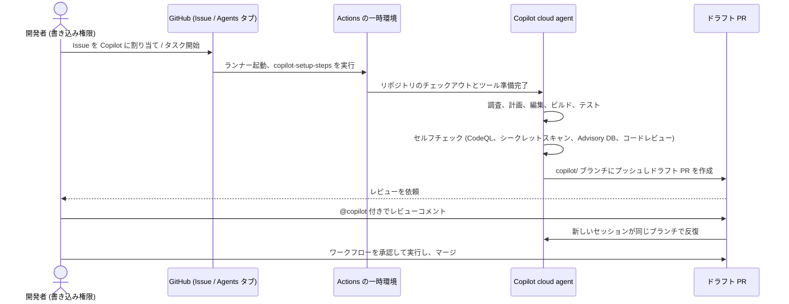
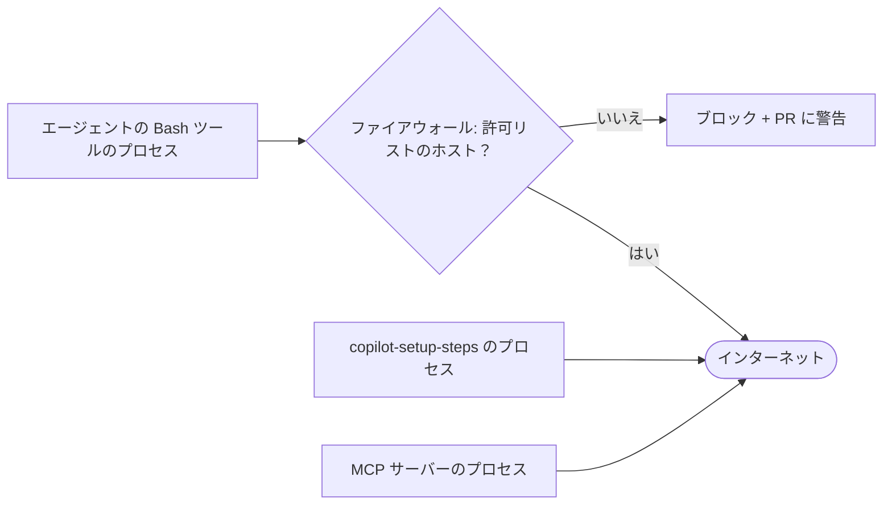

import { TLDR, DocsLinks, LastVerified, DecisionTree, YamlBuilder } from '@components';
import { Aside, Badge, Tabs, TabItem, Steps } from '@astrojs/starlight/components';

export const setupBase = `name: "Copilot Setup Steps"

on:
  workflow_dispatch:
  push:
    paths:
      - .github/workflows/copilot-setup-steps.yml
  pull_request:
    paths:
      - .github/workflows/copilot-setup-steps.yml

jobs:
  # ジョブ名は必ず copilot-setup-steps にすること
  copilot-setup-steps:
    # Ubuntu x64 または Windows x64 のみ。Larger runner / ARC のラベルも可
    runs-on: ubuntu-latest
    # @job
    permissions:
      contents: read
    steps:
      # @steps
`;

export const setupOptions = [
	{
		id: 'checkout',
		label: 'リポジトリをチェックアウト',
		default: true,
		description: '省略可: 省略した場合、セットアップ後に Copilot が自動でチェックアウトします。',
		snippet: `
- name: Checkout code
  uses: actions/checkout@v6`,
	},
	{
		id: 'lfs',
		label: 'Git LFS 付きでチェックアウト',
		description: 'リポジトリで LFS を使う場合、通常のチェックアウトの**代わりに**使います。',
		snippet: `
- name: Checkout code (with LFS)
  uses: actions/checkout@v6
  with:
    lfs: true`,
	},
	{
		id: 'node',
		label: 'Node.js + npm ci',
		snippet: `
- name: Set up Node.js
  uses: actions/setup-node@v7
  with:
    node-version: "22"
    cache: "npm"
- name: Install JavaScript dependencies
  run: npm ci`,
	},
	{
		id: 'python',
		label: 'Python + pip install',
		snippet: `
- name: Set up Python
  uses: actions/setup-python@v6
  with:
    python-version: "3.13"
    cache: "pip"
- name: Install Python dependencies
  run: pip install -r requirements.txt`,
		explanation: 'コピーする前に `actions/setup-python` の最新メジャーバージョンを確認してください。',
	},
	{
		id: 'timeout',
		label: 'タイムアウトを短くする',
		section: 'job',
		snippet: 'timeout-minutes: 30',
		explanation: '最大値は **59** です。セッションが 59 分を超えることはありません。',
	},
	{
		id: 'services',
		label: 'Postgres サービスコンテナー',
		section: 'job',
		snippet: `
services:
  postgres:
    image: postgres:16
    env:
      POSTGRES_PASSWORD: postgres
    ports:
      - 5432:5432`,
		explanation: '`services` は Copilot が考慮する数少ないジョブキーの 1 つです: `steps`、`permissions`、`runs-on`、`services`、`snapshot`、`timeout-minutes`。',
	},
];

<LastVerified date="2026-10" />

<TLDR>
- **Copilot cloud agent** (旧称「コーディングエージェント」) は**非同期**で動作します:
  - Issue を割り当てるか、タスクを説明します。
  - **一時的な GitHub Actions 環境**で調査、計画、編集、ビルド、テストを行います。
  - `copilot/` ブランチにプッシュし、人間がレビューする**ドラフトプルリクエスト**を作成します。
- 実行環境は **`.github/workflows/copilot-setup-steps.yml`** で設定します。このファイルは**デフォルトブランチ**に置き、`copilot-setup-steps` という名前のジョブを 1 つだけ含める必要があります。
- **ガードレール:**
  - **書き込み権限**を持つユーザーだけが起動できます。
  - プッシュできるのは **1 つのブランチ**だけです。
  - 自分の PR を**承認もマージもできず**、PR を依頼した人もその PR を承認できません。
  - その PR での **Actions ワークフローは承認されるまで実行されません**。
  - インターネットアクセスは**ファイアウォール**を経由します。
- **コスト:** AI Credits と **Actions の分数**。セッションの上限は **59 分**です。
- **Copilot コードレビュー:** あらゆる言語に対応し、ルールセットで自動レビュアーとして設定できます。1 回のレビューごとに AI Credits と Actions の分数がかかります。
</TLDR>

## ブースでよくある質問

<details>
<summary>コーディングエージェントと IDE の agent mode はどう違いますか？</summary>

**agent mode** は**ローカルで同期的に**動作します。作業の様子をその場で見られ、自分のマシンと認証情報を使います。

**cloud agent** は、隔離された Actions ランナー上で**リモートかつ非同期に**動作します。成果物はセッションログ付きの **PR** です。次のような、明確に範囲が決まったバックログ作業の委任に向いています:
- バグ修正。
- テストの追加。
- 小さな機能追加。
- 依存関係の更新。
- ドキュメント。

下に [判断ツリー](#cloud-agent-か-ide-の-agent-mode-か) があります。

</details>

<details>
<summary>エージェントは main に直接プッシュしたり、自分の PR をマージしたりできますか？</summary>

**できません。**
- プッシュできるのは自分の `copilot/…` ブランチ、または既存の PR で `@copilot` とメンションされた場合はその PR のブランチだけです。
- 生の `git push` は実行**できません**。
- PR を「Ready for review」にすることも、承認やマージもできません。
- ブランチ保護と必須チェックはエージェントにも適用されます。
- PR を**依頼した人はその PR を承認できない**ため、「Required approvals」には別の人間の承認が必要です。

</details>

<details>
<summary>Copilot の PR で CI が実行されなかったのはなぜですか？</summary>

**仕様です。** cloud agent の PR では、書き込み権限を持つ人が **Approve and run workflows** をクリックするまでワークフローが実行されません。自動で実行されるように設定を変更することもできますが、エージェントのコードがワークフローを変更する可能性があるため、セキュリティ上の判断として扱ってください。

</details>

<details>
<summary>ビルドにプライベートパッケージや社内ネットワークへのアクセスが必要です。動きますか？</summary>

設定すれば動きます。選択肢は次のとおりです:
- `copilot-setup-steps.yml` で**依存関係を事前インストール**する。
- 認証情報用に **Agents のシークレットと変数**を追加する。
- ファイアウォール設定でホストを**許可リスト**に追加する。
- 社内ネットワークには、**Azure プライベートネットワーク接続の Larger runner** または**セルフホストの ARC ランナー**を使う。エフェメラル (使い捨て) のランナーが推奨です。セルフホストランナーでは**組み込みファイアウォールを無効にし**、独自のネットワーク制御を用意する必要があります。

</details>

<details>
<summary>ファイアウォールですべてのデータ流出を防げますか？</summary>

**防げません。** GitHub もそう明言しています。ファイアウォールの対象は、エージェントの **Bash ツール**が起動したプロセスだけです。次は**対象外**です:
- **MCP サーバー**のプロセス。
- **`copilot-setup-steps.yml`** の実行中に動くもの。

また、GitHub ホストの Linux ランナーでしか機能せず、Windows とセルフホストランナーには対応していません。完全な保証ではなく、多層防御の 1 つとして扱ってください。

</details>

<details>
<summary>1 セッションのコストはどれくらいですか？</summary>

各セッションで **AI Credits** (モデルとトークン数に依存) と **GitHub Actions の分数**を消費します。セルフホストランナーは Actions の分数を消費しません。実行中のセッションに追加メッセージでステアリングする場合もクレジットを消費します。Auto model selection を使うと、有料プランではモデルコストが **10% 割引**されます。

</details>

<details>
<summary>Copilot のエージェントの代わりに Claude や Codex を使えますか？</summary>

使えます。**パブリックプレビュー**です <Badge text="プレビュー" variant="caution" />。**サードパーティ製コーディングエージェント** (Claude Agent SDK 経由の Anthropic Claude、Codex SDK 経由の OpenAI Codex) は、Copilot のエージェントと同じ場所から実行できます:
- Agents タブ。
- Issue の割り当て。
- PR での `@AGENT_NAME` メンション。
- GitHub Mobile。
- VS Code。

有効にするにはポリシーが必要です。Business と Enterprise では組織または Enterprise のポリシー、Pro、Pro+、Max ではアカウントの設定です。Free と Student では**利用できません**。Copilot は自社のエージェントと同じセキュリティ保護をサードパーティ製エージェントにも適用します。

</details>

<details>
<summary>Copilot コードレビューは人間のレビュアーの代わりになりますか？</summary>

デフォルトではなりません。Copilot は **「Comment」** レビューを残すので、そのレビューは必須承認数にカウントされません。すべてのレビューの概要コメントには**承認判定**が含まれますが、それだけではマージ条件を満たしません。

**Copilot による承認**は Enterprise、組織、リポジトリの各レベルで有効にできます。**デフォルトではオフ**です。有効にすると、Copilot の「Approve」レビューはチームメイトの承認と同じように必須承認ルールを満たします。リポジトリ管理者は**ファイルパス**で Copilot の承認をカウントする範囲を制御できます。Copilot の承認後に新しいコミットがプッシュされると、その承認は**取り消されます**。

トーキングポイント: **一次レビュアー**として使い、承認はリスクの低いパスに限って有効にしましょう。

</details>

## cloud agent の仕組み



重要なポイント:
- **1 タスクにつき 1 リポジトリ、1 ブランチ、1 PR** です。1 回の実行で複数のリポジトリは変更できません。
- 1 セッションの上限は **59 分**で、延長できません。大きなタスクは小さく分割してください。
- **セルフバリデーション。** デフォルトでは、エージェントは自分のコードを **CodeQL**、**シークレットスキャン**、(新しい依存関係について) **GitHub Advisory Database**、**Copilot コードレビュー**でチェックします。これに **GHAS、Code Security、Secret Protection のライセンスは不要**です。個々のチェックは無効にできます。
- **コミット:**
  - **作成者は Copilot**、**依頼者は共同作成者**になります。
  - コミットは**署名**され、「Verified」と表示されます。
  - 各コミットメッセージには**セッションログへのリンク**が含まれます。
- **セッション:** cloud agent のセッションは、リポジトリにアクセスできる人に**デフォルトで共有されます**。セッションを停止すると Actions の実行は終了しますが、すでにプッシュされたコミットは残ります。

### 開始方法

| 場所 | 方法 |
|---|---|
| Issue | Issue を **Copilot** に割り当てる |
| Agents タブ／ページ | `github.com/copilot/agents` またはリポジトリの **Agents** タブ: 開始、モデルやエージェントの選択、監視、**ステアリング** |
| GitHub.com の Copilot Chat | 変更を依頼する。チャットのコンテキストがセッションに引き継がれる |
| プルリクエスト | 既存の PR で `@copilot …` とコメントする、またはコードレビューのコメントから「Fix with Copilot」 <Badge text="プレビュー" variant="caution" /> |
| IDE | VS Code、JetBrains、Eclipse、Visual Studio から委任 |
| ターミナル | GitHub CLI、Copilot CLI、GitHub MCP サーバー |
| その他 | GitHub Mobile、REST API、Slack、Microsoft Teams、Jira、Azure Boards、Linear、Raycast |
| セキュリティキャンペーン | Code scanning アラートを Copilot に割り当てる |
| Automations | スケジュールまたはリポジトリのイベントで実行 (プライベート／内部リポジトリ、Pro 以上)。リポジトリの **Agents** タブで設定 |

<Aside type="tip" title="トーキングポイント: automations">
**Automations** を使うと、cloud agent を**スケジュールやリポジトリのイベント**で実行できます。たとえば毎晩の「失敗したテストの修正」や毎週のリリースノート作成です。各実行の料金は automation を**作成した**ユーザーに請求され、そのユーザーは automation が作成した PR を**承認できません**。書き込み権限のないユーザーによるイベントは、デフォルトで無視されます。
</Aside>

## `copilot-setup-steps.yml`

間違えやすいルール:
- ファイルは**正確に** `.github/workflows/copilot-setup-steps.yml` に置き、**デフォルトブランチ上**にある必要があります。
- **`copilot-setup-steps` という名前のジョブを 1 つ**含める必要があります。考慮されるキーは `steps`、`permissions`、`runs-on`、`services`、`snapshot`、`timeout-minutes` (最大 59) だけで、それ以外は無視されます。
- いずれかのステップが失敗すると、Copilot は**残りのステップをスキップ**して作業を開始します。
- `actions/checkout` で指定した `fetch-depth` は上書きされます。
- ランナーは **Ubuntu x64 または Windows x64** である必要があります。**macOS は非対応**です。Windows は組み込みファイアウォールに対応していないため、セルフホストまたはプライベートネットワーク接続のランナーと組み合わせて使います。
- **Copilot コードレビューはデフォルトでこのファイルを再利用します。** レビュー用に別の設定をしたい場合は `copilot-code-review.yml` を作成します。
- 組織のオーナーは、cloud agent の**デフォルトのランナー種別**を設定し、リポジトリでの上書きを許可するかどうかを決められます。

<YamlBuilder title="copilot-setup-steps.yml を作成" filename=".github/workflows/copilot-setup-steps.yml" base={setupBase} options={setupOptions} />

## ファイアウォールとネットワーク



- ファイアウォールは cloud agent とコードレビューで**デフォルトで有効**です。リポジトリまたは組織の **Internet access** 設定で構成します。
- **推奨許可リスト**には次が含まれます:
  - OS のパッケージリポジトリ。
  - 一般的なコンテナーレジストリ (Docker Hub、ACR、ECR)。
  - 各言語のパッケージレジストリ。
  - 認証局。
  - Playwright MCP サーバーがブラウザーをダウンロードするのに必要なホスト。
- 独自のホストを追加することも、ファイアウォールを無効にすることもできます。セルフホストランナーを使う場合は無効に**する必要があります**。
- ブロックされた通信は、アクセス先のアドレスと実行したコマンドとともに **PR 上に警告**として表示されます。
- 上の図のとおり、セットアップステップと MCP サーバーはファイアウォールを**迂回**します。

## cloud agent 用の MCP

- **デフォルト:**
  - **GitHub MCP サーバー**。読み取り専用で、現在のリポジトリにスコープされています。
  - **Playwright MCP サーバー**。localhost に制限されています。
- サーバーを追加するには、リポジトリの **Settings → Copilot → MCP servers** に JSON で記述します。この設定は**コードレビューと共有されます**。
- **エージェントは設定されたツールを承認なしで自律的に使います。** 特定の、できれば読み取り専用の `tools` だけを許可リストに入れてください。
- 対応しているのは**ツールのみ**で、リソースやプロンプトは非対応です。
- **非対応:** **OAuth** を使うリモートサーバー。
- シークレットは、名前が **`COPILOT_MCP_`** で始まる **Agents のシークレットまたは変数**にする必要があります。
- **コードレビュー**で使うには、各ツールが `annotations.readOnlyHint: true` を宣言している必要があります。

```json title="リポジトリの Settings → Copilot → MCP servers"
{
  "mcpServers": {
    "sentry": {
      "type": "local",
      "command": "npx",
      "args": ["@sentry/mcp-server@latest"],
      "tools": ["get_issue_details", "get_issue_summary"],
      "env": {
        "SENTRY_ACCESS_TOKEN": "$COPILOT_MCP_SENTRY_ACCESS_TOKEN"
      }
    }
  }
}
```

## セキュリティモデル

| リスク | 組み込みの緩和策 |
|---|---|
| エージェントが不適切なコードをプッシュする | 単一の `copilot/` (または PR) ブランチにのみプッシュ。ブランチ保護と必須チェックが適用される。生の `git push` は不可 |
| 自己承認 | エージェントは承認もマージもできない。**依頼者は承認できない**。人に帰属しないエージェントの PR は**追加の承認が 1 件**必要 (ルールセットではデフォルト、ブランチ保護では常に) |
| 悪意のある CI の変更 | **書き込み権限を持つユーザーが承認するまでワークフローは実行されない** |
| 信頼できない起動元 | **書き込み権限**を持つユーザーのみ起動可能。それ以外のユーザーのコメントはエージェントに渡されない |
| プロンプトインジェクション | Issue やコメントの隠し文字と HTML コメントは除去される |
| データ流出 | ファイアウォール (上記の抜け穴あり) |
| 脆弱な出力 | PR の完成前に CodeQL、シークレットスキャン、Advisory DB チェック、Copilot コードレビュー |
| ルールセットがエージェントをブロックする | 特定のコミット作成者のみを許可するルールは Copilot をブロックすることがある。ルールセットで Copilot を**バイパスアクター**に追加する |
| 監査可能性 | 署名付きコミット、共同作成者の記録、セッションログ、`actor:Copilot` の監査ログイベント |

管理者向けのスイッチ:
- Business と Enterprise では、**cloud agent ポリシー**を有効にする必要があります。Enterprise では、**選択した組織**だけで有効にできます。
- **リポジトリ管理者**は、個々のリポジトリでエージェントを無効にできます。

## 課金

- セッションとステアリングメッセージごとに、モデルのトークンに対して **AI Credits** がかかります。エージェントのセッションは開始したユーザーに、automations は作成したユーザーに請求されます。
- 一時環境には **GitHub Actions の分数**がかかります。Larger runner は分単価が高く、**セルフホストランナー**は分数を消費しません。
- 有料プランでは Auto model selection で **10% 割引**になります。
- 付与量、予算、クレジットを使い切ったときの挙動は [プランと課金](/github-cheatsheet/ja/copilot/plans-billing/) を参照してください。

## サードパーティ製エージェントと Agent apps

- **サードパーティ製コーディングエージェント** <Badge text="プレビュー" variant="caution" />: **Claude** (Claude Agent SDK) と **OpenAI Codex** (Codex SDK)。Agents タブ、Issue の割り当て、PR での `@AGENT_NAME` から選択できます。ポリシーで有効にする必要があり、AI Credits で課金されます。Copilot のエージェントと同じ緩和策が適用されます。
- **Agent apps** <Badge text="プレビュー" variant="caution" />: パートナーが提供する GitHub App で、独自のエージェント (プロンプト、モデル、ツール、MCP サーバー) を同じ開始ポイントに公開します。cloud agent を基盤とし、Copilot の AI Credits として課金されます。パートナーへの MCP 呼び出しは、GitHub が発行する JWT で認証されます。Enterprise 所有の組織では「Agent apps」ポリシーが必要です。

## cloud agent か IDE の agent mode か

<DecisionTree
	title="このタスクは cloud agent に任せるべき？"
	tree={{
		start: 'q1',
		nodes: {
			q1: {
				question: 'タスクは**範囲が明確**で、Issue に書ける受け入れ条件がありますか？',
				options: [
					{ label: 'はい', next: 'q2' },
					{ label: 'いいえ、探索的または曖昧', next: 'ide' },
				],
			},
			q2: {
				question: '**複数のリポジトリ**にまたがりますか？',
				options: [
					{ label: 'はい', next: 'split' },
					{ label: 'いいえ', next: 'q3' },
				],
			},
			q3: {
				question: 'セットアップステップを使えば、リポジトリを **Actions ランナー** (Ubuntu または Windows) でビルド・テストできますか？',
				options: [
					{ label: 'はい', next: 'q4' },
					{ label: 'いいえ、macOS、特殊なハードウェア、ローカル専用のリソースが必要', next: 'ide' },
				],
			},
			q4: {
				question: 'エージェントの実行中も**コーディングを続けたい**、または複数のタスクを並行して実行したいですか？',
				options: [
					{ label: 'はい', next: 'cloud' },
					{ label: 'いいえ、対話的にペアで進めたい', next: 'ide' },
				],
			},
			cloud: { answer: '**cloud agent。** Issue を Copilot に割り当て、`copilot-setup-steps.yml` を追加し、ドラフト PR をレビューします。', links: [{ label: 'Copilot セッションを開始する', href: 'https://docs.github.com/ja/copilot/how-tos/use-copilot-agents/cloud-agent/start-copilot-sessions' }] },
			ide: { answer: '**IDE の agent mode** (まず plan mode から) または **Copilot CLI**。自分もループに入り、ローカルのリソースを使えます。' },
			split: { answer: '**分割しましょう。** cloud agent は 1 タスクにつき 1 リポジトリで動作します。リポジトリごとに Issue を作るか、GitHub Copilot アプリや CLI で複数リポジトリを調整してください。' },
		},
	}}
/>

## Copilot コードレビュー

<Tabs>
<TabItem label="概要">

- **あらゆる言語**の PR をレビューし、数クリックで適用できる変更提案付きのコメントを残します。
- 利用できる場所:
  - GitHub.com、GitHub CLI、GitHub Mobile、VS Code、Visual Studio、Xcode、JetBrains。
  - **Azure DevOps** <Badge text="プレビュー" variant="caution" />。
- **エージェント機能:** **Actions ランナー**上でプロジェクト全体からコンテキストを収集します。Actions が使えない場合は、より限定的なレビューにフォールバックします。
- **「Fix with Copilot」** は提案を cloud agent に引き渡し、修正 PR を作成させます <Badge text="プレビュー" variant="caution" />。
- **モデルは選べません。** レビューは調整済みのモデルの組み合わせを使い、組織の「Models」ページで有効になっていないモデルが含まれることもあります。

</TabItem>
<TabItem label="自動レビュー">

有効にする方法は 3 つあり、互いに独立しています:
- **ユーザー設定:** 自分の PR を自動でレビューします。Pro、Pro+、Max、Business、Enterprise のいずれかが必要で、**EMU アカウントでは利用できません**。
- **リポジトリのルールセット:** Copilot にアクセスできる人が作成したすべての PR をレビューします。
- **組織のルールセット:** 同じことを、一部またはすべてのリポジトリで行います。

設定の関係:
- ユーザー設定とルールセットは**階層関係にありません**。どちらかが有効なら PR はレビューされ、レビューは **1 回だけ**です。
- デフォルトでは、PR が**オープンされたとき**、またはドラフトが初めて Ready になったときにレビューが始まります。
- オプションのトリガー: **新しいプッシュごとのレビュー**と**ドラフトのレビュー**。ルールセットでこれらを有効にした場合、ユーザーは無効にできません。
- 変更後にもう一度レビューしてもらうには **Re-request review** をクリックします。

</TabItem>
<TabItem label="カスタマイズ">

- レビューは **`.github/copilot-instructions.md`**、パス別の **`.github/instructions/**/*.instructions.md`**、**`AGENTS.md`**、レビュー専用の **`REVIEW.md`** を読みます。
- これらはベースブランチではなく、PR の **head ブランチ**から読み込まれます。
- 指示は**約 1,000 行以内**に収めてください。
- **エフォートレベル:**
  - **Lite:** 高速。定型的な変更向け。
  - **Balanced** (デフォルト): 複雑なコード、セキュリティ上重要なコード、サービス横断のコードに、より高度な推論モデルを使います。
  - レベルは次の優先順で決まります: リクエスト時の指定 → その PR での前回の実行 → 依頼者のデフォルト → リポジトリ → 組織 → Balanced。
- 実行環境は `copilot-setup-steps.yml`、または作成した場合は `copilot-code-review.yml` から取得されます。MCP ツールには `readOnlyHint` が必要です。

</TabItem>
<TabItem label="課金とライセンス">

- 1 回のレビューごとに **AI Credits** と **Actions の分数**がかかります。ドキュメントの概算は、Actions の分数を除いて Lite で約 **$0.05〜$1**、Balanced で約 **$0.25〜$5** です。
- **誰に請求されるか:**
  - 自動レビューは **PR の作成者**。
  - 手動リクエストは**依頼者**。
  - cloud agent が作成した PR は**人間の共同作成者**。
  - ボットの PR は**組織**。
  - オーナーは、ライセンスを持つメンバーの分を組織に請求するよう変更できます。
- **Copilot ライセンスなしでのレビュー** (Business と Enterprise のみ): **AI credits paid usage** と **「Allow members without a Copilot license to use Copilot code review in GitHub.com」** を有効にします。このレビューは組織に請求され、GitHub.com でのみ利用できます。
- **「Only allow Copilot code review to be triggered by authorized users」** を有効にすると、*外部*ライセンス (個人や別の組織のライセンス) が自社のリポジトリで使われるのを防げます。
- Actions の使用量を追跡するには、`copilot-pull-request-reviewer` ワークフロー、または請求レポートの `dynamic/agents/copilot-pull-request-reviewer` でフィルターします。

</TabItem>
</Tabs>

**得意なこと:**
- バグ、セキュリティ上の問題、スタイルの不統一を早期に見つけること。
- 変更内容を要約すること。
- 指示に書いた規約を徹底させること。

**限界:**
- **Copilot による承認**を有効にしない限り (デフォルトはオフ)、レビューは必須承認数にカウントされません。
- プッシュごとのレビューを有効にしない限り、レビューは 1 回だけです。
- 問題を見逃したり、誤った指摘をしたりすることがあります。重要な変更には人間のレビューを残してください。

<DocsLinks links={[
  { label: 'GitHub.com 上の GitHub Copilot (cloud agent)', href: 'https://docs.github.com/ja/copilot/concepts/agents/cloud-agent/about-cloud-agent' },
  { label: 'Copilot cloud agent のリスクと緩和策', href: 'https://docs.github.com/ja/copilot/concepts/agents/cloud-agent/risks-and-mitigations' },
  { label: '開発環境を設定する (copilot-setup-steps.yml)', href: 'https://docs.github.com/ja/copilot/how-tos/copilot-on-github/customize-copilot/customize-cloud-agent/customize-the-agent-environment' },
  { label: 'ファイアウォールのカスタマイズまたは無効化', href: 'https://docs.github.com/ja/copilot/how-tos/copilot-on-github/customize-copilot/customize-the-firewall' },
  { label: 'Copilot 許可リストのリファレンス', href: 'https://docs.github.com/ja/copilot/reference/copilot-allowlist-reference' },
  { label: 'リポジトリの MCP サーバーを設定する', href: 'https://docs.github.com/ja/copilot/how-tos/copilot-on-github/customize-copilot/configure-mcp-servers' },
  { label: 'サードパーティ製コーディングエージェント', href: 'https://docs.github.com/ja/copilot/concepts/agent-capabilities/about-agents/about-third-party-coding-agents' },
  { label: 'Copilot automations', href: 'https://docs.github.com/ja/copilot/concepts/agents/cloud-agent/about-automations' },
  { label: 'Copilot コードレビュー', href: 'https://docs.github.com/ja/copilot/concepts/agent-capabilities/agent-powered-workflows-and-operations/code-review' },
  { label: '自動コードレビューを設定する', href: 'https://docs.github.com/ja/copilot/how-tos/copilot-on-github/set-up-copilot/configure-code-review' },
]} />
