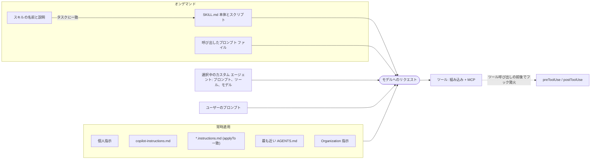

import { TLDR, DocsLinks, LastVerified, CompareTable, FlashCards } from '@components';
import { Aside, Badge, Tabs, TabItem } from '@astrojs/starlight/components';

<LastVerified date="2026-10" />

<TLDR>
- **常時適用:** カスタム指示。`.github/copilot-instructions.md`、`.github/instructions/*.instructions.md`(`applyTo` 付き)、`AGENTS.md`、個人指示、Organization 指示があります。
- **必要なときだけ読み込み:** エージェント スキル(`.github/skills/<name>/SKILL.md`)。Copilot はまず名前と説明だけを参照し、タスクに合致したときに本体を読み込みます。
- **ユーザーが呼び出す:** プロンプト ファイル(`.github/prompts/*.prompt.md`)とカスタム エージェント(`.github/agents/<name>.agent.md`)。Organization / Enterprise レベルのエージェントは `.github-private` リポジトリに置きます。
- **プロンプトではなくコード:** フック(`.github/hooks/*.json`)はライフサイクル イベントでシェル コマンドを実行します。MCP サーバーはツールを追加し、プラグインはこれらをまとめて配布します。
- 対応状況はサーフェスごとに異なります。約束する前に下の対応表を確認してください。
</TLDR>

## ブースでよくある質問

<details>
<summary>カスタム指示、プロンプト ファイル、カスタム エージェント、スキルの違いは?</summary>

GitHub 自身の一言説明は次のとおりです。
- **指示**は Copilot に*全般的な振る舞い方*を伝えます。
- **スキル**は*特定の種類のタスクの進め方*を伝え、関連するときだけ読み込まれます。
- **カスタム エージェント**は独自の指示とツールを持つ*専門ロールを定義*します。
- **プロンプト ファイル**は、1 回の集中したやり取りのために*ユーザーが*実行する再利用可能なテンプレートです。

いちばん分かりやすい区別はトリガー方法です。自動、関連時に自動、ユーザーが選択、ユーザーが呼び出す、の 4 通りです。

</details>

<details>
<summary>Copilot は AGENTS.md を読みますか? CLAUDE.md は?</summary>

読みます。`AGENTS.md` はリポジトリ内のどこにでも置けて、**ディレクトリ ツリー上で最も近いものが優先**されます。ルートに置いた単一の `CLAUDE.md` / `GEMINI.md` も使えます。

対応状況はサーフェスによって異なります。

| サーフェス | 読み込むエージェント指示ファイル |
|---|---|
| Copilot cloud agent | `AGENTS.md`、`CLAUDE.md`、`GEMINI.md` |
| Copilot CLI | `AGENTS.md`、`CLAUDE.md`、`GEMINI.md` |
| GitHub.com の Copilot code review | `AGENTS.md`、`CLAUDE.md`、`GEMINI.md`、`REVIEW.md` |
| VS Code Chat | `AGENTS.md` |

</details>

<details>
<summary>カスタム エージェントを全社で一度に定義できますか?</summary>

はい、2 つのレベルで定義できます。
- **Organization:** Organization の `.github` または `.github-private` リポジトリの `/agents/NAME.md` に置きます。
- **Enterprise:** 指定した `.github-private` リポジトリの `/agents/NAME.md` に置きます。

レベル間で名前が衝突した場合は、**最も下位(最も具体的)のレベルが優先**されます。つまり同じファイル名なら、リポジトリのエージェントが Organization のエージェントを上書きします。

</details>

<details>
<summary>スキルは Copilot 専用の形式ですか?</summary>

いいえ。GitHub は Agent Skills 仕様を、他の AI システムでも使われる**オープン標準**([agentskills/agentskills](https://github.com/agentskills/agentskills))と説明しています。Copilot は `.github/skills`、`.claude/skills`、`.agents/skills` からスキルを読むため、1 つのスキル フォルダーを複数のエージェント ハーネスで共有できます。

共有スキルは `gh skill install OWNER/REPO SKILL` <Badge text="プレビュー" variant="caution" />(GitHub CLI 2.90.0 以降)でインストールできます。スキルは **GitHub による検証を受けていない**ため、先にプレビューで中身を確認してください。

</details>

<details>
<summary>カスタム指示に書けば Copilot は必ずそのルールに従いますか?</summary>

いいえ。GitHub ははっきり<em>「指示はモデルを導くが、すべてのルールに従うことを保証するものではない」</em>と述べています。

「`rm -rf` は絶対に実行しない」「編集後は必ずフォーマットする」のように必ず守らせたいルールは、文章に頼らず次の手段で強制してください。
- **フック**(`preToolUse` でツール呼び出しを拒否できます)
- リンター
- CI
- ルールセット

</details>

<details>
<summary>コーディング エージェント用と IDE 用の MCP 設定はどこで行いますか?</summary>

- **IDE(VS Code):** リポジトリで共有する `.vscode/mcp.json`、またはユーザーの `settings.json`。
- **cloud agent と code review:** リポジトリの **Settings → Copilot → MCP servers** に、`mcpServers` オブジェクトを持つ JSON で設定します。カスタム エージェント プロファイルの `mcp-servers` プロパティでも設定できます。

cloud agent は設定されたツールを**承認を求めずに**使うため、特定の読み取り専用ツールだけを許可リストに入れてください。

</details>

<details>
<summary>VS Code のエージェント「handoffs」は GitHub.com でも動きますか?</summary>

cloud agent では動きません。GitHub のリファレンスには、VS Code / IDE のカスタム エージェントの `argument-hint` と `handoffs` プロパティは GitHub.com の Copilot cloud agent では**無視される**と書かれています。エラーにはならず無視されるだけなので、同じプロファイルを両方で使えます。

</details>

## サーフェス別の対応状況

GitHub のカスタマイズ チートシートに基づく表です。「Preview」はそのサーフェスでプレビュー提供中という意味です。

<CompareTable
	title="サーフェス別カスタマイズ対応表"
	columns={[
		{ key: 'vscode', label: 'VS Code' },
		{ key: 'vs', label: 'Visual Studio' },
		{ key: 'jb', label: 'JetBrains' },
		{ key: 'eclipse', label: 'Eclipse' },
		{ key: 'xcode', label: 'Xcode' },
		{ key: 'gh', label: 'GitHub.com' },
		{ key: 'cli', label: 'Copilot CLI' },
	]}
	rows={[
		{ feature: 'カスタム指示', category: '常時適用', values: { vscode: true, vs: true, jb: 'Preview', eclipse: 'Preview', xcode: 'Preview', gh: true, cli: true } },
		{ feature: 'プロンプト ファイル', category: 'ユーザーが呼び出す', values: { vscode: true, vs: true, jb: 'Preview', eclipse: false, xcode: 'Preview', gh: false, cli: false } },
		{ feature: 'カスタム エージェント', category: 'ユーザーが呼び出す', values: { vscode: true, vs: true, jb: 'Preview', eclipse: 'Preview', xcode: 'Preview', gh: true, cli: true } },
		{ feature: 'サブエージェント(実行時)', category: '自動', values: { vscode: true, vs: false, jb: 'Preview', eclipse: 'Preview', xcode: 'Preview', gh: false, cli: true } },
		{ feature: 'エージェント スキル', category: '関連時に読み込み', values: { vscode: true, vs: true, jb: 'Preview', eclipse: false, xcode: false, gh: true, cli: true } },
		{ feature: 'フック', category: '決定的', values: { vscode: 'Preview', vs: false, jb: false, eclipse: false, xcode: false, gh: true, cli: true } },
		{ feature: 'MCP サーバー', category: 'ツール', values: { vscode: true, vs: true, jb: true, eclipse: true, xcode: true, gh: true, cli: true } },
	]}
/>

<Aside type="caution">
ここでの「GitHub.com」は主に **Copilot cloud agent と Copilot code review** を指します。cloud agent のフックは**イベントの一部のみ**に対応しています。プロンプト ファイルは IDE の機能です。
</Aside>

## コンテキストの組み立て方



複数の種類の指示が該当する場合、優先度は**個人 → リポジトリ → Organization** の順です。ただし該当する指示は*すべて*送られます。GitHub は矛盾する指示を避けるよう推奨しています。

## カスタム指示

| 種類 | 場所 / 形式 | 備考 |
|---|---|---|
| リポジトリ全体 | `.github/copilot-instructions.md` | リポジトリのコンテキストでのすべてのリクエストに適用されます。cloud agent に生成させることもできます。 |
| パス固有 | `.github/instructions/**/NAME.instructions.md`(frontmatter に `applyTo` の glob) | リポジトリ全体の指示と併用されます。`excludeAgent: "code-review"` または `"cloud-agent"` も指定可能です。GitHub.com では cloud agent と code review だけが使います。 |
| エージェント指示 | 任意の場所の `AGENTS.md`(最も近いものが優先)、またはルートの単一の `CLAUDE.md` / `GEMINI.md` | コミュニティの [agents.md](https://github.com/agentsmd/agents.md) 形式に準拠します。 |
| code review 専用 | `REVIEW.md` | GitHub.com の Copilot code review が読みます。 |
| 個人 | GitHub.com の設定 UI。CLI は `~/.copilot/copilot-instructions.md` または `~/.copilot/instructions/**/*.instructions.md` | 最優先です。 |
| Organization | Organization 設定 UI(Business/Enterprise) | GitHub.com の Chat、cloud agent、code review が使います。VS Code Chat では使われ**ません**。 |

<Tabs>
<TabItem label="copilot-instructions.md">

```markdown
This is a Go service with a Ruby client. Keep it short — Copilot reads this on every request.

## Build & test
- Build: `make build` · Test: `make test` · Full CI: `make ci`
- Run `make fmt` before committing.

## Non-obvious rules
- `proto/` changes require `make proto`.
- Bump `ruby/lib/billing-platform/version.rb` (semver) when touching `ruby/`.
```

</TabItem>
<TabItem label="パス固有">

```markdown
---
applyTo: "**/tests/*.spec.ts"
excludeAgent: "code-review"
---
Use Playwright `getByRole()` / `getByTestId()` locators, never CSS selectors.
Each test must be independent; rely on auto-wait, never `setTimeout()`.
```

</TabItem>
<TabItem label="AGENTS.md">

```markdown
# AGENTS.md (packages/api/)
- Package manager: pnpm. Run `pnpm -F api test` before finishing.
- Never edit generated files in `src/gen/`.
```

</TabItem>
</Tabs>

<Aside type="tip">
**code review は PR の head ブランチから指示を読みます**(base ブランチではありません)。GitHub は review 用の指示を **1,000 行程度以下**に抑えることを推奨しています。
</Aside>

## プロンプト ファイル

プロンプト ファイルは、1 回の集中したやり取りのための再利用可能な**オンデマンド**テンプレートです。`.github/prompts/*.prompt.md` に置きます。VS Code と JetBrains では別の場所も設定できます。チャットで参照するか選択して実行します。

```markdown
---
description: Generate a React form component
---
Your goal is to generate a new React form component named ${input:formName}.
Ask for the fields if not provided.
- Use our design-system components: [Form.md](../../docs/design-system/Form.md)
- Use `react-hook-form` + `yup`; define TypeScript types for form data.
```

<Aside type="note">
プロンプト ファイルは **IDE の機能**です。VS Code と Visual Studio は GA、JetBrains と Xcode はプレビューです。Eclipse、GitHub.com、CLI では非対応です。`${input:...}` 変数や追加の frontmatter キーは IDE 固有なので、各 IDE のドキュメントを確認してください。
</Aside>

## カスタム エージェント

カスタム エージェントは**エージェント プロファイル**です。YAML frontmatter 付きの Markdown で、専門ロール、プロンプト(最大 30,000 文字)、さらに任意でツール制限、固定モデル、MCP サーバーを定義します。

| レベル | 場所 |
|---|---|
| リポジトリ | `.github/agents/NAME.agent.md` |
| Organization | Organization の `.github` または `.github-private` リポジトリの `/agents/NAME.md` |
| Enterprise | 指定した `.github-private` リポジトリの `/agents/NAME.md` |
| 個人 | ユーザー プロファイル(IDE / Copilot CLI) |

```markdown
---
name: planner
description: Read-only planner. Researches the codebase and writes an implementation plan; never edits files.
tools: ["read", "search"]
# model: <a model name>   # optional; omit to inherit the default model
---
You are a planning specialist. Produce a numbered plan with files to touch,
risks, and a test strategy. Do not modify code.
```

| frontmatter キー | 用途 |
|---|---|
| `description` | <strong>必須。</strong>エージェントの目的。 |
| `name` | 表示名(任意)。 |
| `tools` | 許可リスト。例: `["read","search","edit"]`、`github/*`、`some-mcp/tool`。省略するとすべてのツール、`[]` でツールなしになります。 |
| `model` | モデルを固定します。省略するとデフォルトのモデルを継承します。 |
| `target` | `vscode` または `github-copilot`。未設定なら両方。 |
| `disable-model-invocation` / `user-invocable` | 自動選択か手動選択かを制御します。廃止された `infer` の後継です。 |
| `mcp-servers` | エージェント単位の MCP サーバー。GitHub.com / CLI のみで、IDE のカスタム エージェントでは使われません。 |
| `handoffs`、`argument-hint` | VS Code / IDE のプロパティです。**cloud agent では無視されます。** |

ツールのエイリアスには `execute`(シェル)、`read`、`edit`、`search`、`agent`、`web`、`todo` があります。最後の 2 つは cloud agent では使えません。

<Aside type="note">
Copilot CLI には**組み込みエージェント**(`explore`、`task`、`general-purpose`、`code-review`、`research`、`rubber-duck`、`security-review`)が付属しています。自作する前にこれらを確認してください。
</Aside>

## エージェント スキル

```text
.github/skills/
└── release-notes/
    ├── SKILL.md            # required; name + description frontmatter
    ├── template.md         # optional resources
    └── collect-changes.sh  # optional scripts
```

```markdown
---
name: release-notes
description: Drafts release notes using our template. Use when asked to write release notes or a changelog.
allowed-tools: shell   # optional; only pre-approve shell for skills you fully trust
---
1. Run `collect-changes.sh` from this skill's directory to list merged PRs.
2. Group them using `template.md`. Keep breaking changes first.
```

- **場所:**
  - プロジェクト: `.github/skills`、`.claude/skills`、`.agents/skills`。
  - 個人: `~/.copilot/skills`、`~/.agents/skills`。
  - 個人スキルはクラウドで動くエージェントからは自動的には使えません。
- **段階的な読み込み:** Copilot はスキルの**名前と説明**で読み込むかどうかを判断します。読み込みが決まって初めて本体が入り、スキル フォルダー内のファイルも使えるようになります。そのため、ベースのコンテキストを小さく保てます。
- **対応サーフェス:** Copilot app、CLI、cloud agent、code review、VS Code / Visual Studio / JetBrains(プレビュー)のエージェント モード。

## フック

フックはエージェントのライフサイクル イベントで**任意のシェル コマンド**を実行します。指示と違い、モデルにお願いするのではなくコードを実行します。

```json
{
  "version": 1,
  "hooks": {
    "preToolUse": [
      { "type": "command", "bash": "./scripts/deny-dangerous.sh", "powershell": "./scripts/deny-dangerous.ps1", "timeoutSec": 15 }
    ],
    "postToolUse": [
      { "type": "command", "bash": "cat >> logs/tool-results.jsonl" }
    ]
  }
}
```

- **場所:** リポジトリの `.github/hooks/*.json`(CLI と cloud agent)。CLI は個人用の `~/.copilot/hooks/*.json` も読みます。
- **イベント:** `sessionStart`、`sessionEnd`、`userPromptSubmitted`、`preToolUse`(ツール呼び出しを**承認 / 拒否**可能)、`postToolUse`、`agentStop`、`subagentStop`、`errorOccurred`。cloud agent はこの一部に対応しています。
- **対応サーフェス:** Copilot app、CLI、cloud agent、VS Code <Badge text="プレビュー" variant="caution" />。
- **パフォーマンス:** フックは同期実行でエージェントをブロックします。GitHub は 1 つあたり約 5 秒以内に抑えることを推奨しています。

## MCP サーバー

<Tabs>
<TabItem label="VS Code (.vscode/mcp.json)">

```json
{
  "servers": {
    "github": { "type": "http", "url": "https://api.githubcopilot.com/mcp/" },
    "fetch": { "command": "uvx", "args": ["mcp-server-fetch"] }
  }
}
```

</TabItem>
<TabItem label="cloud agent(リポジトリ設定)">

```json
{
  "mcpServers": {
    "sentry": {
      "type": "local",
      "command": "npx",
      "args": ["@sentry/mcp-server@latest"],
      "tools": ["get_issue_details"],
      "env": { "SENTRY_ACCESS_TOKEN": "$COPILOT_MCP_SENTRY_TOKEN" }
    }
  }
}
```

</TabItem>
</Tabs>

cloud agent と code review の仕様:
- **デフォルト:** GitHub MCP サーバー(読み取り専用で現在のリポジトリに限定)と Playwright MCP サーバー(localhost のみ)が最初から有効です。
- **対応機能:** ツールのみで、リソースやプロンプトには非対応です。OAuth を使うリモート サーバーも非対応です。
- **シークレット:** 名前は `COPILOT_MCP_*` にする必要があります。
- **code review:** 各ツールが `annotations.readOnlyHint: true` を宣言している必要があります。
- **ファイアウォール:** エージェントのファイアウォールは MCP サーバーのプロセスには**適用されません**。

サンプル中のサーバー名やパッケージ引数は例示です。実際の値は各サーバーのドキュメントを参照してください。

## プラグイン

**プラグイン**は、スキル、カスタム エージェント、フック、MCP 設定をまとめて配布できるインストール可能なパッケージです。Copilot app、CLI、cloud agent、VS Code で使えます。チーム全体で共有するバンドルにはプラグインを使い、小さなワークフロー 1 つならスキル単体のほうがシンプルです。

## 注意点

- GitHub.com でパス固有の指示を使うのは cloud agent と code review **だけ**です。GitHub.com の Chat では使われません。
- VS Code Chat は **Organization** 指示を使いません。JetBrains の Chat は個人指示に対応していますが、VS Code Chat の対応リストには個人指示が含まれていません。
- Copilot CLI では、カスタム エージェントを*サブエージェント*として動かすと、リポジトリ指示はデフォルトでは渡され**ません**(オプトイン)。
- カスタム エージェントのファイル名(`.md` / `.agent.md` を除いた部分)が、リポジトリ / Organization / Enterprise 間の重複判定キーになります。
- `copilot-setup-steps.yml` はここで言うカスタマイズ ファイルではありませんが、cloud agent に必要なツールを用意する手段です。詳しくは [Copilot 概要](/github-cheatsheet/ja/copilot/)を参照してください。

<FlashCards
	title="ファイル パス クイズ"
	cards={[
		{ q: 'リポジトリ全体の指示ファイルは?', a: '`.github/copilot-instructions.md`' },
		{ q: 'パス固有の指示ファイルとキーは?', a: '`.github/instructions/NAME.instructions.md`(frontmatter に `applyTo` の glob)' },
		{ q: 'リポジトリのカスタム エージェント ファイルは?', a: '`.github/agents/NAME.agent.md`' },
		{ q: 'Enterprise 全体のカスタム エージェントは?', a: '指定した `.github-private` リポジトリの `/agents/NAME.md`' },
		{ q: 'スキルのファイル名とプロジェクトでの場所は?', a: '`.github/skills/<skill-name>/` 内の `SKILL.md`(または `.claude/skills`、`.agents/skills`)' },
		{ q: 'フック設定の場所と必須フィールドは?', a: '`.github/hooks/*.json`、`"version": 1`' },
		{ q: 'ツール呼び出しをブロックできるフックは?', a: '`preToolUse`' },
		{ q: 'cloud agent の MCP シークレットのプレフィックスは?', a: '`COPILOT_MCP_`' },
	]}
/>

<DocsLinks
	links={[
		{ label: 'Copilot カスタマイズ チートシート', href: 'https://docs.github.com/ja/copilot/reference/customization-cheat-sheet' },
		{ label: 'Copilot のカスタマイズ機能の比較', href: 'https://docs.github.com/ja/copilot/concepts/customizations/comparing-customizations' },
		{ label: 'リポジトリのカスタム指示を追加する', href: 'https://docs.github.com/ja/copilot/how-tos/copilot-on-github/customize-copilot/add-custom-instructions/add-repository-instructions' },
		{ label: 'カスタム指示の種類ごとのサポート', href: 'https://docs.github.com/ja/copilot/reference/custom-instructions-support' },
		{ label: 'プロンプト ファイル', href: 'https://docs.github.com/ja/copilot/concepts/prompting-and-context/prompt-files' },
		{ label: 'カスタム エージェントの構成リファレンス', href: 'https://docs.github.com/ja/copilot/reference/custom-agents-configuration' },
		{ label: 'エージェント スキルの追加', href: 'https://docs.github.com/ja/copilot/how-tos/copilot-on-github/customize-copilot/customize-cloud-agent/add-skills' },
		{ label: 'GitHub Copilot のフック', href: 'https://docs.github.com/ja/copilot/concepts/customizations/hooks' },
		{ label: 'リポジトリの MCP サーバーを構成する', href: 'https://docs.github.com/ja/copilot/how-tos/copilot-on-github/customize-copilot/configure-mcp-servers' },
		{ label: 'カスタマイズ ライブラリ(例)', href: 'https://docs.github.com/ja/copilot/tutorials/customization-library' },
	]}
/>
