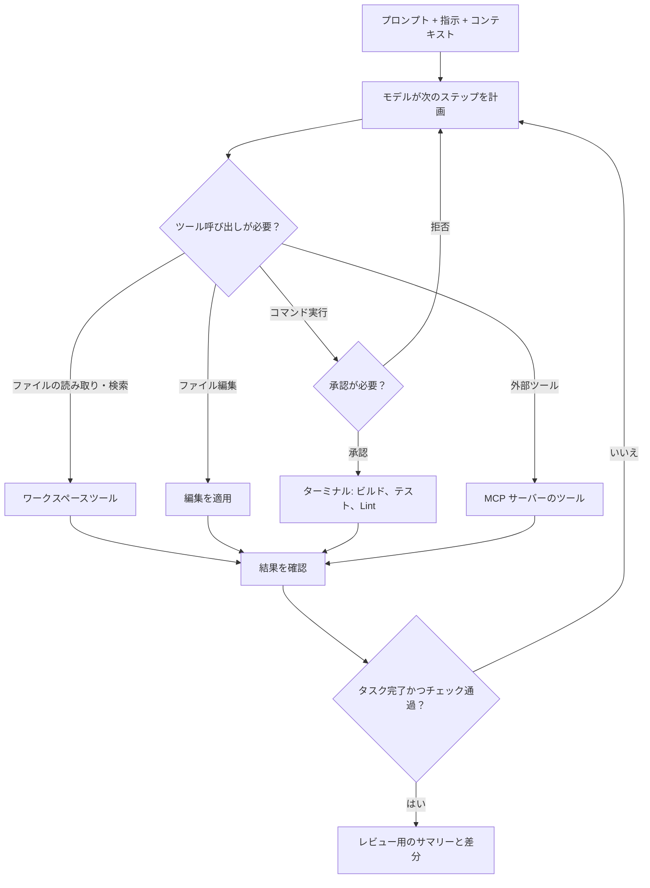

import { TLDR, DocsLinks, LastVerified, CompareTable, DecisionTree } from '@components';
import { Aside, Badge, Tabs, TabItem } from '@astrojs/starlight/components';

<LastVerified date="2026-10" />

<TLDR>
- IDE で Copilot を使う 3 つの方法:
  - **インライン**: コード補完と **Next Edit Suggestions (NES)**。有料プランでは AI Credits を消費しません。
  - **チャット**: チャットパネルとインラインチャット。
  - **エージェント**: ファイルを編集し、ターミナルコマンドを実行して反復する **agent mode** と、コードを変更する前に計画を作成する **plan mode**。
- 新機能は **VS Code** に最初に届きます。**Visual Studio、JetBrains、Eclipse、Xcode** はチャット、agent mode、MCP に対応しています。**Neovim はコード補完のみ**です。
- **Auto model selection は GA** です。タスクの複雑さとモデルの稼働状況に応じて各プロンプトをルーティングし、有料プランでは 10% 割引になります。Free と Student プランは Auto のみです。
- agent mode は **MCP ツール**を呼び出せます。MCP サーバーはインストールする依存関係と同じように扱い、事前に精査してください。
</TLDR>

## ブースでよくある質問

<details>
<summary>JetBrains / Eclipse / Xcode は VS Code と同等ですか？</summary>

コア機能はほぼ同等です。**コード補完、チャット、agent mode、MCP はすべての IDE で GA** です。

違いは次のとおりです:
- **NES** は VS Code と Visual Studio で GA、JetBrains、Eclipse、Xcode では**パブリックプレビュー**です。
- **カスタム指示**と**プロンプトファイル**は JetBrains と Xcode ではプレビューです。プロンプトファイルは Eclipse では未対応です。
- **Edit mode** は VS Code と JetBrains のみです。

機能マトリックス自体がパブリックプレビュー扱いなので、最新情報を確認してください。[対応表](#ide-サポートマトリクス) も参照してください。

</details>

<details>
<summary>Ask / Edit / Agent / Plan はどう使い分けますか？</summary>

- **Ask (チャット):** 質問や説明。適用するまでは何も変更されません。
- **Edit:** 対象ファイルを自分で選び、Copilot が複数ファイルの編集を提案し、それをレビューします。VS Code と JetBrains のみです。
- **Agent:** Copilot が触るファイルを自分で判断し、コマンドやテストを実行し、エラーを読んで、タスクが完了するまで反復します。
- **Plan:** Copilot が**読み取り専用**ツールで調査し、確認の質問をして、段階的な計画を作成します。その後 *Start Implementation* をクリックすると agent mode に引き継がれます。

</details>

<details>
<summary>コード補完で AI Credits は減りますか？</summary>

**減りません。** コード補完と Next Edit Suggestions は **AI Credits の課金対象外**で、有料プランでは無制限です。Copilot Free は**月 2,000 回**が上限です。チャット、インラインチャット、agent mode、plan mode は AI Credits を**消費します**。

</details>

<details>
<summary>Copilot はどうやってプロジェクト全体を把握するのですか？</summary>

Copilot は次のようなコンテキストを使います:
- **ワークスペースのインデックス作成**。VS Code、Visual Studio、JetBrains、Eclipse では GA ですが、Xcode は**未対応**です。
- エディターで**開いているファイルや選択範囲**。
- ファイルやシンボル、選択範囲などの **`#` 参照**。
- `.github/copilot-instructions.md` などの**カスタム指示**。

agent mode では、Copilot がツールを使って**自らファイルを検索して読みます**。

</details>

<details>
<summary>モデルは選べますか？ピッカーが表示されないユーザーがいるのはなぜ？</summary>

**Free と Student** は **Auto** のみなので、手動のピッカーはありません。

有料プランのピッカーには、プランに含まれるモデルから**管理者がポリシーで無効にしたものを除いた**モデルが表示されます。Auto も、プラン外のモデル、ポリシーでブロックされたモデル、データレジデンシーで除外されたモデルは選びません。

Auto の **Efficiency / Balance / Intelligence** ティアは、**VS Code、Copilot CLI、Copilot アプリ**でのみ利用できます。

</details>

<details>
<summary>agent mode は安全ですか？`rm -rf` を実行することはありますか？</summary>

agent mode は、ターミナルコマンドや機密性の高いツールを実行する前に承認を求めます。特定のツールを自動承認にすることもできますが、トレードオフがあります。

リスクの高い作業では:
- まず **plan mode** を使います。
- 自動承認の範囲は狭く保ちます。
- 隔離され、ファイアウォールで保護された Actions 環境で動く **cloud agent** を優先します。

なお、コンテンツ除外のドキュメントによると、**コンテンツ除外は IDE の agent mode には適用されません**。

</details>

<details>
<summary>Neovim / Vim で Copilot は使えますか？</summary>

**コード補完のみ**です。チャット、agent mode、MCP、NES には対応していません。ターミナル中心のワークフローを好む方には **Copilot CLI** を紹介してください。[CLI ほか](/github-cheatsheet/ja/copilot/cli-and-more/) を参照してください。

</details>

## 基本機能

| 機能 | 内容 | クレジット消費 |
|---|---|---|
| **コード補完** | 入力中にゴーストテキストで提案 | なし (有料は無制限、Free は月 2,000 回) |
| **Next Edit Suggestions (NES)** | 名前変更の後などに、*次の*編集箇所と変更内容を予測 | なし |
| **チャット** | ワークスペースをコンテキストにしたサイドパネルでの対話 | あり |
| **インラインチャット** | エディター内 (VS Code ではターミナルも) でその場でプロンプト | あり |
| **Edit mode** | *自分で*選んだファイル群に複数ファイル編集 | あり |
| **agent mode** | 自律ループ: 計画、編集、実行、エラーの読み取り、修正 | あり (1 タスクで多数のモデル呼び出しになることが多い) |
| **plan mode** | 読み取り専用の調査、レビューできる計画の作成、agent への引き継ぎ | あり |
| **IDE でのコードレビュー** | 選択範囲や未コミットの変更をレビュー | あり |

注意: **Visual Studio** では NES を**手動で有効にする**必要があります。

## agent mode のループ



トーキングポイント: agent mode は**反復的で自己修正します**。コンパイラやテストの出力を読んで再挑戦します。そのため 1 つのエージェントタスクで**多数**のモデル呼び出しが発生することがあり、トークン課金ではこの点が重要になります。

## コンテキスト: `#` 参照、`@` 参加者、`/` コマンド

<Tabs>
<TabItem label="VS Code">

- **`#` チャット変数**でコンテキストを添付します: `#file`、`#selection`、`#function`、`#class`、`#block`、`#sym`、`#project`、`#path` など。
- **`@` 参加者**はプロンプトを専門分野のエキスパートに振り分けます:
  - `@github`: GitHub のスキル。
  - `@terminal`: ターミナル。
  - `@vscode`: エディターのコマンド。
  - `@azure` <Badge text="プレビュー" variant="caution" />。
- **`/` コマンド**: `/explain`、`/fix`、`/tests`、`/fixTestFailure`、`/new`、`/clear`、`/help`。

</TabItem>
<TabItem label="Visual Studio">

- **`#` 参照**: `#MyFile.cs`、行範囲を指定する `#MyFile.cs: 66-72`、`#solution`。
- **`/` コマンド**: `/doc`、`/explain`、`/fix`、`/optimize`、`/tests`、`/help`。

</TabItem>
<TabItem label="GitHub.com">

- **`@` メンション**で Issue、PR、ファイル、リポジトリ、ディスカッションを添付します。
- GitHub.com のチャットには、`create_branch`、`create_or_update_file`、`merge_pull_request` などの GitHub MCP スキルが組み込まれています。

</TabItem>
</Tabs>

チャット欄に `/`、`#`、`@` を入力すると、利用できる項目が表示されます。一覧は IDE やバージョンによって異なります。

## モデル: Auto と手動選択


**Auto の提供状況:**
- GitHub.com のチャット、VS Code、Copilot CLI、Copilot アプリ、JetBrains では、**タスク最適化**付きで GA です。
- Eclipse、Xcode、Visual Studio では、**信頼性／可用性最適化**版が GA です。

**ティア:** Efficiency、Balance、Intelligence でルーティングをコスト寄りか品質寄りに調整できます。VS Code、CLI、アプリのみで利用できます。

**ドキュメントのモデル選択ガイド:** 素早い反復的なタスクには小型で高速なモデルが向いています。深い推論や長時間のエージェント作業には、より大きな Codex、Opus、Astra クラスのモデルが向いています。[モデル比較](https://docs.github.com/ja/copilot/reference/ai-models/model-comparison) を参照してください。

## agent mode での MCP

- MCP は VS Code、Visual Studio、JetBrains、Eclipse、Xcode で GA で、Free を含む**すべてのプラン**に含まれます。
- **VS Code** では 1.99 以降が必要です。拡張機能ビューで `@mcp <名前>` と入力してサーバーをインストール (GitHub MCP Registry、<Badge text="プレビュー" variant="caution" />) するか、`.vscode/mcp.json` で設定します。
- **Business と Enterprise** の管理者は、**デフォルトで無効**の **「MCP servers in Copilot」** ポリシーで MCP を制御します。このポリシーは Free、Pro、Pro+、Max のユーザーには適用されません。
- Enterprise では、*どの*サーバーを許可するかを制限できます:
  - **`managed-settings.json` 許可リスト (GA)**: 推奨される方法です。
  - **カスタム MCP レジストリ** <Badge text="プレビュー" variant="caution" />。

```json title=".vscode/mcp.json"
{
  "servers": {
    "github": {
      "type": "http",
      "url": "https://api.githubcopilot.com/mcp/"
    }
  }
}
```

## IDE サポートマトリクス

<Aside type="note">出典: [Copilot 機能マトリックス](https://docs.github.com/ja/copilot/reference/copilot-feature-matrix)。このマトリックスページ自体がパブリックプレビュー扱いで、変更される可能性があります。</Aside>

<CompareTable
	title="IDE 別の Copilot 機能"
	featureLabel="機能"
	columns={[
		{ key: 'vsc', label: 'VS Code' },
		{ key: 'vs', label: 'Visual Studio' },
		{ key: 'jb', label: 'JetBrains' },
		{ key: 'ecl', label: 'Eclipse' },
		{ key: 'xc', label: 'Xcode' },
		{ key: 'nvim', label: 'Neovim' },
	]}
	rows={[
		{ feature: 'コード補完', category: 'インライン', values: { vsc: 'GA', vs: 'GA', jb: 'GA', ecl: 'GA', xc: 'GA', nvim: 'GA' } },
		{ feature: 'Next Edit Suggestions', category: 'インライン', values: { vsc: 'GA', vs: 'GA (手動で有効化)', jb: 'プレビュー', ecl: 'プレビュー', xc: 'プレビュー', nvim: false } },
		{ feature: 'チャット', category: 'チャット', values: { vsc: 'GA', vs: 'GA', jb: 'GA', ecl: 'GA', xc: 'GA', nvim: false } },
		{ feature: 'Vision (チャットでの画像)', category: 'チャット', values: { vsc: 'プレビュー', vs: 'GA', jb: 'プレビュー', ecl: 'GA', xc: 'プレビュー', nvim: false } },
		{ feature: 'Edit mode', category: 'エージェント', values: { vsc: 'GA', vs: false, jb: 'GA', ecl: false, xc: false, nvim: false } },
		{ feature: 'agent mode', category: 'エージェント', values: { vsc: 'GA', vs: 'GA', jb: 'GA', ecl: 'GA', xc: 'GA', nvim: false } },
		{ feature: 'plan mode', category: 'エージェント', values: { vsc: true, vs: false, jb: true, ecl: true, xc: true, nvim: false } },
		{ feature: 'Copilot コードレビュー', category: 'エージェント', values: { vsc: 'GA', vs: 'GA', jb: 'GA', ecl: false, xc: 'GA', nvim: false } },
		{ feature: 'MCP', category: '拡張性', values: { vsc: 'GA', vs: 'GA', jb: 'GA', ecl: 'GA', xc: 'GA', nvim: false } },
		{ feature: 'カスタムエージェント', category: 'カスタマイズ', values: { vsc: 'GA', vs: 'GA', jb: 'プレビュー', ecl: 'GA', xc: 'プレビュー', nvim: false } },
		{ feature: 'カスタム指示', category: 'カスタマイズ', values: { vsc: 'GA', vs: 'GA', jb: 'プレビュー', ecl: 'プレビュー', xc: 'プレビュー', nvim: false } },
		{ feature: 'プロンプトファイル', category: 'カスタマイズ', values: { vsc: 'GA', vs: 'GA', jb: 'プレビュー', ecl: false, xc: 'プレビュー', nvim: false } },
		{ feature: 'ワークスペースのインデックス作成', category: 'コンテキスト', values: { vsc: 'GA', vs: 'GA', jb: 'GA', ecl: 'GA', xc: false, nvim: false } },
		{ feature: 'Auto model selection', category: 'モデル', values: { vsc: 'GA (ティア付き)', vs: 'GA (可用性最適化)', jb: 'GA', ecl: 'GA (可用性最適化)', xc: 'GA (可用性最適化)', nvim: false } },
	]}
/>

Copilot は **SQL Server Management Studio** (課金のクライアントバージョン表に記載) と、コミットメッセージの作成を支援する **GitHub Desktop** でも使えます。

<DecisionTree
	title="どの IDE モードを勧める？"
	tree={{
		start: 'q1',
		nodes: {
			q1: {
				question: '来場者は**コードを変更**したいのですか、それとも理解したいだけですか？',
				options: [
					{ label: '理解したい／質問したいだけ', next: 'ask' },
					{ label: 'コードを変更したい', next: 'q2' },
				],
			},
			q2: {
				question: 'タスクは **明確で小さい** ですか？ (例: 関数 1 つや、わかっている数ファイル)',
				options: [
					{ label: 'はい', next: 'q3' },
					{ label: 'いいえ、曖昧または大きい', next: 'plan' },
				],
			},
			q3: {
				question: '**ビルドやテストを実行**して反復する必要がありますか？',
				options: [
					{ label: 'はい', next: 'agent' },
					{ label: 'いいえ', next: 'edit' },
				],
			},
			ask: { answer: '**Ask／チャット** (またはインラインチャット)。正確なコンテキストを渡すには `#` 参照を使います。' },
			edit: { answer: '**インラインチャットまたは Edit mode** (Edit mode は VS Code と JetBrains のみ)。変更するファイルを自分でコントロールできます。' },
			agent: { answer: '**agent mode**。ツールの自動承認は最小限にしてください。' },
			plan: { answer: 'まず **plan mode**、次に agent mode で *Start Implementation*。無人で実行できるなら **cloud agent** への委任も検討してください。', links: [{ label: 'plan mode を使う', href: 'https://docs.github.com/ja/copilot/how-tos/copilot-in-your-ide/use-copilot-agents/use-plan-mode' }] },
		},
	}}
/>

## 注意点とトーキングポイント

- **IDE からの委任:** VS Code、JetBrains、Eclipse、Visual Studio から **cloud agent** のセッションを開始できます。長いタスクを任せて、自分はコーディングを続けられます。[コーディングエージェント](/github-cheatsheet/ja/copilot/coding-agent/) を参照してください。
- **セッションの共有:** ローカルの IDE や CLI のエージェントセッションは**デフォルトで共有されません**。cloud agent のセッションは、リポジトリにアクセスできる人に共有されます。
- **コンテンツ除外**は IDE の agent mode には適用されません。除外要件が厳しいお客様には伝えてください。詳細はこのセクションのプライバシーとセキュリティのページにあります。
- **クライアントを更新しましょう。** 従量課金が正しく表示されるのは新しいクライアントのみです (例: VS Code 1.120 以降、JetBrains プラグイン 1.9.1 以降)。[プランと課金](/github-cheatsheet/ja/copilot/plans-billing/#クライアントを更新する) を参照してください。

<DocsLinks links={[
  { label: 'Copilot 機能マトリックス', href: 'https://docs.github.com/ja/copilot/reference/copilot-feature-matrix' },
  { label: 'Copilot Chat チートシート', href: 'https://docs.github.com/ja/copilot/reference/chat-cheat-sheet' },
  { label: 'IDE で agent mode を使う', href: 'https://docs.github.com/ja/copilot/how-tos/copilot-in-your-ide/use-copilot-agents/use-agent-mode' },
  { label: 'IDE で plan mode を使う', href: 'https://docs.github.com/ja/copilot/how-tos/copilot-in-your-ide/use-copilot-agents/use-plan-mode' },
  { label: 'Auto model selection', href: 'https://docs.github.com/ja/copilot/concepts/models/auto-model-selection' },
  { label: 'サポートされている AI モデル', href: 'https://docs.github.com/ja/copilot/reference/ai-models/supported-models' },
  { label: 'MCP で Copilot Chat を拡張する', href: 'https://docs.github.com/ja/copilot/how-tos/copilot-in-your-ide/customize-copilot/extend-copilot-with-tools-and-context/extend-copilot-chat-with-mcp' },
]} />
