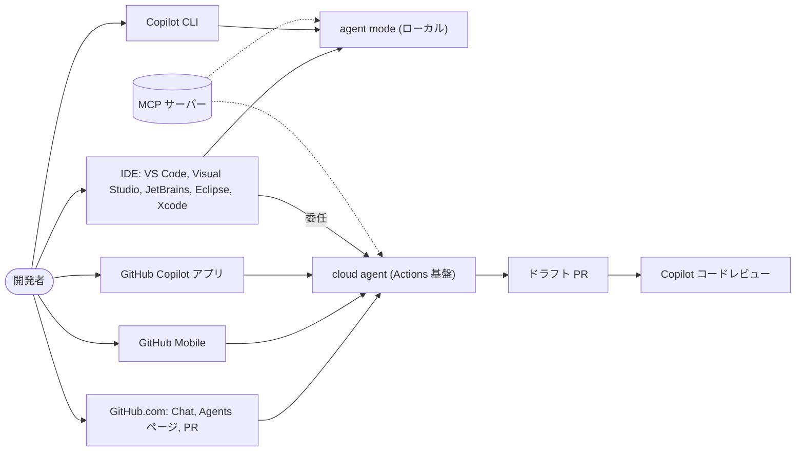
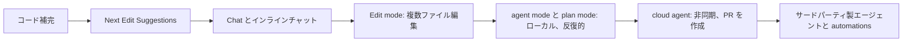

import { TLDR, DocsLinks, LastVerified } from '@components';
import { Aside, Badge, LinkCard, CardGrid } from '@astrojs/starlight/components';

<LastVerified date="2026-10" />

<TLDR>
- Copilot はもはや IDE プラグインだけではありません。**IDE、GitHub.com、Copilot CLI、GitHub Copilot アプリ、GitHub Mobile、SDK** で動作し、自らプルリクエストを作成する**エージェント**も支えています。
- **2026 年 6 月 1 日に課金が変わりました。** Premium requests は*レガシー*になり、利用量は **GitHub AI Credits** で計測されます。1 クレジット = $0.01 で、コストはモデルと使用トークン数で決まります。有料プランではコード補完と Next Edit Suggestions は引き続き無制限です。
- 押さえておくべきプランは 6 つです: **Free、Pro、Pro+、Max (新設、月額 $100)、Business、Enterprise**。このほか、認証済み学生向けの無料プラン Student があります。
- **Auto model selection が GA になりました。** 有料プランで Auto を使うと、モデルコストが 10% 割引されます。
- Copilot は **GitHub Enterprise Server では利用できません**。Copilot Enterprise には GitHub Enterprise Cloud が必要です。
</TLDR>

## ブースでよくある質問

前回の Universe 以降、Copilot で何が変わりましたか？

最大の変更は課金モデルです。2026 年 6 月 1 日に、リクエストベースの課金 (premium requests と乗数) が **GitHub AI Credits による従量課金**に置き換わりました。そのほかの変更:
- 個人向けの新プラン **Copilot Max** (月額 $100)。
- **Auto model selection** の GA。
- エージェントのセッションを開始・ステアリング・追跡できる統合された **Agents** ページ／タブ。
- **サードパーティ製コーディングエージェント** (Anthropic Claude、OpenAI Codex) <Badge text="プレビュー" variant="caution" />。
- Copilot CLI の **plan mode** と **クラウドサンドボックス** <Badge text="プレビュー" variant="caution" />。

詳しくは [プランと課金](/github-cheatsheet/ja/copilot/plans-billing/) を参照してください。

GitHub Enterprise Server で Copilot を使えますか？

直接は使えません。ドキュメントには *"Copilot is not currently available for GitHub Enterprise Server."* と明記されています。Copilot Enterprise は **GitHub Enterprise Cloud** (GHE.com を含む) 向けです。GHES のお客様は通常、GHEC の Enterprise アカウント経由で Copilot のライセンスを取得します。なお、リモート版の GitHub MCP サーバーも GHES には対応していません。

agent mode とコーディングエージェントの違いは何ですか？

**agent mode** は **IDE (または CLI) 内**で同期的に動作します。*自分のマシン上*でファイルを編集し、コマンドを実行する様子をその場で見られます。

**Copilot コーディングエージェント**は非同期で動作します。現在のドキュメントでは **Copilot cloud agent** と呼ばれています。GitHub Actions を基盤とする一時的な環境で**クラウド上**で動作し、成果物を**プルリクエスト**として届けます。Issue を割り当てたら、あとは任せておけます。

詳しくは [コーディングエージェントとコードレビュー](/github-cheatsheet/ja/copilot/coding-agent/) を参照してください。

Copilot は自社のコードを学習に使いますか？

**Business/Enterprise** (ボリュームライセンス) のお客様については、使いません。GitHub Generative AI Services Terms には、お客様の指示がない限り、GitHub は Inputs や Outputs を生成 AI モデルの学習に使用しないと定められています。個人プランは別の規約の対象で、オプトアウト設定があります。詳細は下のリンクにあるプライバシーとセキュリティのページを参照してください。

コーディングエージェントにはどのプランが必要ですか？

**Free 以外**のすべてのプランです。cloud agent は Student、Pro、Pro+、Max、Business、Enterprise に含まれます。Business と Enterprise では、まず管理者が cloud agent ポリシーを有効にする必要があります。

## Copilot のサーフェスマップ

## コード補完からエージェントへ

トーキングポイント: 各段階で**委任する自律性が大きくなります**。人間がレビューするタイミングは*キー入力ごと*から*プルリクエストごと*へ移り、Copilot のセーフガードもそれに合わせて移ります:
- ブランチ保護。
- 実行前に承認が必要なワークフロー。
- 依頼者自身はエージェントの PR を承認できないというルール。

## このセクションのページ

<CardGrid>
	<LinkCard title="プランと課金" href="/github-cheatsheet/ja/copilot/plans-billing/" description="AI Credits、プラン比較、Auto 割引、予算、クレジットを使い切ったときの挙動。" />
	<LinkCard title="IDE の機能" href="/github-cheatsheet/ja/copilot/ide-features/" description="補完、NES、チャット、edit/agent/plan mode、モデルピッカー、IDE 対応表。" />
	<LinkCard title="コーディングエージェントとコードレビュー" href="/github-cheatsheet/ja/copilot/coding-agent/" description="cloud agent のライフサイクル、copilot-setup-steps.yml、ファイアウォール、セキュリティモデル、コードレビュー。" />
	<LinkCard title="CLI、Spaces、MCP ほか" href="/github-cheatsheet/ja/copilot/cli-and-more/" description="Copilot CLI、Spaces、GitHub.com とモバイル、Extensions → MCP、GitHub MCP サーバー。" />
	<LinkCard title="カスタマイズ" href="/github-cheatsheet/ja/copilot/customization/" description="カスタム指示、プロンプトファイル、カスタムエージェント、スキル、フック。" />
	<LinkCard title="ベストプラクティス" href="/github-cheatsheet/ja/copilot/best-practices/" description="2026 年にエージェントで良い結果を得るために。" />
	<LinkCard title="管理とガバナンス" href="/github-cheatsheet/ja/copilot/admin-governance/" description="ポリシー、AI controls、メトリクス、監査ログ。" />
	<LinkCard title="プライバシーとセキュリティ" href="/github-cheatsheet/ja/copilot/privacy-security/" description="データの取り扱い、学習、知的財産、コンテンツ除外。" />
</CardGrid>

<Aside type="caution" title="名称について">
古い資料で **「Copilot coding agent」** と呼ばれていたものは、現在のドキュメントでは **「Copilot cloud agent」** と表記されています。どちらも同じ製品を指します。報道では「Agent HQ」や「Mission Control」という名称も使われましたが、現在の公式名称であることは**確認できていません**。ブースでは「Agents ページ／タブ」と呼んでください。
</Aside>

<DocsLinks links={[
  { label: 'GitHub Copilot を使用できる場所', href: 'https://docs.github.com/ja/copilot/get-started/where-to-use-github-copilot' },
  { label: 'GitHub Copilot のプラン', href: 'https://docs.github.com/ja/copilot/get-started/plans' },
  { label: 'Copilot 機能マトリックス', href: 'https://docs.github.com/ja/copilot/reference/copilot-feature-matrix' },
  { label: 'GitHub.com 上の GitHub Copilot (cloud agent)', href: 'https://docs.github.com/ja/copilot/concepts/agents/cloud-agent/about-cloud-agent' },
  { label: '課金の変更点 (2026 年 6 月)', href: 'https://docs.github.com/ja/copilot/reference/copilot-billing/request-based-billing-legacy/what-changed-with-billing' },
]} />
