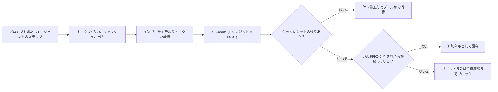

import { TLDR, DocsLinks, LastVerified, CompareTable, FlashCards, DecisionTree } from '@components';
import { Aside, Badge, Tabs, TabItem } from '@astrojs/starlight/components';

<LastVerified date="2026-10" />

<TLDR>
- **2026 年 6 月 1 日以降**、Copilot は **GitHub AI Credits** で課金されます。**1 クレジット = $0.01 USD** で、1 回のやり取りのコストは**モデル**と**トークン数**で決まります。premium requests と乗数は**レガシー**となり、一部の年額 Pro/Pro+ 契約者にのみ適用されます。
- **コード補完と Next Edit Suggestions はクレジットを消費しません。** 有料プランでは無制限で、Free は月 2,000 回までです。
- **プランごとの月間クレジット:**
  - Pro **1,500** (ベース 1,000 + フレックス 500)。
  - Pro+ **7,000**。
  - Max **20,000**。
  - Business **ユーザーあたり 1,900**、Enterprise **ユーザーあたり 3,900**。どちらも請求エンティティ全体で**プール**されます。
- **Auto model selection** を使うと、有料プランはモデルコストが **10% 割引**されます。
- クレジットを使い切っても、安いモデルへの自動フォールバックは**ありません**。個人はアップグレードするか、追加利用の予算を設定できます。組織では、管理者が「AI credits paid usage」ポリシーを無効にしない限り、追加利用が**デフォルトで有効**です。
</TLDR>

## ブースでよくある質問

各プランの価格と含まれる内容は？

| プラン | 価格 | 月間 AI Credits |
|---|---|---|
| Free | $0 | 一定の付与量 (プランページに具体的な数値の記載なし) |
| Student | $0 (認証済み学生) | 一定の付与量 |
| Pro | 月額 $10 | ベース 1,000 + フレックス 500 = **1,500** |
| Pro+ | 月額 $39 | ベース 3,900 + フレックス 3,100 = **7,000** |
| Max | 月額 $100 | ベース 10,000 + フレックス 10,000 = **20,000** |
| Business | 付与シートあたり月額 $19 | **ユーザーあたり 1,900** (プール) |
| Enterprise | 付与シートあたり月額 $39 | **ユーザーあたり 3,900** (プール) |

トーキングポイント: ベースクレジットはサブスクリプション価格と同額です。Pro の $10 で 1,000 クレジット、つまり $10 分の利用量が付いてきます。

AI Credits と従来の premium requests の違いは？

**premium requests (レガシー):**
- チャットやエージェントのリクエスト 1 件を「1 リクエスト × モデルの**乗数**」として数えていました。
- Pro は月 300 リクエスト、Pro+ は月 1,500 リクエストが含まれ、超過分は 1 リクエスト $0.04 でした。

**AI Credits (現行):**
- **実際に使ったトークン** (入力・キャッシュ・出力) に、モデルごとのトークン単価を掛けてクレジットに換算します。
- 小さなモデルへの短い質問なら 1 クレジット未満で済みます。フロンティアモデルで長時間の cloud agent セッションを実行すると、はるかに多くかかります。

クレジットを使い切るとどうなりますか？安いモデルに切り替わりますか？

**切り替わりません。** ドキュメントには *"There is no automatic fallback to lower-cost models when a budget is exhausted."* とあります。

**個人**には 3 つの選択肢があります:
- **アップグレードする。** 差額のみを支払い、大きい付与量がすぐに適用されます。
- 追加利用のための**ドル建て予算を設定する。**
- 毎月 1 日 00:00 UTC の**リセットを待つ。**

**組織と Enterprise:**
- 追加利用が許可されている場合 (**デフォルト**)、1 クレジット $0.01 で利用を継続できます。
- 許可されていない場合、次のサイクルまで利用がブロックされます。
- **ユーザーレベル予算**に達したユーザーは、共有プールに残りがあってもブロックされます。

未使用のクレジットは繰り越せますか？請求日にリセットされますか？

**繰り越しはありません。** 未使用分は失効します。付与量やプールは、請求日に関係なく**毎月 1 日の 00:00:00 UTC** にリセットされます。

Business/Enterprise のプールはどう機能しますか？

各ライセンスのクレジットは、請求エンティティ単位の**共有プール**に加算されます。たとえば Business 100 シートなら 190,000 クレジットのプールになります。ヘビーユーザーは多く使い、ライトユーザーがその分を相殺します。
- サイクル途中で**シートを追加**すると、プールは**すぐに**増えます。
- **シートを削除**しても、プールが減るのは**次のサイクル**からです。

コードレビューは課金されますか？コーディングエージェントは？

どちらも 2 つの要素で課金されます: モデルのトークンに対する **AI Credits** と、実行環境に対する **GitHub Actions の分数**です。
- **コードレビュー:** ドキュメントの概算では、1 回あたり「Lite」で約 **$0.05〜$1**、「Balanced」(デフォルト) で約 **$0.25〜$5** です。Actions の分数は別途かかります。
- **cloud agent:** 各セッションで Actions の分数と AI Credits を消費します。
- **セルフホストランナー**は Actions の分数を消費しません。

詳しくは [コーディングエージェントとコードレビュー](/github-cheatsheet/ja/copilot/coding-agent/#課金) を参照してください。

個人で Copilot Pro を契約していて、会社から Business シートが付与されました。二重払いになりますか？

なりません。Business または Enterprise のシートが割り当てられると、個人の Pro、Pro+、Max プランは**自動的にキャンセル**され、**日割りで返金**されます。

Auto 割引は紹介する価値がありますか？

あります。有料プランでは、Chat、CLI、Copilot アプリ、cloud agent で Auto を使うと**モデルコストが 10% 割引**されます。

ドキュメントには、**Copilot Max** ユーザー向けの **2026 年 10 月 28 日まで**の Auto 一時割引 **30%** も記載されています。この割引は間もなく終了するため、案内する前にドキュメントを確認してください。

## プラン比較

<Aside type="note">以下の値は 2026 年 10 月時点の [GitHub Copilot のプラン](https://docs.github.com/ja/copilot/get-started/plans) ページに基づきます。「限定的」などの文言は同ページの記載によるものです。</Aside>

<CompareTable
	title="Copilot プラン (2026 年 10 月)"
	featureLabel="機能"
	columns={[
		{ key: 'free', label: 'Free' },
		{ key: 'student', label: 'Student' },
		{ key: 'pro', label: 'Pro' },
		{ key: 'proplus', label: 'Pro+' },
		{ key: 'max', label: 'Max' },
		{ key: 'biz', label: 'Business' },
		{ key: 'ent', label: 'Enterprise' },
	]}
	rows={[
		{ feature: '価格', category: '価格', values: { free: '$0', student: '$0 (認証済み)', pro: '月額 $10', proplus: '月額 $39', max: '月額 $100', biz: 'シートあたり月額 $19', ent: 'シートあたり月額 $39' } },
		{ feature: '月間 GitHub AI Credits', category: '価格', values: { free: '一定の付与量', student: '一定の付与量', pro: '1,500 (1,000 + フレックス 500)', proplus: '7,000 (3,900 + フレックス 3,100)', max: '20,000 (10,000 + フレックス 10,000)', biz: 'ユーザーあたり 1,900 (プール)', ent: 'ユーザーあたり 3,900 (プール)' } },
		{ feature: 'コード補完 + Next Edit Suggestions', category: 'IDE', values: { free: '月 2,000 回の補完', student: '無制限', pro: '無制限', proplus: '無制限', max: '無制限', biz: '無制限', ent: '無制限' } },
		{ feature: 'モデルへのアクセス', category: 'モデル', values: { free: 'Auto のみ', student: 'Auto のみ', pro: '一部のモデル', proplus: 'プレミアムモデル', max: 'プレミアムモデルへの優先アクセス', biz: 'プレミアムモデル', ent: 'プレミアムモデルへの優先アクセス' } },
		{ feature: 'agent mode (IDE)', category: 'エージェント', values: { free: true, student: true, pro: true, proplus: true, max: true, biz: true, ent: true } },
		{ feature: 'Copilot cloud (コーディング) エージェント', category: 'エージェント', values: { free: false, student: true, pro: true, proplus: true, max: true, biz: true, ent: true } },
		{ feature: 'Copilot コードレビュー', category: 'エージェント', values: { free: 'VS Code の「Review selection」のみ', student: true, pro: true, proplus: true, max: true, biz: true, ent: true } },
		{ feature: 'サードパーティ製エージェント (プレビュー)', category: 'エージェント', values: { free: false, student: false, pro: true, proplus: true, max: true, biz: true, ent: true } },
		{ feature: 'MCP', category: 'エージェント', values: { free: true, student: true, pro: true, proplus: true, max: true, biz: true, ent: true } },
		{ feature: 'Copilot CLI + Copilot アプリ', category: 'サーフェス', values: { free: true, student: true, pro: true, proplus: true, max: true, biz: true, ent: true } },
		{ feature: 'リポジトリ／個人のカスタム指示、プロンプトファイル', category: 'カスタマイズ', values: { free: true, student: true, pro: true, proplus: true, max: true, biz: true, ent: true } },
		{ feature: '組織のカスタム指示', category: 'カスタマイズ', values: { free: false, student: false, pro: false, proplus: false, max: false, biz: true, ent: true } },
		{ feature: 'コンテンツ除外', category: 'ガバナンス', values: { free: false, student: false, pro: false, proplus: false, max: false, biz: true, ent: true } },
		{ feature: '組織全体のポリシー管理', category: 'ガバナンス', values: { free: false, student: false, pro: false, proplus: false, max: false, biz: true, ent: true } },
		{ feature: '監査ログ', category: 'ガバナンス', values: { free: false, student: false, pro: false, proplus: true, max: true, biz: true, ent: true } },
		{ feature: 'パブリックコードに一致する提案のブロック', category: 'ガバナンス', values: { free: true, student: true, pro: true, proplus: true, max: true, biz: true, ent: true } },
		{ feature: 'PR サマリー', category: 'GitHub.com', values: { free: false, student: true, pro: true, proplus: true, max: true, biz: true, ent: true } },
		{ feature: 'GitHub Spark (プレビュー)', category: 'GitHub.com', values: { free: false, student: false, pro: false, proplus: true, max: false, biz: false, ent: true } },
	]}
/>

注意点:
- **Spark** <Badge text="プレビュー" variant="caution" /> は **Pro+ と Enterprise のみ**に記載されています。Max と Business には含まれて*いません*。
- 自分の PR の**自動コードレビュー** (個人設定) には Pro、Pro+、Max、Business、Enterprise のいずれかが必要で、**マネージドユーザーアカウント (EMU) では利用できません**。リポジトリや組織のルールセットでは引き続き自動レビューを有効にできます。
- Free プランは、組織経由で Copilot を利用して**いない**個人のみが対象です。認証済みの教員や人気 OSS のメンテナーは、Pro を無料で利用できる場合があります。

## AI Credits の仕組み

**クレジットを消費するもの:** Copilot Chat、Copilot CLI、cloud agent、Copilot Spaces、Spark、サードパーティ製コーディングエージェント、コードレビュー。
**消費しないもの:** コード補完と Next Edit Suggestions。

**消費量が増える要因:**
- 長い会話。
- エージェント型のセッション。1 タスクで何度もモデルを呼び出します。
- 大きなコンテキストウィンドウや拡張コンテキスト。
- 高い推論レベル。
- フロンティアモデル。

個人プランでは、まず**ベースクレジット**、次に**フレックス枠**が消費されます。フレックスは付与量のうち変動する部分で、モデルの経済性の変化に応じて GitHub が調整する場合があります。

### トークン単価の例

以下は [models and pricing](https://docs.github.com/ja/copilot/reference/copilot-billing/models-and-pricing) ページから引用した、100 万トークンあたりの USD 価格です。価格は変わるため、案内する前に最新の値を確認してください。

| モデル | 入力 | キャッシュ入力 | 出力 |
|---|---|---|---|
| GPT-6 Luna | $0.10 | $0.01 | $0.50 |
| Claude Haiku 4.5 | $1.00 | $0.10 | $5.00 |
| GPT-5.3-Codex | $1.75 | $0.175 | $14.00 |
| Claude Sonnet 5 | $2.00 | $0.20 | $10.00 |
| Claude Opus 5 | $5.00 | $0.50 | $25.00 |
| GPT-6 Astra | $10.00 | $1.00 | $50.00 |

トーキングポイント: このサンプルでは、最も高いモデルの入力単価は最も安いモデルの約 **100 倍**です。出力単価も最安 $0.50 に対して最高 $50.00 です。この差があるからこそ、トークン課金では **Auto** と適切なサイズのモデル選びがはるかに重要になります。

## 予算とコントロール

<Tabs>
<TabItem label="個人">

- USD 建ての**追加利用予算**を設定します。クレジットは固定レートで予算から差し引かれ、$10 の予算 = 1,000 クレジットです。
- 追加利用には**上限が設けられる場合があります**。上限に達したら、それまでの利用分を支払わないと続行できません。
- サイクル途中でアップグレードすると**差額のみ**が請求され、それまでの利用分は新しい (より大きな) 付与量に対してカウントされます。

</TabItem>
<TabItem label="組織と Enterprise">

- **AI credits paid usage** ポリシーは**デフォルトで有効**です。プールした付与量で確実に止めたい場合は、AI Controls で無効にします。
- **ユーザーレベル予算 (ULB)** は、プールと追加利用を合わせた 1 ユーザーの消費量に上限を設けます。**$0 の ULB はユーザーを即座にブロックします**。ULB は全体共通、コストセンター単位、個人単位で設定でき、個人単位の ULB には有効期限を付けられます。
- **コストセンター予算**は、プールを使い切った*後*の、ユーザーグループの従量課金に上限を設けます。
- **組織予算**と **Enterprise の支出上限**は、プールを使い切った後の従量課金の合計に上限を設けます。
- 自分の ULB に達する**前に**、Enterprise の支出上限によってブロックされることもあります。

</TabItem>
</Tabs>

<DecisionTree
	title="来場者:「どの Copilot プランにすべき？」"
	tree={{
		start: 'q1',
		nodes: {
			q1: {
				question: '**会社／組織**向けですか、それとも**個人**向けですか？',
				options: [
					{ label: '会社／組織', next: 'q2' },
					{ label: '個人', next: 'q4' },
				],
			},
			q2: {
				question: 'ユーザーあたりのより大きなプール、Spark、エンタープライズ向け機能など、**GitHub Enterprise Cloud** の機能が必要ですか？',
				options: [
					{ label: 'はい', next: 'ent' },
					{ label: 'いいえ／わからない', next: 'q3' },
				],
			},
			q3: {
				question: 'ユーザーの多くは**エージェントのヘビーユーザー** (cloud agent、長時間の agent mode セッション) ですか？',
				help: 'Business はユーザーあたり 1,900 クレジット、Enterprise は 3,900 クレジットです。どちらもプールされます。',
				options: [
					{ label: 'はい', next: 'ent' },
					{ label: 'いいえ', next: 'biz' },
				],
			},
			q4: {
				question: '認証済みの**学生**ですか？',
				options: [
					{ label: 'はい', next: 'student' },
					{ label: 'いいえ', next: 'q5' },
				],
			},
			q5: {
				question: 'チャットやエージェントをどのくらい使いますか？',
				options: [
					{ label: '試してみたいだけ', next: 'free' },
					{ label: '毎日。主に補完と少しのチャット', next: 'pro' },
					{ label: '毎日エージェントとプレミアムモデルを使う', next: 'proplus' },
					{ label: '継続的に大量のエージェント作業', next: 'max' },
				],
			},
			ent: { answer: '**Copilot Enterprise**: シートあたり月額 $39、ユーザーあたり 3,900 クレジット (プール)。GitHub Enterprise Cloud が必要です。', links: [{ label: 'Enterprise のプランを選択する', href: 'https://docs.github.com/ja/copilot/tutorials/roll-out-at-scale/assign-licenses/choose-enterprise-plan' }] },
			biz: { answer: '**Copilot Business**: シートあたり月額 $19、ユーザーあたり 1,900 クレジット (プール)。ポリシー管理、コンテンツ除外、組織のカスタム指示を含みます。' },
			student: { answer: '**Copilot Student**: 無料、Auto モデルのみ、補完は無制限、cloud agent を含みます (サードパーティ製エージェントは対象外)。' },
			free: { answer: '**Copilot Free**: 月 2,000 回の補完、Auto モデルのみ、AI Credits の付与あり、agent mode と MCP を含みます。cloud agent は含まれません。' },
			pro: { answer: '**Copilot Pro**: 月額 $10、1,500 クレジット、補完は無制限。' },
			proplus: { answer: '**Copilot Pro+**: 月額 $39、7,000 クレジット、プレミアムモデル、監査ログ、Spark (プレビュー)。' },
			max: { answer: '**Copilot Max**: 月額 $100、20,000 クレジット、プレミアムモデルへの優先アクセス。' },
		},
	}}
/>

## レガシーの premium requests (年額プランの継続契約者向け)

<Aside type="caution">リクエストベースの課金が残っているのは、従量課金に移行していない一部の年額 **Pro/Pro+** 契約者のみです。GitHub は、この対象者は**新しいモデルや機能を利用できない**としています。</Aside>

- 付与量は月あたり **Pro 300**、**Pro+ 1,500** premium requests です。超過分は **1 リクエスト $0.04** です。
- モデルごとに**乗数**があります。例: Claude Haiku 4.5 = 0.33×、GPT-5.3-Codex = 6×、Claude Opus 4.8 = 27×。
- 2026 年 6 月 1 日以降、Copilot コードレビューは 1 回あたり一律 **13 premium requests** です。
- リクエストベースの課金は、もともと 2025 年 6 月 18 日 (GitHub.com) と 2025 年 8 月 1 日 (GHE.com) に始まりました。

## クライアントを更新する

古いクライアントも動作はしますが、価格や利用量が正しく表示されなかったり、利用量アラートが届かなかったりすることがあります。従量課金に対応する最小バージョンは次のとおりです:

| クライアント | 最小バージョン |
|---|---|
| VS Code | 1.120 |
| Visual Studio 2022 | 17.14.33 |
| Visual Studio 2026 | 18.6.0 |
| JetBrains プラグイン | 1.9.1 |
| Eclipse プラグイン | 0.18.0 |
| Xcode 拡張機能 | 0.50.0 |
| Copilot CLI | 1.0.48 |

## 理解度チェック

<FlashCards
	title="Copilot 課金トリビア"
	cards={[
		{ q: 'GitHub AI Credit 1 クレジットの価値は？', a: '**$0.01 USD**。' },
		{ q: '従量課金が premium requests に置き換わったのはいつ？', a: '**2026 年 6 月 1 日**。' },
		{ q: 'Copilot Pro+ の月間クレジットは？', a: '**7,000** (ベース 3,900 + フレックス 3,100)。' },
		{ q: 'Copilot Max のクレジットは？', a: '**20,000** (ベース 10,000 + フレックス 10,000)、月額 $100。' },
		{ q: 'コード補完は AI Credits を消費する？', a: '**しません。** 補完と Next Edit Suggestions は有料プランで無制限です。Free は月 2,000 回までです。' },
		{ q: 'Business ユーザーあたりのクレジットは？ Enterprise は？', a: '**1,900** と **3,900**。請求エンティティ全体でプールされます。' },
		{ q: 'クレジットがリセットされるのはいつ？', a: '毎月 **1 日の 00:00:00 UTC**。繰り越しはありません。' },
		{ q: 'Auto model selection の割引率は？', a: '有料プランで **10%**。Max には 2026 年 10 月 28 日までの一時的な 30% 割引もありました。' },
		{ q: '組織では超過利用がデフォルトで有効？', a: '**有効です。** 止めるには **AI credits paid usage** ポリシーを無効にします。' },
		{ q: '$0 のユーザーレベル予算はどう動く？', a: 'そのユーザーを**即座にブロック**します。' },
		{ q: 'Spark が記載されているプランは？', a: '**Pro+** と **Enterprise** のみです (パブリックプレビュー)。' },
		{ q: 'Copilot は GHES で使える？', a: '**使えません。** Copilot Enterprise には GitHub Enterprise Cloud が必要です。' },
	]}
/>

<DocsLinks links={[
  { label: 'GitHub Copilot のプラン', href: 'https://docs.github.com/ja/copilot/get-started/plans' },
  { label: '個人向けの従量課金', href: 'https://docs.github.com/ja/copilot/concepts/billing-and-usage/individuals/billing' },
  { label: '組織と Enterprise 向けの従量課金', href: 'https://docs.github.com/ja/copilot/concepts/billing-and-usage/organizations-and-enterprises/billing' },
  { label: '従量課金の予算', href: 'https://docs.github.com/ja/copilot/concepts/billing-and-usage/organizations-and-enterprises/budgets' },
  { label: 'モデルと価格', href: 'https://docs.github.com/ja/copilot/reference/copilot-billing/models-and-pricing' },
  { label: 'Auto model selection', href: 'https://docs.github.com/ja/copilot/concepts/models/auto-model-selection' },
  { label: '課金の変更点', href: 'https://docs.github.com/ja/copilot/reference/copilot-billing/request-based-billing-legacy/what-changed-with-billing' },
]} />
